# Layout experiments

## Kale (1913), PDF page 17 / 252

### Method 001 — Geometry baseline

**Method:** [001-geometry: Geometry baseline](methods/001-geometry/README.md).

**Input:** `kale-1913-page-017`; an unannotated rendering at 300 dpi, 1407 × 2135 pixels.

**Run:** 2026-11-02 03:09:28 UTC.

| Measurement | Result |
| --- | --- |
| Output boxes | 6 |
| Measured ink pixels | 410,866 |
| Uncovered ink pixels | 0 |
| Measured ink covered | 100.0000% |

Measured ink is the dark-pixel mask after margin exclusion and filtering of speckles, borders and horizontal rules. Coverage counts mask pixels inside at least one output box.

Purple marks the region labelled `header`; blue marks the other regions. Numbers show the proposed reading order.

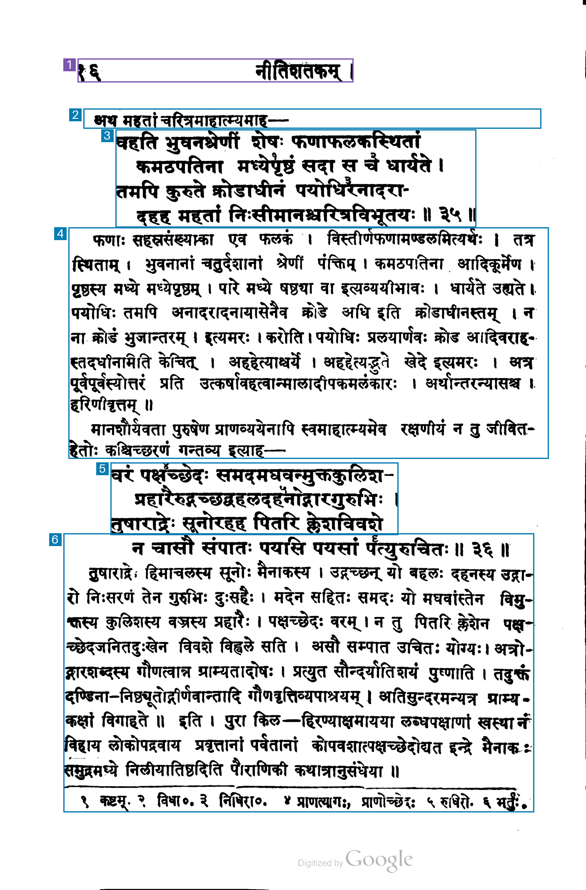

### Method 002 — PP-DocLayout-S

**Method:** [002-pp-doclayout-s: PP-DocLayout-S](methods/002-pp-doclayout-s/README.md).

**Input:** `kale-1913-page-017`; an unannotated rendering at 300 dpi, 1407 × 2135 pixels.

**Settings:** Detector input 480 × 480 pixels; confidence threshold 0.30; additional suppression of overlapping boxes across classes at intersection-over-union threshold 0.55.

**Run:** 2026-11-02 03:35:43 UTC.

| Measurement | Result |
| --- | --- |
| Output boxes | 11 |
| Measured ink pixels | 410,866 |
| Uncovered ink pixels | 372 |
| Measured ink covered | 99.9095% |

Purple marks predictions labelled `number` or `footer_image`; blue marks other predictions. Red marks uncovered measured ink. Numbers show the proposed reading order.

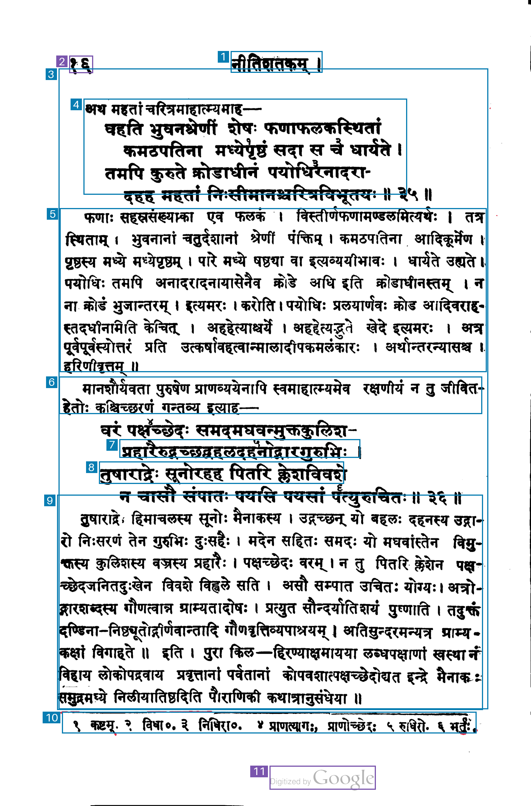

### Method 003 — PP-DocLayoutV3

**Method:** [003-pp-doclayoutv3: PP-DocLayoutV3](methods/003-pp-doclayoutv3/README.md).

**Input:** `kale-1913-page-017`; an unannotated rendering at 300 dpi, 1407 × 2135 pixels.

**Settings:** Detector input 800 × 800 pixels; confidence threshold 0.30; reading order from predicted pairwise-order votes. Overlapping predictions are retained.

**Run:** 2026-11-02 04:53:32 UTC.

| Measurement | Result |
| --- | --- |
| Output boxes | 15 |
| Measured ink pixels | 410,866 |
| Uncovered ink pixels | 31,265 |
| Measured ink covered | 92.3905% |

Purple marks predictions labelled `header` or `footer`; blue marks other predictions. Red marks uncovered measured ink. Numbers show the proposed reading order.

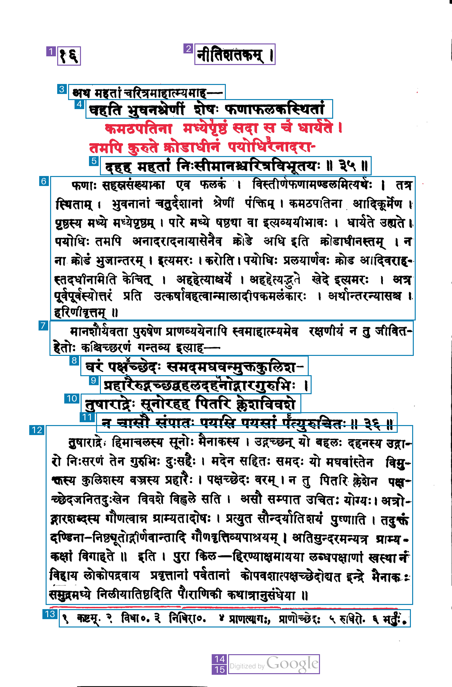

### Method 004 — PP-DocLayoutV3 + pixel refinement

**Method:** [004-pp-doclayoutv3-pixel-refinement: PP-DocLayoutV3 + pixel refinement](methods/004-pp-doclayoutv3-pixel-refinement/README.md).

**Input:** `kale-1913-page-017`; an unannotated rendering at 300 dpi, 1407 × 2135 pixels.

**Source detections:** Method 003, confidence threshold 0.30, recorded at 2026-11-02 04:53:32 UTC.

**Settings:** Connected-component boundary extension, two-pixel padding and residual-ink recovery; boxes starting in the bottom 6% are discarded; final reading order is assigned by position.

**Run:** 2026-11-02 05:19:41 UTC.

| Measurement | Result |
| --- | --- |
| Output boxes | 15 |
| Retained detector boxes | 13 |
| Discarded detector boxes | 2 |
| Recovered ink regions | 2 |
| Measured ink pixels | 410,866 |
| Uncovered ink pixels | 20 |
| Measured ink covered | 99.9951% |

Orange marks recovered regions, purple marks headers, and blue marks other refined detector regions. Red marks uncovered measured ink. Numbers show the proposed reading order.

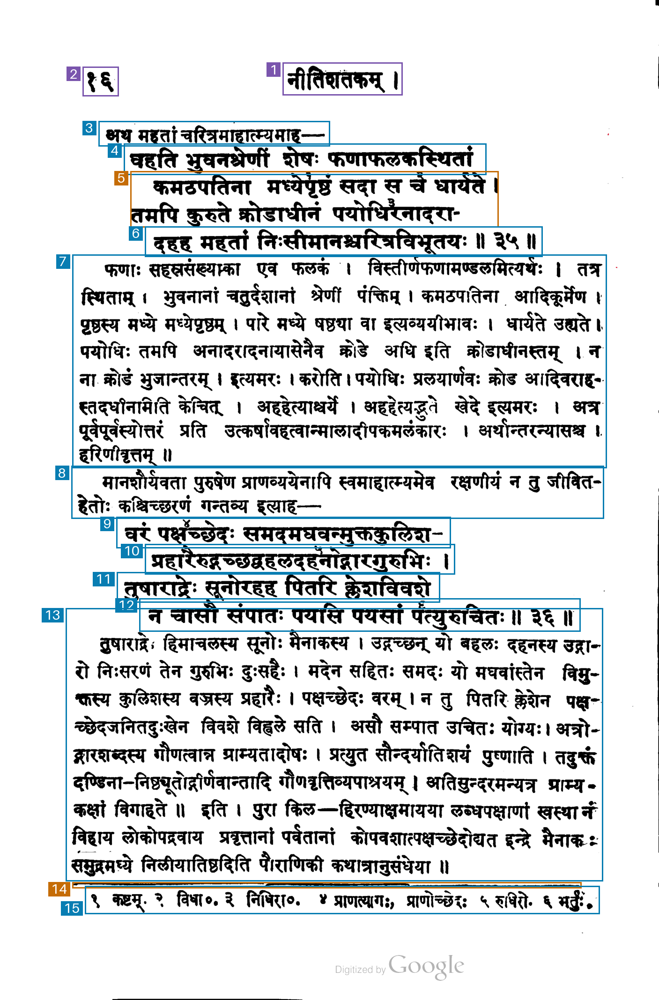

### Method 005 — GPT-6 Astra direct regions

**Method:** [005-gpt-6-astra-direct: GPT-6 Astra direct regions](methods/005-gpt-6-astra-direct/README.md).

**Input:** `kale-1913-page-017`; an unannotated rendering at 300 dpi, 1407 × 2135 pixels.

**Settings:** Requested and returned model `gpt-6-astra`; high reasoning effort; image detail `original`; strict JSON output; maximum 16,384 output tokens including reasoning. The request contained the page image and a prompt asking for whole verses, separate commentary, lead-ins, footnotes and page furniture.

**Run:** 2026-11-02 13:17:48 UTC.

| Measurement                        | Result   |
| ---------------------------------- | -------- |
| Output boxes                       | 14       |
| Boxes marked keep=true             | 12       |
| Regions marked uncertain           | 0        |
| Measured ink pixels                | 410,866  |
| Uncovered ink pixels, all boxes    | 4,524    |
| Measured ink covered, all boxes    | 98.8989% |
| API wall time                      | 45.49 s  |
| Input tokens                       | 3,919    |
| Output tokens, including reasoning | 2,013    |
| Reasoning tokens                   | 1,552    |

Returned region types: 2 verse, 2 commentary, 2 lead-in, 6 footnote, 1 running header and 1 page number.

Blue marks regions with `keep=true`; purple marks regions with `keep=false`. Red marks uncovered measured ink. Content numbers show returned reading order; H marks the running header and PN the page number.

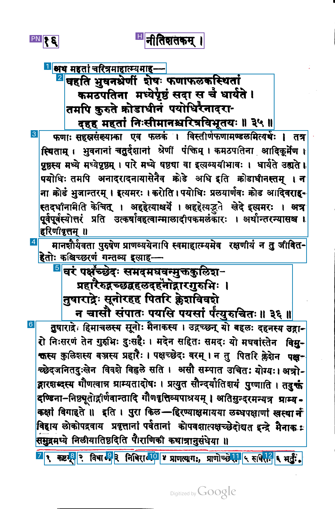

#### Uncovered-pixel inspection

Of the 4,524 uncovered measured pixels, 4,492 are in the horizontal separator above the footnotes (view A). The remaining 32 pixels form seven small components, shown enlarged in views B–G. Views E and G include tiny clipped character tips.

Red marks the exact counted pixels; gray shows the source image for context. Teal markers identify the enlarged areas.

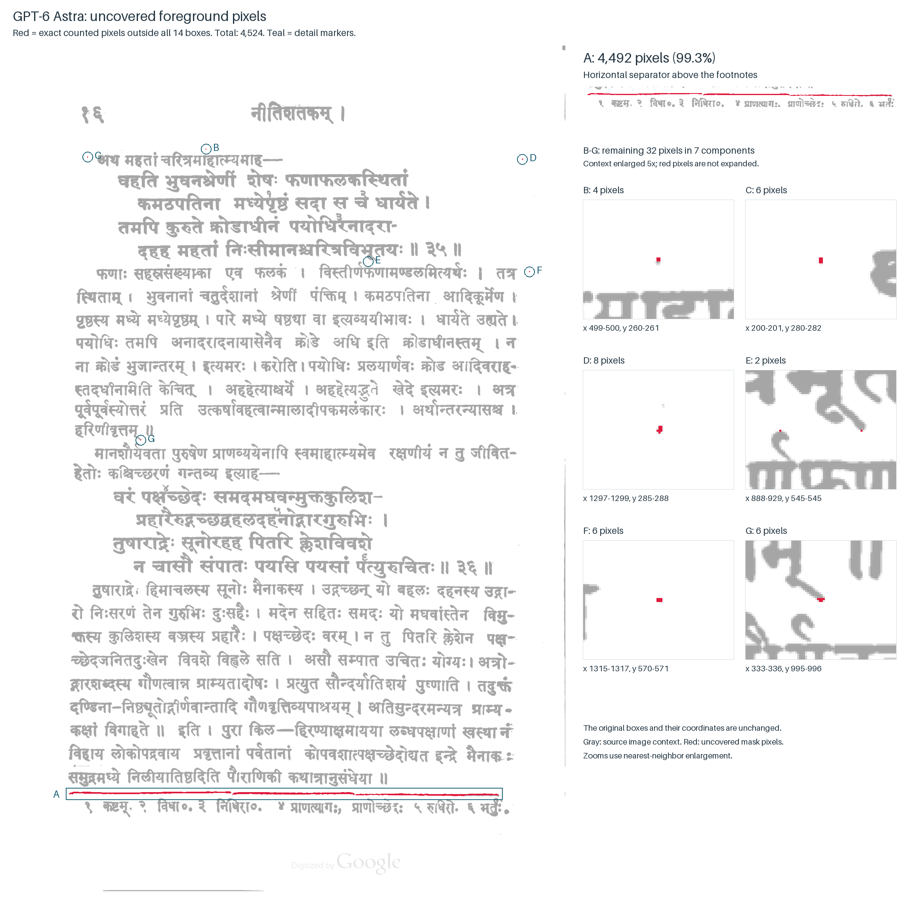


### Method 006 — Gemini 3.8 Flash direct regions

**Method:** [006-gemini-3.8-flash-direct: Gemini 3.8 Flash direct regions](methods/006-gemini-3.8-flash-direct/README.md).

**Input:** `kale-1913-page-017`; an unannotated rendering at 300 dpi, 1407 × 2135 pixels.

**Settings:** Requested and returned model `gemini-3.8-flash`; thinking level `low`; image resolution `high`; JSON Schema output; maximum 16,384 output tokens including thinking; standard service tier. The request contained the page image and a prompt asking for whole verses, separate commentary, lead-ins, footnotes and page furniture.

**Run:** 2026-11-02 14:13:51 UTC.

| Measurement              | Result      |
| ------------------------ | ----------- |
| Output boxes             | 9           |
| Boxes marked keep=true   | 7           |
| Regions marked uncertain | 0           |
| API wall time            | 341.23 s    |
| Input tokens             | 1,413       |
| Image input tokens       | 1,107       |
| Text input tokens        | 306         |
| Text output tokens       | 378         |
| Thinking tokens reported | 0           |
| Estimated paid-tier cost | $0.00247725 |

The cost estimate uses $0.75 per million input tokens and $3.75 per million output tokens including thinking: (1,413 × $0.75 + 378 × $3.75) / 1,000,000. The response also reported `initial_input_tokens=1698`; the estimate uses `total_input_tokens=1413`.

Returned region types: 2 verse, 2 commentary, 2 lead-in, 1 footnote, 1 running header and 1 page number. The footnote box contains all six printed footnotes.

Earlier attempts returned HTTP 400 for the v1 endpoint's input format, then HTTP 503 for high demand on the v1beta endpoint. The completed request used v1beta; its payload was identical to both earlier attempts. The time and usage above are for the completed request.

Blue marks regions with `keep=true`; purple marks regions with `keep=false`. Red marks uncovered measured ink. Content numbers show returned reading order; H marks the running header and PN the page number.

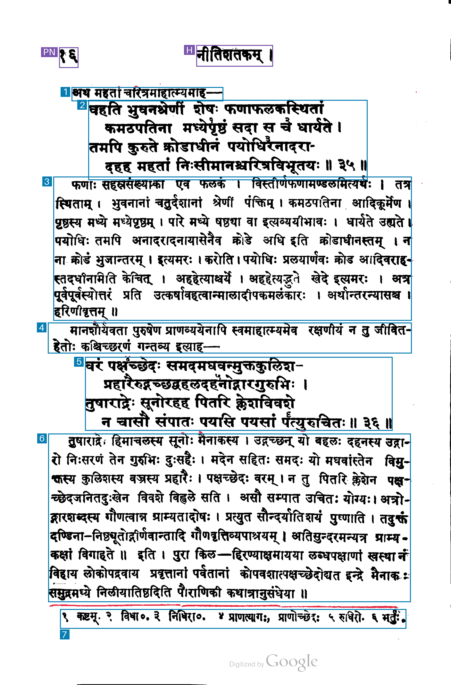


### Method 007 — Gemini 4 Argon direct regions

**Method:** [007-gemini-4-argon-direct: Gemini 4 Argon direct regions](methods/007-gemini-4-argon-direct/README.md).

**Input:** `kale-1913-page-017`; an unannotated rendering at 300 dpi, 1407 × 2135 pixels.

**Settings:** Requested and returned model `gemini-4-argon`; thinking level `low`; image resolution `high`; JSON Schema output; maximum 16,384 output tokens including thinking; standard service tier. The request contained the page image and a prompt asking for whole verses, separate commentary, lead-ins, footnotes and page furniture.

**Run:** 2026-11-02 15:19:59 UTC.

| Measurement | Result |
| --- | --- |
| Output boxes | 9 |
| Boxes marked keep=true | 7 |
| Regions marked uncertain | 0 |
| API wall time | 8.67 s |
| Input tokens | 1,835 |
| Image input tokens | 1,107 |
| Text input tokens | 728 |
| Text output tokens | 403 |
| Thinking tokens reported | 0 |
| Estimated paid-tier cost | $0.0077 |

The cost estimate uses $2.00 per million input tokens and $10.00 per million output tokens including thinking: (1,835 × $2.00 + 403 × $10.00) / 1,000,000.

Returned region types: 2 verse, 2 commentary, 2 lead-in, 1 footnote, 1 running header and 1 page number.

The prompt requested `[x1,y1,x2,y2]`. The returned arrays appear to use `[y1,x1,y2,x2]`: for example, the page-number box is `[71,126,95,175]`. The first image applies the requested x/y interpretation; the second applies permutation `[1,0,3,2]` to each returned array before scaling to image pixels.

Blue marks regions with `keep=true`; purple marks regions with `keep=false`. Red marks uncovered measured ink. Content numbers show returned reading order; H marks the running header and PN the page number.

**Returned coordinates, interpreted as requested:**

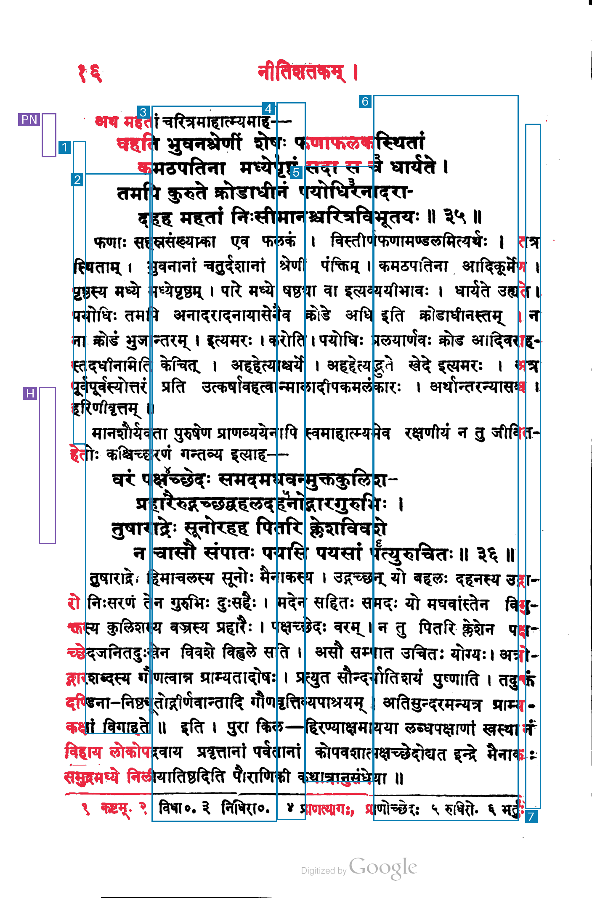

**Coordinate-order inspection, interpreted as y1,x1,y2,x2:**

With this interpretation, each verse is enclosed in one box, commentary and lead-ins have separate boxes, and one box contains all six printed footnotes.

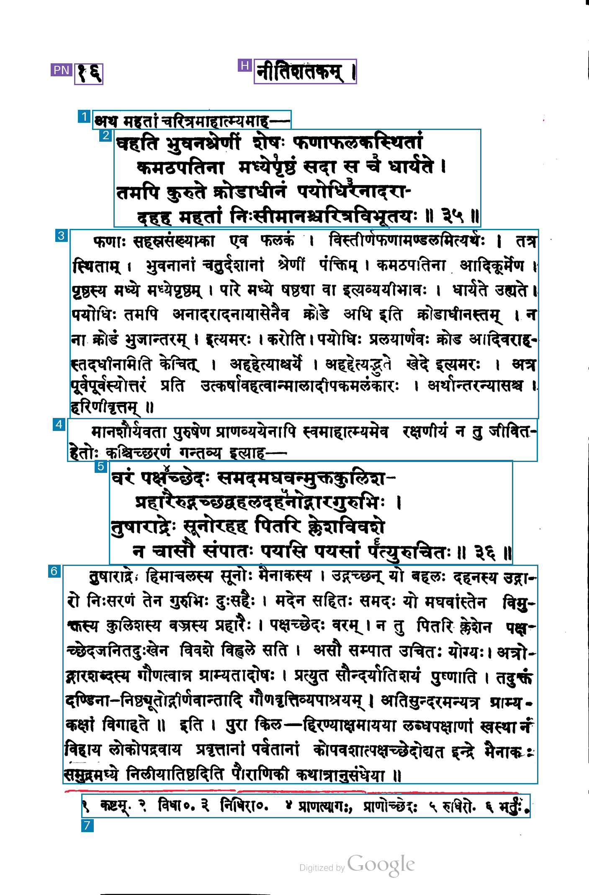


### Method 008 — Claude Sonnet 5.5 direct regions

**Method:** [008-claude-sonnet-5.5-direct: Claude Sonnet 5.5 direct regions](methods/008-claude-sonnet-5.5-direct/README.md).

**Input:** `kale-1913-page-017`; an unannotated rendering at 300 dpi, 1407 × 2135 pixels.

**Settings:** Requested and returned model `claude-sonnet-5-5`; adaptive thinking at low effort; provider-default image processing with the original PNG bytes; JSON Schema output; maximum 16,384 output tokens including thinking. The unchanged prompt asked for whole verses, separate commentary, lead-ins, footnotes and page furniture. Numerical limits and fixed array length were moved to schema descriptions for Claude's structured-output interface and validated locally. The response reported standard tier, standard speed and global inference.

**Run:** 2026-11-03 04:23:42 UTC.

| Measurement | Result |
| --- | --- |
| Output boxes | 9 |
| Boxes marked keep=true | 7 |
| Regions marked uncertain | 0 |
| API wall time | 5.21 s |
| Input tokens | 4,934 |
| Output tokens, including thinking | 414 |
| Thinking tokens reported | 0 |
| Cache read or creation tokens | 0 |
| Estimated paid-tier cost | $0.014008 |

The cost estimate uses $2.00 per million input tokens and $10.00 per million output tokens including thinking: (4,934 × $2.00 + 414 × $10.00) / 1,000,000.

Returned region types: 2 verse, 3 commentary, 1 lead-in, 1 footnote, 1 running header and 1 page number.

The footnote-labeled box (order 7) lies below the printed footnotes. The final commentary box (order 6) includes the printed footnote line. Both verse boxes clip upper parts of glyphs; the second verse box (order 5) extends into the first line of following commentary.

Blue marks regions with `keep=true`; purple marks regions with `keep=false`. Red marks uncovered measured ink. Content numbers show returned reading order; H marks the running header and PN the page number.

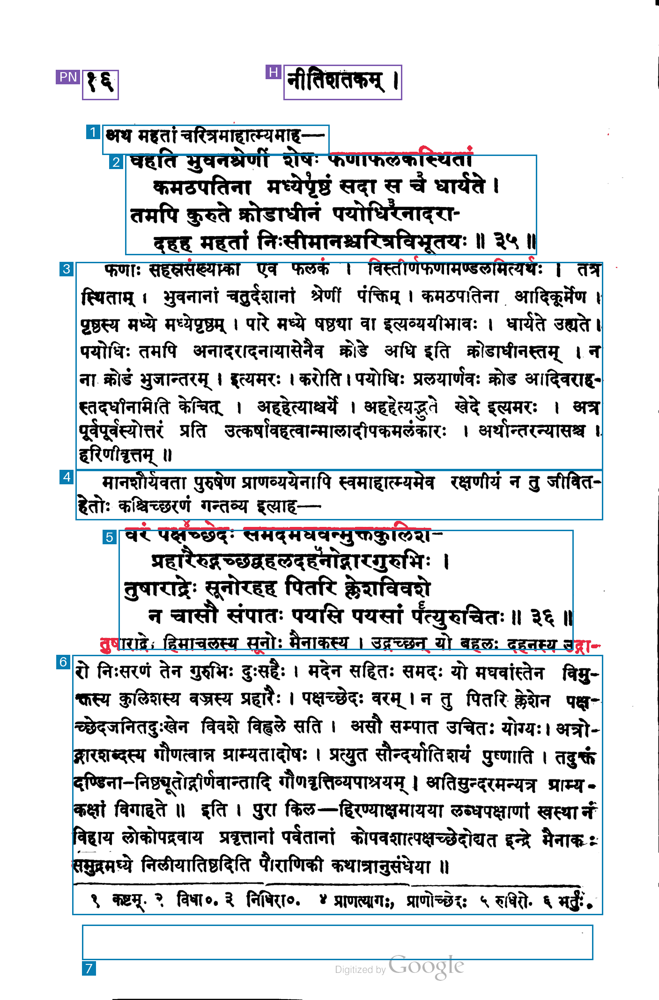


### Method 009 — Gemini 4 Argon high thinking

**Method:** [009-gemini-4-argon-high: Gemini 4 Argon high thinking](methods/009-gemini-4-argon-high/README.md).

**Input:** `kale-1913-page-017`; an unannotated rendering at 300 dpi, 1407 × 2135 pixels.

**Settings:** Requested and returned model `gemini-4-argon`; thinking level `high`; image resolution `high`; JSON Schema output; maximum 16,384 output tokens including thinking; standard service tier. The unchanged prompt asked for whole verses, separate commentary, lead-ins, footnotes and page furniture.

**Run:** 2026-11-03 14:27:07 UTC.

| Measurement | Result |
| --- | --- |
| Output boxes | 9 |
| Boxes marked keep=true | 7 |
| Regions marked uncertain | 0 |
| Footnote regions | 1 |
| API wall time | 42.04 s |
| Input tokens | 1,835 |
| Image input tokens | 1,107 |
| Text input tokens | 728 |
| Text output tokens | 404 |
| Thinking tokens | 2,035 |
| Output tokens, including thinking | 2,439 |
| Estimated paid-tier cost | $0.02806 |

The cost estimate uses $2.00 per million input tokens and $10.00 per million output tokens including thinking: (1,835 × $2.00 + 2,439 × $10.00) / 1,000,000.

Returned region types: 2 verse, 2 commentary, 2 lead-in, 1 footnote, 1 running header and 1 page number.

Each verse is enclosed in one box; the two commentary passages and two lead-ins have separate boxes. One box contains all six printed footnotes. The returned arrays use the requested x/y coordinate order.

Blue marks regions with `keep=true`; purple marks regions with `keep=false`. Red marks uncovered measured ink. Content numbers show returned reading order; H marks the running header and PN the page number.

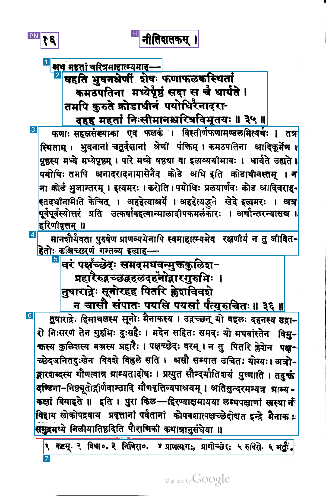


### Method 010 — Claude Fable 5.1 high effort

**Method:** [010-claude-fable-5.1-high: Claude Fable 5.1 high effort](methods/010-claude-fable-5.1-high/README.md).

**Input:** `kale-1913-page-017`; an unannotated rendering at 300 dpi, 1407 × 2135 pixels.

**Settings:** Requested and returned model `claude-fable-5-1`; adaptive thinking at `high` effort; provider-default image processing with the original PNG bytes; JSON Schema output; maximum 16,384 output tokens including thinking. The unchanged prompt asked for whole verses, separate commentary, lead-ins, footnotes and page furniture. Numerical limits and fixed array length were carried as schema descriptions and validated locally. The response reported standard tier, standard speed and global inference.

**Run:** 2026-11-03 14:27:10 UTC.

| Measurement | Result |
| --- | --- |
| Output boxes | 9 |
| Boxes marked keep=true | 7 |
| Regions marked uncertain | 0 |
| Footnote regions | 1 |
| API wall time | 4.95 s |
| Input tokens | 4,934 |
| Output tokens, including thinking | 415 |
| Thinking tokens reported | 0 |
| Cache read or creation tokens | 0 |
| Estimated paid-tier cost | $0.07009 |

The cost estimate uses $10.00 per million input tokens and $50.00 per million output tokens including thinking: (4,934 × $10.00 + 415 × $50.00) / 1,000,000.

Returned region types: 2 verse, 2 commentary, 2 lead-in, 1 footnote, 1 running header and 1 page number.

The footnote-labeled box (order 7) is below the printed footnotes, which lie inside the final commentary box (order 6). The first verse box clips upper parts of its first line; the second verse box starts below its first line. Both commentary boxes begin partway through their first printed lines.

Blue marks regions with `keep=true`; purple marks regions with `keep=false`. Red marks uncovered measured ink. Content numbers show returned reading order; H marks the running header and PN the page number.

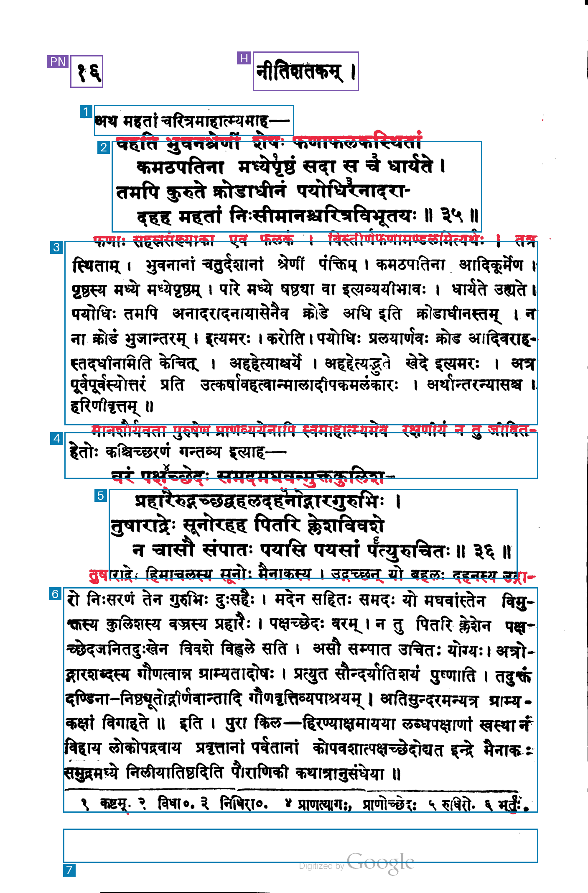


### Method 011 — Claude Fable 5.1 max effort

**Method:** [011-claude-fable-5.1-max: Claude Fable 5.1 max effort](methods/011-claude-fable-5.1-max/README.md).

**Input:** `kale-1913-page-017`; an unannotated rendering at 300 dpi, 1407 × 2135 pixels.

**Settings:** Requested and returned model `claude-fable-5-1`; adaptive thinking at `max` effort; provider-default image processing with the original PNG bytes; JSON Schema output; maximum 16,384 output tokens including thinking. The unchanged prompt asked for whole verses, separate commentary, lead-ins, footnotes and page furniture. Numerical limits and fixed array length were carried as schema descriptions and validated locally. The response reported standard tier, standard speed and global inference.

**Run:** 2026-11-03 14:29:16 UTC.

| Measurement | Result |
| --- | --- |
| Output boxes | 9 |
| Boxes marked keep=true | 7 |
| Regions marked uncertain | 0 |
| Footnote regions | 1 |
| API wall time | 52.63 s |
| Input tokens | 4,934 |
| Output tokens, including thinking | 4,758 |
| Thinking tokens reported | 4,343 |
| Cache read or creation tokens | 0 |
| Estimated paid-tier cost | $0.28724 |

The cost estimate uses $10.00 per million input tokens and $50.00 per million output tokens including thinking: (4,934 × $10.00 + 4,758 × $50.00) / 1,000,000.

Returned region types: 2 verse, 2 commentary, 2 lead-in, 1 footnote, 1 running header and 1 page number.

The footnote-labeled box (order 7) covers the last commentary line and the separator above the printed footnotes; most footnote text lies below it. The final commentary box ends above its last printed line. The first commentary and second verse boxes clip their last lines; the second lead-in box clips its second line.

Blue marks regions with `keep=true`; purple marks regions with `keep=false`. Red marks uncovered measured ink. Content numbers show returned reading order; H marks the running header and PN the page number.

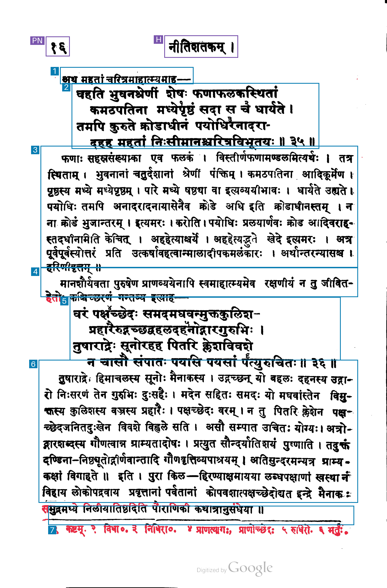


### Method 012 — Claude Opus 5.5 max effort

**Method:** [012-claude-opus-5.5-max: Claude Opus 5.5 max effort](methods/012-claude-opus-5.5-max/README.md).

**Input:** `kale-1913-page-017`; an unannotated rendering at 300 dpi, 1407 × 2135 pixels.

**Settings:** Requested and returned model `claude-opus-5-5`; adaptive thinking at `max` effort; provider-default image processing with the original PNG bytes; JSON Schema output; maximum 16,384 output tokens including thinking. The unchanged prompt asked for whole verses, separate commentary, lead-ins, footnotes and page furniture. Numerical limits and fixed array length were carried as schema descriptions and validated locally. The response reported standard tier, standard speed and global inference.

**Run:** 2026-11-03 14:31:28 UTC.

| Measurement | Result |
| --- | --- |
| Output boxes | 9 |
| Boxes marked keep=true | 7 |
| Regions marked uncertain | 0 |
| Footnote regions | 1 |
| API wall time | 58.27 s |
| Input tokens | 4,934 |
| Output tokens, including thinking | 6,460 |
| Thinking tokens reported | 6,045 |
| Cache read or creation tokens | 0 |
| Estimated paid-tier cost | $0.148936 |

The cost estimate uses $4.00 per million input tokens and $20.00 per million output tokens including thinking: (4,934 × $4.00 + 6,460 × $20.00) / 1,000,000.

Returned region types: 2 verse, 2 commentary, 2 lead-in, 1 footnote, 1 running header and 1 page number.

The footnotes are assigned one region. Its lower boundary clips the printed footnote line. Both commentary boxes clip their last lines. The second lead-in box clips part of its second line; the second verse box extends upward into that lead-in line.

Blue marks regions with `keep=true`; purple marks regions with `keep=false`. Red marks uncovered measured ink. Content numbers show returned reading order; H marks the running header and PN the page number.

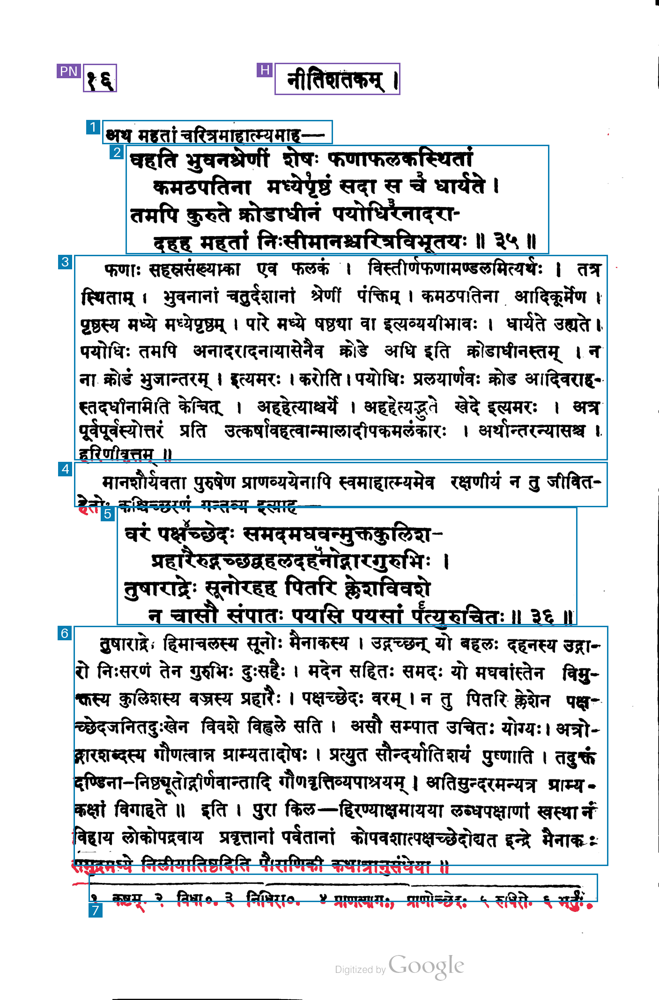


### Method 013 — Gemini 4 Argon high thinking, individual footnotes

**Method:** [013-gemini-4-argon-high-footnotes: Gemini 4 Argon high thinking, individual footnotes](methods/013-gemini-4-argon-high-footnotes/README.md).

**Input:** `kale-1913-page-017`; the unchanged PNG rendering at 300 dpi, 1407 × 2135 pixels.

**Settings:** Requested and returned model `gemini-4-argon`; thinking level `high`; image resolution `high`; JSON Schema output; maximum 16,384 output tokens including thinking; standard service tier.

**Footnote instruction:**

> Return one region per numbered footnote, including its marker and text. Separate neighboring footnotes even when they share a printed line.

**Coordinates:** Requested `[x1,y1,x2,y2]` coordinates normalized to 0–1000. Converted to original-image pixels using x × 1407 / 1000 and y × 2135 / 1000.

**Run:** 2026-11-03 14:53:05 UTC.

| Measurement | Result |
| --- | --- |
| Output boxes | 14 |
| Boxes marked keep=true | 12 |
| Regions marked uncertain | 0 |
| Footnote regions | 6 |
| API wall time | 32.71 s |
| Input tokens | 1,848 |
| Text output tokens | 616 |
| Thinking tokens | 1,521 |
| Output tokens, including thinking | 2,137 |
| Coordinate clamping adjustments | 0 |
| Estimated paid-tier cost | $0.025066 |

The cost estimate uses $2.00 per million input tokens and $10.00 per million output tokens including thinking: (1,848 × $2.00 + 2,137 × $10.00) / 1,000,000.

Returned region types: 2 verse, 2 commentary, 2 lead-in, 6 footnote, 1 running header and 1 page number.

Each numbered footnote has its own box containing its marker and text. Each verse remains one region; the commentary passages and lead-ins have separate boxes.

Blue marks regions with `keep=true`; purple marks regions with `keep=false`. Red marks uncovered measured ink. Content numbers show returned reading order; H marks the running header and PN the page number.

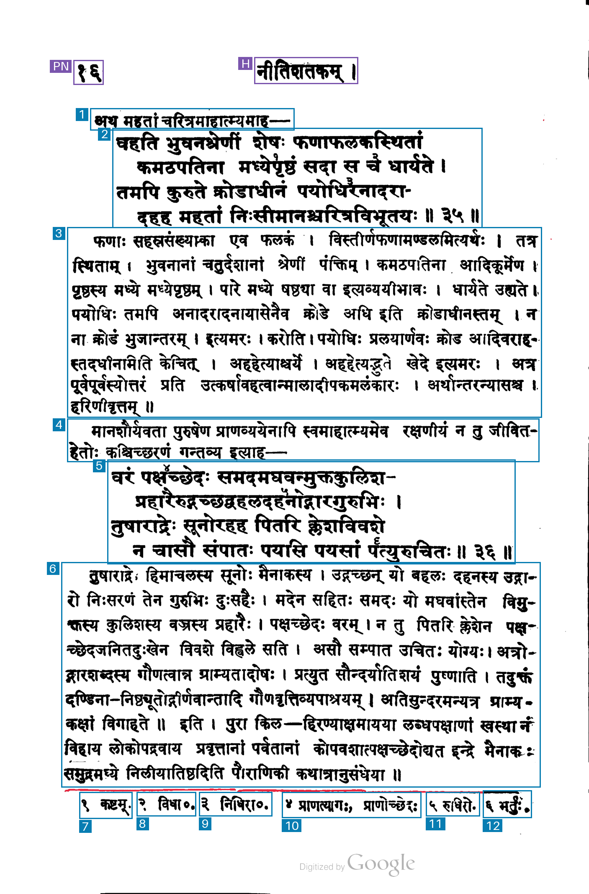


### Method 014 — Gemini 4 Argon high thinking, individual footnotes, native coordinates

**Method:** [014-gemini-4-argon-high-native: Gemini 4 Argon high thinking, individual footnotes, native coordinates](methods/014-gemini-4-argon-high-native/README.md).

**Input:** `kale-1913-page-017`; the unchanged PNG rendering at 300 dpi, 1407 × 2135 pixels.

**Settings:** Requested and returned model `gemini-4-argon`; thinking level `high`; image resolution `high`; JSON Schema output; maximum 16,384 output tokens including thinking; standard service tier.

**Footnote instruction:**

> Return one region per numbered footnote, including its marker and text. Separate neighboring footnotes even when they share a printed line.

**Coordinates:** Requested Google's documented `[ymin,xmin,ymax,xmax]` coordinates normalized to 0–1000. Converted by reordering to `[xmin,ymin,xmax,ymax]`, then multiplying x by 1407 / 1000 and y by 2135 / 1000.

**Run:** 2026-11-03 14:53:08 UTC.

| Measurement | Result |
| --- | --- |
| Output boxes | 14 |
| Boxes marked keep=true | 12 |
| Regions marked uncertain | 0 |
| Footnote regions | 6 |
| API wall time | 24.58 s |
| Input tokens | 1,842 |
| Text output tokens | 616 |
| Thinking tokens | 1,524 |
| Output tokens, including thinking | 2,140 |
| Coordinate clamping adjustments | 0 |
| Estimated paid-tier cost | $0.025084 |

The cost estimate uses $2.00 per million input tokens and $10.00 per million output tokens including thinking: (1,842 × $2.00 + 2,140 × $10.00) / 1,000,000.

Returned region types: 2 verse, 2 commentary, 2 lead-in, 6 footnote, 1 running header and 1 page number.

Each numbered footnote has its own box containing its marker and text. Each verse remains one region; the commentary passages and lead-ins have separate boxes. A few upper glyph tips on the first line of the final commentary fall above its box.

Blue marks regions with `keep=true`; purple marks regions with `keep=false`. Red marks uncovered measured ink. Content numbers show returned reading order; H marks the running header and PN the page number.

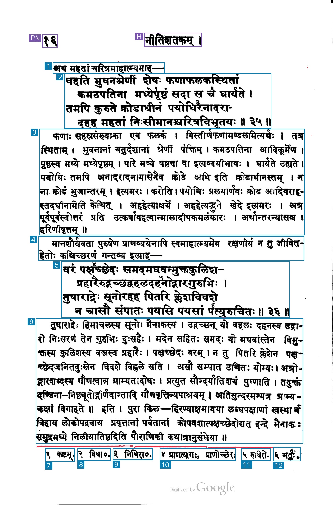


### Method 015 — Claude Fable 5.1 max effort, individual footnotes, pixel coordinates

**Method:** [015-claude-fable-5.1-max-pixels: Claude Fable 5.1 max effort, individual footnotes, pixel coordinates](methods/015-claude-fable-5.1-max-pixels/README.md).

**Input:** `kale-1913-page-017`; the unchanged PNG rendering at 300 dpi, 1407 × 2135 pixels.

**Settings:** Requested and returned model `claude-fable-5-1`; adaptive thinking at `max` effort; JSON Schema output; maximum 16,384 output tokens including thinking; returned standard tier, standard speed and global inference. Fixed array length was carried as a schema description and validated locally.

**Footnote instruction:**

> Return one region per numbered footnote, including its marker and text. Separate neighboring footnotes even when they share a printed line.

**Coordinates:** Requested Anthropic's documented `[x1,y1,x2,y2]` absolute pixel coordinates. The 1407 × 2135 input fits the model's high-resolution tier: 51 × 77 = 3,927 visual patches, within the 4,784-patch budget and 2,576-pixel edge limit. Coordinates map directly to the original unpadded image. No resize or coordinate clamping was applied.

**Run:** 2026-11-03 14:53:11 UTC.

| Measurement | Result |
| --- | --- |
| Output boxes | 14 |
| Boxes marked keep=true | 12 |
| Regions marked uncertain | 0 |
| Footnote regions | 6 |
| API wall time | 50.98 s |
| Input tokens | 4,955 |
| Output tokens, including thinking | 4,851 |
| Thinking tokens reported | 4,168 |
| Cache read or creation tokens | 0 |
| Coordinate clamping adjustments | 0 |
| Estimated paid-tier cost | $0.2921 |

The cost estimate uses $10.00 per million input tokens and $50.00 per million output tokens including thinking: (4,955 × $10.00 + 4,851 × $50.00) / 1,000,000.

Returned region types: 2 verse, 2 commentary, 2 lead-in, 6 footnote, 1 running header and 1 page number.

Six footnote boxes are returned. Some boundaries separate a note's marker from its text: the first footnote box also includes the marker for note 2, and the second also includes the marker for note 3. The two verses, commentary passages and lead-ins have separate boxes.

Blue marks regions with `keep=true`; purple marks regions with `keep=false`. Red marks uncovered measured ink. Content numbers show returned reading order; H marks the running header and PN the page number.

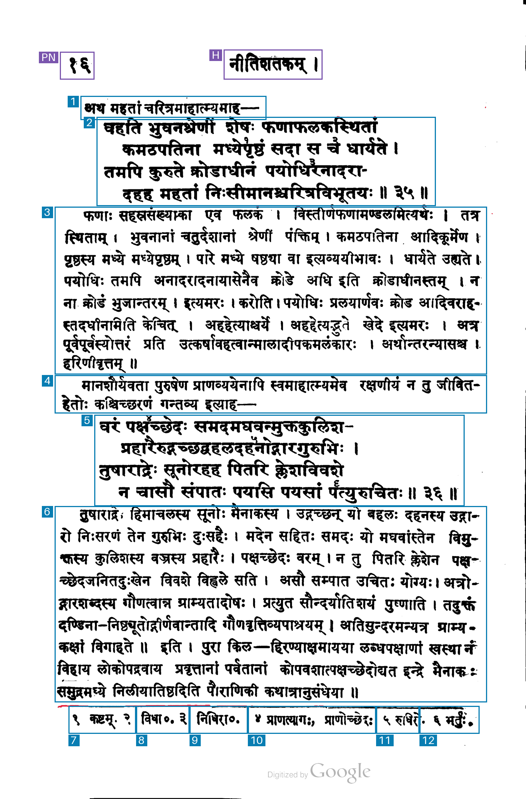


### Method 016 — Claude Opus 5.5 max effort, individual footnotes, pixel coordinates

**Method:** [016-claude-opus-5.5-max-pixels: Claude Opus 5.5 max effort, individual footnotes, pixel coordinates](methods/016-claude-opus-5.5-max-pixels/README.md).

**Input:** `kale-1913-page-017`; the unchanged PNG rendering at 300 dpi, 1407 × 2135 pixels.

**Settings:** Requested and returned model `claude-opus-5-5`; adaptive thinking at `max` effort; JSON Schema output; maximum 16,384 output tokens including thinking; returned standard tier, standard speed and global inference. Fixed array length was carried as a schema description and validated locally.

**Footnote instruction:**

> Return one region per numbered footnote, including its marker and text. Separate neighboring footnotes even when they share a printed line.

**Coordinates:** Requested Anthropic's documented `[x1,y1,x2,y2]` absolute pixel coordinates. The 1407 × 2135 input fits the model's high-resolution tier: 51 × 77 = 3,927 visual patches, within the 4,784-patch budget and 2,576-pixel edge limit. Coordinates map directly to the original unpadded image. No resize or coordinate clamping was applied.

**Run:** 2026-11-03 14:53:13 UTC.

| Measurement | Result |
| --- | --- |
| Output boxes | 14 |
| Boxes marked keep=true | 12 |
| Regions marked uncertain | 0 |
| Footnote regions | 6 |
| API wall time | 74.62 s |
| Input tokens | 4,955 |
| Output tokens, including thinking | 8,803 |
| Thinking tokens reported | 8,121 |
| Cache read or creation tokens | 0 |
| Coordinate clamping adjustments | 0 |
| Estimated paid-tier cost | $0.19588 |

The cost estimate uses $4.00 per million input tokens and $20.00 per million output tokens including thinking: (4,955 × $4.00 + 8,803 × $20.00) / 1,000,000.

Returned region types: 2 verse, 2 commentary, 2 lead-in, 6 footnote, 1 running header and 1 page number.

Six footnote boxes are returned. Their lower boundaries cross the printed footnote line, clipping lower parts of glyphs. The final commentary box also clips its last printed line.

Blue marks regions with `keep=true`; purple marks regions with `keep=false`. Red marks uncovered measured ink. Content numbers show returned reading order; H marks the running header and PN the page number.

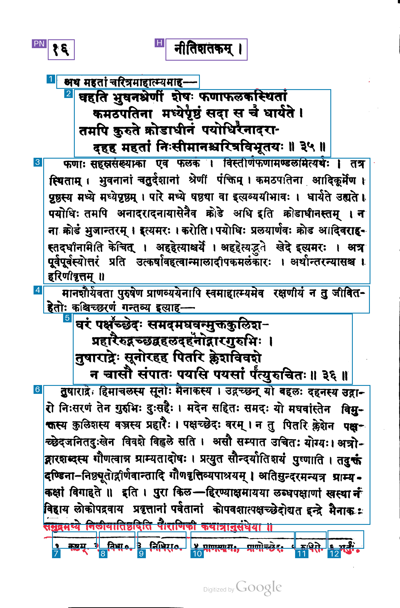

### Method 017 — Gemini 4 Argon low thinking, individual footnotes, native coordinates

**Method:** [017-gemini-4-argon-low-native: Gemini 4 Argon low thinking, individual footnotes, native coordinates](methods/017-gemini-4-argon-low-native/README.md).

**Input:** `kale-1913-page-017`; the unchanged PNG rendering at 300 dpi, 1407 × 2135 pixels.

**Settings:** Requested and returned model `gemini-4-argon`; thinking level `low`; image resolution `high`; JSON Schema output; maximum 16,384 output tokens including thinking; standard service tier; `store=false`.

**Footnote instruction:**

> Return one region per numbered footnote, including its marker and text. Separate neighboring footnotes even when they share a printed line.

**Coordinates:** Requested Google's documented [ymin,xmin,ymax,xmax] coordinates normalized to 0–1000. Converted by reordering to [xmin,ymin,xmax,ymax], then multiplying x by 1407 / 1000 and y by 2135 / 1000.

**Run:** 2026-11-03 15:16:46 UTC.

| Measurement | Result |
| --- | --- |
| Output boxes | 14 |
| Boxes marked keep=true | 12 |
| Regions marked uncertain | 0 |
| Footnote regions | 6 |
| API wall time | 28.23 s |
| Input tokens | 1,842 |
| Text output tokens | 618 |
| Thinking tokens | 0 |
| Output tokens, including thinking | 618 |
| Cached input tokens | 0 |
| Coordinate clamping adjustments | 0 |
| Estimated paid-tier cost | $0.009864 |

The estimated cost uses $2 per million input tokens and $10 per million output tokens including thinking: (1,842 × $2 + 618 × $10) / 1,000,000 = $0.009864. Rates checked on 2026-11-03.

Returned region types: 2 verse, 2 commentary, 2 lead in, 6 footnote, 1 running header, 1 page number.

Each of the six numbered footnotes has its own box containing its marker and text. Both four-line verses remain whole; the two commentary passages and two lead-ins have separate boxes.

Blue marks regions with `keep=true`; purple marks regions with `keep=false`. Red marks uncovered measured ink. Content numbers show returned reading order; H marks the running header and PN the page number.

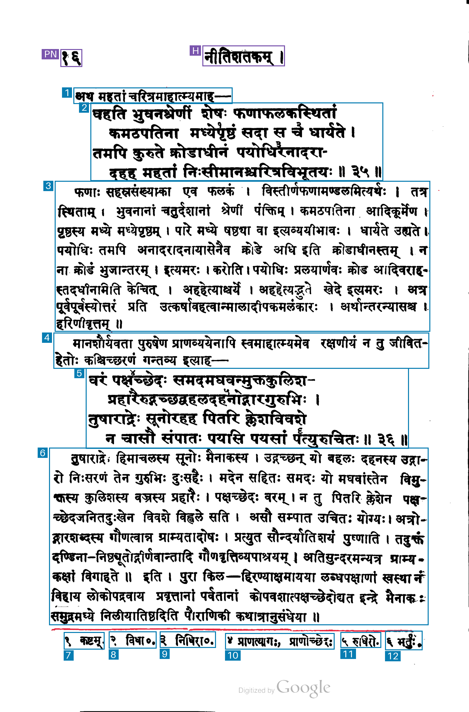


### Method 018 — Gemini 3.8 Flash low thinking, individual footnotes, native coordinates

#### Run 001

**Method:** [018-gemini-3.8-flash-low-native: Gemini 3.8 Flash low thinking, individual footnotes, native coordinates](methods/018-gemini-3.8-flash-low-native/README.md).

**Input:** `kale-1913-page-017`; the unchanged PNG rendering at 300 dpi, 1407 × 2135 pixels.

**Settings:** Requested and returned model `gemini-3.8-flash`; thinking level `low`; image resolution `high`; JSON Schema output; maximum 16,384 output tokens including thinking; standard service tier; `store=false`.

**Footnote instruction:**

> Return one region per numbered footnote, including its marker and text. Separate neighboring footnotes even when they share a printed line.

**Coordinates:** Requested Google's documented [ymin,xmin,ymax,xmax] coordinates normalized to 0–1000. Converted by reordering to [xmin,ymin,xmax,ymax], then multiplying x by 1407 / 1000 and y by 2135 / 1000.

**Run:** 2026-11-03 15:16:51 UTC.

| Measurement | Result |
| --- | --- |
| Output boxes | 14 |
| Boxes marked keep=true | 12 |
| Regions marked uncertain | 0 |
| Footnote regions | 6 |
| API wall time | 7.46 s |
| Input tokens | 1,420 |
| Text output tokens | 622 |
| Thinking tokens | 0 |
| Output tokens, including thinking | 622 |
| Cached input tokens | 0 |
| Coordinate clamping adjustments | 0 |
| Estimated paid-tier cost | $0.0033975 |

The estimated cost uses $0.75 per million input tokens and $3.75 per million output tokens including thinking: (1,420 × $0.75 + 622 × $3.75) / 1,000,000 = $0.0033975. Rates checked on 2026-11-03.

Returned region types: 2 verse, 2 commentary, 2 lead in, 6 footnote, 1 running header, 1 page number.

Each of the six numbered footnotes has its own box containing its marker and text. Both four-line verses remain whole; the two commentary passages and two lead-ins have separate boxes. Several edges are tight, including the right edge of the fifth footnote.

Blue marks regions with `keep=true`; purple marks regions with `keep=false`. Red marks uncovered measured ink. Content numbers show returned reading order; H marks the running header and PN the page number.

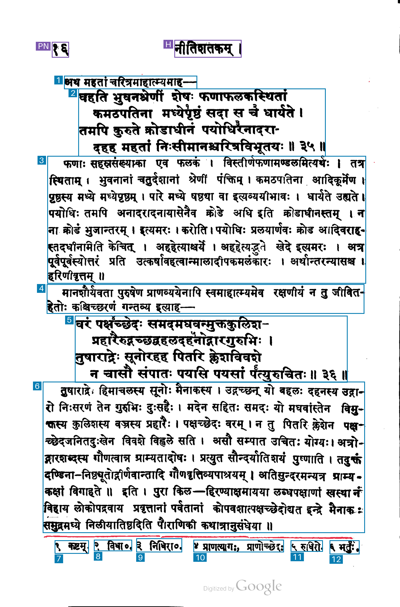

Footnotes enlarged 2× from original-image crop [150,1870,1300,2005], using nearest-neighbor scaling:

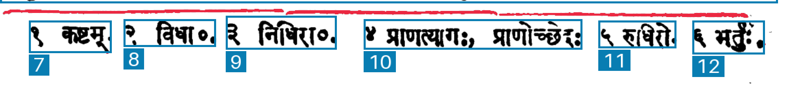


#### Run 002

**Method:** [018-gemini-3.8-flash-low-native: Gemini 3.8 Flash low thinking, individual footnotes, native coordinates](methods/018-gemini-3.8-flash-low-native/README.md).

**Input:** `kale-1913-page-017`; the unchanged PNG rendering at 300 dpi, 1407 × 2135 pixels.

**Settings:** Requested and returned model `gemini-3.8-flash`; thinking level `low`; image resolution `high`; JSON Schema output; maximum 16,384 output tokens including thinking; standard service tier; `store=false`. One synchronous request, with automatic retries disabled.

**Footnote instruction:**

> Return one region per numbered footnote, including its marker and text. Separate neighboring footnotes even when they share a printed line.

**Coordinates:** Requested [ymin,xmin,ymax,xmax] integer coordinates normalized to 0–1000. Converted by reordering to [xmin,ymin,xmax,ymax], then multiplying x by 1407 / 1000 and y by 2135 / 1000. No coordinate clamping was applied.

**Run:** 2026-11-04 03:23:40 UTC; `run-002`; HTTP 200, response completed.

| Measurement | Result |
| --- | --- |
| Output boxes | 14 |
| Boxes marked keep=true | 12 |
| Regions marked uncertain | 0 |
| Footnote regions | 6 |
| API wall time | 7.12 s |
| Input tokens | 1,420 |
| Text output tokens | 619 |
| Thinking tokens | 0 |
| Output tokens, including thinking | 619 |
| Cached input tokens | 0 |
| Coordinate clamping adjustments | 0 |
| Estimated paid-tier cost | $0.00338625 |

The estimated paid-tier cost uses $0.75 per million input tokens and $3.75 per million output tokens including thinking: (1,420 × $0.75 + 619 × $3.75) / 1,000,000 = $0.00338625. Rates checked on 2026-11-03.

Returned region types: 2 verse, 2 commentary, 2 lead in, 6 footnote, 1 running header, 1 page number.

Each of the six numbered footnotes has a separate box containing its marker and text. Both four-line verses remain whole, with separate commentary and lead-in boxes. Some box edges are tight, including the first commentary's right edge and the fifth footnote's left edge.

Blue marks regions with `keep=true`; purple marks regions with `keep=false`. Red marks uncovered measured ink. Content numbers show returned reading order; H marks the running header and PN the page number.


#### Run 003

**Method:** [018-gemini-3.8-flash-low-native: Gemini 3.8 Flash low thinking, individual footnotes, native coordinates](methods/018-gemini-3.8-flash-low-native/README.md).

**Input:** `kale-1913-page-017`; the unchanged PNG rendering at 300 dpi, 1407 × 2135 pixels.

**Settings:** Requested and returned model `gemini-3.8-flash`; thinking level `low`; image resolution `high`; JSON Schema output; maximum 16,384 output tokens including thinking; standard service tier; `store=false`. One synchronous request, with automatic retries disabled.

**Footnote instruction:**

> Return one region per numbered footnote, including its marker and text. Separate neighboring footnotes even when they share a printed line.

**Coordinates:** Requested [ymin,xmin,ymax,xmax] integer coordinates normalized to 0–1000. Converted by reordering to [xmin,ymin,xmax,ymax], then multiplying x by 1407 / 1000 and y by 2135 / 1000. No coordinate clamping was applied.

**Run:** 2026-11-04 03:23:58 UTC; `run-003`; HTTP 200, response completed.

| Measurement | Result |
| --- | --- |
| Output boxes | 14 |
| Boxes marked keep=true | 12 |
| Regions marked uncertain | 0 |
| Footnote regions | 6 |
| API wall time | 5.49 s |
| Input tokens | 1,420 |
| Text output tokens | 619 |
| Thinking tokens | 0 |
| Output tokens, including thinking | 619 |
| Cached input tokens | 0 |
| Coordinate clamping adjustments | 0 |
| Estimated paid-tier cost | $0.00338625 |

The estimated paid-tier cost uses $0.75 per million input tokens and $3.75 per million output tokens including thinking: (1,420 × $0.75 + 619 × $3.75) / 1,000,000 = $0.00338625. Rates checked on 2026-11-03.

Returned region types: 2 verse, 2 commentary, 2 lead in, 6 footnote, 1 running header, 1 page number.

Each of the six numbered footnotes has a separate box containing its marker and text. Both four-line verses remain whole, with separate commentary and lead-in boxes. A few glyph tips fall beyond tight boundaries, including the top of the first verse and the left edge of the second footnote.

Blue marks regions with `keep=true`; purple marks regions with `keep=false`. Red marks uncovered measured ink. Content numbers show returned reading order; H marks the running header and PN the page number.

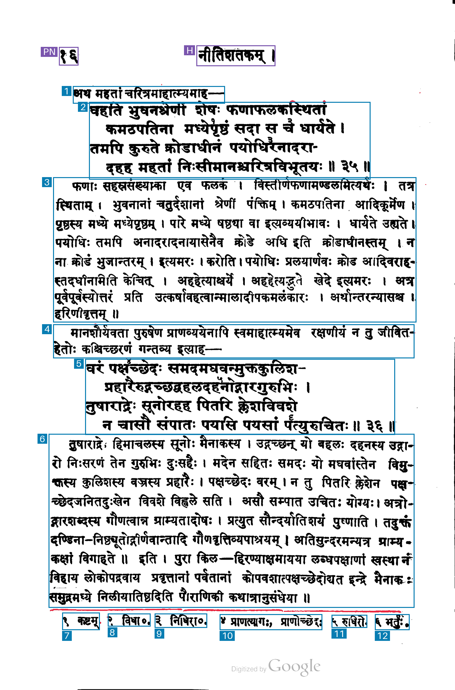


### Method 019 — Gemini 3.5 Flash-Lite minimal thinking, individual footnotes, native coordinates

**Method:** [019-gemini-3.5-flash-lite-minimal: Gemini 3.5 Flash-Lite minimal thinking, individual footnotes, native coordinates](methods/019-gemini-3.5-flash-lite-minimal/README.md).

**Input:** `kale-1913-page-017`; the unchanged PNG rendering at 300 dpi, 1407 × 2135 pixels.

**Settings:** Requested and returned model `gemini-3.5-flash-lite`; thinking level `minimal`; image resolution `high`; JSON Schema output; maximum 16,384 output tokens including thinking; standard service tier; `store=false`.

**Footnote instruction:**

> Return one region per numbered footnote, including its marker and text. Separate neighboring footnotes even when they share a printed line.

**Coordinates:** Requested Google's documented [ymin,xmin,ymax,xmax] coordinates normalized to 0–1000. Converted by reordering to [xmin,ymin,xmax,ymax], then multiplying x by 1407 / 1000 and y by 2135 / 1000.

**Run:** 2026-11-03 15:16:57 UTC.

| Measurement | Result |
| --- | --- |
| Output proposals | 9 |
| Boxes marked keep=true | 7 |
| Regions marked uncertain | 0 |
| Footnote regions | 1 |
| API wall time | 2.46 s |
| Input tokens | 1,420 |
| Text output tokens | 684 |
| Thinking tokens | 0 |
| Output tokens, including thinking | 684 |
| Cached input tokens | 0 |
| Valid rectangles rendered in diagnostic | 8 |
| Invalid rectangle proposals | 1 |
| Estimated paid-tier cost | $0.002136 |

The estimated cost uses $0.3 per million input tokens and $2.5 per million output tokens including thinking: (1,420 × $0.3 + 684 × $2.5) / 1,000,000 = $0.002136. Rates checked on 2026-11-03.

Returned region types: 2 verse, 2 commentary, 2 lead in, 1 footnote, 1 running header, 1 page number.

The API returned nine proposals. The page-number proposal has inverted vertical coordinates, [130,132,22,173] in [ymin,xmin,ymax,xmax] order, and local validation stopped with `Nonpositive rectangle at region 1`. The first verse box contains only three of its four lines; its fourth line is included in the commentary box. All six numbered footnotes share one box.

The diagnostic image renders the eight valid returned rectangles with their original coordinates. The invalid page-number proposal is omitted. Blue marks regions with `keep=true`; purple marks regions with `keep=false`; red marks uncovered measured ink. Content numbers show returned reading order; H marks the running header.

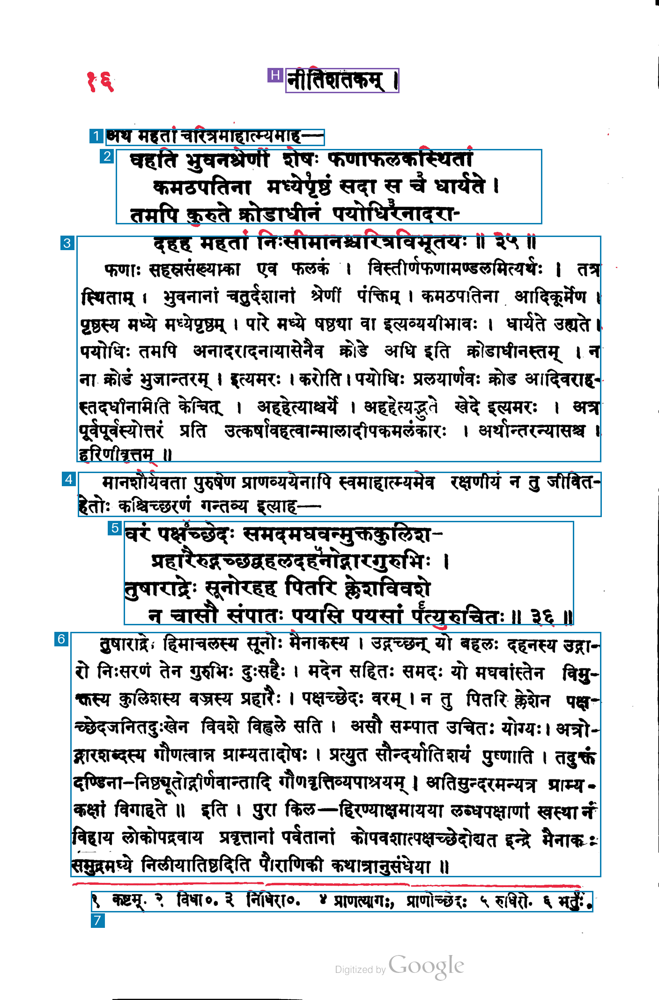


### Method 020 — GPT-6 Astra low reasoning, individual footnotes

**Method:** [020-gpt-6-astra-low-footnotes: GPT-6 Astra low reasoning, individual footnotes](methods/020-gpt-6-astra-low-footnotes/README.md).

**Input:** `kale-1913-page-017`; the unchanged PNG rendering at 300 dpi, 1407 × 2135 pixels.

**Settings:** Requested and returned model `gpt-6-astra`; reasoning effort `low`; image detail `original`; strict JSON Schema output; maximum 16,384 output tokens including reasoning; returned service tier `default`; `store=false`.

**Footnote instruction:**

> Return one region per numbered footnote, including its marker and text. Separate neighboring footnotes even when they share a printed line.

**Coordinates:** Requested [xmin,ymin,xmax,ymax] coordinates normalized to 0–1000. Converted by multiplying x by 1407 / 1000 and y by 2135 / 1000.

**Run:** 2026-11-03 15:20:34 UTC.

| Measurement | Result |
| --- | --- |
| Output boxes | 14 |
| Boxes marked keep=true | 12 |
| Regions marked uncertain | 0 |
| Footnote regions | 6 |
| API wall time | 11.36 s |
| Input tokens | 3,932 |
| Ordinary input tokens | 3 |
| Cache-write input tokens, default 30-minute lifetime | 3,929 |
| Cache-read input tokens | 0 |
| Output tokens, including reasoning | 510 |
| Reasoning tokens | 49 |
| Output tokens excluding reasoning | 461 |
| Coordinate clamping adjustments | 0 |
| Estimated paid-tier cost | $0.0746425 |

The estimated cost uses $10 per million ordinary input tokens, $12.5 per million default 30-minute cache-write tokens and $50 per million output tokens including reasoning: (3 × $10 + 3,929 × $12.5 + 510 × $50) / 1,000,000 = $0.0746425. Rates checked on 2026-11-03.

Returned region types: 2 verse, 2 commentary, 2 lead in, 6 footnote, 1 running header, 1 page number.

Each of the six numbered footnotes has its own box containing its marker and text. Both four-line verses remain whole; the two commentary passages and two lead-ins have separate boxes. A few upper glyph tips on the first line of the final commentary extend above its box.

Blue marks regions with `keep=true`; purple marks regions with `keep=false`. Red marks uncovered measured ink. Content numbers show returned reading order; H marks the running header and PN the page number.

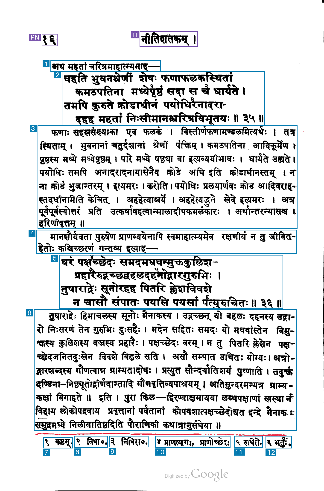


### Method 021 — GPT-6.1 Terra low reasoning, individual footnotes

#### Run 001

**Method:** [021-gpt-6.1-terra-low-footnotes: GPT-6.1 Terra low reasoning, individual footnotes](methods/021-gpt-6.1-terra-low-footnotes/README.md).

**Input:** `kale-1913-page-017`; the unchanged PNG rendering at 300 dpi, 1407 × 2135 pixels.

**Settings:** Requested and returned model `gpt-6.1-terra`; reasoning effort `low`; image detail `original`; strict JSON Schema output; maximum 16,384 output tokens including reasoning; returned service tier `default`; `store=false`.

**Footnote instruction:**

> Return one region per numbered footnote, including its marker and text. Separate neighboring footnotes even when they share a printed line.

**Coordinates:** Requested [xmin,ymin,xmax,ymax] coordinates normalized to 0–1000. Converted by multiplying x by 1407 / 1000 and y by 2135 / 1000.

**Run:** 2026-11-03 15:20:39 UTC.

| Measurement | Result |
| --- | --- |
| Output boxes | 14 |
| Boxes marked keep=true | 12 |
| Regions marked uncertain | 0 |
| Footnote regions | 6 |
| API wall time | 7.82 s |
| Input tokens | 3,932 |
| Ordinary input tokens | 3 |
| Cache-write input tokens, default 30-minute lifetime | 3,929 |
| Cache-read input tokens | 0 |
| Output tokens, including reasoning | 519 |
| Reasoning tokens | 58 |
| Output tokens excluding reasoning | 461 |
| Coordinate clamping adjustments | 0 |
| Estimated paid-tier cost | $0.00750925 |

The estimated cost uses $1 per million ordinary input tokens, $1.25 per million default 30-minute cache-write tokens and $5 per million output tokens including reasoning: (3 × $1 + 3,929 × $1.25 + 519 × $5) / 1,000,000 = $0.00750925. Rates checked on 2026-11-03.

Returned region types: 2 verse, 2 commentary, 2 lead in, 6 footnote, 1 running header, 1 page number.

Each of the six numbered footnotes has its own box containing its marker and text. Both four-line verses remain whole; the two commentary passages and two lead-ins have separate boxes. A few glyph tips extend beyond the commentary boundaries.

Blue marks regions with `keep=true`; purple marks regions with `keep=false`. Red marks uncovered measured ink. Content numbers show returned reading order; H marks the running header and PN the page number.

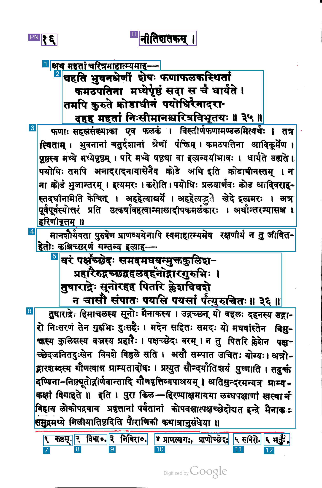


#### Run 002

**Method:** [021-gpt-6.1-terra-low-footnotes: GPT-6.1 Terra low reasoning, individual footnotes](methods/021-gpt-6.1-terra-low-footnotes/README.md).

**Input:** `kale-1913-page-017`; the unchanged PNG rendering at 300 dpi, 1407 × 2135 pixels.

**Settings:** Requested and returned model `gpt-6.1-terra`; reasoning effort `low`; image detail `original`; strict JSON Schema output; maximum 16,384 output tokens including reasoning; returned service tier `default`; `store=false`. One synchronous request, with automatic retries disabled.

**Footnote instruction:**

> Return one region per numbered footnote, including its marker and text. Separate neighboring footnotes even when they share a printed line.

**Coordinates:** Requested [xmin,ymin,xmax,ymax] integer coordinates normalized to 0–1000. Converted by multiplying x by 1407 / 1000 and y by 2135 / 1000. No coordinate clamping was applied.

**Run:** 2026-11-04 03:23:48 UTC; `run-002`; HTTP 200, response completed.

| Measurement | Result |
| --- | --- |
| Output boxes | 14 |
| Boxes marked keep=true | 12 |
| Regions marked uncertain | 0 |
| Footnote regions | 6 |
| API wall time | 8.85 s |
| Input tokens | 3,932 |
| Ordinary input tokens | 3 |
| Cache-write input tokens, default 30-minute lifetime | 3,929 |
| Cache-read input tokens | 0 |
| Output tokens, including reasoning | 513 |
| Reasoning tokens | 52 |
| Output tokens excluding reasoning | 461 |
| Coordinate clamping adjustments | 0 |
| Estimated paid-tier cost | $0.00747925 |

The estimated paid-tier cost uses $1 per million ordinary input tokens, $1.25 per million default 30-minute cache-write tokens, $0.05 per million cache-read tokens and $5 per million output tokens including reasoning: (3 × $1 + 3,929 × $1.25 + 0 × $0.05 + 513 × $5) / 1,000,000 = $0.00747925. Rates checked on 2026-11-03.

Returned region types: 2 verse, 2 commentary, 2 lead in, 6 footnote, 1 running header, 1 page number.

Each of the six numbered footnotes has a separate box containing its marker and text. Both four-line verses remain whole, with separate commentary and lead-in boxes.

Blue marks regions with `keep=true`; purple marks regions with `keep=false`. Red marks uncovered measured ink. Content numbers show returned reading order; H marks the running header and PN the page number.

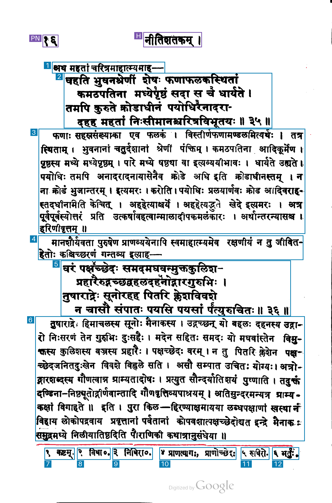


#### Run 003

**Method:** [021-gpt-6.1-terra-low-footnotes: GPT-6.1 Terra low reasoning, individual footnotes](methods/021-gpt-6.1-terra-low-footnotes/README.md).

**Input:** `kale-1913-page-017`; the unchanged PNG rendering at 300 dpi, 1407 × 2135 pixels.

**Settings:** Requested and returned model `gpt-6.1-terra`; reasoning effort `low`; image detail `original`; strict JSON Schema output; maximum 16,384 output tokens including reasoning; returned service tier `default`; `store=false`. One synchronous request, with automatic retries disabled.

**Footnote instruction:**

> Return one region per numbered footnote, including its marker and text. Separate neighboring footnotes even when they share a printed line.

**Coordinates:** Requested [xmin,ymin,xmax,ymax] integer coordinates normalized to 0–1000. Converted by multiplying x by 1407 / 1000 and y by 2135 / 1000. No coordinate clamping was applied.

**Run:** 2026-11-04 03:24:05 UTC; `run-003`; HTTP 200, response completed.

| Measurement | Result |
| --- | --- |
| Output boxes | 14 |
| Boxes marked keep=true | 12 |
| Regions marked uncertain | 0 |
| Footnote regions | 6 |
| API wall time | 8.26 s |
| Input tokens | 3,932 |
| Ordinary input tokens | 3 |
| Cache-write input tokens, default 30-minute lifetime | 0 |
| Cache-read input tokens | 3,929 |
| Output tokens, including reasoning | 535 |
| Reasoning tokens | 74 |
| Output tokens excluding reasoning | 461 |
| Coordinate clamping adjustments | 0 |
| Estimated paid-tier cost | $0.00287445 |

The estimated paid-tier cost uses $1 per million ordinary input tokens, $1.25 per million default 30-minute cache-write tokens, $0.05 per million cache-read tokens and $5 per million output tokens including reasoning: (3 × $1 + 0 × $1.25 + 3,929 × $0.05 + 535 × $5) / 1,000,000 = $0.00287445. Rates checked on 2026-11-03.

Returned region types: 2 verse, 2 commentary, 2 lead in, 6 footnote, 1 running header, 1 page number.

Each of the six numbered footnotes has a separate box containing its marker and text. Both four-line verses remain whole, with separate commentary and lead-in boxes. The API reported 3,929 cached input tokens and zero cache-write tokens.

Blue marks regions with `keep=true`; purple marks regions with `keep=false`. Red marks uncovered measured ink. Content numbers show returned reading order; H marks the running header and PN the page number.

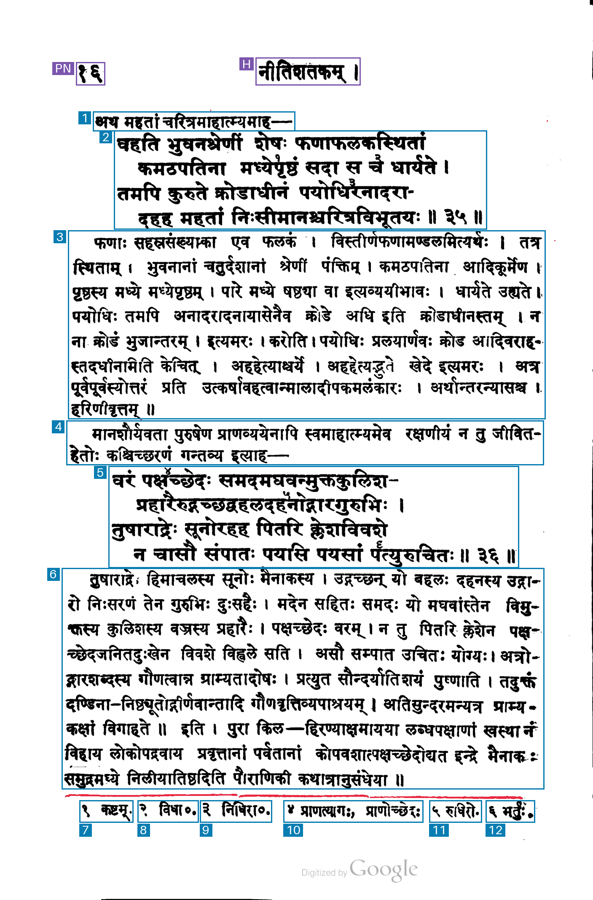


### Method 022 — GPT-6 Luna low reasoning, individual footnotes

**Method:** [022-gpt-6-luna-low-footnotes: GPT-6 Luna low reasoning, individual footnotes](methods/022-gpt-6-luna-low-footnotes/README.md).

**Input:** `kale-1913-page-017`; the unchanged PNG rendering at 300 dpi, 1407 × 2135 pixels.

**Settings:** Requested and returned model `gpt-6-luna`; reasoning effort `low`; image detail `original`; strict JSON Schema output; maximum 16,384 output tokens including reasoning; returned service tier `default`; `store=false`.

**Footnote instruction:**

> Return one region per numbered footnote, including its marker and text. Separate neighboring footnotes even when they share a printed line.

**Coordinates:** Requested [xmin,ymin,xmax,ymax] coordinates normalized to 0–1000. Converted by multiplying x by 1407 / 1000 and y by 2135 / 1000.

**Run:** 2026-11-03 15:20:44 UTC.

| Measurement | Result |
| --- | --- |
| Output boxes | 15 |
| Boxes marked keep=true | 13 |
| Regions marked uncertain | 7 |
| Footnote regions | 6 |
| API wall time | 8.62 s |
| Input tokens | 3,932 |
| Ordinary input tokens | 3 |
| Cache-write input tokens, default 30-minute lifetime | 3,929 |
| Cache-read input tokens | 0 |
| Output tokens, including reasoning | 750 |
| Reasoning tokens | 257 |
| Output tokens excluding reasoning | 493 |
| Coordinate clamping adjustments | 0 |
| Estimated paid-tier cost | $0.000866425 |

The estimated cost uses $0.1 per million ordinary input tokens, $0.125 per million default 30-minute cache-write tokens and $0.5 per million output tokens including reasoning: (3 × $0.1 + 3,929 × $0.125 + 750 × $0.5) / 1,000,000 = $0.000866425. Rates checked on 2026-11-03.

Returned region types: 2 verse, 3 commentary, 2 lead in, 6 footnote, 1 running header, 1 page number.

Six footnote boxes are returned, but several horizontal boundaries pass through notes and separate markers from their text. The final box combines notes 5 and 6, while earlier boxes split note 4. The second lead-in is split across two overlapping boxes labeled lead_in and commentary. Both verses remain whole.

Blue marks regions with `keep=true`; purple marks regions with `keep=false`. Red marks uncovered measured ink. Content numbers show returned reading order; H marks the running header and PN the page number.

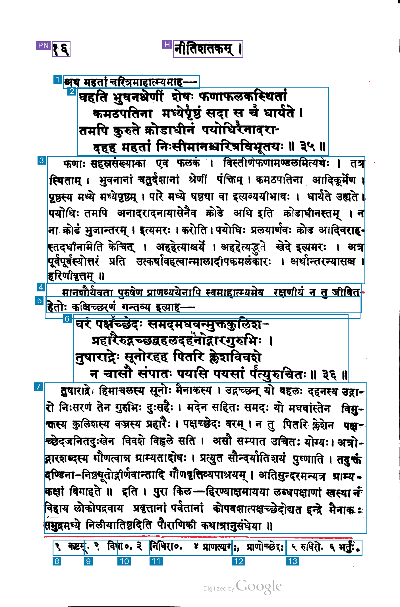


### Method 023 — GPT-6 Luna high reasoning, individual footnotes

**Method:** [023-gpt-6-luna-high-footnotes: GPT-6 Luna high reasoning, individual footnotes](methods/023-gpt-6-luna-high-footnotes/README.md).

**Input:** `kale-1913-page-017`; the unchanged PNG rendering at 300 dpi, 1407 × 2135 pixels.

**Settings:** Requested and returned model `gpt-6-luna`; reasoning effort `high`; image detail `original`; strict JSON Schema output; maximum 16,384 output tokens including reasoning; returned service tier `default`; `store=false`.

**Footnote instruction:**

> Return one region per numbered footnote, including its marker and text. Separate neighboring footnotes even when they share a printed line.

**Coordinates:** Requested [xmin,ymin,xmax,ymax] coordinates normalized to 0–1000. Converted by multiplying x by 1407 / 1000 and y by 2135 / 1000.

**Run:** 2026-11-03 15:23:37 UTC.

| Measurement | Result |
| --- | --- |
| Output boxes | 14 |
| Boxes marked keep=true | 12 |
| Regions marked uncertain | 0 |
| Footnote regions | 6 |
| API wall time | 23.31 s |
| Input tokens | 3,932 |
| Ordinary input tokens | 3 |
| Cache-write input tokens, default 30-minute lifetime | 3,929 |
| Cache-read input tokens | 0 |
| Output tokens, including reasoning | 2,646 |
| Reasoning tokens | 2,185 |
| Output tokens excluding reasoning | 461 |
| Coordinate clamping adjustments | 0 |
| Estimated paid-tier cost | $0.001814425 |

The estimated cost uses $0.1 per million ordinary input tokens, $0.125 per million default 30-minute cache-write tokens and $0.5 per million output tokens including reasoning: (3 × $0.1 + 3,929 × $0.125 + 2,646 × $0.5) / 1,000,000 = $0.001814425. Rates checked on 2026-11-03.

Returned region types: 2 verse, 2 commentary, 2 lead in, 6 footnote, 1 running header, 1 page number.

The six footnote boxes lie below the printed footnote line, over blank space. The final commentary box includes the footnote line and separator rule. The second verse box omits its first line and includes the first line of its commentary; the omitted verse line is included in the preceding lead-in box.

Blue marks regions with `keep=true`; purple marks regions with `keep=false`. Red marks uncovered measured ink. Content numbers show returned reading order; H marks the running header and PN the page number.

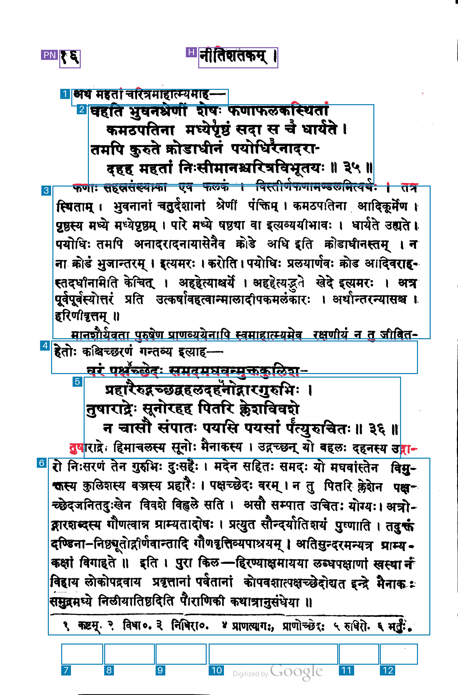

### Method 024 — Gemini 3.5 Flash-Lite low thinking, individual footnotes, native coordinates

**Method:** [024-gemini-3.5-flash-lite-low: Gemini 3.5 Flash-Lite low thinking, individual footnotes, native coordinates](methods/024-gemini-3.5-flash-lite-low/README.md).

**Input:** `kale-1913-page-017`; the unchanged PNG rendering at 300 dpi, 1407 × 2135 pixels.

**Settings:** Requested and returned model `gemini-3.5-flash-lite`; thinking level `low`; image resolution `high`; JSON Schema output; maximum 16,384 output tokens including thinking; standard service tier; `store=false`. One synchronous request, with automatic retries disabled.

**Footnote instruction:**

> Return one region per numbered footnote, including its marker and text. Separate neighboring footnotes even when they share a printed line.

**Coordinates:** Requested [ymin,xmin,ymax,xmax] integer coordinates normalized to 0–1000. Converted by reordering to [xmin,ymin,xmax,ymax], then multiplying x by 1407 / 1000 and y by 2135 / 1000. No coordinate clamping was applied.

**Run:** 2026-11-04 03:24:14 UTC; `run-001`; HTTP 200, response completed.

| Measurement | Result |
| --- | --- |
| Output boxes | 9 |
| Boxes marked keep=true | 7 |
| Regions marked uncertain | 0 |
| Footnote regions | 1 |
| API wall time | 1.94 s |
| Input tokens | 1,420 |
| Text output tokens | 378 |
| Thinking tokens | 0 |
| Output tokens, including thinking | 378 |
| Cached input tokens | 0 |
| Coordinate clamping adjustments | 0 |
| Estimated paid-tier cost | $0.001371 |

The estimated paid-tier cost uses $0.3 per million input tokens and $2.5 per million output tokens including thinking: (1,420 × $0.3 + 378 × $2.5) / 1,000,000 = $0.001371. Rates checked on 2026-11-03.

Returned region types: 2 verse, 2 commentary, 2 lead in, 1 footnote, 1 running header, 1 page number.

All six numbered footnotes share one box. The first verse box contains three of its four lines; the fourth line is included in the following commentary box. The second verse is whole. Several upper glyph tips extend beyond their box boundaries.

Blue marks regions with `keep=true`; purple marks regions with `keep=false`. Red marks uncovered measured ink. Content numbers show returned reading order; H marks the running header and PN the page number.

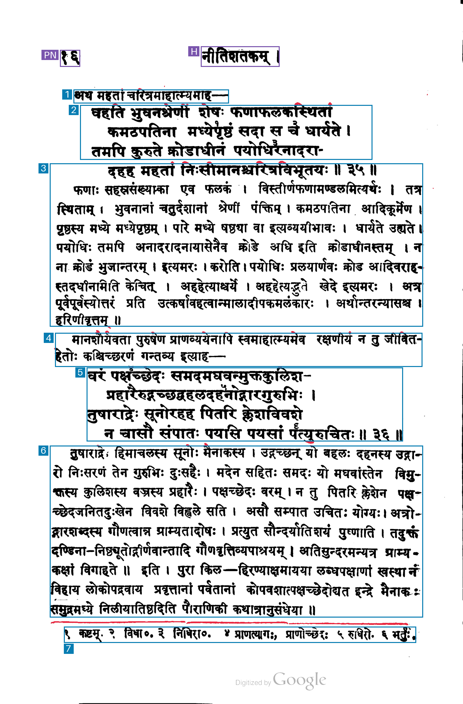


### Method 025 — GPT-6.1 Terra without reasoning, individual footnotes

**Method:** [025-gpt-6.1-terra-none-footnotes: GPT-6.1 Terra without reasoning, individual footnotes](methods/025-gpt-6.1-terra-none-footnotes/README.md).

**Input:** `kale-1913-page-017`; the unchanged PNG rendering at 300 dpi, 1407 × 2135 pixels.

**Settings:** Requested and returned model `gpt-6.1-terra`; reasoning effort `none`; image detail `original`; strict JSON Schema output; maximum 16,384 output tokens including reasoning; returned service tier `default`; `store=false`. One synchronous request, with automatic retries disabled.

**Footnote instruction:**

> Return one region per numbered footnote, including its marker and text. Separate neighboring footnotes even when they share a printed line.

**Coordinates:** Requested [xmin,ymin,xmax,ymax] integer coordinates normalized to 0–1000. Converted by multiplying x by 1407 / 1000 and y by 2135 / 1000. No coordinate clamping was applied.

**Run:** 2026-11-04 03:24:17 UTC; `run-001`; HTTP 200, response completed.

| Measurement | Result |
| --- | --- |
| Output boxes | 14 |
| Boxes marked keep=true | 12 |
| Regions marked uncertain | 0 |
| Footnote regions | 6 |
| API wall time | 8.36 s |
| Input tokens | 3,932 |
| Ordinary input tokens | 3 |
| Cache-write input tokens, default 30-minute lifetime | 3,929 |
| Cache-read input tokens | 0 |
| Output tokens, including reasoning | 459 |
| Reasoning tokens | 0 |
| Output tokens excluding reasoning | 459 |
| Coordinate clamping adjustments | 0 |
| Estimated paid-tier cost | $0.00720925 |

The estimated paid-tier cost uses $1 per million ordinary input tokens, $1.25 per million default 30-minute cache-write tokens, $0.05 per million cache-read tokens and $5 per million output tokens including reasoning: (3 × $1 + 3,929 × $1.25 + 0 × $0.05 + 459 × $5) / 1,000,000 = $0.00720925. Rates checked on 2026-11-03.

Returned region types: 2 verse, 2 commentary, 2 lead in, 6 footnote, 1 running header, 1 page number.

Each of the six numbered footnotes has a separate box containing its marker and text. Both four-line verses remain whole, with separate commentary and lead-in boxes. The API reported zero reasoning tokens.

Blue marks regions with `keep=true`; purple marks regions with `keep=false`. Red marks uncovered measured ink. Content numbers show returned reading order; H marks the running header and PN the page number.

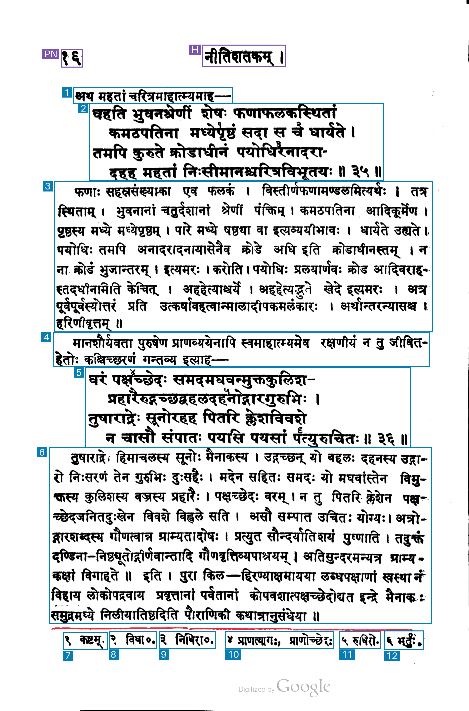


### Method 028 — Gemini 4 Argon low thinking, explicit crop padding

**Method:** [028-gemini-4-argon-low-padded-prompt](methods/028-gemini-4-argon-low-padded-prompt/README.md).

**Input:** [kale-1913-page-017](inputs/kale-1913-page-017.png); unchanged RGB rendering at 300 dpi, 1407 × 2135 pixels.

**Settings:** Requested and returned model `gemini-4-argon`; thinking level `low`; image resolution `high`; JSON Schema output; maximum 16,384 output tokens including thinking; standard service tier; `store=false`. One synchronous request with automatic retries disabled.

**Footnote instruction:**

> Return one region per numbered footnote, including its marker and text. Separate neighboring footnotes even when they share a printed line.

**Padding instruction:** The prompt explicitly requests complete glyphs, a white margin and an edge inspection before returning the boxes.

> Leave a visible white margin of at least 5 normalized x units on the left and right and 3 normalized y units above and below the outermost ink (about seven original-image pixels per axis on this page). Reduce this margin only where it would include a neighboring text block or footnote, or a separator rule. Keep each footnote separate.

**Coordinates:** Returned [ymin,xmin,ymax,xmax] integer coordinates normalized to 0–1000, mechanically reordered to [xmin,ymin,xmax,ymax] and scaled by x × 1407 / 1000 and y × 2135 / 1000. Original arrays are preserved. No coordinate clamping was applied.


**Run:** 2026-11-04 06:00:06 UTC.

| Measurement | Result |
| --- | --- |
| Output boxes | 14 |
| Boxes marked keep=true | 12 |
| Regions marked uncertain | 0 |
| Footnote regions | 6 |
| Unique text components cut by kept crop edges | 8 |
| Overlapping kept-box pairs containing text | 1 |
| Detected separator pixels inside kept boxes | 305 |
| API wall time | 8.06 s |
| Input tokens | 1,961 |
| Text output tokens | 617 |
| Thinking tokens | 0 |
| Output tokens, including thinking | 617 |
| Cached input tokens | 0 |
| Coordinate clamping adjustments | 0 |
| Estimated paid-tier API cost | $0.010092 |

The estimated paid-tier cost uses $2 per million input tokens and $10 per million output tokens including thinking: (1,961 × $2 + 617 × $10) / 1,000,000 = $0.010092. Rates checked on 2026-11-03.

The audit uses grayscale <175, speckle and margin filtering, and the same automatic thin-line separator detector for all compared results. It counts connected text components crossing individual kept crop edges, kept-box overlaps containing text-mask pixels, and detected separator pixels inside kept boxes. A cut can belong to text from a neighboring passage that enters a crop.

Returned region types: 1 page number, 1 running header, 2 lead in, 2 verse, 2 commentary, 6 footnote.

Both verses remain whole, with separate commentary, lead-ins and six footnotes. Some glyph tips still cross crop edges. One neighboring pair overlaps printed text.

The full-page overlay marks kept boxes blue and excluded page furniture purple. Red marks uncovered pixels from the method's analysis mask. The enlarged inspection marks text-mask pixels cut by individual crops in red.

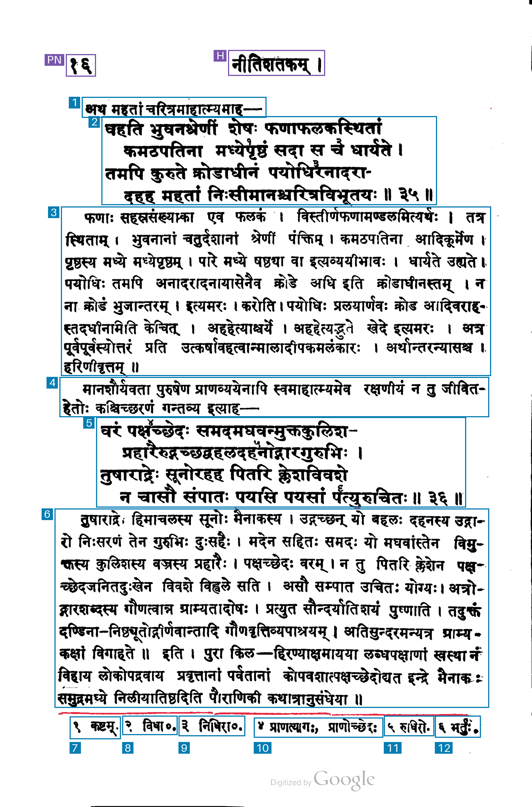

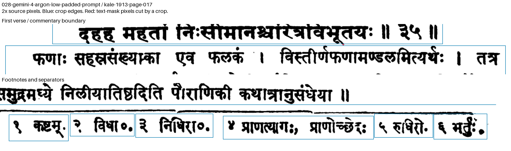


### Method 029 — Gemini 3.8 Flash low thinking, explicit crop padding

**Method:** [029-gemini-3.8-flash-low-padded-prompt](methods/029-gemini-3.8-flash-low-padded-prompt/README.md).

**Input:** [kale-1913-page-017](inputs/kale-1913-page-017.png); unchanged RGB rendering at 300 dpi, 1407 × 2135 pixels.

**Settings:** Requested and returned model `gemini-3.8-flash`; thinking level `low`; image resolution `high`; JSON Schema output; maximum 16,384 output tokens including thinking; standard service tier; `store=false`. One synchronous request with automatic retries disabled.

**Footnote instruction:**

> Return one region per numbered footnote, including its marker and text. Separate neighboring footnotes even when they share a printed line.

**Padding instruction:** The prompt explicitly requests complete glyphs, a white margin and an edge inspection before returning the boxes.

> Leave a visible white margin of at least 5 normalized x units on the left and right and 3 normalized y units above and below the outermost ink (about seven original-image pixels per axis on this page). Reduce this margin only where it would include a neighboring text block or footnote, or a separator rule. Keep each footnote separate.

**Coordinates:** Returned [ymin,xmin,ymax,xmax] integer coordinates normalized to 0–1000, mechanically reordered to [xmin,ymin,xmax,ymax] and scaled by x × 1407 / 1000 and y × 2135 / 1000. Original arrays are preserved. No coordinate clamping was applied.


**Run:** 2026-11-04 06:00:15 UTC.

| Measurement | Result |
| --- | --- |
| Output boxes | 14 |
| Boxes marked keep=true | 12 |
| Regions marked uncertain | 0 |
| Footnote regions | 6 |
| Unique text components cut by kept crop edges | 21 |
| Overlapping kept-box pairs containing text | 2 |
| Detected separator pixels inside kept boxes | 0 |
| API wall time | 5.72 s |
| Input tokens | 1,538 |
| Text output tokens | 619 |
| Thinking tokens | 0 |
| Output tokens, including thinking | 619 |
| Cached input tokens | 0 |
| Coordinate clamping adjustments | 0 |
| Estimated paid-tier API cost | $0.00347475 |

The estimated paid-tier cost uses $0.75 per million input tokens and $3.75 per million output tokens including thinking: (1,538 × $0.75 + 619 × $3.75) / 1,000,000 = $0.00347475. Rates checked on 2026-11-03.

The audit uses grayscale <175, speckle and margin filtering, and the same automatic thin-line separator detector for all compared results. It counts connected text components crossing individual kept crop edges, kept-box overlaps containing text-mask pixels, and detected separator pixels inside kept boxes. A cut can belong to text from a neighboring passage that enters a crop.

Returned region types: 1 page number, 1 running header, 2 lead in, 2 verse, 2 commentary, 6 footnote.

Both verses remain whole, with separate commentary, lead-ins and six footnotes. Upper glyph tips on the first verse and several other character edges are clipped. Two neighboring pairs overlap printed text.

The full-page overlay marks kept boxes blue and excluded page furniture purple. Red marks uncovered pixels from the method's analysis mask. The enlarged inspection marks text-mask pixels cut by individual crops in red.

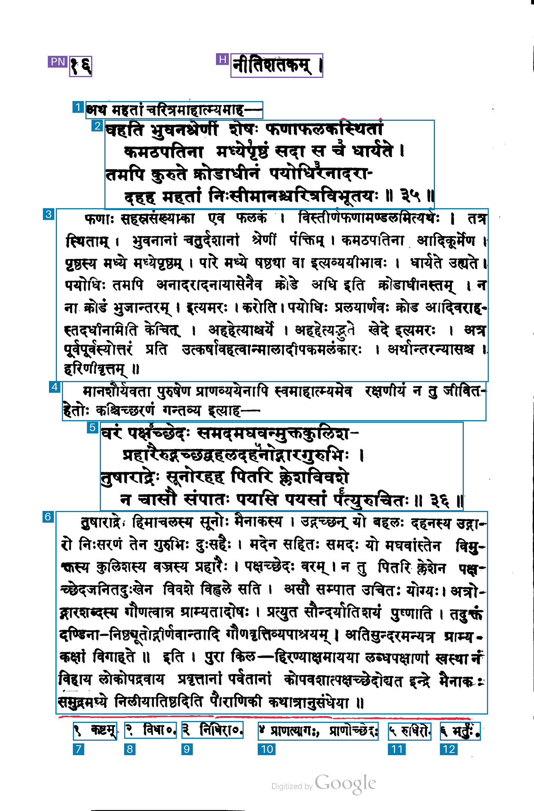

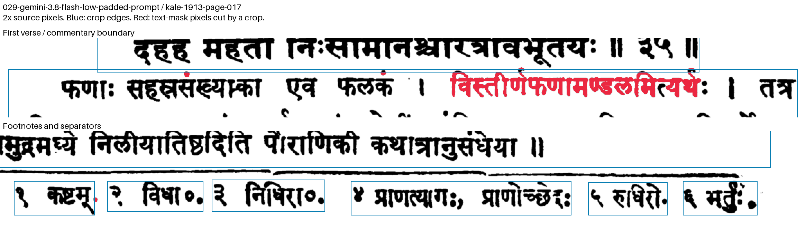


### Method 030 — Gemini 4 Argon low thinking + component completion, padding and slanted-separator handling

**Method:** [030-gemini-4-argon-low-slanted-refinement](methods/030-gemini-4-argon-low-slanted-refinement/README.md).

**Input:** [kale-1913-page-017](inputs/kale-1913-page-017.png); unchanged RGB rendering at 300 dpi, 1407 × 2135 pixels.

**Source method:** [017-gemini-4-argon-low-native](methods/017-gemini-4-argon-low-native/README.md), applied to the identical raw image.

**Settings:** Complete assigned foreground components within ceil(1.5% of width) horizontally and ceil(1.2% of height) vertically; request ceil(0.5% of width) horizontal and ceil(0.3% of height) vertical padding. Keep source region count, types, keep flags, reading order and uncertainty flags.

**Separator handling:** Detect near-straight thin components from source pixels: width at least max(80 pixels, 8% of image width), aspect ratio at least 10, height at most 5% of image height, at least 95% filled columns, median column thickness at most max(3 pixels, 0.3% of image height), maximum thickness at most twice that, absolute line slope at most 0.05 and 95th-percentile fit residual at most max(1.5 pixels, 0.15% of image height). Exclude accepted line pixels from component ownership. Limit crop edges to their local line envelope, requesting a one-pixel gap. Original whitespace and separator inclusion can be reduced while preserving owned text and all text-mask pixels originally inside each source box.

**Coordinates:** Final integer [xmin,ymin,xmax,ymax] pixel rectangles, with exclusive right and bottom edges. Original model coordinates are preserved.


**Run:** 2026-11-04 06:05:31 UTC.

| Measurement | Result |
| --- | --- |
| Output boxes | 14 |
| Boxes marked keep=true | 12 |
| Regions marked uncertain | 0 |
| Footnote regions | 6 |
| Unique text components cut by kept crop edges | 31 |
| Overlapping kept-box pairs containing text | 4 |
| Detected separator pixels inside kept boxes | 0 |
| Source text components cut by kept crop edges | 10 |
| Detected separator fragments | 3 |
| Regions constrained by separators | 6 |
| Requested padding per axis | 8 × 7 pixels |
| Ambiguous component assignments | 0 |
| Completed rectangle overlap warnings | 4 |
| Local refinement time | 0.0371 s |
| Local total before file writes | 0.2325 s |
| Additional API calls | 0 |
| Estimated source API cost | $0.009864 |
| Additional API cost | $0 |

The local step uses the saved source boxes. Its additional API cost is $0; the previously recorded source request is estimated at $0.009864.

The audit uses grayscale <175, speckle and margin filtering, and the same automatic thin-line separator detector for all compared results. It counts connected text components crossing individual kept crop edges, kept-box overlaps containing text-mask pixels, and detected separator pixels inside kept boxes. A cut can belong to text from a neighboring passage that enters a crop.

Returned region types: 1 page number, 1 running header, 2 lead in, 2 verse, 2 commentary, 6 footnote.

The detected separator stays outside every kept box, and source labels and reading order are retained. Padding extends into neighboring text at existing body-box overlaps. The audit records 31 cut text components and 4 overlaps containing text. The output retains 0 ambiguous component assignments and 4 completed-rectangle overlap warnings for inspection. Source text-mask pixels remain enclosed.

The full-page overlay marks kept boxes blue and excluded page furniture purple. Red marks uncovered pixels from the method's analysis mask. The enlarged inspection marks text-mask pixels cut by individual crops in red.

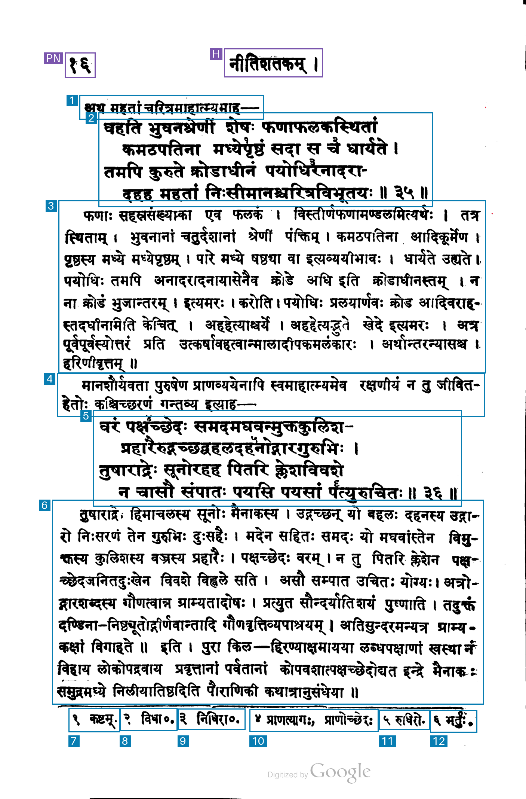

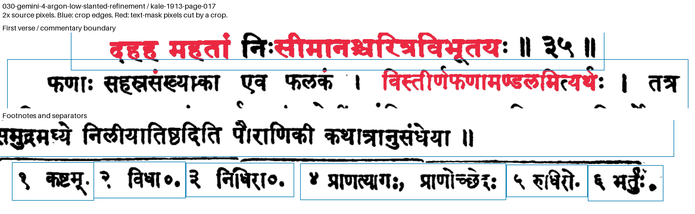


### Method 031 — Gemini 3.8 Flash low thinking + component completion, padding and slanted-separator handling

**Method:** [031-gemini-3.8-flash-low-slanted-refinement](methods/031-gemini-3.8-flash-low-slanted-refinement/README.md).

**Input:** [kale-1913-page-017](inputs/kale-1913-page-017.png); unchanged RGB rendering at 300 dpi, 1407 × 2135 pixels.

**Source method:** [018-gemini-3.8-flash-low-native](methods/018-gemini-3.8-flash-low-native/README.md), applied to the identical raw image.

**Settings:** Complete assigned foreground components within ceil(1.5% of width) horizontally and ceil(1.2% of height) vertically; request ceil(0.5% of width) horizontal and ceil(0.3% of height) vertical padding. Keep source region count, types, keep flags, reading order and uncertainty flags.

**Separator handling:** Detect near-straight thin components from source pixels: width at least max(80 pixels, 8% of image width), aspect ratio at least 10, height at most 5% of image height, at least 95% filled columns, median column thickness at most max(3 pixels, 0.3% of image height), maximum thickness at most twice that, absolute line slope at most 0.05 and 95th-percentile fit residual at most max(1.5 pixels, 0.15% of image height). Exclude accepted line pixels from component ownership. Limit crop edges to their local line envelope, requesting a one-pixel gap. Original whitespace and separator inclusion can be reduced while preserving owned text and all text-mask pixels originally inside each source box.

**Coordinates:** Final integer [xmin,ymin,xmax,ymax] pixel rectangles, with exclusive right and bottom edges. Original model coordinates are preserved.


**Run:** 2026-11-04 06:05:32 UTC.

| Measurement | Result |
| --- | --- |
| Output boxes | 14 |
| Boxes marked keep=true | 12 |
| Regions marked uncertain | 0 |
| Footnote regions | 6 |
| Unique text components cut by kept crop edges | 25 |
| Overlapping kept-box pairs containing text | 3 |
| Detected separator pixels inside kept boxes | 0 |
| Source text components cut by kept crop edges | 15 |
| Detected separator fragments | 3 |
| Regions constrained by separators | 4 |
| Requested padding per axis | 8 × 7 pixels |
| Ambiguous component assignments | 0 |
| Completed rectangle overlap warnings | 3 |
| Local refinement time | 0.0383 s |
| Local total before file writes | 0.2096 s |
| Additional API calls | 0 |
| Estimated source API cost | $0.0033975 |
| Additional API cost | $0 |

The local step uses the saved source boxes. Its additional API cost is $0; the previously recorded source request is estimated at $0.0033975.

The audit uses grayscale <175, speckle and margin filtering, and the same automatic thin-line separator detector for all compared results. It counts connected text components crossing individual kept crop edges, kept-box overlaps containing text-mask pixels, and detected separator pixels inside kept boxes. A cut can belong to text from a neighboring passage that enters a crop.

Returned region types: 1 page number, 1 running header, 2 lead in, 2 verse, 2 commentary, 6 footnote.

The detected separator stays outside every kept box, and source labels and reading order are retained. Padding extends into neighboring text at existing body-box overlaps. The audit records 25 cut text components and 3 overlaps containing text. The output retains 0 ambiguous component assignments and 3 completed-rectangle overlap warnings for inspection. Source text-mask pixels remain enclosed.

The full-page overlay marks kept boxes blue and excluded page furniture purple. Red marks uncovered pixels from the method's analysis mask. The enlarged inspection marks text-mask pixels cut by individual crops in red.

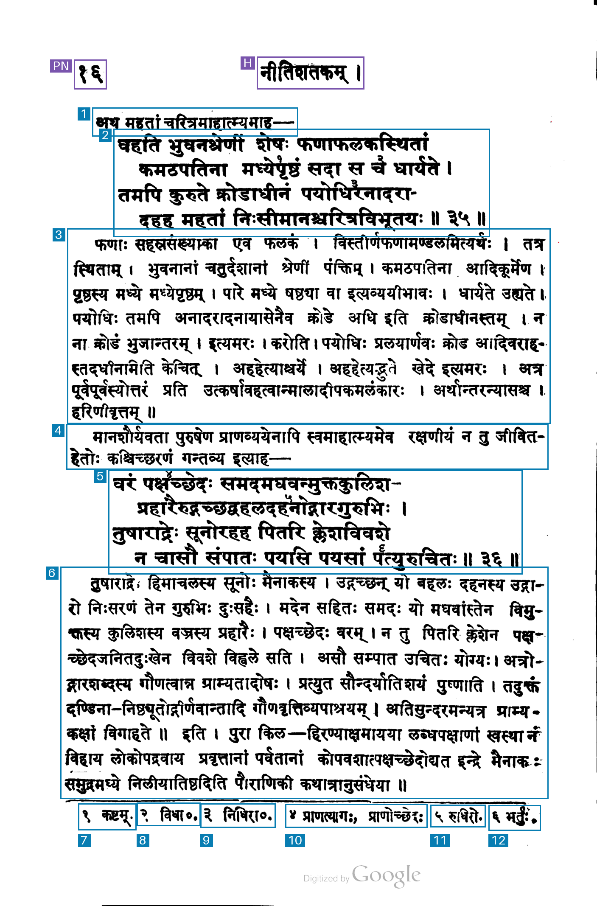

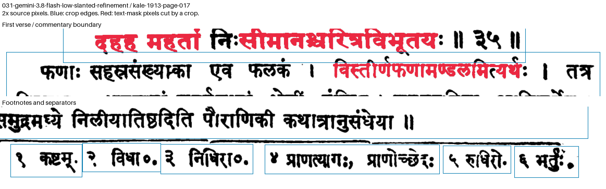


### Method 032 — Text-line skew, curvature and boundary separability

**Method:** [032-line-skew-separability](methods/032-line-skew-separability/README.md).

**Input:** [kale-1913-page-017](inputs/kale-1913-page-017.png); unchanged RGB rendering at 300 dpi, 1407 × 2135 pixels.

**Settings:** Local measurement only; no API call and no image resampling (rotations act on pixel coordinates). Hysteresis ink mask: strong ink at or below the Otsu threshold, weak ink darker than the midpoint between that threshold and white, kept when connected to strong ink; specks below max(4 px, page area × 5e-7, (0.1 × character height)²) removed; thin long components classed as rules and components taller than 3 character heights or wider than 60% of the page classed as large non-text. Page text angle by projection-profile sharpness over ±6° (0.1° then 0.01° steps). Lines from main components (0.55–2.2 character heights) split at rotated-center gaps above 0.35 character heights, with detached marks joined to the nearest line within 1.2 character heights. Per-line angle and bow from segment row-profile cross-correlation on lines at least 60% of the column width and 10 character heights long. Bow is positive when the middle of a line is higher than its ends.

Consecutive lines in a column are tested with four boundary representations: tight axis-aligned rectangles; tight rectangles at the page text angle; a straight cut at any angle within ±6°; and a per-column staircase cut. Two pixels conflict when their centers are less than one pixel apart in the tested direction.

**Run:** 2026-11-04 07:09:02 UTC.

| Measurement | Result |
| --- | --- |
| Page text angle | −0.05° |
| Character height | 40 px |
| Lines | 30, of which 21 long |
| Long-line angles, excluding line 0 | −0.19° to +0.41°, median +0.22° |
| Long-line bow, excluding line 0 | −1.0 to +4.2 px, median 2.1 px |
| Unassigned text components | 1 |
| Components touching two lines | 0 |
| Line pairs tested | 29 |
| Not separable by tight axis-aligned rectangles | 10 |
| Not separable by tight rectangles at the page angle | 10 |
| Not separable by any straight cut | 6 |
| Not separable by a staircase cut | 0 |
| API calls | 0 |

The page is essentially unrotated. Ten of 29 adjacent line pairs still cannot be separated by tight axis-aligned rectangles, and rotation does not change that count, so these conflicts come from marks above and below neighboring lines rather than skew. Every pair has a clear per-column gap.

Lines are drawn in cycling colors, rules black and unassigned text light gray. The square left of each line pair shows the most constrained representation that separates it: light gray axis-aligned rectangle, orange rectangle at the page angle, red straight cut at another angle, purple staircase only.

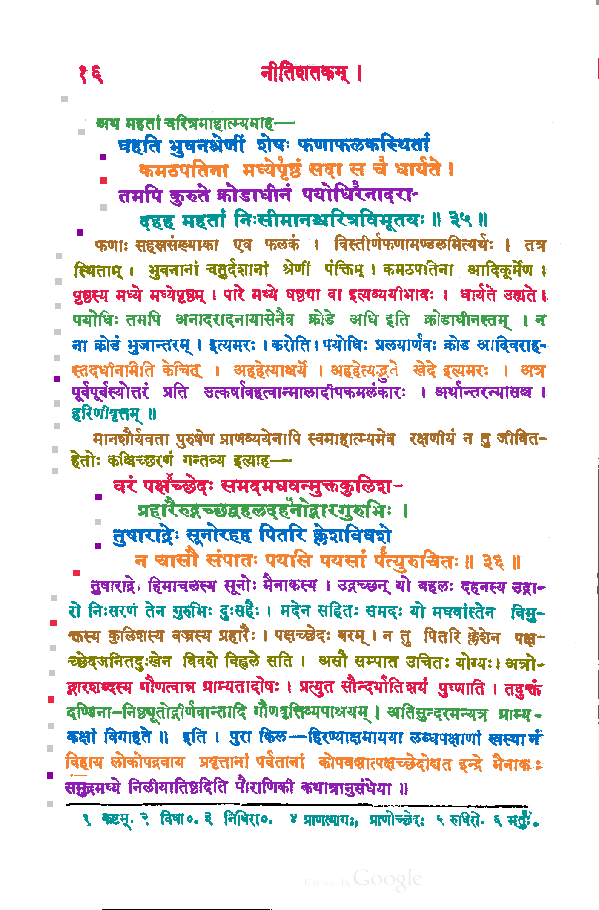


### Proposed passage reference

**Reference:** [references/kale-1913-page-017](references/kale-1913-page-017/README.md). Claude proposed it, and it has not yet been reviewed by a person. It was written from the page image and the method 032 line segmentation with line numbers drawn on it, before any method 033 or 034 output existed for this page. No API call was made.

**Input:** [kale-1913-page-017](inputs/kale-1913-page-017.png); unchanged RGB rendering at 300 dpi, 1407 × 2135 pixels.

**Built:** 2026-11-04 15:38:58 UTC with `reference.py` from [033-gpt-6.1-terra-none-line-polygons](methods/033-gpt-6.1-terra-none-line-polygons/README.md). That is method 032's builder plus split rules that can leave components unlabeled.

| Passage | Detected lines | Ink pixels |
| --- | --- | ---: |
| Page number | 0, x < 400 | 1,080 |
| Running header | 0, 400 ≤ x < 1127 | 5,456 |
| Lead-in to verse 35 | 1 | 7,442 |
| Verse 35 | 2–5 | 58,351 |
| Commentary on verse 35 | 6–13 | 111,545 |
| Lead-in to verse 36 | 14–15 | 23,575 |
| Verse 36 | 16–19 | 55,049 |
| Commentary on verse 36 | 20–28 | 148,012 |
| Footnotes 1–6 | 29, split | 12,513 |

Footnote line 29 is split at the centers of the ink-free column runs before each footnote numeral: x = 321.5, 473, 661, 1011.5 and 1148.5. The six footnotes have 1,500, 1,537, 2,176, 4,283, 1,446 and 1,571 ink pixels. The gap between प्राणत्यागः, and प्राणोच्छेदः is inside footnote 4 and is not a split.

Four scanner-edge components at x ≥ 1399 are unlabeled. Two of them had been attached to lines 0 and 27 by the line finder, and one is a tall edge strip classed as large non-text.

Each passage is shown in its own color, with separators in black.

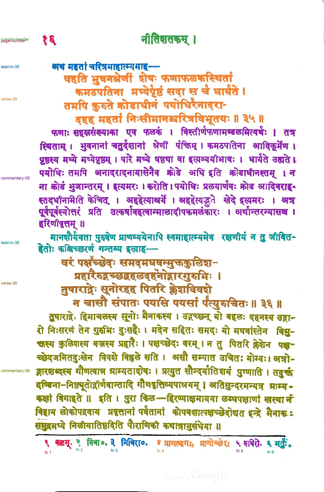

### Methods 033 and 034 — GPT-6.1 Terra without reasoning and GPT-6 Astra low reasoning + line ownership and polygon regions

**Methods:** [033-gpt-6.1-terra-none-line-polygons](methods/033-gpt-6.1-terra-none-line-polygons/README.md) and [034-gpt-6-astra-low-line-polygons](methods/034-gpt-6-astra-low-line-polygons/README.md).

**Input:** [kale-1913-page-017](inputs/kale-1913-page-017.png); unchanged RGB rendering at 300 dpi, 1407 × 2135 pixels.

**Source results:** [025 — GPT-6.1 Terra without reasoning, individual footnotes](methods/025-gpt-6.1-terra-none-footnotes/README.md) and [020 — GPT-6 Astra low reasoning, individual footnotes](methods/020-gpt-6-astra-low-footnotes/README.md). Their page-17 `regions.json` files are used unchanged; no new API call was made.

**Settings:** Local processing only. Method 032's hysteresis ink mask and line finder, copied unchanged. Each line goes whole to the model box holding the largest share of its ink, if that share is at least 25%. A box narrower than 90% of a line's extent and holding at least half of its own line ink on that line is line-local. Line-local boxes claim the components with at least half their pixels inside, smallest box first. Another box may then claim the unclaimed remainder it holds, if that is at least 25% of the line's ink. Anything left joins the claimed component with the smallest horizontal edge-to-edge gap on the line. Components more than 1 character height outside their owner's box and more than 2 character heights from the rest of their line stay unassigned. Outlines come from a nearest-ink partition, in which owned ink and separators (rules and large non-text) are sites. Each region is its cell clipped to a rectangle at the page text angle around its own ink, padded by 0.25 character heights, and lines are outlined the same way within their region. Rings are simplified with Douglas–Peucker at 1 px.

**Reference:** the proposed page-17 reference above, which has not yet been reviewed by a person.

**Run:** 2026-11-04 15:49:40 UTC (033), 15:49:46 UTC (034); reference evaluation 15:50:02 UTC.

| Measurement | Method 033 (Terra boxes) | Method 034 (Astra boxes) |
| --- | --- | --- |
| Lines: whole / split between regions / uncovered | 28 / 2 / 0 | identical |
| Outlier marks dropped | 2 scanner-edge marks, on lines 0 and 27 | identical |
| Unassigned text pixels | 251 | identical |
| Polygon vertices, all regions | 811 | identical |
| Whitespace pixels inside two adjacent outlines | 160, with no ink | identical |
| Local time: ink and lines / ownership / outlines | 0.67 s / 0.01 s / 0.56 s | similar |
| API calls | 0 | 0 |

Against the reference, summed over kept passages: other passages' ink inside each passage's matched region / own ink outside it / separator pixels inside it.

| Result | Other passages' ink | Own ink left out | Separator pixels |
| --- | ---: | ---: | ---: |
| GPT-6.1 Terra without reasoning (025), boxes as returned | 87 | 13 | 176 |
| GPT-6.1 Terra without reasoning + line ownership polygons (033) | 0 | 0 | 0 |
| GPT-6 Astra low reasoning (020), boxes as returned | 17 | 56 | 11 |
| GPT-6 Astra low reasoning + line ownership polygons (034) | 0 | 0 | 0 |

The two split lines are line 0 (page number and running header) and footnote line 29. Both models' boxes are already close on this page; the polygons remove the remaining overlaps and the footnote rule. The unassigned text is the two dropped edge marks and a speck at the top-right corner. Terra and Astra boxes lead to identical line ownership.

In the overlay, owned ink is colored by region, outlines are drawn in the region color, the original model boxes are thin gray rectangles, unassigned text ink is red and separators are black. The comparison shows the four results; red marks other passages' ink inside a passage's matched region and magenta its own ink outside.

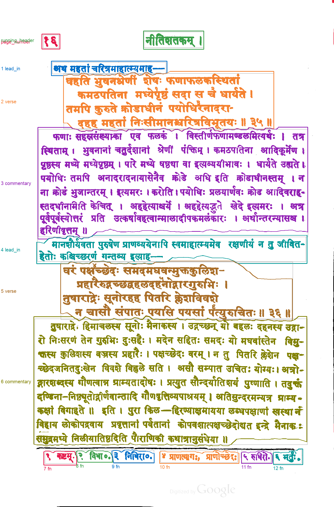

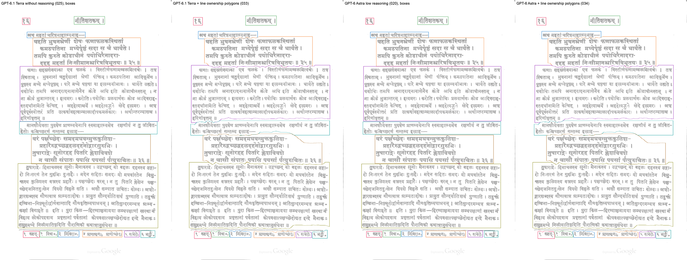

## Kale (1913), PDF page 97 / 252

### Method 017 — Gemini 4 Argon low thinking, individual footnotes, native coordinates

**Method:** [017-gemini-4-argon-low-native: Gemini 4 Argon low thinking, individual footnotes, native coordinates](methods/017-gemini-4-argon-low-native/README.md).

**Input:** [kale-1913-page-097](inputs/kale-1913-page-097.png); unannotated RGB rendering at 300 dpi, 1374 × 2114 pixels. Two four-line verses, two commentary passages, one lead-in and six numbered footnotes; the sixth footnote is printed on a second line.

**Settings:** Requested and returned model `gemini-4-argon`; thinking level `low`; image resolution `high`; JSON Schema output; maximum 16,384 output tokens including thinking; standard service tier; `store=false`. One synchronous request, with automatic retries disabled.

**Footnote instruction:**

> Return one region per numbered footnote, including its marker and text. Separate neighboring footnotes even when they share a printed line.

**Coordinates:** Requested [ymin,xmin,ymax,xmax] integer coordinates normalized to 0–1000. Converted by reordering to [xmin,ymin,xmax,ymax], then multiplying x by 1374 / 1000 and y by 2114 / 1000. No coordinate clamping was applied.

**Run:** 2026-11-04 04:28:40 UTC; HTTP 200, response completed.

| Measurement | Result |
| --- | --- |
| Output boxes | 13 |
| Boxes marked keep=true | 11 |
| Regions marked uncertain | 0 |
| Footnote regions | 6 |
| API wall time | 9.66 s |
| Input tokens | 1,801 |
| Text output tokens | 571 |
| Thinking tokens | 0 |
| Output tokens, including thinking | 571 |
| Cached input tokens | 0 |
| Coordinate clamping adjustments | 0 |
| Estimated paid-tier cost | $0.009312 |

The estimated paid-tier cost uses $2 per million input tokens and $10 per million output tokens including thinking: (1,801 × $2 + 571 × $10) / 1,000,000 = $0.009312. Rates checked on 2026-11-03.

Returned region types: 2 verse, 2 commentary, 1 lead in, 6 footnote, 1 running header, 1 page number.

Both four-line verses remain whole. The two commentary passages and the short lead-in have separate boxes. Each numbered footnote has a separate box containing its marker and text, including the sixth footnote on the second printed footnote line. Some right edges of commentary boxes are tight, with small glyph tips extending beyond them.

Blue marks regions with `keep=true`; purple marks regions with `keep=false`. Red marks uncovered measured ink. Content numbers show returned reading order; H marks the running header and PN the page number.


### Method 018 — Gemini 3.8 Flash low thinking, individual footnotes, native coordinates

**Method:** [018-gemini-3.8-flash-low-native: Gemini 3.8 Flash low thinking, individual footnotes, native coordinates](methods/018-gemini-3.8-flash-low-native/README.md).

**Input:** [kale-1913-page-097](inputs/kale-1913-page-097.png); unannotated RGB rendering at 300 dpi, 1374 × 2114 pixels. Two four-line verses, two commentary passages, one lead-in and six numbered footnotes; the sixth footnote is printed on a second line.

**Settings:** Requested and returned model `gemini-3.8-flash`; thinking level `low`; image resolution `high`; JSON Schema output; maximum 16,384 output tokens including thinking; standard service tier; `store=false`. One synchronous request, with automatic retries disabled.

**Footnote instruction:**

> Return one region per numbered footnote, including its marker and text. Separate neighboring footnotes even when they share a printed line.

**Coordinates:** Requested [ymin,xmin,ymax,xmax] integer coordinates normalized to 0–1000. Converted by reordering to [xmin,ymin,xmax,ymax], then multiplying x by 1374 / 1000 and y by 2114 / 1000. No coordinate clamping was applied.

**Run:** 2026-11-04 04:28:23 UTC; HTTP 200, response completed.

| Measurement | Result |
| --- | --- |
| Output boxes | 13 |
| Boxes marked keep=true | 11 |
| Regions marked uncertain | 0 |
| Footnote regions | 6 |
| API wall time | 5.99 s |
| Input tokens | 1,379 |
| Text output tokens | 575 |
| Thinking tokens | 0 |
| Output tokens, including thinking | 575 |
| Cached input tokens | 0 |
| Coordinate clamping adjustments | 0 |
| Estimated paid-tier cost | $0.0031905 |

The estimated paid-tier cost uses $0.75 per million input tokens and $3.75 per million output tokens including thinking: (1,379 × $0.75 + 575 × $3.75) / 1,000,000 = $0.0031905. Rates checked on 2026-11-03.

Returned region types: 2 verse, 2 commentary, 1 lead in, 6 footnote, 1 running header, 1 page number.

Both four-line verses remain whole. The two commentary passages and the short lead-in have separate boxes. Each numbered footnote has a separate box containing its marker and text; the sixth footnote is on the second printed footnote line. Several boundaries are tight, with small glyph tips outside the first verse and commentary boxes.

Blue marks regions with `keep=true`; purple marks regions with `keep=false`. Red marks uncovered measured ink. Content numbers show returned reading order; H marks the running header and PN the page number.

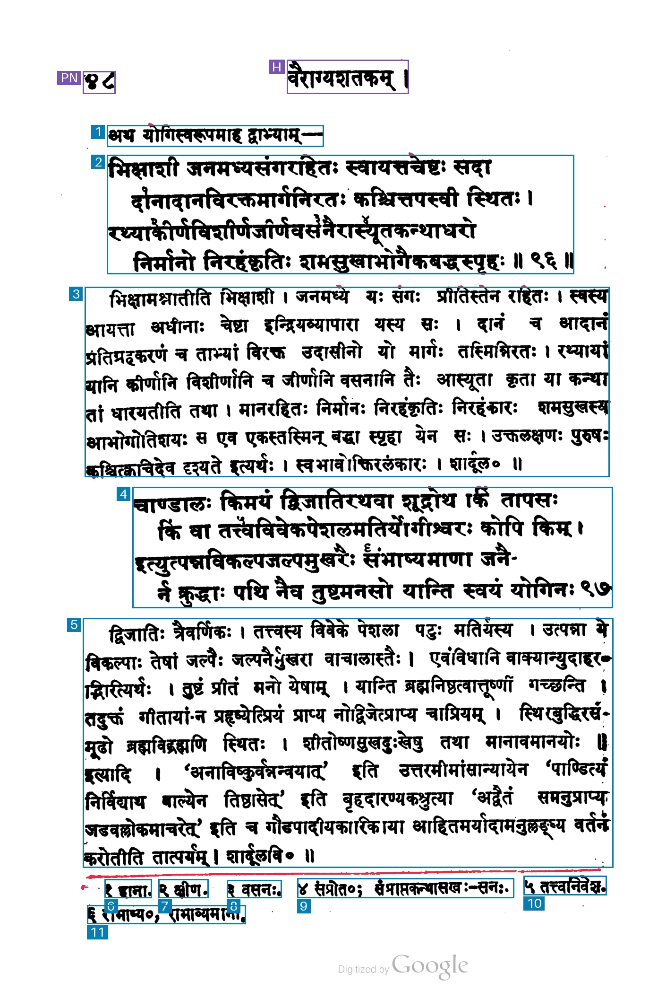


### Method 020 — GPT-6 Astra low reasoning, individual footnotes

**Method:** [020-gpt-6-astra-low-footnotes: GPT-6 Astra low reasoning, individual footnotes](methods/020-gpt-6-astra-low-footnotes/README.md).

**Input:** [kale-1913-page-097](inputs/kale-1913-page-097.png); unannotated RGB rendering at 300 dpi, 1374 × 2114 pixels. Two four-line verses, two commentary passages, one lead-in and six numbered footnotes; the sixth footnote is printed on a second line.

**Settings:** Requested and returned model `gpt-6-astra`; reasoning effort `low`; image detail `original`; strict JSON Schema output; maximum 16,384 output tokens including reasoning; returned service tier `default`; `store=false`. One synchronous request, with automatic retries disabled.

**Footnote instruction:**

> Return one region per numbered footnote, including its marker and text. Separate neighboring footnotes even when they share a printed line.

**Coordinates:** Requested [xmin,ymin,xmax,ymax] integer coordinates normalized to 0–1000. Converted by multiplying x by 1374 / 1000 and y by 2114 / 1000. No coordinate clamping was applied.

**Run:** 2026-11-04 04:28:51 UTC; HTTP 200, response completed.

| Measurement | Result |
| --- | --- |
| Output boxes | 13 |
| Boxes marked keep=true | 11 |
| Regions marked uncertain | 0 |
| Footnote regions | 6 |
| API wall time | 9.71 s |
| Input tokens | 3,852 |
| Ordinary input tokens | 3 |
| Cache-write input tokens, default 30-minute lifetime | 3,849 |
| Cache-read input tokens | 0 |
| Output tokens, including reasoning | 427 |
| Reasoning tokens | 0 |
| Output tokens excluding reasoning | 427 |
| Coordinate clamping adjustments | 0 |
| Estimated paid-tier cost | $0.0694925 |

The estimated paid-tier cost uses $10 per million ordinary input tokens, $12.5 per million default 30-minute cache-write tokens, $1 per million cache-read tokens and $50 per million output tokens including reasoning: (3 × $10 + 3,849 × $12.5 + 0 × $1 + 427 × $50) / 1,000,000 = $0.0694925. Rates checked on 2026-11-03.

Returned region types: 2 verse, 2 commentary, 1 lead in, 6 footnote, 1 running header, 1 page number.

Both four-line verses remain whole. The two commentary passages and the short lead-in have separate boxes. Each numbered footnote has a separate box containing its marker and text, including the sixth footnote on the second printed footnote line.

Blue marks regions with `keep=true`; purple marks regions with `keep=false`. Red marks uncovered measured ink. Content numbers show returned reading order; H marks the running header and PN the page number.

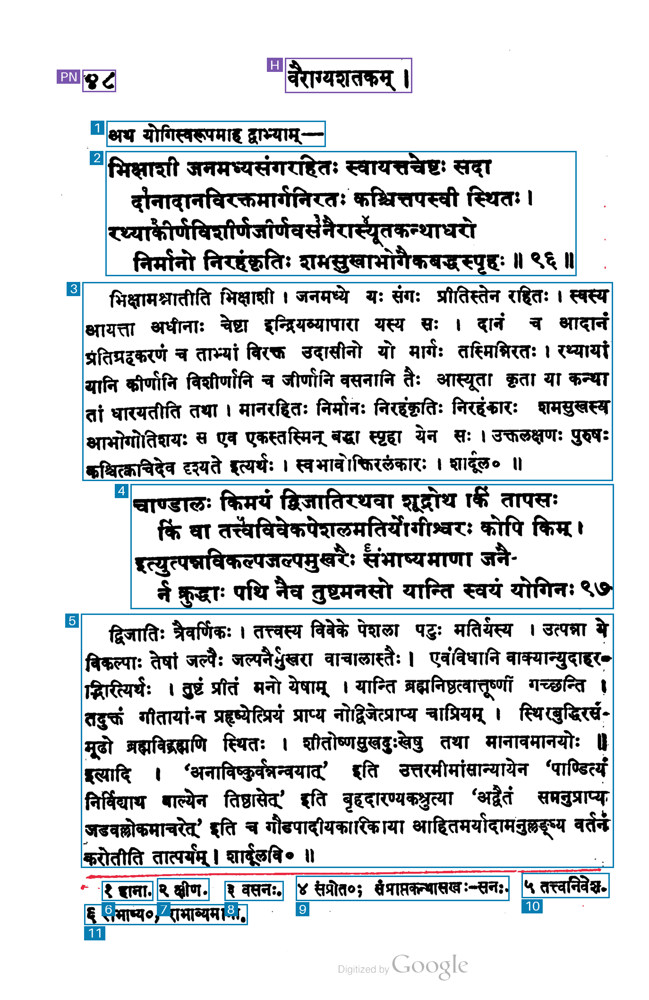
### Method 025 — GPT-6.1 Terra without reasoning, individual footnotes

**Method:** [025-gpt-6.1-terra-none-footnotes: GPT-6.1 Terra without reasoning, individual footnotes](methods/025-gpt-6.1-terra-none-footnotes/README.md).

**Input:** [kale-1913-page-097](inputs/kale-1913-page-097.png); unannotated RGB rendering at 300 dpi, 1374 × 2114 pixels. Two four-line verses, two commentary passages, one lead-in and six numbered footnotes; the sixth footnote is printed on a second line.

**Settings:** Requested and returned model `gpt-6.1-terra`; reasoning effort `none`; image detail `original`; strict JSON Schema output; maximum 16,384 output tokens including reasoning; returned service tier `default`; `store=false`. One synchronous request, with automatic retries disabled.

**Footnote instruction:**

> Return one region per numbered footnote, including its marker and text. Separate neighboring footnotes even when they share a printed line.

**Coordinates:** Requested [xmin,ymin,xmax,ymax] integer coordinates normalized to 0–1000. Converted by multiplying x by 1374 / 1000 and y by 2114 / 1000. No coordinate clamping was applied.

**Run:** 2026-11-04 04:28:30 UTC; HTTP 200, response completed.

| Measurement | Result |
| --- | --- |
| Output boxes | 13 |
| Boxes marked keep=true | 11 |
| Regions marked uncertain | 0 |
| Footnote regions | 6 |
| API wall time | 8.83 s |
| Input tokens | 3,852 |
| Ordinary input tokens | 3 |
| Cache-write input tokens, default 30-minute lifetime | 3,849 |
| Cache-read input tokens | 0 |
| Output tokens, including reasoning | 427 |
| Reasoning tokens | 0 |
| Output tokens excluding reasoning | 427 |
| Coordinate clamping adjustments | 0 |
| Estimated paid-tier cost | $0.00694925 |

The estimated paid-tier cost uses $1 per million ordinary input tokens, $1.25 per million default 30-minute cache-write tokens, $0.05 per million cache-read tokens and $5 per million output tokens including reasoning: (3 × $1 + 3,849 × $1.25 + 0 × $0.05 + 427 × $5) / 1,000,000 = $0.00694925. Rates checked on 2026-11-03.

Returned region types: 2 verse, 2 commentary, 1 lead in, 6 footnote, 1 running header, 1 page number.

Both four-line verses remain whole. The two commentary passages and the short lead-in have separate boxes. Each numbered footnote has a separate box containing its marker and text, including the sixth footnote on the second printed footnote line.

Blue marks regions with `keep=true`; purple marks regions with `keep=false`. Red marks uncovered measured ink. Content numbers show returned reading order; H marks the running header and PN the page number.

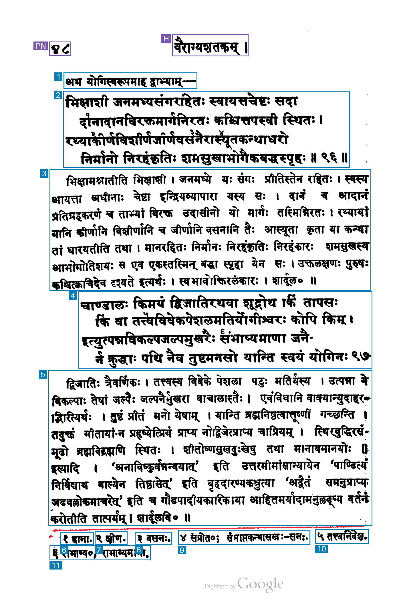

### Method 026 — Gemini 4 Argon low thinking + component completion and padding

**Method:** [026-gemini-4-argon-low-pixel-refinement](methods/026-gemini-4-argon-low-pixel-refinement/README.md).

**Input:** [kale-1913-page-097](inputs/kale-1913-page-097.png); unannotated RGB rendering at 300 dpi, 1374 × 2114 pixels.

**Source method:** [017-gemini-4-argon-low-native](methods/017-gemini-4-argon-low-native/README.md), applied to the same 1374 × 2114 raw image.

**Settings:** Local processing of saved method 017 boxes on the identical raw image. Complete foreground components assigned by greatest original-box pixel intersection; include uniquely nearest detached components within the padding distance. Limit completion to 21 pixels horizontally and 26 vertically beyond each rounded source box, then request seven pixels of padding on every side. Padding stops at image edges, detected rule rows and midpoints between neighboring completed rectangles. Preserve source region count, types, keep flags, reading order and uncertainty flags.

**Coordinates:** Original model boxes remain in the saved source record. Final boxes use integer [xmin,ymin,xmax,ymax] original-image pixels, with exclusive right and bottom edges.


**Run:** 2026-11-04 05:39:09 UTC.

| Measurement | Result |
| --- | --- |
| Output boxes | 13 |
| Boxes marked keep=true | 11 |
| Regions marked uncertain | 0 |
| Footnote regions | 6 |
| Source text components cut by crop edges, separator excluded | 19 |
| Output text components cut by crop edges, separator excluded | 0 |
| Padding requested per axis | 7 × 7 pixels |
| Component extension limit before padding | 21 pixels horizontally; 26 vertically |
| Changed boxes | 13 |
| Ambiguous component assignments | 1 |
| Overlapping completed rectangle pairs | 0 |
| Local pixel-refinement time | 0.0190 s |
| Local total before file writes, including mask and drawing | 0.1517 s |
| Additional API calls | 0 |
| Estimated source API cost | $0.009312 |
| Additional API cost | $0 |

The source API request was previously recorded at an estimated $0.009312. This run uses its saved boxes; the additional API cost is $0.

The boundary audit counts connected foreground components that cross individual kept crop edges in the grayscale <175 mask, after the existing speckle and margin filtering. Visual inspection identifies two slanted-separator components, bounded by [1096,1835,1273,1845] and [182,1839,1094,1858] in original-image pixels; these are reported separately from text-component cuts.

Returned region types: 2 verse, 2 commentary, 1 lead-in, 6 footnote, 1 running header and 1 page number.

Both four-line verses remain whole, with separate commentary and lead-in regions and six individual footnotes. The previously clipped text components are enclosed. The slanted separator survives the rule filter: one component receives a tied assignment, and parts of the separator enter the expanded final-commentary and footnote crops.

The full-page overlay marks kept boxes blue, page furniture purple and uncovered measured ink red. Reading-order labels for footnotes appear below both printed footnote lines.

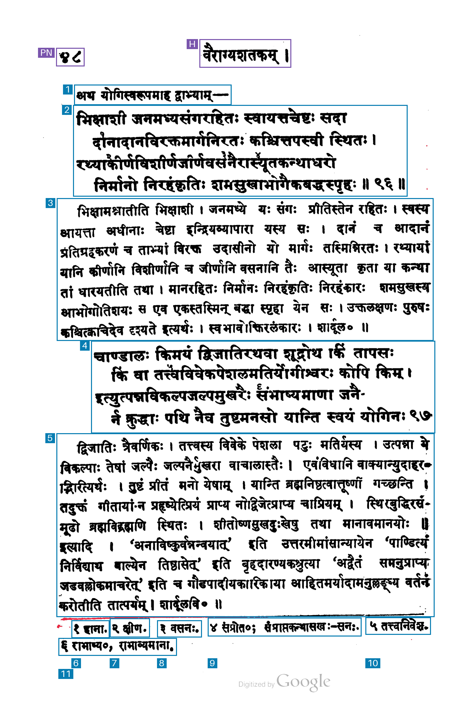

The enlarged panels show original pixels at 2× scale, crop edges in blue and clipped text-mask pixels in red.

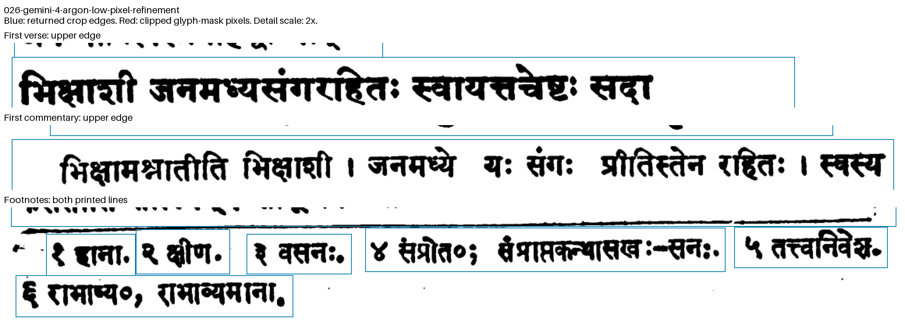


### Method 027 — Gemini 3.8 Flash low thinking + component completion and padding

**Method:** [027-gemini-3.8-flash-low-pixel-refinement](methods/027-gemini-3.8-flash-low-pixel-refinement/README.md).

**Input:** [kale-1913-page-097](inputs/kale-1913-page-097.png); unannotated RGB rendering at 300 dpi, 1374 × 2114 pixels.

**Source method:** [018-gemini-3.8-flash-low-native](methods/018-gemini-3.8-flash-low-native/README.md), applied to the same 1374 × 2114 raw image.

**Settings:** Local processing of saved method 018 boxes on the identical raw image. Complete foreground components assigned by greatest original-box pixel intersection; include uniquely nearest detached components within the padding distance. Limit completion to 21 pixels horizontally and 26 vertically beyond each rounded source box, then request seven pixels of padding on every side. Padding stops at image edges, detected rule rows and midpoints between neighboring completed rectangles. Preserve source region count, types, keep flags, reading order and uncertainty flags.

**Coordinates:** Original model boxes remain in the saved source record. Final boxes use integer [xmin,ymin,xmax,ymax] original-image pixels, with exclusive right and bottom edges.


**Run:** 2026-11-04 05:39:10 UTC.

| Measurement | Result |
| --- | --- |
| Output boxes | 13 |
| Boxes marked keep=true | 11 |
| Regions marked uncertain | 0 |
| Footnote regions | 6 |
| Source text components cut by crop edges, separator excluded | 17 |
| Output text components cut by crop edges, separator excluded | 0 |
| Padding requested per axis | 7 × 7 pixels |
| Component extension limit before padding | 21 pixels horizontally; 26 vertically |
| Changed boxes | 13 |
| Ambiguous component assignments | 1 |
| Overlapping completed rectangle pairs | 0 |
| Local pixel-refinement time | 0.0181 s |
| Local total before file writes, including mask and drawing | 0.1302 s |
| Additional API calls | 0 |
| Estimated source API cost | $0.0031905 |
| Additional API cost | $0 |

The source API request was previously recorded at an estimated $0.0031905. This run uses its saved boxes; the additional API cost is $0.

The boundary audit counts connected foreground components that cross individual kept crop edges in the grayscale <175 mask, after the existing speckle and margin filtering. Visual inspection identifies two slanted-separator components, bounded by [1096,1835,1273,1845] and [182,1839,1094,1858] in original-image pixels; these are reported separately from text-component cuts.

Returned region types: 2 verse, 2 commentary, 1 lead-in, 6 footnote, 1 running header and 1 page number.

Both four-line verses remain whole, with separate commentary and lead-in regions and six individual footnotes. The previously clipped text components are enclosed. The slanted separator survives the rule filter: one component receives a tied assignment, and parts of the separator enter the expanded final-commentary and footnote crops.

The full-page overlay marks kept boxes blue, page furniture purple and uncovered measured ink red. Reading-order labels for footnotes appear below both printed footnote lines.


The enlarged panels show original pixels at 2× scale, crop edges in blue and clipped text-mask pixels in red.

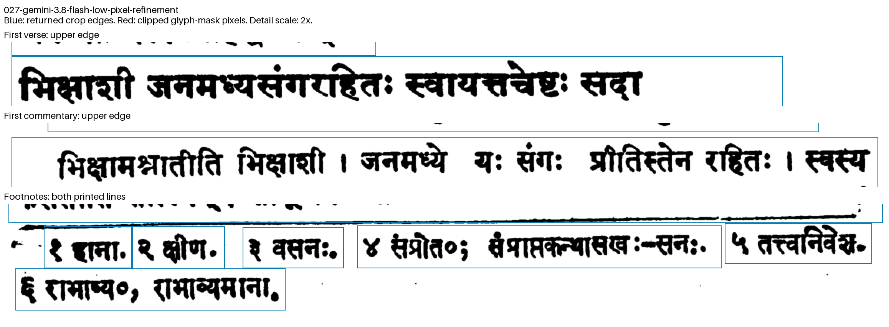


### Method 028 — Gemini 4 Argon low thinking, explicit crop padding

**Method:** [028-gemini-4-argon-low-padded-prompt](methods/028-gemini-4-argon-low-padded-prompt/README.md).

**Input:** [kale-1913-page-097](inputs/kale-1913-page-097.png); unannotated RGB rendering at 300 dpi, 1374 × 2114 pixels.

**Source method:** [017-gemini-4-argon-low-native](methods/017-gemini-4-argon-low-native/README.md). The prompt replaces its general padding instruction with the following text; model, reasoning level, image and API schema remain the same. The request contains the unannotated source image and the revised prompt.

> Include every visible glyph completely, including all diacritics, detached accents, superscripts, punctuation, upper tips and lower strokes. Never place a crop edge through printed ink.
>
> Leave a visible white margin of at least 5 normalized x units on the left and right and 3 normalized y units above and below the outermost ink (about seven original-image pixels per axis on this page). Reduce this margin only where it would include a neighboring text block or footnote, or a separator rule. Keep each footnote separate.
>
> Before returning the boxes, inspect every edge and expand any box whose edge touches or cuts a glyph. Prefer a slightly loose crop that preserves the complete glyph over a tight crop.

**Settings:** Requested and returned model `gemini-4-argon`; thinking level `low`; image resolution `high`; native [ymin,xmin,ymax,xmax] 0–1000 JSON Schema output; maximum 16,384 output tokens including thinking; standard service tier; `store=false`. One fresh synchronous request with automatic retries disabled.

**Footnote instruction:**

> Return one region per numbered footnote, including its marker and text. Separate neighboring footnotes even when they share a printed line.

**Coordinates:** Reorder returned [ymin,xmin,ymax,xmax] coordinates to [xmin,ymin,xmax,ymax], then multiply x by 1374 / 1000 and y by 2114 / 1000. Original model coordinates are preserved. No coordinate clamping was applied.


**Run:** 2026-11-04 05:39:11 UTC.

| Measurement | Result |
| --- | --- |
| Output boxes | 13 |
| Boxes marked keep=true | 11 |
| Regions marked uncertain | 0 |
| Footnote regions | 6 |
| Source text components cut by crop edges, separator excluded | 19 |
| Output text components cut by crop edges, separator excluded | 0 |
| API wall time | 9.15 s |
| Input tokens | 1,920 |
| Text output tokens | 571 |
| Thinking tokens | 0 |
| Output tokens, including thinking | 571 |
| Cached input tokens | 0 |
| Coordinate clamping adjustments | 0 |
| Estimated paid-tier API cost | $0.00955 |

The estimated paid-tier cost uses $2 per million input tokens and $10 per million output tokens including thinking: (1,920 × $2 + 571 × $10) / 1,000,000 = $0.00955. Rates checked on 2026-11-03.

The boundary audit counts connected foreground components that cross individual kept crop edges in the grayscale <175 mask, after the existing speckle and margin filtering. Visual inspection identifies two slanted-separator components, bounded by [1096,1835,1273,1845] and [182,1839,1094,1858] in original-image pixels; these are reported separately from text-component cuts.

Returned region types: 2 verse, 2 commentary, 1 lead-in, 6 footnote, 1 running header and 1 page number.

Both four-line verses remain whole, with separate commentary and lead-in regions and six individual footnotes. The boxes have visible white margins. The audit finds zero cut text components after excluding the slanted separator. Part of that separator remains inside the final commentary crop.

The full-page overlay marks kept boxes blue, page furniture purple and uncovered measured ink red. Reading-order labels for footnotes appear below both printed footnote lines.


The enlarged panels show original pixels at 2× scale, crop edges in blue and clipped text-mask pixels in red.

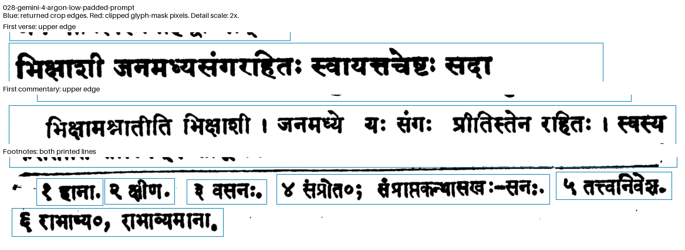


### Method 029 — Gemini 3.8 Flash low thinking, explicit crop padding

**Method:** [029-gemini-3.8-flash-low-padded-prompt](methods/029-gemini-3.8-flash-low-padded-prompt/README.md).

**Input:** [kale-1913-page-097](inputs/kale-1913-page-097.png); unannotated RGB rendering at 300 dpi, 1374 × 2114 pixels.

**Source method:** [018-gemini-3.8-flash-low-native](methods/018-gemini-3.8-flash-low-native/README.md). The prompt replaces its general padding instruction with the following text; model, reasoning level, image and API schema remain the same. The request contains the unannotated source image and the revised prompt.

> Include every visible glyph completely, including all diacritics, detached accents, superscripts, punctuation, upper tips and lower strokes. Never place a crop edge through printed ink.
>
> Leave a visible white margin of at least 5 normalized x units on the left and right and 3 normalized y units above and below the outermost ink (about seven original-image pixels per axis on this page). Reduce this margin only where it would include a neighboring text block or footnote, or a separator rule. Keep each footnote separate.
>
> Before returning the boxes, inspect every edge and expand any box whose edge touches or cuts a glyph. Prefer a slightly loose crop that preserves the complete glyph over a tight crop.

**Settings:** Requested and returned model `gemini-3.8-flash`; thinking level `low`; image resolution `high`; native [ymin,xmin,ymax,xmax] 0–1000 JSON Schema output; maximum 16,384 output tokens including thinking; standard service tier; `store=false`. One fresh synchronous request with automatic retries disabled.

**Footnote instruction:**

> Return one region per numbered footnote, including its marker and text. Separate neighboring footnotes even when they share a printed line.

**Coordinates:** Reorder returned [ymin,xmin,ymax,xmax] coordinates to [xmin,ymin,xmax,ymax], then multiply x by 1374 / 1000 and y by 2114 / 1000. Original model coordinates are preserved. No coordinate clamping was applied.


**Run:** 2026-11-04 05:39:21 UTC.

| Measurement | Result |
| --- | --- |
| Output boxes | 13 |
| Boxes marked keep=true | 11 |
| Regions marked uncertain | 0 |
| Footnote regions | 6 |
| Source text components cut by crop edges, separator excluded | 17 |
| Output text components cut by crop edges, separator excluded | 2 |
| API wall time | 5.65 s |
| Input tokens | 1,497 |
| Text output tokens | 545 |
| Thinking tokens | 0 |
| Output tokens, including thinking | 545 |
| Cached input tokens | 0 |
| Coordinate clamping adjustments | 0 |
| Estimated paid-tier API cost | $0.0031665 |

The estimated paid-tier cost uses $0.75 per million input tokens and $3.75 per million output tokens including thinking: (1,497 × $0.75 + 545 × $3.75) / 1,000,000 = $0.0031665. Rates checked on 2026-11-03.

The boundary audit counts connected foreground components that cross individual kept crop edges in the grayscale <175 mask, after the existing speckle and margin filtering. Visual inspection identifies two slanted-separator components, bounded by [1096,1835,1273,1845] and [182,1839,1094,1858] in original-image pixels; these are reported separately from text-component cuts.

Returned region types: 2 verse, 2 commentary, 1 lead-in, 6 footnote, 1 running header and 1 page number.

Both four-line verses remain whole, with separate commentary and lead-in regions and six individual footnotes. Body text has more margin than in the source result. The final punctuation of note 1 falls across the gap between its box and the box for note 2; note 3's final punctuation is also clipped. The audit records two unique cut punctuation components, intersected by three boxes. Parts of the slanted separator enter the final-commentary and footnote crops.

The full-page overlay marks kept boxes blue, page furniture purple and uncovered measured ink red. Reading-order labels for footnotes appear below both printed footnote lines.


The enlarged panels show original pixels at 2× scale, crop edges in blue and clipped text-mask pixels in red.


### Method 030 — Gemini 4 Argon low thinking + component completion, padding and slanted-separator handling

**Method:** [030-gemini-4-argon-low-slanted-refinement](methods/030-gemini-4-argon-low-slanted-refinement/README.md).

**Input:** [kale-1913-page-097](inputs/kale-1913-page-097.png); unchanged RGB rendering at 300 dpi, 1374 × 2114 pixels.

**Source method:** [017-gemini-4-argon-low-native](methods/017-gemini-4-argon-low-native/README.md), applied to the identical raw image.

**Settings:** Complete assigned foreground components within ceil(1.5% of width) horizontally and ceil(1.2% of height) vertically; request ceil(0.5% of width) horizontal and ceil(0.3% of height) vertical padding. Keep source region count, types, keep flags, reading order and uncertainty flags.

**Separator handling:** Detect near-straight thin components from source pixels: width at least max(80 pixels, 8% of image width), aspect ratio at least 10, height at most 5% of image height, at least 95% filled columns, median column thickness at most max(3 pixels, 0.3% of image height), maximum thickness at most twice that, absolute line slope at most 0.05 and 95th-percentile fit residual at most max(1.5 pixels, 0.15% of image height). Exclude accepted line pixels from component ownership. Limit crop edges to their local line envelope, requesting a one-pixel gap. Original whitespace and separator inclusion can be reduced while preserving owned text and all text-mask pixels originally inside each source box.

**Coordinates:** Final integer [xmin,ymin,xmax,ymax] pixel rectangles, with exclusive right and bottom edges. Original model coordinates are preserved.


**Run:** 2026-11-04 06:05:33 UTC.

| Measurement | Result |
| --- | --- |
| Output boxes | 13 |
| Boxes marked keep=true | 11 |
| Regions marked uncertain | 0 |
| Footnote regions | 6 |
| Unique text components cut by kept crop edges | 0 |
| Overlapping kept-box pairs containing text | 0 |
| Detected separator pixels inside kept boxes | 0 |
| Source text components cut by kept crop edges | 19 |
| Detected separator fragments | 2 |
| Regions constrained by separators | 4 |
| Requested padding per axis | 7 × 7 pixels |
| Ambiguous component assignments | 0 |
| Completed rectangle overlap warnings | 0 |
| Local refinement time | 0.0335 s |
| Local total before file writes | 0.2031 s |
| Additional API calls | 0 |
| Estimated source API cost | $0.009312 |
| Additional API cost | $0 |

The local step uses the saved source boxes. Its additional API cost is $0; the previously recorded source request is estimated at $0.009312.

The audit uses grayscale <175, speckle and margin filtering, and the same automatic thin-line separator detector for all compared results. It counts connected text components crossing individual kept crop edges, kept-box overlaps containing text-mask pixels, and detected separator pixels inside kept boxes. A cut can belong to text from a neighboring passage that enters a crop.

Returned region types: 1 page number, 1 running header, 1 lead in, 2 verse, 2 commentary, 6 footnote.

Both verses, commentary passages and the lead-in retain their source grouping; each of the six footnotes remains separate. The detected separator stays outside every kept box. The audit records zero cut text components and zero overlaps containing text. Component assignments and completed rectangles produce zero ambiguity or overlap warnings.

The full-page overlay marks kept boxes blue and excluded page furniture purple. Red marks uncovered pixels from the method's analysis mask. The enlarged inspection marks text-mask pixels cut by individual crops in red.


### Method 031 — Gemini 3.8 Flash low thinking + component completion, padding and slanted-separator handling

**Method:** [031-gemini-3.8-flash-low-slanted-refinement](methods/031-gemini-3.8-flash-low-slanted-refinement/README.md).

**Input:** [kale-1913-page-097](inputs/kale-1913-page-097.png); unchanged RGB rendering at 300 dpi, 1374 × 2114 pixels.

**Source method:** [018-gemini-3.8-flash-low-native](methods/018-gemini-3.8-flash-low-native/README.md), applied to the identical raw image.

**Settings:** Complete assigned foreground components within ceil(1.5% of width) horizontally and ceil(1.2% of height) vertically; request ceil(0.5% of width) horizontal and ceil(0.3% of height) vertical padding. Keep source region count, types, keep flags, reading order and uncertainty flags.

**Separator handling:** Detect near-straight thin components from source pixels: width at least max(80 pixels, 8% of image width), aspect ratio at least 10, height at most 5% of image height, at least 95% filled columns, median column thickness at most max(3 pixels, 0.3% of image height), maximum thickness at most twice that, absolute line slope at most 0.05 and 95th-percentile fit residual at most max(1.5 pixels, 0.15% of image height). Exclude accepted line pixels from component ownership. Limit crop edges to their local line envelope, requesting a one-pixel gap. Original whitespace and separator inclusion can be reduced while preserving owned text and all text-mask pixels originally inside each source box.

**Coordinates:** Final integer [xmin,ymin,xmax,ymax] pixel rectangles, with exclusive right and bottom edges. Original model coordinates are preserved.


**Run:** 2026-11-04 06:05:33 UTC.

| Measurement | Result |
| --- | --- |
| Output boxes | 13 |
| Boxes marked keep=true | 11 |
| Regions marked uncertain | 0 |
| Footnote regions | 6 |
| Unique text components cut by kept crop edges | 0 |
| Overlapping kept-box pairs containing text | 0 |
| Detected separator pixels inside kept boxes | 0 |
| Source text components cut by kept crop edges | 17 |
| Detected separator fragments | 2 |
| Regions constrained by separators | 5 |
| Requested padding per axis | 7 × 7 pixels |
| Ambiguous component assignments | 0 |
| Completed rectangle overlap warnings | 0 |
| Local refinement time | 0.0361 s |
| Local total before file writes | 0.2225 s |
| Additional API calls | 0 |
| Estimated source API cost | $0.0031905 |
| Additional API cost | $0 |

The local step uses the saved source boxes. Its additional API cost is $0; the previously recorded source request is estimated at $0.0031905.

The audit uses grayscale <175, speckle and margin filtering, and the same automatic thin-line separator detector for all compared results. It counts connected text components crossing individual kept crop edges, kept-box overlaps containing text-mask pixels, and detected separator pixels inside kept boxes. A cut can belong to text from a neighboring passage that enters a crop.

Returned region types: 1 page number, 1 running header, 1 lead in, 2 verse, 2 commentary, 6 footnote.

Both verses, commentary passages and the lead-in retain their source grouping; each of the six footnotes remains separate. The detected separator stays outside every kept box. The audit records zero cut text components and zero overlaps containing text. Component assignments and completed rectangles produce zero ambiguity or overlap warnings.

The full-page overlay marks kept boxes blue and excluded page furniture purple. Red marks uncovered pixels from the method's analysis mask. The enlarged inspection marks text-mask pixels cut by individual crops in red.


### Method 032 — Text-line skew, curvature and boundary separability

**Method:** [032-line-skew-separability](methods/032-line-skew-separability/README.md).

**Input:** [kale-1913-page-097](inputs/kale-1913-page-097.png); unchanged RGB rendering at 300 dpi, 1374 × 2114 pixels.

**Settings:** Local measurement only; no API call and no image resampling (rotations act on pixel coordinates). Hysteresis ink mask: strong ink at or below the Otsu threshold, weak ink darker than the midpoint between that threshold and white, kept when connected to strong ink; specks below max(4 px, page area × 5e-7, (0.1 × character height)²) removed; thin long components classed as rules and components taller than 3 character heights or wider than 60% of the page classed as large non-text. Page text angle by projection-profile sharpness over ±6° (0.1° then 0.01° steps). Lines from main components (0.55–2.2 character heights) split at rotated-center gaps above 0.35 character heights, with detached marks joined to the nearest line within 1.2 character heights. Per-line angle and bow from segment row-profile cross-correlation on lines at least 60% of the column width and 10 character heights long. Bow is positive when the middle of a line is higher than its ends.

Consecutive lines in a column are tested with four boundary representations: tight axis-aligned rectangles; tight rectangles at the page text angle; a straight cut at any angle within ±6°; and a per-column staircase cut. Two pixels conflict when their centers are less than one pixel apart in the tested direction.

**Run:** 2026-11-04 07:09:03 UTC.

| Measurement | Result |
| --- | --- |
| Page text angle | −0.57° |
| Character height | 43 px |
| Lines | 28, of which 25 long |
| Long-line angles, excluding line 0 | −0.94° to −0.36°, median −0.63° |
| Long-line bow, excluding line 0 | −0.5 to +3.3 px, median 1.9 px |
| Detected rule angle | −1.21° (the slanted footnote rule) |
| Unassigned text components | 0 |
| Components touching two lines | 0 |
| Line pairs tested | 27 |
| Not separable by tight axis-aligned rectangles | 8 |
| Not separable by tight rectangles at the page angle | 5 |
| Not separable by any straight cut | 2 |
| Not separable by a staircase cut | 0 |
| API calls | 0 |

Text lines are rotated by about −0.6°, while the detected footnote rule is at −1.21°, so the rule angle is not a good estimate of the text angle on this page. Rotating rectangles to the page angle reduces non-separable line pairs from 8 to 5 of 27.

Lines are drawn in cycling colors, rules black and unassigned text light gray. The square left of each line pair shows the most constrained representation that separates it: light gray axis-aligned rectangle, orange rectangle at the page angle, red straight cut at another angle, purple staircase only.


### Proposed passage reference

**Reference:** [references/kale-1913-page-097](references/kale-1913-page-097/README.md). Claude proposed it, and it has not yet been reviewed by a person. It was written from the page image and the method 032 line segmentation with line numbers drawn on it, before any method 033 or 034 output existed for this page. No API call was made.

**Input:** [kale-1913-page-097](inputs/kale-1913-page-097.png); unchanged RGB rendering at 300 dpi, 1374 × 2114 pixels.

**Built:** 2026-11-04 15:39:00 UTC with `reference.py` from [033-gpt-6.1-terra-none-line-polygons](methods/033-gpt-6.1-terra-none-line-polygons/README.md). That is method 032's builder plus split rules that can leave components unlabeled.

| Passage | Detected lines | Ink pixels |
| --- | --- | ---: |
| Page number | 0, x < 400 | 1,099 |
| Running header | 0, x ≥ 400 | 5,698 |
| Lead-in to verses 96–97 | 1 | 7,864 |
| Verse 96 | 2–5 | 71,923 |
| Commentary on verse 96 | 6–12 | 112,440 |
| Verse 97 | 13–16 | 71,748 |
| Commentary on verse 97 | 17–25 | 149,986 |
| Footnotes 1–5 | 26, split | 14,259 |
| Footnote 6 | 27 | 5,081 |

Footnote line 26 is split at the centers of the ink-free column runs before each footnote numeral: x = 329, 459.5, 613 and 1093.5. The five footnotes have 1,513, 1,587, 1,636, 6,553 and 2,970 ink pixels. The gap between संप्रोत०; and संप्राप्तकन्थासखः is inside footnote 4 and is not a split.

A 93-pixel smudge left of footnote numeral १ (x 171–187) is unlabeled. The slanted footnote separator is labeled separator.

Each passage is shown in its own color, with separators in black.


### Methods 033 and 034 — GPT-6.1 Terra without reasoning and GPT-6 Astra low reasoning + line ownership and polygon regions

**Methods:** [033-gpt-6.1-terra-none-line-polygons](methods/033-gpt-6.1-terra-none-line-polygons/README.md) and [034-gpt-6-astra-low-line-polygons](methods/034-gpt-6-astra-low-line-polygons/README.md).

**Input:** [kale-1913-page-097](inputs/kale-1913-page-097.png); unchanged RGB rendering at 300 dpi, 1374 × 2114 pixels.

**Source results:** [025 — GPT-6.1 Terra without reasoning, individual footnotes](methods/025-gpt-6.1-terra-none-footnotes/README.md) and [020 — GPT-6 Astra low reasoning, individual footnotes](methods/020-gpt-6-astra-low-footnotes/README.md). Their page-97 `regions.json` files are used unchanged; no new API call was made.

**Settings:** Local processing only. Method 032's hysteresis ink mask and line finder, copied unchanged. Each line goes whole to the model box holding the largest share of its ink, if that share is at least 25%. A box narrower than 90% of a line's extent and holding at least half of its own line ink on that line is line-local. Line-local boxes claim the components with at least half their pixels inside, smallest box first. Another box may then claim the unclaimed remainder it holds, if that is at least 25% of the line's ink. Anything left joins the claimed component with the smallest horizontal edge-to-edge gap on the line. Components more than 1 character height outside their owner's box and more than 2 character heights from the rest of their line stay unassigned. Outlines come from a nearest-ink partition, in which owned ink and separators (rules and large non-text) are sites. Each region is its cell clipped to a rectangle at the page text angle around its own ink, padded by 0.25 character heights, and lines are outlined the same way within their region. Rings are simplified with Douglas–Peucker at 1 px.

**Reference:** the proposed page-97 reference above, which has not yet been reviewed by a person.

**Run:** 2026-11-04 15:49:42 UTC (033), 15:49:48 UTC (034); reference evaluation 15:50:03 UTC.

| Measurement | Method 033 (Terra boxes) | Method 034 (Astra boxes) |
| --- | --- | --- |
| Lines: whole / split between regions / uncovered | 26 / 2 / 0 | identical |
| Outlier marks dropped | 0 | identical |
| Unassigned text pixels | 0 | identical |
| Polygon vertices, all regions | 533 | identical |
| Whitespace pixels inside two adjacent outlines | 88, with no ink | identical |
| Local time: ink and lines / ownership / outlines | 0.64 s / 0.01 s / 0.51 s | similar |
| API calls | 0 | 0 |

Against the reference, summed over kept passages: other passages' ink inside each passage's matched region / own ink outside it / separator pixels inside it.

| Result | Other passages' ink | Own ink left out | Separator pixels |
| --- | ---: | ---: | ---: |
| GPT-6.1 Terra without reasoning (025), boxes as returned | 0 | 0 | 44 |
| GPT-6.1 Terra without reasoning + line ownership polygons (033) | 0 | 0 | 0 |
| GPT-6 Astra low reasoning (020), boxes as returned | 0 | 0 | 1 |
| GPT-6 Astra low reasoning + line ownership polygons (034) | 0 | 0 | 0 |

Both models' boxes already separate every passage on this page; the only remaining issue was separator pixels inside boxes, which the polygons exclude. The split lines are line 0 and footnote line 26; footnote 6 has line 27 to itself. Terra and Astra boxes lead to identical line ownership.


## Kale (1913), PDF page 113 / 252


### Method 017 — Gemini 4 Argon low thinking, individual footnotes, native coordinates

**Method:** [017-gemini-4-argon-low-native](methods/017-gemini-4-argon-low-native/README.md).

**Input:** [kale-1913-page-113](inputs/kale-1913-page-113.png); unchanged RGB rendering at 300 dpi, 1370 × 2118 pixels.

**Settings:** Requested and returned model `gemini-4-argon`; thinking level `low`; image resolution `high`; JSON Schema output; maximum 16,384 output tokens including thinking; standard service tier; `store=false`. One synchronous request with automatic retries disabled.

**Footnote instruction:**

> Return one region per numbered footnote, including its marker and text. Separate neighboring footnotes even when they share a printed line.

**Coordinates:** Returned [ymin,xmin,ymax,xmax] integer coordinates normalized to 0–1000, mechanically reordered to [xmin,ymin,xmax,ymax] and scaled by x × 1370 / 1000 and y × 2118 / 1000. Original arrays are preserved. No coordinate clamping was applied.


**Run:** 2026-11-04 06:00:22 UTC.

| Measurement | Result |
| --- | --- |
| Output boxes | 14 |
| Boxes marked keep=true | 12 |
| Regions marked uncertain | 0 |
| Footnote regions | 6 |
| Unique text components cut by kept crop edges | 45 |
| Overlapping kept-box pairs containing text | 5 |
| Detected separator pixels inside kept boxes | 1953 |
| API wall time | 7.42 s |
| Input tokens | 1,801 |
| Text output tokens | 612 |
| Thinking tokens | 0 |
| Output tokens, including thinking | 612 |
| Cached input tokens | 0 |
| Coordinate clamping adjustments | 0 |
| Estimated paid-tier API cost | $0.009722 |

The estimated paid-tier cost uses $2 per million input tokens and $10 per million output tokens including thinking: (1,801 × $2 + 612 × $10) / 1,000,000 = $0.009722. Rates checked on 2026-11-03.

The audit uses grayscale <175, speckle and margin filtering, and the same automatic thin-line separator detector for all compared results. It counts connected text components crossing individual kept crop edges, kept-box overlaps containing text-mask pixels, and detected separator pixels inside kept boxes. A cut can belong to text from a neighboring passage that enters a crop.

Returned region types: 1 page number, 1 running header, 3 verse, 3 commentary, 6 footnote.

Three four-line verse groups, three commentary passages and six individual footnotes are returned. Neighboring body boxes overlap at five transitions, with text in each intersection. Several crop edges pass through upper or lower glyph parts. The audit records 45 cut text components.

The full-page overlay marks kept boxes blue and excluded page furniture purple. Red marks uncovered pixels from the method's analysis mask. The enlarged inspection marks text-mask pixels cut by individual crops in red.


### Method 018 — Gemini 3.8 Flash low thinking, individual footnotes, native coordinates

**Method:** [018-gemini-3.8-flash-low-native](methods/018-gemini-3.8-flash-low-native/README.md).

**Input:** [kale-1913-page-113](inputs/kale-1913-page-113.png); unchanged RGB rendering at 300 dpi, 1370 × 2118 pixels.

**Settings:** Requested and returned model `gemini-3.8-flash`; thinking level `low`; image resolution `high`; JSON Schema output; maximum 16,384 output tokens including thinking; standard service tier; `store=false`. One synchronous request with automatic retries disabled.

**Footnote instruction:**

> Return one region per numbered footnote, including its marker and text. Separate neighboring footnotes even when they share a printed line.

**Coordinates:** Returned [ymin,xmin,ymax,xmax] integer coordinates normalized to 0–1000, mechanically reordered to [xmin,ymin,xmax,ymax] and scaled by x × 1370 / 1000 and y × 2118 / 1000. Original arrays are preserved. No coordinate clamping was applied.


**Run:** 2026-11-04 06:00:30 UTC.

| Measurement | Result |
| --- | --- |
| Output boxes | 14 |
| Boxes marked keep=true | 12 |
| Regions marked uncertain | 0 |
| Footnote regions | 6 |
| Unique text components cut by kept crop edges | 63 |
| Overlapping kept-box pairs containing text | 5 |
| Detected separator pixels inside kept boxes | 337 |
| API wall time | 5.90 s |
| Input tokens | 1,379 |
| Text output tokens | 602 |
| Thinking tokens | 0 |
| Output tokens, including thinking | 602 |
| Cached input tokens | 0 |
| Coordinate clamping adjustments | 0 |
| Estimated paid-tier API cost | $0.00329175 |

The estimated paid-tier cost uses $0.75 per million input tokens and $3.75 per million output tokens including thinking: (1,379 × $0.75 + 602 × $3.75) / 1,000,000 = $0.00329175. Rates checked on 2026-11-03.

The audit uses grayscale <175, speckle and margin filtering, and the same automatic thin-line separator detector for all compared results. It counts connected text components crossing individual kept crop edges, kept-box overlaps containing text-mask pixels, and detected separator pixels inside kept boxes. A cut can belong to text from a neighboring passage that enters a crop.

Returned region types: 1 page number, 1 running header, 3 verse, 3 commentary, 6 footnote.

Three four-line verse groups, three commentary passages and six individual footnotes are returned. Neighboring body boxes overlap at five transitions, with text in each intersection. Several crop edges pass through upper or lower glyph parts. The audit records 63 cut text components.

The full-page overlay marks kept boxes blue and excluded page furniture purple. Red marks uncovered pixels from the method's analysis mask. The enlarged inspection marks text-mask pixels cut by individual crops in red.


### Method 020 — GPT-6 Astra low reasoning, individual footnotes

**Method:** [020-gpt-6-astra-low-footnotes](methods/020-gpt-6-astra-low-footnotes/README.md).

**Input:** [kale-1913-page-113](inputs/kale-1913-page-113.png); unchanged RGB rendering at 300 dpi, 1370 × 2118 pixels.

**Settings:** Requested and returned model `gpt-6-astra`; reasoning effort `low`; image detail `original`; strict JSON Schema output; maximum 16,384 output tokens including reasoning; returned service tier `default`; `store=false`. One synchronous request with automatic retries disabled.

**Footnote instruction:**

> Return one region per numbered footnote, including its marker and text. Separate neighboring footnotes even when they share a printed line.

**Coordinates:** Returned [xmin,ymin,xmax,ymax] integer coordinates normalized to 0–1000, scaled by x × 1370 / 1000 and y × 2118 / 1000. Original arrays are preserved. No coordinate clamping was applied.


**Run:** 2026-11-04 05:59:23 UTC.

| Measurement | Result |
| --- | --- |
| Output boxes | 14 |
| Boxes marked keep=true | 12 |
| Regions marked uncertain | 0 |
| Footnote regions | 6 |
| Unique text components cut by kept crop edges | 33 |
| Overlapping kept-box pairs containing text | 5 |
| Detected separator pixels inside kept boxes | 479 |
| API wall time | 11.94 s |
| Input tokens | 3,852 |
| Ordinary input tokens | 3 |
| Cache-write input tokens, default 30-minute lifetime | 3,849 |
| Cache-read input tokens | 0 |
| Output tokens, including reasoning | 458 |
| Reasoning tokens | 0 |
| Coordinate clamping adjustments | 0 |
| Estimated paid-tier API cost | $0.0710425 |

The estimated paid-tier cost uses $10 per million ordinary input tokens, $12.5 per million default 30-minute cache-write tokens, $1 per million cache-read tokens and $50 per million output tokens including reasoning: (3 × $10 + 3,849 × $12.5 + 0 × $1 + 458 × $50) / 1,000,000 = $0.0710425. Rates checked on 2026-11-03.

The audit uses grayscale <175, speckle and margin filtering, and the same automatic thin-line separator detector for all compared results. It counts connected text components crossing individual kept crop edges, kept-box overlaps containing text-mask pixels, and detected separator pixels inside kept boxes. A cut can belong to text from a neighboring passage that enters a crop.

Returned region types: 1 page number, 1 running header, 3 verse, 3 commentary, 6 footnote.

Three four-line verse groups, three commentary passages and six individual footnotes are returned. Neighboring body boxes overlap at five transitions, with text in each intersection. Several crop edges pass through upper or lower glyph parts. The audit records 33 cut text components.

The full-page overlay marks kept boxes blue and excluded page furniture purple. Red marks uncovered pixels from the method's analysis mask. The enlarged inspection marks text-mask pixels cut by individual crops in red.


### Method 025 — GPT-6.1 Terra without reasoning, individual footnotes

**Method:** [025-gpt-6.1-terra-none-footnotes](methods/025-gpt-6.1-terra-none-footnotes/README.md).

**Input:** [kale-1913-page-113](inputs/kale-1913-page-113.png); unchanged RGB rendering at 300 dpi, 1370 × 2118 pixels.

**Settings:** Requested and returned model `gpt-6.1-terra`; reasoning effort `none`; image detail `original`; strict JSON Schema output; maximum 16,384 output tokens including reasoning; returned service tier `default`; `store=false`. One synchronous request with automatic retries disabled.

**Footnote instruction:**

> Return one region per numbered footnote, including its marker and text. Separate neighboring footnotes even when they share a printed line.

**Coordinates:** Returned [xmin,ymin,xmax,ymax] integer coordinates normalized to 0–1000, scaled by x × 1370 / 1000 and y × 2118 / 1000. Original arrays are preserved. No coordinate clamping was applied.


**Run:** 2026-11-04 05:59:36 UTC.

| Measurement | Result |
| --- | --- |
| Output boxes | 14 |
| Boxes marked keep=true | 12 |
| Regions marked uncertain | 0 |
| Footnote regions | 6 |
| Unique text components cut by kept crop edges | 24 |
| Overlapping kept-box pairs containing text | 5 |
| Detected separator pixels inside kept boxes | 368 |
| API wall time | 7.00 s |
| Input tokens | 3,852 |
| Ordinary input tokens | 3 |
| Cache-write input tokens, default 30-minute lifetime | 3,849 |
| Cache-read input tokens | 0 |
| Output tokens, including reasoning | 458 |
| Reasoning tokens | 0 |
| Coordinate clamping adjustments | 0 |
| Estimated paid-tier API cost | $0.00710425 |

The estimated paid-tier cost uses $1 per million ordinary input tokens, $1.25 per million default 30-minute cache-write tokens, $0.05 per million cache-read tokens and $5 per million output tokens including reasoning: (3 × $1 + 3,849 × $1.25 + 0 × $0.05 + 458 × $5) / 1,000,000 = $0.00710425. Rates checked on 2026-11-03.

The audit uses grayscale <175, speckle and margin filtering, and the same automatic thin-line separator detector for all compared results. It counts connected text components crossing individual kept crop edges, kept-box overlaps containing text-mask pixels, and detected separator pixels inside kept boxes. A cut can belong to text from a neighboring passage that enters a crop.

Returned region types: 1 page number, 1 running header, 3 verse, 3 commentary, 6 footnote.

Three four-line verse groups, three commentary passages and six individual footnotes are returned. Neighboring body boxes overlap at five transitions, with text in each intersection. Several crop edges pass through upper or lower glyph parts. The audit records 24 cut text components.

The full-page overlay marks kept boxes blue and excluded page furniture purple. Red marks uncovered pixels from the method's analysis mask. The enlarged inspection marks text-mask pixels cut by individual crops in red.


### Method 028 — Gemini 4 Argon low thinking, explicit crop padding

**Method:** [028-gemini-4-argon-low-padded-prompt](methods/028-gemini-4-argon-low-padded-prompt/README.md).

**Input:** [kale-1913-page-113](inputs/kale-1913-page-113.png); unchanged RGB rendering at 300 dpi, 1370 × 2118 pixels.

**Settings:** Requested and returned model `gemini-4-argon`; thinking level `low`; image resolution `high`; JSON Schema output; maximum 16,384 output tokens including thinking; standard service tier; `store=false`. One synchronous request with automatic retries disabled.

**Footnote instruction:**

> Return one region per numbered footnote, including its marker and text. Separate neighboring footnotes even when they share a printed line.

**Padding instruction:** The prompt explicitly requests complete glyphs, a white margin and an edge inspection before returning the boxes.

> Leave a visible white margin of at least 5 normalized x units on the left and right and 3 normalized y units above and below the outermost ink (about seven original-image pixels per axis on this page). Reduce this margin only where it would include a neighboring text block or footnote, or a separator rule. Keep each footnote separate.

**Coordinates:** Returned [ymin,xmin,ymax,xmax] integer coordinates normalized to 0–1000, mechanically reordered to [xmin,ymin,xmax,ymax] and scaled by x × 1370 / 1000 and y × 2118 / 1000. Original arrays are preserved. No coordinate clamping was applied.


**Run:** 2026-11-04 05:59:44 UTC.

| Measurement | Result |
| --- | --- |
| Output boxes | 14 |
| Boxes marked keep=true | 12 |
| Regions marked uncertain | 0 |
| Footnote regions | 6 |
| Unique text components cut by kept crop edges | 53 |
| Overlapping kept-box pairs containing text | 5 |
| Detected separator pixels inside kept boxes | 2161 |
| API wall time | 12.82 s |
| Input tokens | 1,920 |
| Text output tokens | 614 |
| Thinking tokens | 0 |
| Output tokens, including thinking | 614 |
| Cached input tokens | 0 |
| Coordinate clamping adjustments | 0 |
| Estimated paid-tier API cost | $0.00998 |

The estimated paid-tier cost uses $2 per million input tokens and $10 per million output tokens including thinking: (1,920 × $2 + 614 × $10) / 1,000,000 = $0.00998. Rates checked on 2026-11-03.

The audit uses grayscale <175, speckle and margin filtering, and the same automatic thin-line separator detector for all compared results. It counts connected text components crossing individual kept crop edges, kept-box overlaps containing text-mask pixels, and detected separator pixels inside kept boxes. A cut can belong to text from a neighboring passage that enters a crop.

Returned region types: 1 page number, 1 running header, 3 verse, 3 commentary, 6 footnote.

Three four-line verse groups, three commentary passages and six individual footnotes are returned. Neighboring body boxes overlap at five transitions, with text in each intersection. Several crop edges pass through upper or lower glyph parts. The audit records 53 cut text components.

The full-page overlay marks kept boxes blue and excluded page furniture purple. Red marks uncovered pixels from the method's analysis mask. The enlarged inspection marks text-mask pixels cut by individual crops in red.


### Method 029 — Gemini 3.8 Flash low thinking, explicit crop padding

**Method:** [029-gemini-3.8-flash-low-padded-prompt](methods/029-gemini-3.8-flash-low-padded-prompt/README.md).

**Input:** [kale-1913-page-113](inputs/kale-1913-page-113.png); unchanged RGB rendering at 300 dpi, 1370 × 2118 pixels.

**Settings:** Requested and returned model `gemini-3.8-flash`; thinking level `low`; image resolution `high`; JSON Schema output; maximum 16,384 output tokens including thinking; standard service tier; `store=false`. One synchronous request with automatic retries disabled.

**Footnote instruction:**

> Return one region per numbered footnote, including its marker and text. Separate neighboring footnotes even when they share a printed line.

**Padding instruction:** The prompt explicitly requests complete glyphs, a white margin and an edge inspection before returning the boxes.

> Leave a visible white margin of at least 5 normalized x units on the left and right and 3 normalized y units above and below the outermost ink (about seven original-image pixels per axis on this page). Reduce this margin only where it would include a neighboring text block or footnote, or a separator rule. Keep each footnote separate.

**Coordinates:** Returned [ymin,xmin,ymax,xmax] integer coordinates normalized to 0–1000, mechanically reordered to [xmin,ymin,xmax,ymax] and scaled by x × 1370 / 1000 and y × 2118 / 1000. Original arrays are preserved. No coordinate clamping was applied.


**Run:** 2026-11-04 05:59:58 UTC.

| Measurement | Result |
| --- | --- |
| Output boxes | 14 |
| Boxes marked keep=true | 12 |
| Regions marked uncertain | 0 |
| Footnote regions | 6 |
| Unique text components cut by kept crop edges | 35 |
| Overlapping kept-box pairs containing text | 5 |
| Detected separator pixels inside kept boxes | 0 |
| API wall time | 6.27 s |
| Input tokens | 1,497 |
| Text output tokens | 604 |
| Thinking tokens | 0 |
| Output tokens, including thinking | 604 |
| Cached input tokens | 0 |
| Coordinate clamping adjustments | 0 |
| Estimated paid-tier API cost | $0.00338775 |

The estimated paid-tier cost uses $0.75 per million input tokens and $3.75 per million output tokens including thinking: (1,497 × $0.75 + 604 × $3.75) / 1,000,000 = $0.00338775. Rates checked on 2026-11-03.

The audit uses grayscale <175, speckle and margin filtering, and the same automatic thin-line separator detector for all compared results. It counts connected text components crossing individual kept crop edges, kept-box overlaps containing text-mask pixels, and detected separator pixels inside kept boxes. A cut can belong to text from a neighboring passage that enters a crop.

Returned region types: 1 page number, 1 running header, 3 verse, 3 commentary, 6 footnote.

Three four-line verse groups, three commentary passages and six individual footnotes are returned. Neighboring body boxes overlap at five transitions, with text in each intersection. Several crop edges pass through upper or lower glyph parts. The audit records 35 cut text components.

The full-page overlay marks kept boxes blue and excluded page furniture purple. Red marks uncovered pixels from the method's analysis mask. The enlarged inspection marks text-mask pixels cut by individual crops in red.


### Method 030 — Gemini 4 Argon low thinking + component completion, padding and slanted-separator handling

**Method:** [030-gemini-4-argon-low-slanted-refinement](methods/030-gemini-4-argon-low-slanted-refinement/README.md).

**Input:** [kale-1913-page-113](inputs/kale-1913-page-113.png); unchanged RGB rendering at 300 dpi, 1370 × 2118 pixels.

**Source method:** [017-gemini-4-argon-low-native](methods/017-gemini-4-argon-low-native/README.md), applied to the identical raw image.

**Settings:** Complete assigned foreground components within ceil(1.5% of width) horizontally and ceil(1.2% of height) vertically; request ceil(0.5% of width) horizontal and ceil(0.3% of height) vertical padding. Keep source region count, types, keep flags, reading order and uncertainty flags.

**Separator handling:** Detect near-straight thin components from source pixels: width at least max(80 pixels, 8% of image width), aspect ratio at least 10, height at most 5% of image height, at least 95% filled columns, median column thickness at most max(3 pixels, 0.3% of image height), maximum thickness at most twice that, absolute line slope at most 0.05 and 95th-percentile fit residual at most max(1.5 pixels, 0.15% of image height). Exclude accepted line pixels from component ownership. Limit crop edges to their local line envelope, requesting a one-pixel gap. Original whitespace and separator inclusion can be reduced while preserving owned text and all text-mask pixels originally inside each source box.

**Coordinates:** Final integer [xmin,ymin,xmax,ymax] pixel rectangles, with exclusive right and bottom edges. Original model coordinates are preserved.


**Run:** 2026-11-04 06:05:34 UTC.

| Measurement | Result |
| --- | --- |
| Output boxes | 14 |
| Boxes marked keep=true | 12 |
| Regions marked uncertain | 0 |
| Footnote regions | 6 |
| Unique text components cut by kept crop edges | 88 |
| Overlapping kept-box pairs containing text | 5 |
| Detected separator pixels inside kept boxes | 0 |
| Source text components cut by kept crop edges | 45 |
| Detected separator fragments | 2 |
| Regions constrained by separators | 6 |
| Requested padding per axis | 7 × 7 pixels |
| Ambiguous component assignments | 4 |
| Completed rectangle overlap warnings | 5 |
| Local refinement time | 0.0367 s |
| Local total before file writes | 0.1748 s |
| Additional API calls | 0 |
| Estimated source API cost | $0.009722 |
| Additional API cost | $0 |

The local step uses the saved source boxes. Its additional API cost is $0; the previously recorded source request is estimated at $0.009722.

The audit uses grayscale <175, speckle and margin filtering, and the same automatic thin-line separator detector for all compared results. It counts connected text components crossing individual kept crop edges, kept-box overlaps containing text-mask pixels, and detected separator pixels inside kept boxes. A cut can belong to text from a neighboring passage that enters a crop.

Returned region types: 1 page number, 1 running header, 3 verse, 3 commentary, 6 footnote.

The detected separator stays outside every kept box, and source labels and reading order are retained. Padding extends into neighboring text at existing body-box overlaps. The audit records 88 cut text components and 5 overlaps containing text. The output retains 4 ambiguous component assignments and 5 completed-rectangle overlap warnings for inspection. Source text-mask pixels remain enclosed.

The full-page overlay marks kept boxes blue and excluded page furniture purple. Red marks uncovered pixels from the method's analysis mask. The enlarged inspection marks text-mask pixels cut by individual crops in red.


### Method 031 — Gemini 3.8 Flash low thinking + component completion, padding and slanted-separator handling

**Method:** [031-gemini-3.8-flash-low-slanted-refinement](methods/031-gemini-3.8-flash-low-slanted-refinement/README.md).

**Input:** [kale-1913-page-113](inputs/kale-1913-page-113.png); unchanged RGB rendering at 300 dpi, 1370 × 2118 pixels.

**Source method:** [018-gemini-3.8-flash-low-native](methods/018-gemini-3.8-flash-low-native/README.md), applied to the identical raw image.

**Settings:** Complete assigned foreground components within ceil(1.5% of width) horizontally and ceil(1.2% of height) vertically; request ceil(0.5% of width) horizontal and ceil(0.3% of height) vertical padding. Keep source region count, types, keep flags, reading order and uncertainty flags.

**Separator handling:** Detect near-straight thin components from source pixels: width at least max(80 pixels, 8% of image width), aspect ratio at least 10, height at most 5% of image height, at least 95% filled columns, median column thickness at most max(3 pixels, 0.3% of image height), maximum thickness at most twice that, absolute line slope at most 0.05 and 95th-percentile fit residual at most max(1.5 pixels, 0.15% of image height). Exclude accepted line pixels from component ownership. Limit crop edges to their local line envelope, requesting a one-pixel gap. Original whitespace and separator inclusion can be reduced while preserving owned text and all text-mask pixels originally inside each source box.

**Coordinates:** Final integer [xmin,ymin,xmax,ymax] pixel rectangles, with exclusive right and bottom edges. Original model coordinates are preserved.


**Run:** 2026-11-04 06:05:35 UTC.

| Measurement | Result |
| --- | --- |
| Output boxes | 14 |
| Boxes marked keep=true | 12 |
| Regions marked uncertain | 0 |
| Footnote regions | 6 |
| Unique text components cut by kept crop edges | 119 |
| Overlapping kept-box pairs containing text | 5 |
| Detected separator pixels inside kept boxes | 0 |
| Source text components cut by kept crop edges | 63 |
| Detected separator fragments | 2 |
| Regions constrained by separators | 7 |
| Requested padding per axis | 7 × 7 pixels |
| Ambiguous component assignments | 10 |
| Completed rectangle overlap warnings | 5 |
| Local refinement time | 0.0363 s |
| Local total before file writes | 0.1823 s |
| Additional API calls | 0 |
| Estimated source API cost | $0.00329175 |
| Additional API cost | $0 |

The local step uses the saved source boxes. Its additional API cost is $0; the previously recorded source request is estimated at $0.00329175.

The audit uses grayscale <175, speckle and margin filtering, and the same automatic thin-line separator detector for all compared results. It counts connected text components crossing individual kept crop edges, kept-box overlaps containing text-mask pixels, and detected separator pixels inside kept boxes. A cut can belong to text from a neighboring passage that enters a crop.

Returned region types: 1 page number, 1 running header, 3 verse, 3 commentary, 6 footnote.

The detected separator stays outside every kept box, and source labels and reading order are retained. Padding extends into neighboring text at existing body-box overlaps. The audit records 119 cut text components and 5 overlaps containing text. The output retains 10 ambiguous component assignments and 5 completed-rectangle overlap warnings for inspection. Source text-mask pixels remain enclosed.

The full-page overlay marks kept boxes blue and excluded page furniture purple. Red marks uncovered pixels from the method's analysis mask. The enlarged inspection marks text-mask pixels cut by individual crops in red.


### Method 032 — Text-line skew, curvature and boundary separability

**Method:** [032-line-skew-separability](methods/032-line-skew-separability/README.md).

**Input:** [kale-1913-page-113](inputs/kale-1913-page-113.png); unchanged RGB rendering at 300 dpi, 1370 × 2118 pixels.

**Settings:** Local measurement only; no API call and no image resampling (rotations act on pixel coordinates). Hysteresis ink mask: strong ink at or below the Otsu threshold, weak ink darker than the midpoint between that threshold and white, kept when connected to strong ink; specks below max(4 px, page area × 5e-7, (0.1 × character height)²) removed; thin long components classed as rules and components taller than 3 character heights or wider than 60% of the page classed as large non-text. Page text angle by projection-profile sharpness over ±6° (0.1° then 0.01° steps). Lines from main components (0.55–2.2 character heights) split at rotated-center gaps above 0.35 character heights, with detached marks joined to the nearest line within 1.2 character heights. Per-line angle and bow from segment row-profile cross-correlation on lines at least 60% of the column width and 10 character heights long. Bow is positive when the middle of a line is higher than its ends.

Consecutive lines in a column are tested with four boundary representations: tight axis-aligned rectangles; tight rectangles at the page text angle; a straight cut at any angle within ±6°; and a per-column staircase cut. Two pixels conflict when their centers are less than one pixel apart in the tested direction.

**Run:** 2026-11-04 07:09:04 UTC.

| Measurement | Result |
| --- | --- |
| Page text angle | −1.43° |
| Character height | 40 px |
| Lines | 30, of which 27 long |
| Long-line angles, excluding line 0 | −1.69° to −1.14°, median −1.46° |
| Long-line bow, excluding line 0 | +0.4 to +4.1 px, median 2.2 px |
| Detected short centered rule angle | −1.09° |
| Unassigned text components | 3 (two dots and the dark mark at the bottom edge) |
| Components touching two lines | 0 |
| Line pairs tested | 29 |
| Not separable by tight axis-aligned rectangles | 26 |
| Not separable by tight rectangles at the page angle | 17 |
| Not separable by any straight cut | 12 |
| Not separable by a staircase cut | 0 |
| Smallest per-column gap between adjacent lines | 4 px |
| API calls | 0 |

Text lines are rotated by about −1.4°, steeper than the separator angles previously measured (−1.19° for the long rule, −1.09° for the short rule). Lines also bend slightly: in commentary 42 the leftmost segment of each line sits about 4–6 px lower than the rest of the line, and on other long lines about 2.5 px or less. Only 3 of 29 adjacent line pairs can be separated by tight axis-aligned rectangles; rectangles at the page angle separate 12. Every pair has a clear per-column gap of at least 4 px, so the inter-line whitespace exists but is not straight. Line 0 combines the page number with the running header; its fitted angle (−2.18°) and bow (13 px) are not a real line shape.

Lines are drawn in cycling colors, rules black and unassigned text light gray. The square left of each line pair shows the most constrained representation that separates it: light gray axis-aligned rectangle, orange rectangle at the page angle, red straight cut at another angle, purple staircase only.


### Method 032 — Text-line skew, curvature and boundary separability: passage boundaries against a proposed reference

**Method:** [032-line-skew-separability](methods/032-line-skew-separability/README.md), `evaluate.py`.

**Input:** [kale-1913-page-113](inputs/kale-1913-page-113.png); unchanged RGB rendering at 300 dpi, 1370 × 2118 pixels.

**Reference:** [references/kale-1913-page-113](references/kale-1913-page-113/README.md), a component-level passage assignment proposed by Claude from the method 032 lines and not yet human-reviewed at the time of this run. It labels page number, running header, verses 42–44, three commentary passages, footnotes 1–6 and two rules.

**Review, 2026-11-04, after this run:** The user inspected `review.png` and confirmed that every label is correct. The reference files and the numbers below are unchanged.

**Saved results compared:** [020 — GPT-6 Astra low reasoning, individual footnotes](methods/020-gpt-6-astra-low-footnotes/README.md) and [025 — GPT-6.1 Terra without reasoning, individual footnotes](methods/025-gpt-6.1-terra-none-footnotes/README.md), page-113 `regions.json` unchanged; no new API call.

**Settings:** For each kept passage, other passages' ink inside the tight rectangle around all its own ink, for axis-aligned rectangles, rectangles at the page text angle (−1.43°) and the best single angle per passage (0.05° steps within ±6°). For each adjacent pair, the four separability tests and the best placement of one shared edge with the other edges tight, scored as own ink left out plus other ink included. Model boxes are scored the same way, overall and at each boundary.

**Run:** 2026-11-04 07:09 UTC.

| Measurement | Result |
| --- | --- |
| Other passages' ink inside tight axis-aligned rectangles, summed over 12 kept passages | 3,966 px |
| The same at the page text angle | 614 px |
| The same at the best single angle per passage | 283 px |
| GPT-6.1 Terra without reasoning: other passages' ink inside its boxes | 3,053 px |
| GPT-6.1 Terra without reasoning: own ink left outside its boxes | 210 px |
| GPT-6.1 Terra without reasoning: separator pixels inside its boxes | 378 px |
| GPT-6 Astra low reasoning: other passages' ink inside its boxes | 3,930 px |
| GPT-6 Astra low reasoning: own ink left outside its boxes | 94 px |
| GPT-6 Astra low reasoning: separator pixels inside its boxes | 491 px |
| Passages without a matching box, either result | 0 |
| API calls | 0 |

Best single-edge cost, in pixels of own ink left out plus other ink included. Each pair of numbers is the upper box's bottom edge, then the lower box's top edge.

| Boundary | Best axis-aligned | Best at page angle | GPT-6.1 Terra without reasoning | GPT-6 Astra low reasoning | Straight cut at any angle | Smallest per-column gap |
| --- | --- | --- | --- | --- | --- | ---: |
| verse 42 / commentary 42 | 522 / 564 | 67 / 67 | 601 / 1,141 | 1,644 / 905 | no, −5.8 px margin | 10 px |
| commentary 42 / verse 43 | 172 / 60 | 0 / 0 | 334 / 84 | 243 / 60 | yes | 15 px |
| verse 43 / commentary 43 | 0 / 0 | 19 / 19 | 36 / 173 | 7 / 337 | yes, 1.0 px margin | 7 px |
| commentary 43 / verse 44 | 46 / 24 | 0 / 0 | 201 / 50 | 66 / 25 | yes | 12 px |
| verse 44 / commentary 44 | 182 / 258 | 10 / 10 | 342 / 301 | 217 / 520 | no, 0.85 px margin | 13 px |

Commentary 44 / footnotes and all five boundaries between neighboring footnotes are separable by tight axis-aligned rectangles.

Four of the five verse/commentary boundaries cannot be drawn with axis-aligned rectangles without some ink of the neighboring passage, whatever the coordinates. Rectangles at the page angle remove about 85% of the unavoidable inclusion and make two of those four boundaries clean; verse 42 / commentary 42 and verse 44 / commentary 44 still need a non-straight boundary. Verse 43 / commentary 43 is separable by axis-aligned rectangles, yet both models' commentary-43 boxes include verse-43 ink: 173 px for GPT-6.1 Terra without reasoning and 337 px for GPT-6 Astra low reasoning. At the other boundaries the model edges cost between 1.0 and 4.4 times the best achievable axis-aligned edge.

The first image shows tight axis-aligned rectangles (left) and tight rectangles at the page angle (right), with other passages' ink inside them in red. The boundary image compares tight axis-aligned rectangles, rectangles at the page angle and both saved results at 2x source pixels: red marks the other passage's ink inside a box, magenta a box's own ink outside it.


### Methods 033 and 034 — GPT-6.1 Terra without reasoning and GPT-6 Astra low reasoning + line ownership and polygon regions

**Methods:** [033-gpt-6.1-terra-none-line-polygons](methods/033-gpt-6.1-terra-none-line-polygons/README.md) and [034-gpt-6-astra-low-line-polygons](methods/034-gpt-6-astra-low-line-polygons/README.md).

**Input:** [kale-1913-page-113](inputs/kale-1913-page-113.png); unchanged RGB rendering at 300 dpi, 1370 × 2118 pixels.

**Source results:** [025 — GPT-6.1 Terra without reasoning, individual footnotes](methods/025-gpt-6.1-terra-none-footnotes/README.md) and [020 — GPT-6 Astra low reasoning, individual footnotes](methods/020-gpt-6-astra-low-footnotes/README.md). Their page-113 `regions.json` files are used unchanged; no new API call was made.

**Settings:** Local processing only. Method 032's hysteresis ink mask and line finder, copied unchanged. Each line goes whole to the model box holding the largest share of its ink, if that share is at least 25%. A box narrower than 90% of a line's extent and holding at least half of its own line ink on that line is line-local. Line-local boxes claim the components with at least half their pixels inside, smallest box first. Another box may then claim the unclaimed remainder it holds, if that is at least 25% of the line's ink. Anything left joins the claimed component with the smallest horizontal edge-to-edge gap on the line. Components more than 1 character height outside their owner's box and more than 2 character heights from the rest of their line stay unassigned. Outlines come from a nearest-ink partition, in which owned ink and separators (rules and large non-text) are sites. Each region is its cell clipped to a rectangle at the page text angle around its own ink, padded by 0.25 character heights, and lines are outlined the same way within their region. Rings are simplified with Douglas–Peucker at 1 px.

**Reference:** [references/kale-1913-page-113](references/kale-1913-page-113/README.md), reviewed by the user on 2026-11-04 and confirmed correct.

**Run:** 2026-11-04 15:49:44 UTC (033), 15:49:50 UTC (034); reference evaluation 15:50:05 UTC.

| Measurement | Method 033 (Terra boxes) | Method 034 (Astra boxes) |
| --- | --- | --- |
| Lines: whole / split between regions / uncovered | 28 / 2 / 0 | identical |
| Outlier marks dropped | 0 | identical |
| Unassigned text pixels | 1,232 | identical |
| Polygon vertices, all regions | 857 | identical |
| Whitespace pixels inside two adjacent outlines | 166, with no ink | identical |
| Local time: ink and lines / ownership / outlines | 0.82 s / 0.01 s / 0.55 s | similar |
| API calls | 0 | 0 |

Against the reference, summed over kept passages: other passages' ink inside each passage's matched region / own ink outside it / separator pixels inside it.

| Result | Other passages' ink | Own ink left out | Separator pixels |
| --- | ---: | ---: | ---: |
| GPT-6.1 Terra without reasoning (025), boxes as returned | 3,053 | 210 | 378 |
| GPT-6.1 Terra without reasoning + line ownership polygons (033) | 0 | 0 | 0 |
| GPT-6 Astra low reasoning (020), boxes as returned | 3,930 | 94 | 491 |
| GPT-6 Astra low reasoning + line ownership polygons (034) | 0 | 0 | 0 |

The page text angle is −1.43°. Raw-box numbers match the method 032 passage evaluation. Each of the five verse/commentary boundaries has 0 pixels taken across it by the polygons. Taken across by the boxes (upper region taking lower ink / lower region taking upper ink):

| Boundary | Terra 025 boxes | Astra 020 boxes |
| --- | --- | --- |
| verse 42 / commentary 42 | 463 / 1,140 | 1,644 / 881 |
| commentary 42 / verse 43 | 334 / 84 | 240 / 40 |
| verse 43 / commentary 43 | 36 / 173 | 7 / 337 |
| commentary 43 / verse 44 | 201 / 50 | 66 / 25 |
| verse 44 / commentary 44 | 332 / 240 | 177 / 513 |

Most of the unassigned text is the dark mark at the bottom edge (1,186 px). The reference and the polygons use the same ink mask and line finder, so the zeros show that the model grouping plus line ownership reproduces the reviewed line-to-passage assignment; the line finder itself was checked by the user's review of the reference image.

The boundary image shows verse 42 / commentary 42 at source resolution for all four results.


## Survey: all Kale (1913) pages and six other scanned books

### Method 032 — Text-line skew, curvature and boundary separability

**Method:** [032-line-skew-separability](methods/032-line-skew-separability/README.md), `survey.py` with `books.json`.

**Inputs:** All 252 pages of `Kale-1913-pp21-272.pdf`, and 12 pages sampled evenly between 10% and 90% of each of four other local scans: a Digital Library of India Telang edition of Bhartṛhari, the Vavilla edition with Rāmacandra Budhendra's commentary, and the 1896 and 1914 Google Books editions of the Nītiśataka, Śṛṅgāraśataka and Vairāgyaśataka. For M. N. Dutt's English Mahābhārata, the second page of 12 chapter files sampled the same way from the sorted file list. All four pages of F. N. Cole (1903) from the Bulletin of the AMS are also included. Each PDF's SHA-256 is in `summary.json`; no page image is saved.

**Settings:** Pages rendered with PyMuPDF 1.26.6 as grayscale without alpha at 300 dpi, or at the embedded page image's native resolution when lower (Telang: 1500 × 2500). Measurement settings as for the test pages above. Telang PDF page 50, a sideways table, is excluded from its summary after inspection.

**Run:** 2026-11-04 07:14:07–07:15:11 UTC.

| Book | Pages analyzed | Median abs. page angle | 90th percentile | Maximum | Pages ≥ 0.5° | Line pairs | Not separable: axis-aligned / page angle / any straight cut / staircase |
| --- | ---: | ---: | ---: | ---: | ---: | ---: | --- |
| Kale (1913) | 252 of 252 | 0.06° | 0.34° | 1.43° | 18 | 7,349 | 18.3% / 17.2% / 10.8% / 0.1% |
| Telang, Digital Library of India | 11 of 12 | 0.01° | 0.10° | 0.15° | 0 | 301 | 15.0% / 15.3% / 12.0% / 0.0% |
| Vavilla, Rāmacandra Budhendra commentary | 12 of 12 | 0.01° | 0.10° | 0.24° | 0 | 108 | 17.6% / 18.5% / 17.6% / 0.0% |
| Nītiśataka etc., 1896 | 12 of 12 | 0.08° | 0.09° | 0.11° | 0 | 278 | 26.3% / 27.3% / 21.9% / 0.4% |
| Nītiśataka etc., 1914 | 12 of 12 | 0.03° | 0.10° | 0.33° | 0 | 254 | 48.8% / 49.6% / 43.3% / 0.4% |
| Dutt, Mahābhārata | 12 of 12 | 0.08° | 0.11° | 0.19° | 0 | 922 | 1.5% / 1.5% / 0.2% / 0.0% |
| Cole (1903) | 4 of 4 | 0.01° | 0.01° | 0.01° | 0 | 130 | 13.1% / 13.8% / 12.3% / 0.0% |

In Kale, page 113 has the largest absolute text angle of all 252 pages. The other pages at or above 1° are 146 (+1.20°), 58 (−1.15°) and 246 (+1.06°). On the 18 Kale pages at 0.5° or more, line pairs not separable by axis-aligned rectangles fall from 48.3% to 23.2% at the page angle, and conflicts larger than a quarter character-height square fall from 22.2% to 5.3%. On the other 234 Kale pages the axis-aligned and page-angle rates are 15.9% and 16.8%, with 5.0% and 4.9% above a quarter character-height square.

None of the sampled pages from the other books reaches 0.5°. Their non-separable rates are almost unchanged by rotation, so they come from marks above and below tightly set lines rather than skew. The two-column Dutt pages, with wide leading, are nearly all separable. A staircase boundary separates at least 99.5% of line pairs in every book.

The 1914 edition's pages have a border of small repeated ornaments that the line segmentation attaches to text lines (visible at the page edges in its contact sheet), so its line-pair rates are not reliable. Its page angles are unaffected.

Each contact sheet shows six sampled pages with the line overlay described for the test pages.


## Robustness of line ownership: saved model results and perturbed boxes

### Method 033 — GPT-6.1 Terra without reasoning + line ownership and polygon regions: robustness sweep

**Method:** [033-gpt-6.1-terra-none-line-polygons](methods/033-gpt-6.1-terra-none-line-polygons/README.md), `sweep.py`.

**Inputs:** Kale (1913) PDF pages 17, 97 and 113 with their passage references. Page 113's was reviewed by the user; pages 17 and 97 are proposed. The inputs are every saved box result under `outputs/<page>/`: 25 on page 17, 10 on page 97 and 8 on page 113. They come from earlier methods, including results whose prompts did not ask for individual footnotes. No API call was made.

**Settings:** Method 033's settings, applied in memory to each source's boxes; no method outputs are written for the other sources. Ownership errors count reference ink owned by anything other than the region owning most of that passage's ink. A region that owns most of several kept passages is reported as a merge, which reflects the source's grouping. For the perturbation, Terra 025's boxes were changed in three ways: each edge moved independently by a uniform amount (20 trials per size, generator seed 20261104), all boxes shifted together, and all coordinates scaled about the page center. Character height is 40 px on pages 17 and 113 and 43 px on page 97.

**Run:** 2026-11-04 15:50:05–15:51:15 UTC. Output: `outputs/surveys/033-gpt-6.1-terra-none-line-polygons/robustness.json`.

Page 113. Every saved result groups the page as the reference does.

| Source | Boxes: other passages' ink / own ink left out | Polygons: other / own | Ownership errors |
| --- | --- | --- | ---: |
| 017 — Gemini 4 Argon low thinking, native coordinates | 6,249 / 101 | 0 / 0 | 0 |
| 018 — Gemini 3.8 Flash low thinking, native coordinates | 14,533 / 86 | 0 / 0 | 0 |
| 020 — GPT-6 Astra low reasoning | 3,930 / 94 | 0 / 0 | 0 |
| 025 — GPT-6.1 Terra without reasoning | 3,053 / 210 | 0 / 0 | 0 |
| 028 — Gemini 4 Argon low thinking, explicit crop padding | 8,353 / 25 | 0 / 0 | 0 |
| 029 — Gemini 3.8 Flash low thinking, explicit crop padding | 4,224 / 189 | 0 / 0 | 0 |
| 030 — Gemini 4 Argon low thinking + slanted-separator refinement | 18,609 / 0 | 0 / 0 | 0 |
| 031 — Gemini 3.8 Flash low thinking + slanted-separator refinement | 34,727 / 0 | 0 / 0 | 0 |

Page 97: all ten saved results (017, 018, 020, 025, 026, 027, 028, 029, 030, 031) group the page as the reference does. All ten give 0 ownership errors and polygons with 0 other-passage ink and 0 own ink left out. The raw boxes include at most 5 pixels of other passages' ink and leave out at most 407 of their own.

Page 17:

| Source | Difference from the reference's grouping | Boxes: other / own | Polygons: other / own | Ownership errors |
| --- | --- | --- | --- | ---: |
| 001 — Geometry baseline | coarse blocks: header with page number, lead-in 36 with commentary 35, footnotes with commentary 36; verse 36's last line in the commentary block | 1,207,567 / 15,430 | 1,206,679 / 15,487 | 15,487 |
| 002 — PP-DocLayout-S | all body text in one region, footnotes in another | 1,840,585 / 114 | 1,923,115 / 31,864 | 31,864 |
| 003 — PP-DocLayoutV3 | verse lines in separate regions, two verse-35 lines outside every box, footnotes in one region | 66,413 / 82,497 | 62,565 / 81,843 | 82,472 |
| 005 — GPT-6 Astra direct | same | 21 / 22 | 0 / 0 | 0 |
| 008 — Claude Sonnet 5.5 direct | footnotes with commentary 36; commentary 36's first line inside the verse box | 884,899 / 23,567 | 885,335 / 15,563 | 15,563 |
| 009 — Gemini 4 Argon high thinking | footnotes in one region | 62,689 / 61 | 62,565 / 0 | 0 |
| 010 — Claude Fable 5.1 high effort | footnotes with commentary 36; boxes a line off around verse 36 | 893,314 / 57,188 | 898,580 / 28,808 | 28,808 |
| 011 — Claude Fable 5.1 max effort | no footnote regions; boxes a line off at the ends of verse 36 and commentary 36 | 77,919 / 40,038 | 15,487 / 41,989 | 29,476 |
| 012 — Claude Opus 5.5 max effort | footnotes in one region | 44,650 / 12,902 | 62,565 / 0 | 0 |
| 013 — Gemini 4 Argon high thinking, individual footnotes | same | 250 / 2 | 0 / 0 | 0 |
| 014 — Gemini 4 Argon high thinking, native coordinates | same | 17 / 59 | 0 / 0 | 0 |
| 015 — Claude Fable 5.1 max effort, pixel coordinates | same | 1,316 / 1,087 | 599 / 599 | 599 |
| 016 — Claude Opus 5.5 max effort, pixel coordinates | same | 582 / 13,788 | 401 / 401 | 401 |
| 017 — Gemini 4 Argon low thinking, native coordinates | same | 117 / 25 | 0 / 0 | 0 |
| 018 — Gemini 3.8 Flash low thinking, native coordinates | same | 211 / 57 | 0 / 0 | 0 |
| 020 — GPT-6 Astra low reasoning | same | 17 / 56 | 0 / 0 | 0 |
| 021 — GPT-6.1 Terra low reasoning | same | 32 / 124 | 0 / 0 | 0 |
| 022 — GPT-6 Luna low reasoning | footnote boxes far off, footnotes 5 and 6 together | 5,457 / 3,264 | 5,074 / 2,640 | 2,640 |
| 023 — GPT-6 Luna high reasoning | footnotes with commentary 36; boxes a line off around lead-in 36 and verse 36 | 1,009,740 / 43,603 | 1,013,101 / 36,162 | 36,162 |
| 024 — Gemini 3.5 Flash-Lite low thinking | footnotes in one region; verse 35's last line inside the commentary box | 77,648 / 16,665 | 78,006 / 15,441 | 15,441 |
| 025 — GPT-6.1 Terra without reasoning | same | 87 / 13 | 0 / 0 | 0 |
| 028 — Gemini 4 Argon low thinking, explicit crop padding | same | 25 / 69 | 0 / 0 | 0 |
| 029 — Gemini 3.8 Flash low thinking, explicit crop padding | same | 353 / 238 | 0 / 0 | 0 |
| 030 — Gemini 4 Argon low thinking + slanted-separator refinement | same | 2,046 / 0 | 0 / 0 | 0 |
| 031 — Gemini 3.8 Flash low thinking + slanted-separator refinement | same | 1,824 / 0 | 0 / 0 | 0 |

Across the three pages, 32 saved results group the page as the reference does, and 30 of them give zero ownership errors. The two exceptions, Claude Fable 015 and Claude Opus 016 on page 17, err only on footnote line 29. There, the models' own boxes place footnote numeral २ inside the preceding note's box, and for 015 also numeral ३ and a period. Where a source groups differently, ownership reproduces that grouping. Where a source's boxes are a whole line off at a passage boundary, as for 001, 008, 010, 011, 023 and 024, ownership follows the boxes and assigns that line to the wrong passage. This matches the perturbation results below.

Perturbation of Terra 025's boxes (clean trials, or error pixels):

| Perturbation | Page 17 | Page 97 | Page 113 |
| --- | --- | --- | --- |
| Each edge moved independently within ±10 px | 20 / 20 clean | 20 / 20 clean | 20 / 20 clean |
| Within ±20 px | 12 / 20 clean, at most 323 px on one line | 19 / 20, at most 63 px | 17 / 20, at most 75 px |
| Within ±30 px | 2 / 20; merges in 6 | 9 / 20; merges in 7 | 7 / 20; merges in 10 |
| Within ±40 px | 0 / 20 | 5 / 20 | 4 / 20 |
| Within ±60 px | 0 / 20 | 0 / 20 | 0 / 20 |
| All boxes shifted ±20 px vertically | clean | clean | clean |
| All boxes shifted ±40 px vertically | 55,546 / 66,002 px | 42,371 / 46,942 px | 77,018 / 74,425 px |
| All boxes shifted −20 / +20 px horizontally | 167 / 546 px | 63 / 327 px | 255 / 275 px |
| All boxes shifted −40 / +40 px horizontally | 1,134 / 990 px | 393 / 629 px | 1,257 / 1,225 px |
| All coordinates scaled by 0.99 or 1.01 | clean | clean | clean |
| Scaled by 0.97 / 1.03 | 465 / 323 px | 305 / 607 px | 159 / 800 px |

Every error from a horizontal shift or a scaling was on the page's shared footnote line: line 29 on pages 17 and 113, line 26 on page 97. Whole-line ownership tolerated independent edge errors of a quarter character height on every trial, and a common vertical shift of half a character height. It failed once boxes were off by about a full line.

An earlier run of this sweep (15:46–15:47 UTC) used center-to-center distance to place components left outside every box on a shared line. It had 32 and 63 error pixels from Gemini 3.8 Flash 029 on pages 17 and 97: a footnote's final period, cut off by the model's box, joined the next footnote's numeral. Method 033 was changed to edge-to-edge distance, a synthetic test for the case was added, and all method 033 and 034 outputs and this sweep were regenerated before being recorded here.

## Cross-book test: 43 more pages from seven books

### Test pages

**Inputs:** 43 pages, listed in [inputs/pages.json](inputs/pages.json) and rendered on 2026-11-04 by [inputs/render_pages.py](inputs/render_pages.py). Each page has a provenance record next to it (`inputs/<input_id>.json`) with the source PDF's SHA-256. Book descriptions are in [methods/032-line-skew-separability/books.json](methods/032-line-skew-separability/books.json).

| Book | PDF pages | Pixel size |
| --- | --- | --- |
| Kale (1913) | 1, 43, 85, 127, 169, 211 (contents, verse with commentary, English translation, English notes), and 58, 146, 246 | 1347–1379 × 2105–2119 |
| Telang, Digital Library of India scan | 21, 50, 79, 108, 137, 166 | 1500 × 2500 |
| Vavilla edition | 34, 82, 130, 179, 227, 275 | 1488 × 2140 |
| Nītiśataka edition (1896), Google Books | 51, 123, 195, 267, 339, 411 | 1539–1580 × 2388–2403 |
| Nītiśataka edition (1914), Google Books | 49, 119, 189, 258, 328, 398 | 1524–1620 × 2342–2366 |
| M. N. Dutt's Mahābhārata | page 2 of chapter files 13F 221_1, 14F 225, 15F 239, 17F 154, 19F 034 and 20F 337 | 2071–2101 × 2808–2862 |
| Cole (1903) | 1–4 | 1800–1809 × 2850–2855 |

The selection was made before any model run on these pages. Each book contributes every other page of method 032's evenly spaced survey sample, which are the pages on that survey's contact sheets. Cole contributes all four pages. Kale also contributes pages 58, 146 and 246, three of the four Kale pages whose text angle reaches 1°; page 113 is the fourth. Pages are RGB with no alpha, rendered with PyMuPDF 1.26.6 at 300 dpi, or at the scan's native resolution where that is lower: the Telang scan's page images are 1500 × 2500 pixels.

### Proposed passage references

**References:** [telang-dli-page-108](references/telang-dli-page-108/passage-spec.json), [vavilla-page-034](references/vavilla-page-034/passage-spec.json), [gopinath-1896-page-123](references/gopinath-1896-page-123/version-1/passage-spec.json), [gopinath-1914-page-258](references/gopinath-1914-page-258/version-1/passage-spec.json), [dutt-mahabharata-14f-chapter-225-page-002](references/dutt-mahabharata-14f-chapter-225-page-002/version-1/passage-spec.json) and [cole-1903-page-003](references/cole-1903-page-003/version-1/passage-spec.json). Claude proposed them; the user's review of them is recorded in the entry "Passage references after review" below, and the links here are to version 1 of the four that were revised. Each was written from the page image and the method 032 line segmentation with line numbers drawn on it. The Terra requests for all 43 pages had already been sent, but no model or method 033 output for these six pages was opened until all six references were built. No API call was made for the references.

**Built:** 2026-11-04 18:14:00–18:19:06 UTC with `reference.py` from [033-gpt-6.1-terra-none-line-polygons](methods/033-gpt-6.1-terra-none-line-polygons/README.md).

**Unit definition:** the finest visually separate unit. That is one passage per verse, or per verse fragment where a verse crosses the page boundary or where Dutt interleaves a half-verse with a paragraph; one per prose or translation paragraph, heading, metre line and note item; and one per displayed formula or list in Cole. A result that joins such units is a grouping difference, not an ownership error.

| Page | Lines | Passages (kept) | Notes on unlabeled ink |
| --- | ---: | --- | --- |
| Telang 108 | 35 | 9 (8): page number, the end of verse 79, verses 80 and 81, the start of verse 82, and apparatus entries for verses 79–82 | 8 specks, 119 px |
| Vavilla 34 | 34 | 7 (5): page number, running header, end of commentary 23, verse 24, commentary 24, the metre line of verse 24, verse 25 | a margin mark and three specks, 196 px |
| Nītiśataka 1896, page 123 | 36 | 10 (9): running header, verse 54, Hindi translation, the भावार्थ heading, the Hindi gist, English translation, and four note items | the vertical frame bars and three frame pieces that the line finder attached to text lines 14, 15 and 24 |
| Nītiśataka 1914, page 258 | 30 | 7 (5): running header, page number, verse 81, Hindi translation, English translation, two note paragraphs | the ornament border, which the line finder splits into eight lines of its own and pieces attached to ten text lines; also the word मुष्टिभिरेव, one 240 × 87 px component that the line finder puts on no line |
| Dutt 14F 225, page 2 | 85, in two columns | 32 (30): running header, page number, a speaker line, 20 verses or half-verses, 9 translation paragraphs | the vertical rule between the columns |
| Cole page 3 | 54 | 14 (12): page number, running header, 7 prose blocks, 4 displays, the footnote | 10 components of the displays that the line finder puts on no line, 860 px. The broken left end of the footnote rule, about 130 px, is attached to the first footnote line and is labeled footnote. |

Each review image shows every passage in its own color, with separators in black and unlabeled ink in gray.


### Method 025 — GPT-6.1 Terra without reasoning, individual footnotes: 43 more pages

**Method:** [025-gpt-6.1-terra-none-footnotes](methods/025-gpt-6.1-terra-none-footnotes/README.md), unchanged: `gpt-6.1-terra`, reasoning effort `none`, image detail `original`, strict JSON Schema output, 16,384 maximum output tokens, `store=false`, one request per page and no retries. The prompt was written for Kale. Its region types are verse, commentary, lead-in, footnote, running header, page number and other.

**Inputs:** the 43 pages above, unchanged PNGs.

**Run:** 2026-11-04 18:12:38–18:13:59 UTC, four requests at a time. All 43 requests returned HTTP 200 with status `completed`, with no validation warnings and no coordinate clamping. Outputs: `outputs/<input_id>/025-gpt-6.1-terra-none-footnotes/`.

| Book | Pages | Regions | Regions flagged uncertain | Estimated cost |
| --- | ---: | ---: | ---: | ---: |
| Kale (1913) | 9 | 101 | 2 | $0.0599 |
| Telang | 6 | 51 | 4 | $0.0449 |
| Vavilla | 6 | 40 | 3 | $0.0380 |
| Nītiśataka 1896 | 6 | 62 | 5 | $0.0465 |
| Nītiśataka 1914 | 6 | 56 | 7 | $0.0452 |
| Dutt | 6 | 187 | 24 | $0.0855 |
| Cole (1903) | 4 | 61 | 0 | $0.0427 |
| All | 43 | 558 | 45 | $0.3627 |

Input tokens ranged from 3,800 to 7,523 per request and output tokens from 172 to 1,174. The API reported zero reasoning tokens for every request. API wall time summed to 292.9 s, at most 14.8 s for one request. Costs use the pricing snapshot recorded with method 025, checked on 2026-11-03.

Grouping, from inspecting every page's overlay:

- **Kale.** Every page matches its visible structure. On the contents page each entry and heading is its own region. Each numbered translation on pages 127 and 146 and each "Sl." note on pages 169, 211 and 246 is its own region. Verses, commentaries, lead-ins and individual footnotes are separate, as on the earlier test pages, and the colophon on page 43 is its own region. Running headers and page numbers are excluded, and so are the printer's signature marks on pages 146 and 246.
- **Telang.** Verses, each verse's apparatus entry, each stanza's note, preface paragraphs and the six footnotes on page 21 are separate. On page 50, a sideways table, the model returned one region for the table and six for the sideways notes.
- **Vavilla.** Verses, commentaries, metre lines, quoted verses and lead-ins are separate. The printer's signature numbers at the foot are labeled inconsistently: on page 179 "12" is kept as content with reading order 6; on pages 227 and 275 it is excluded.
- **Nītiśataka 1896 and 1914.** Verse, Hindi translation, भावार्थ heading and gist, English translation, each note item and each variant-reading entry are separate. The page frames are excluded.
- **Dutt.** Every verse or half-verse, every translation paragraph and every speaker line ("Sanjaya said", मार्कण्डेय उवाच) is its own region. Reading order runs down the left column, then the right.
- **Cole.** Prose blocks, each displayed formula, the title, author and affiliation lines, and the footnotes are separate. The running header is returned as two regions, title and date.

The 45 uncertain flags are mostly on verse fragments: Dutt's half-verses and the verse fragments that cross page boundaries on Telang page 108. The rest are spread over running headers, printer's signature marks, footnotes and other regions.

### Method 033 — GPT-6.1 Terra without reasoning + line ownership and polygon regions: 43 more pages

**Method:** [033-gpt-6.1-terra-none-line-polygons](methods/033-gpt-6.1-terra-none-line-polygons/README.md), settings unchanged from the Kale entries. A new script in the method directory, `crossbook.py`, writes the summary below; the runtime files are unchanged.

**Source results:** the 43 Terra 025 results above, used unchanged.

**Run:** 2026-11-04 18:19:27–18:21:20 UTC. Reference evaluations followed at 18:21:54–18:22:03 UTC, and the summary at 18:23:17 UTC: `outputs/surveys/033-gpt-6.1-terra-none-line-polygons/cross-book.json` and one overlay contact sheet per book. Local time per page was 1.6–3.3 s, and 4.6–5.6 s on the larger Dutt pages. No API call was made.

| Page | Regions kept / all | Uncertain | Lines whole / split / uncovered | Text components on no line | Unassigned text pixels (share) | Dropped marks | Regions in several pieces | Terra cost |
| --- | --- | ---: | --- | ---: | --- | ---: | ---: | ---: |
| [kale-1913-page-001](inputs/kale-1913-page-001.png) | 28 / 28 | 0 | 30 / 0 / 2 | 6 | 5,279 (1.71%) | 0 | 0 | $0.0093 |
| [kale-1913-page-043](inputs/kale-1913-page-043.png) | 13 / 15 | 0 | 23 / 2 / 0 | 2 | 55 (0.02%) | 0 | 0 | $0.0074 |
| [kale-1913-page-085](inputs/kale-1913-page-085.png) | 12 / 14 | 0 | 28 / 2 / 0 | 1 | 725 (0.16%) | 0 | 0 | $0.0071 |
| [kale-1913-page-127](inputs/kale-1913-page-127.png) | 5 / 6 | 0 | 35 / 0 / 0 | 3 | 18 (0.01%) | 0 | 0 | $0.0057 |
| [kale-1913-page-169](inputs/kale-1913-page-169.png) | 4 / 5 | 0 | 36 / 0 / 0 | 1 | 13 (0.00%) | 0 | 0 | $0.0056 |
| [kale-1913-page-211](inputs/kale-1913-page-211.png) | 5 / 6 | 0 | 35 / 0 / 0 | 2 | 62 (0.01%) | 0 | 0 | $0.0058 |
| [kale-1913-page-146](inputs/kale-1913-page-146.png) | 6 / 8 | 1 | 37 / 0 / 0 | 5 | 57 (0.01%) | 0 | 0 | $0.0061 |
| [kale-1913-page-058](inputs/kale-1913-page-058.png) | 10 / 12 | 0 | 26 / 2 / 0 | 2 | 54 (0.01%) | 0 | 1 | $0.0069 |
| [kale-1913-page-246](inputs/kale-1913-page-246.png) | 5 / 7 | 1 | 35 / 0 / 1 | 3 | 129 (0.03%) | 0 | 0 | $0.0060 |
| [telang-dli-page-021](inputs/telang-dli-page-021.png) | 9 / 10 | 0 | 37 / 0 / 0 | 4 | 41 (0.01%) | 0 | 0 | $0.0077 |
| [telang-dli-page-050](inputs/telang-dli-page-050.png) | 7 / 8 | 1 | 113 / 0 / 0 | 25 | 7,129 (3.47%) | 36 | 6 | $0.0074 |
| [telang-dli-page-079](inputs/telang-dli-page-079.png) | 11 / 12 | 0 | 27 / 0 / 0 | 8 | 155 (0.06%) | 0 | 0 | $0.0080 |
| [telang-dli-page-108](inputs/telang-dli-page-108.png) | 8 / 9 | 3 | 35 / 0 / 0 | 8 | 119 (0.04%) | 0 | 0 | $0.0075 |
| [telang-dli-page-137](inputs/telang-dli-page-137.png) | 3 / 5 | 0 | 30 / 1 / 0 | 3 | 113 (0.03%) | 2 | 0 | $0.0069 |
| [telang-dli-page-166](inputs/telang-dli-page-166.png) | 5 / 7 | 0 | 30 / 1 / 0 | 2 | 145 (0.04%) | 0 | 0 | $0.0072 |
| [vavilla-page-034](inputs/vavilla-page-034.png) | 5 / 7 | 0 | 32 / 1 / 1 | 3 | 196 (0.07%) | 0 | 0 | $0.0064 |
| [vavilla-page-082](inputs/vavilla-page-082.png) | 3 / 5 | 0 | 35 / 1 / 2 | 2 | 790 (0.27%) | 0 | 0 | $0.0061 |
| [vavilla-page-130](inputs/vavilla-page-130.png) | 5 / 7 | 0 | 40 / 1 / 0 | 5 | 1,110 (0.37%) | 0 | 0 | $0.0064 |
| [vavilla-page-179](inputs/vavilla-page-179.png) | 6 / 8 | 1 | 39 / 1 / 0 | 2 | 178 (0.05%) | 0 | 0 | $0.0065 |
| [vavilla-page-227](inputs/vavilla-page-227.png) | 4 / 7 | 1 | 36 / 1 / 2 | 2 | 408 (0.12%) | 0 | 0 | $0.0064 |
| [vavilla-page-275](inputs/vavilla-page-275.png) | 3 / 6 | 1 | 41 / 1 / 1 | 2 | 544 (0.16%) | 0 | 0 | $0.0062 |
| [gopinath-1896-page-051](inputs/gopinath-1896-page-051.png) | 4 / 6 | 0 | 30 / 1 / 0 | 11 | 222 (0.05%) | 0 | 0 | $0.0070 |
| [gopinath-1896-page-123](inputs/gopinath-1896-page-123.png) | 9 / 10 | 0 | 36 / 0 / 0 | 14 | 2,152 (0.48%) | 0 | 0 | $0.0077 |
| [gopinath-1896-page-195](inputs/gopinath-1896-page-195.png) | 7 / 10 | 1 | 30 / 2 / 7 | 12 | 4,731 (1.27%) | 0 | 0 | $0.0077 |
| [gopinath-1896-page-267](inputs/gopinath-1896-page-267.png) | 4 / 7 | 1 | 23 / 1 / 1 | 15 | 1,479 (0.45%) | 0 | 0 | $0.0072 |
| [gopinath-1896-page-339](inputs/gopinath-1896-page-339.png) | 7 / 10 | 2 | 36 / 1 / 5 | 12 | 2,169 (0.39%) | 4 | 6 | $0.0078 |
| [gopinath-1896-page-411](inputs/gopinath-1896-page-411.png) | 17 / 19 | 1 | 30 / 1 / 4 | 9 | 10,309 (3.15%) | 0 | 0 | $0.0091 |
| [gopinath-1914-page-049](inputs/gopinath-1914-page-049.png) | 3 / 5 | 0 | 29 / 1 / 19 | 7 | 47,052 (13.30%) | 2 | 0 | $0.0070 |
| [gopinath-1914-page-119](inputs/gopinath-1914-page-119.png) | 7 / 9 | 2 | 29 / 1 / 14 | 11 | 63,524 (13.47%) | 6 | 0 | $0.0076 |
| [gopinath-1914-page-189](inputs/gopinath-1914-page-189.png) | 6 / 8 | 1 | 31 / 1 / 10 | 18 | 35,916 (9.08%) | 0 | 1 | $0.0073 |
| [gopinath-1914-page-258](inputs/gopinath-1914-page-258.png) | 5 / 7 | 0 | 21 / 1 / 8 | 22 | 72,407 (18.91%) | 0 | 0 | $0.0070 |
| [gopinath-1914-page-328](inputs/gopinath-1914-page-328.png) | 7 / 9 | 3 | 24 / 1 / 21 | 3 | 76,579 (16.05%) | 3 | 0 | $0.0074 |
| [gopinath-1914-page-398](inputs/gopinath-1914-page-398.png) | 15 / 18 | 1 | 29 / 1 / 11 | 13 | 55,725 (15.85%) | 5 | 0 | $0.0089 |
| [cole-1903-page-001](inputs/cole-1903-page-001.png) | 10 / 13 | 0 | 39 / 1 / 0 | 1 | 37 (0.01%) | 0 | 1 | $0.0103 |
| [cole-1903-page-002](inputs/cole-1903-page-002.png) | 8 / 11 | 0 | 43 / 1 / 0 | 0 | 0 (0.00%) | 0 | 1 | $0.0100 |
| [cole-1903-page-003](inputs/cole-1903-page-003.png) | 12 / 15 | 0 | 53 / 1 / 0 | 10 | 860 (0.26%) | 0 | 0 | $0.0106 |
| [cole-1903-page-004](inputs/cole-1903-page-004.png) | 19 / 22 | 0 | 37 / 1 / 0 | 8 | 385 (0.16%) | 0 | 0 | $0.0117 |
| [dutt-mahabharata-13f-chapter-221-1-page-002](inputs/dutt-mahabharata-13f-chapter-221-1-page-002.png) | 35 / 37 | 15 | 86 / 0 / 0 | 0 | 0 (0.00%) | 0 | 0 | $0.0152 |
| [dutt-mahabharata-14f-chapter-225-page-002](inputs/dutt-mahabharata-14f-chapter-225-page-002.png) | 30 / 32 | 6 | 85 / 0 / 0 | 0 | 0 (0.00%) | 0 | 0 | $0.0143 |
| [dutt-mahabharata-15f-chapter-239-page-002](inputs/dutt-mahabharata-15f-chapter-239-page-002.png) | 29 / 31 | 0 | 31 / 14 / 0 | 0 | 0 (0.00%) | 0 | 18 | $0.0142 |
| [dutt-mahabharata-17f-chapter-154-page-002](inputs/dutt-mahabharata-17f-chapter-154-page-002.png) | 30 / 32 | 0 | 84 / 0 / 0 | 0 | 0 (0.00%) | 0 | 0 | $0.0145 |
| [dutt-mahabharata-19f-chapter-034-page-002](inputs/dutt-mahabharata-19f-chapter-034-page-002.png) | 22 / 24 | 0 | 83 / 0 / 0 | 0 | 0 (0.00%) | 0 | 0 | $0.0130 |
| [dutt-mahabharata-20f-chapter-337-page-002](inputs/dutt-mahabharata-20f-chapter-337-page-002.png) | 29 / 31 | 3 | 84 / 0 / 0 | 0 | 0 (0.00%) | 0 | 0 | $0.0144 |

Against the six proposed references, summed over kept passages:

| Page | Terra boxes: other passages' ink / own ink left out / separator pixels | Method 033 polygons: other / own / separator | Method 033 ownership check |
| --- | --- | --- | ---: |
| Telang 108 | 58 / 88 / 0 | 0 / 0 / 0 | 0 |
| Vavilla 34 | 0 / 0 / 0 | 0 / 0 / 0 | 0 |
| Nītiśataka 1896, page 123 | 613 / 541 / 0 | 0 / 0 / 0 | 0 |
| Nītiśataka 1914, page 258 | 0 / 0 / 0 | 0 / 0 / 0 | 0 |
| Dutt 14F 225, page 2 | 0 / 24 / 0 | 0 / 0 / 0 | 0 |
| Cole page 3 | 123 / 346 / 0 | 0 / 0 / 0 | 1,208 |

Terra's grouping matches every reference at the finest unit: no kept passage is missing and no region holds two kept passages. On Cole page 3, the 1,208 pixels in the ownership check are the "[Dec.," half of the running header. Terra returned it as a second running-header region, and the reference has one header passage.

The references leave frames, borders and specks unlabeled, so the scores above do not count them. Unlabeled ink inside kept regions, Terra boxes against method 033 polygons:

| Page | Unlabeled ink | Inside kept boxes | Inside kept polygons |
| --- | ---: | ---: | ---: |
| Telang 108 | 209 | 83 | 98 |
| Vavilla 34 | 277 | 95 | 69 |
| Nītiśataka 1896, page 123 | 75,090 | 364 | 1,294 |
| Nītiśataka 1914, page 258 | 111,035 | 8,734 | 28,112 |
| Dutt 14F 225, page 2 | 8,654 | 14 | 14 |
| Cole page 3 | 866 | 806 | 658 |

On Nītiśataka 1914 page 258, both counts include the 8,604-pixel word मुष्टिभिरेव. It is verse text that the line finder put on no line, and it lies inside both the verse box and the verse polygon. The remaining difference is border ornament.

Failures and weaknesses seen in the overlays and diagnostics:

- **Columns not found: Dutt 15F 239, page 2.** The line finder found one column on this page and two on the other five Dutt pages. Its 45 lines span both columns. Fourteen were split between regions; the other 31 went whole to the box holding the largest share, often about half the line. As a result, 19 of the 31 regions own ink in the other column, and 18 come out in several pieces. For example, region 9, a left-column paragraph, owns 12,558 pixels in the right column. Whole-line assignments where the owner box holds under 75% of the line's ink while another box holds a substantial share occur on this page (20 lines) and on Telang page 50 (26 lines), and nowhere else.
- **Sideways table: Telang page 50.** The rotated text is read as 113 short lines, 36 marks are dropped and 6 regions come out in several pieces. The outlines are unusable; the model's box is the better region here.
- **Frames and ornament borders.** The line finder classes long frame bars as large non-text, but it attaches shorter frame and ornament pieces to text lines, and ownership then gives them to text regions.
  - On Nītiśataka 1896 page 339, regions 4, 5, 6, 8, 9 and 10 each have a second piece in the right margin beyond the frame (x 1482–1580). It comes from scanner-edge marks that are close to frame pieces on the same line, so the isolation rule did not drop them. Four other marks at the page edges were dropped.
  - On page 411, the page-number region owns part of the top frame line, and its outline spans x 191–570.
  - On the 1914 edition, outlines bulge into the ornament border wherever a border piece joined a text line. Its unassigned share of 9–19% is mostly border pieces on lines of their own, which no box covers; that part is correct.
- **Loose outlines next to short lines.** Where a region's ink leaves empty space inside its padded rectangle, such as a verse whose number sits at the right margin (Vavilla 34, 227, 275), the nearest-ink partition fills that space with spiky boundaries. The outlines contain no other ink, but they are not tight.
- **Ink on no line.** Large merged glyphs (Nītiśataka 1914), long dashes (Vavilla 130) and display fragments (Cole) stay unassigned. Where they lie inside a region's padded rectangle, the outline still covers them.

In the contact sheets, owned ink is colored by region, outlines are drawn in the region's color, the model's boxes are thin gray rectangles, unassigned text ink is red and separators are black.


### Method 035 — GPT-6.1 Terra without reasoning + line ownership with side-by-side reassignment and in-box isolation, polygon regions: 46 pages

**Method:** [035-gpt-6.1-terra-none-column-margin-ownership](methods/035-gpt-6.1-terra-none-column-margin-ownership/README.md). This is method 033 with two changes to ownership, made after the method 033 cross-book test above:
- **Side-by-side reassignment.** After each line's decision, a component lying wholly to the left or right of its assigned box moves to another box under two conditions. The other box must hold at least half of the component's pixels, and it must overlap the assigned box horizontally by less than 10% of the narrower width.
- **Isolation beyond all boxes.** For a component lying wholly beyond the outermost left or right edge of all boxes, the outlier rule measures its distance to the line's components that some box holds, rather than to any component on the line. All other settings are method 033's.

**Tests:** method 033's seven synthetic tests plus two new ones, all passing:
- two columns that the line finder reads as one line;
- a scanner-edge mark close to a frame piece beyond the text.

Both new tests fail under method 033's ownership code.

**Development note:** the first version of the isolation change measured distance only to components held by the owner's box, on every line. A robustness sweep on the nine referenced pages showed it was less robust than method 033 when boxes were perturbed. For example, with all coordinates scaled by 0.97, Kale page 113 had 2,561 error pixels against 159. On shared page-number and footnote lines, glyphs that no perturbed box held had fallen back to the nearest note and were then dropped. The rule was restricted to components beyond all boxes. Every output of the first version, made 18:33–18:39 UTC, was deleted, and all outputs below were regenerated.

**Source results:** Terra 025 on the 46 pages (Kale 17, 97 and 113, and the 43 above), plus the repeat requests below.

**Run:** 2026-11-04 18:43:39–18:45:40 UTC (run-001 sources) and 18:45:46–18:47:40 UTC (run-002 sources). Reference evaluations ran 18:48:04–18:48:36 UTC and the cross-book summary at 18:48:54 UTC: `outputs/surveys/035-gpt-6.1-terra-none-column-margin-ownership/cross-book.json`, with overlay contact sheets. No API call was made.

Ownership differs from method 033's on six of the 46 pages:

| Page | Ink pixels whose owner changed | Components moved beside | Marks dropped, 033 → 035 | Regions in several pieces, 033 → 035 | Lines split, 033 → 035 |
| --- | ---: | ---: | --- | --- | --- |
| Dutt 15F 239, page 2 | 118,267 | 708 | 0 → 0 | 18 → 0 | 14 → 41 |
| Telang page 50 (sideways table) | 30,362 | 273 | 36 → 0 | 6 → 3 | 0 → 64 |
| Nītiśataka 1914, page 119 | 5,247 | 0 | 6 → 10 | 0 → 0 | 1 → 1 |
| Nītiśataka 1896, page 339 | 1,123 | 0 | 4 → 21 | 6 → 0 | 1 → 1 |
| Nītiśataka 1914, page 328 | 765 | 0 | 3 → 4 | 0 → 0 | 1 → 1 |
| Nītiśataka 1914, page 49 | 210 | 0 | 2 → 5 | 0 → 0 | 1 → 1 |

On Dutt 15F 239, content regions now own 15 ink pixels across the column gutter (x = 1044), against tens of thousands under method 033; every paragraph and verse has one color in the overlay. The newly dropped marks on the Nītiśataka pages all lie at the page edges, at x ≥ 1429 on pages 1,548–1,620 pixels wide: scanner-edge marks and border ornaments beyond the frame. No previously dropped mark is kept. Telang page 50 is still unusable, now with fewer dropped marks. On the other 40 pages, ownership is identical to method 033's.

Against the nine passage references, method 035 gives 0 other passages' ink, 0 own ink left out and 0 separator pixels on every page, exactly as method 033 does. The ownership check is 0 everywhere except Cole page 3, where it is 1,208, also as in method 033: the running header that Terra split in two.

**Robustness:** `sweep.py` was run on the nine referenced pages twice, with method 035's recipe and with method 033's (`--recipe-dir`), on identical trials. The generator is reseeded for each page, and the method 033 recipe reproduced the original Kale results of the method 033 sweep exactly. Run started 2026-11-04 18:47:54 UTC. Outputs: `robustness.json` and `robustness-recipe-033-gpt-6.1-terra-none-line-polygons.json` in the method 035 survey folder.

The two recipes give identical results in 149 of the 153 page–condition pairs (nine pages × 17 perturbation conditions). The source sweep, 49 saved box results on the nine pages, is also identical. The four differences all come at perturbations where both recipes already fail:
- On Kale page 97, independent edge moves within ±30 px leave 8 of 20 trials clean, against 9 for method 033; within ±40 px, 4 against 5. In the trial that changed at ±30 px, footnote 6's moved box covers the first footnote line. Method 033 gives footnotes 1–3 to footnote 4's region; method 035 moves part of them to footnote 6's.
- Kale page 97 at ±60 px and page 17 shifted 40 px up differ by at most 2% in error pixels.

Method 035 on the six new referenced pages (clean trials out of 20, and the largest error in pixels; single trials give error pixels):

| Perturbation | Telang 108 | Vavilla 34 | Nītiśataka 1896 p. 123 | Nītiśataka 1914 p. 258 | Dutt 14F 225 | Cole 3 |
| --- | --- | --- | --- | --- | --- | --- |
| Character height | 34 px | 33 px | 39 px | 37 px | 31 px | 21 px |
| Each edge moved independently within ±10 px | 20 / 20 | 20 / 20 | 20 / 20 | 20 / 20 | 20 / 20 | max 1,256 |
| Within ±20 px | 14 / 20, max 228 | 16 / 20, max 183 | 19 / 20, max 2,708 | 20 / 20 | 20 / 20 | max 5,836 |
| Within ±30 px | 9 / 20, max 8,185 | 15 / 20, max 183 | 13 / 20, max 3,217 | 20 / 20 | 14 / 20, max 16,331 | max 10,998 |
| All boxes shifted 20 px up / down | 228 / 330 | 0 / 183 | 2,708 / 0 | 0 / 0 | 0 / 0 | 12,360 / 1,537 |
| All boxes shifted 20 px left / right | 0 / 0 | 0 / 0 | 0 / 0 | 0 / 0 | 0 / 0 | 1,208 / 1,256 |
| All coordinates scaled by 0.97 / 1.03 | 2,170 / 0 | 183 / 0 | 11,319 / 0 | 0 / 0 | 21,840 / 10,309 | 8,788 / 77 |

On Cole page 3 every trial counts the 1,208 pixels of the running header that Terra returned as two regions, so no trial can be clean. Its character height is 21 px, so ±10 px is half a character height there. Scaling by 1.03 happens to put the header's two pieces in one region. Dutt's scaling errors come from boxes moving by up to about 40 px vertically at the top and bottom of a tall page, close to a full line pitch. Shared lines remain the weak point under horizontal error, as on the Kale pages. The new pages have none except Cole's header line, so horizontal shifts are clean on them.


### Method 025 — GPT-6.1 Terra without reasoning, individual footnotes: repeat request on the 43 pages

**Method:** [025-gpt-6.1-terra-none-footnotes](methods/025-gpt-6.1-terra-none-footnotes/README.md), unchanged. One more request per page, saved to `outputs/<input_id>/025-gpt-6.1-terra-none-footnotes/run-002/`.

**Run:** 2026-11-04 18:37:18–18:38:35 UTC, four requests at a time, about 24 minutes after the first requests. All 43 returned HTTP 200 with status `completed`, with no validation warnings. Of 217,342 input tokens, 217,213 were read from the provider's prompt cache, written by the first requests within the default 30-minute lifetime. The estimated cost was therefore $0.0966 in total, about a quarter of the first pass. Zero reasoning tokens. API wall time summed to 270.7 s, at most 13.4 s per request. The requests returned 523 regions, against 558 the first time, and flagged 37 as uncertain.

**Grouping stability**, from method 035 run on both passes and compared ink pixel by ink pixel (`stability.py` in method 035; output `stability.json` in its survey folder, written 2026-11-04 18:51:58 UTC). Regions are matched one to one, greedily by shared owned ink. The table counts a region as split or merged only when at least 5% of its ink, and at least 500 pixels, goes to each counterpart.

Pages where the two passes differ:

| Page | Regions, first / repeat | Owned ink with a corresponding owner | Difference |
| --- | --- | ---: | --- |
| Kale page 1 (contents) | 28 / 6 | 20.3% | The first pass made each heading and contents entry its own region (27 "other" and a lead-in). The repeat grouped them into 5 blocks and one commentary region. |
| Dutt 13F 221_1, page 2 | 37 / 25 | 79.0% | The repeat put consecutive verses together: 8 of its regions each hold 2–4 verses that the first pass kept separate. |
| Nītiśataka 1914, page 119 | 9 / 6 | 91.0% | The repeat joined the footnote, the note paragraph and the quoted verse into one region. That region also covered 3,287 pixels that the first pass left unowned. |
| Telang page 50 (sideways table) | 8 / 10 | 92.8% | The sideways notes were divided differently. |
| Cole page 4 | 22 / 20 | 95.8% | The repeat joined two displayed formulas and the word "and" between them into one region. |
| Vavilla page 227 | 7 / 8 | 98.8% | The repeat made the lead-in तदुक्तं भगवता— a region of its own. |
| Nītiśataka 1896, page 339 | 10 / 11 | 99.9% | The repeat made the "Cf.—" before the quoted verses a lead-in region of its own. |
| Vavilla page 179 | 8 / 8 | 100% | The printer's signature number is kept in one pass and excluded in the other. |

On the other 35 pages, ownership and keep flags are identical between the passes. On two of them some types differ:
- Cole page 3: "commentary" against "lead_in";
- Nītiśataka 1914 page 328: "other" against "verse" for the three quoted verses.

On all 43 pages, reading order among matched kept regions is identical. Apart from the one keep flag and the type labels, every difference is in granularity, joining or separating adjacent units; neither pass moved text into a non-adjacent region.

On the six referenced new pages, the repeat request again matched every reference at the finest unit, and method 035 again gave 0 / 0 / 0. The raw repeat boxes included other passages' ink and left out own ink as follows: 48 / 43 on Telang 108, 0 / 3 on Vavilla 34, 1,561 / 587 on Nītiśataka 1896 page 123, 0 / 0 on Nītiśataka 1914 page 258, 0 / 29 on Dutt 14F 225 and 86 / 376 on Cole page 3. Cole's ownership check is again 1,208 pixels, from the running header split in two.

### Passage references after the user's review: version 2 of four references

**Review:** on 2026-11-04 the user looked at the `review.png` of the six proposed references, version 1 (linked in "Proposed passage references" above).
- **Dutt 14F 225, page 2:** looks good, but with every label in the left margin, the right column is hard to read.
- **Nītiśataka 1896, page 123:** a tiny bit of the decorative frame at the top is labeled verse-54.
- **Nītiśataka 1914, page 258:** an entire word of verse 81 is missing.
- **Cole page 3:** display-4 is missing part of one ≡ sign and all of the next. Pieces of the footnote rule are labeled as the ink of display-4 and of the footnote.

The user's notes did not mention Telang page 108 or Vavilla page 34. Those two references are unchanged.

**Cause:** the builder labels components by their detected line, and the method 032 line finder leaves some ink on no line. On the 1914 page this was the word मुष्टिभिरेव, one merged component of 240 × 87 pixels; on the Cole page, four bars of the two ≡ signs. The line finder also attaches thin pieces of the frame (1896) and of the broken left end of the footnote rule (Cole) to text lines. Version 1 recorded the unlabeled word and the rule pieces in its notes. Split rules divide a line only by x, so they cannot pick out a thin piece that shares x positions with text on its line.

**Check of all unlabeled ink:** before building version 2, Claude looked at a crop of every unlabeled text component on all nine references, 33 crops in all. Ornament-border pieces on the 1914 page and frame bars on the 1896 page were left out of the crops, since they are frame by position. Claude also listed every labeled component that is thin and at least a character height long on the five pages with frames or columns. Beyond the user's findings, this turned up five more glyphs on no line, all on these three pages:
- the "e" of "done" (1896);
- the apostrophe of "women's" (1914);
- on the Cole page, the minus sign before 23.157 and the four dots after 23.193 in display-2.

The other unlabeled components are specks, scanner-edge marks, a blot in the Vavilla margin, and a blob on the dark band at the bottom edge of Kale page 113. The thin-component listing found only the 1896 frame piece and a dash in Vavilla's commentary, which is text.

**Builder:** `reference.py` in [method 035](methods/035-gpt-6.1-terra-none-column-margin-ownership/README.md), a copy of method 033's builder with two additions. Line finder, ink mask and settings are unchanged.
- **Component rules:** a rule labels every component (other than specks of role "none") that lies wholly inside a given box. It can label them with a passage, as unlabeled, or as separator, and it overrides the line and separator rules.
- **Right-margin labels:** in `review.png`, passages starting right of the page center are labeled in a margin added to the right of the page.

Run on the nine version 1 specs, it reproduced all nine label images byte for byte.

**Built:** 2026-11-04 19:56:38–19:56:43 UTC. Version 1's four files were moved into a `version-1/` folder inside each reference folder, and every reference folder that was revised has a README describing both versions. No API call was made.

| Page | Component rules in version 2 | Pixels whose label changed |
| --- | --- | --- |
| Nītiśataka 1896, page 123 | The frame piece on line 1 (x 586–672, y 261–267) becomes unlabeled; the "e" of "done" becomes note-cf-a. | verse-54 → unlabeled 438; unlabeled → note-cf-a 174 |
| Nītiśataka 1914, page 258 | मुष्टिभिरेव becomes verse-81; the apostrophe of "women's" becomes note-comment. | unlabeled → verse-81 8,604; unlabeled → note-comment 60 |
| Cole page 3 | The six bars of the ≡ signs on rows 2 and 3 become display-4; the minus sign and four dots become display-2; every piece of the footnote rule becomes separator. | unlabeled → display-4 561; unlabeled → display-2 242; display-4 → separator 124; footnote → separator 133; unlabeled → separator 57 |
| Dutt 14F 225, page 2 | None. The spec differs only in its status text. | None: the label image is byte-identical to version 1. |

On the Cole page, no text component is now unlabeled.

**Second review:** later on 2026-11-04 the user confirmed version 2 of the three corrected references (Nītiśataka 1896 page 123, Nītiśataka 1914 page 258, Cole page 3) and said that version 1 of Telang page 108 and Vavilla page 34 was fine. All nine references are now reviewed. The user also confirmed the version 2 review image of Dutt 14F 225, with right-column labels on the right. The `status` text inside each spec and `passages.json` predates the review and is left unchanged, because evaluations record their hashes.


### Methods 025, 033 and 035 against the revised references

**Evaluation:** `evaluate.py` of method 035, unchanged, on the three pages whose labels changed. For the first Terra request it scored Terra 025's raw boxes, method 033's polygons and method 035's polygons. For the repeat request it scored Terra 025's run-002 boxes and method 035's run-002 polygons. The outputs went to new folders, `reference-evaluation-version-2/` beside each version 1 `reference-evaluation/`. Run 2026-11-04 19:57:16–19:57:24 UTC. No API call was made.

Other passages' ink / own ink left out / separator pixels, against version 1 and version 2:

| Page | Result | Version 1 | Version 2 |
| --- | --- | --- | --- |
| Cole page 3 | Terra 025 boxes, first request | 123 / 346 / 0 | 123 / 89 / 0 |
| | Method 033 polygons | 0 / 0 / 0 | 0 / 208 / 314 |
| | Method 035 polygons | 0 / 0 / 0 | 0 / 208 / 314 |
| | Terra 025 boxes, repeat request | 86 / 376 / 0 | 86 / 119 / 0 |
| | Method 035 polygons, repeat request | 0 / 0 / 0 | 0 / 208 / 314 |
| Nītiśataka 1896, page 123 | Terra 025 boxes, first request | 613 / 541 / 0 | 613 / 103 / 0 |
| | Methods 033 and 035 polygons | 0 / 0 / 0 | 0 / 0 / 0 |
| | Terra 025 boxes, repeat request | 1,561 / 587 / 0 | 1,561 / 149 / 0 |
| | Method 035 polygons, repeat request | 0 / 0 / 0 | 0 / 0 / 0 |
| Nītiśataka 1914, page 258 | Terra 025 boxes, both requests | 0 / 0 / 0 | 0 / 0 / 0 |
| | Methods 033 and 035 polygons, and method 035 on the repeat request | 0 / 0 / 0 | 0 / 137 / 0 |

Methods 033 and 035 give identical scores on all three pages, and so do method 035's results from the two requests.
- **Raw boxes look better.** Version 1 had counted ink against them that was not text. On the 1896 page, 438 of the 541 pixels left out were the frame piece that version 1 labeled verse-54. On the Cole page, 257 of the 346 were footnote-rule pieces labeled display-4 and footnote.
- **Polygons look worse.** The ownership step and the outlines inherit the line finder's view of the page, as version 1 did, so the correction exposes errors in them:
  - **Cole page 3, own ink left out:** the 208 pixels are two bars of the ≡ sign that begins row 3 of display-4. They are on no line, so no region owns them, and the region's outline passes through the sign.
  - **Cole page 3, separator pixels:** method 033 and 035 regions own the rule pieces attached to lines 47 and 49, so display-4's outline takes in 124 separator pixels and the footnote's 190.
  - **Nītiśataka 1914, own ink left out:** the 137 pixels are the lower-left tail of मुष्टिभिरेव. The word owns no region, but verse 81's outline still covers all but its tail.
  - **Nītiśataka 1896:** the outline of note-cf-a covers the "e" of "done", although the "e" is on no line.
- **Ownership check:** this counts reference ink owned by a region other than the passage's main owner, or by none. It rose from 1,208 to 2,011 pixels on the Cole page, from 0 to 174 on the 1896 page and from 0 to 8,664 on the 1914 page. In every case the increase is exactly the ink that version 2 newly labels as text on no line, which no region owns.


**Robustness:** method 035's `sweep.py`, unchanged, was run again on the nine referenced pages with method 035's recipe and with method 033's (`--recipe-dir`), now against reference version 2, on the same trials. Run started 2026-11-04 19:58:05 UTC. Outputs: `robustness.json` and `robustness-recipe-033-gpt-6.1-terra-none-line-polygons.json` in `outputs/surveys/035-gpt-6.1-terra-none-column-margin-ownership/references-version-2/`. No API call was made.
- **Unchanged references.** On the six pages whose labels did not change, including Dutt, every result is identical to the version 1 sweep.
- **The three revised pages.** Every trial now has a constant error: the ink that version 2 newly labels as text on no line, which no box owns in any trial. That is 803 pixels on the Cole page, 174 on the 1896 page and 8,664 on the 1914 page, so no trial on these pages is clean any more.
  - Beyond that constant, no condition's median or maximum error went up.
  - Some went down, by at most 438 pixels: the frame piece and rule pieces that version 1 counted as text.
- **Recipes.** The two recipes again give identical results in 149 of 153 page–condition pairs. The four differences are the same Kale page 17 and 97 conditions as before.

### Method 036 — GPT-6.1 Terra without reasoning + line ownership with ink on no line and rule pieces, polygon regions: 46 pages

**Method:** [036-gpt-6.1-terra-none-unlined-ink-ownership](methods/036-gpt-6.1-terra-none-unlined-ink-ownership/README.md). This is method 035 with two additions to ownership. Both were made after the version 2 references exposed method 035's errors (entry above). No API call; the sources are the saved Terra 025 results of both requests.
- **Rule pieces:** before ownership, a thin text component is reclassified as a rule piece if it continues a printed rule. That means at most 0.25 character heights tall, within 3 character heights of the rule's ink or of pieces already joined, and within the rows that ink occupies. For the rule itself, only rows its ink crosses in at least half of its nearby columns count. Rule pieces are never owned and act as separators in the outlines.
- **Ink on no line:** after the isolation check, a text component on no line joins the region whose box holds it and whose owned ink is nearest, within 2 character heights. Attachments may chain. The component counts with the region's line that spans its vertical center.

**Settings were chosen by measurement before the run.** With method 035's ownership, every unowned text component on no line that some box holds was listed on all 46 pages with its gap to the nearest region's ink.
- The glyphs newly labeled in reference version 2 have gaps of 0.05–1.6 character heights. So the limit was set at 2, the isolation rule's distance.
- Of the 53 components within 2 character heights, Claude looked at a crop of each of the 29 with at least 40 pixels outside the three revised pages. All are text: letters of a word that the line finder missed, commas, periods, dashes after lead-ins, ≡ bars, and a page-number bracket. None is a frame piece or margin mark.

**Development note:** the first version of the rule-piece step took each rule's whole bounding box as its band. Across the 46 pages it reclassified 53 pieces, two of them wrongly:
- on Kale page 113, a vowel sign's top below the skewed footnote rule, whose bounding box is tall;
- on Kale page 58, a period beside the footnote rule, which there is fused with footnote glyphs into one large component.

The band was changed to the nearby rule ink's rows, and then to rule-like rows only. The final step reclassifies 44 pieces on 8 pages. Claude looked at all of them: pieces of broken rules on Cole pages 2–4, Nītiśataka 1914 page 119 and Kale page 43, and specks in a frame or ornament border on three Nītiśataka pages. The 1896 frame piece that reference version 2 leaves unlabeled is no longer reclassified, because it lies below the frame's rule-like rows. These checks used the method's code in memory; no output was written before the final version.

**Tests:** method 035's nine synthetic tests plus two new ones, all passing:
- a merged word and an ellipsis on no line, with a margin mark in no box;
- a broken rule end that the line finder attaches to a text line.

Under method 035's ownership code, both new tests fail: the word is not owned, and the outlines contain 398 rule pixels.

**Run:** 2026-11-04 20:35:19–20:36:30 UTC, on the 46 pages for the first Terra request and the 43 cross-book pages for the repeat request. Reference evaluations ran 20:37:09–20:37:42 UTC, the cross-book summary at 20:38:13 UTC and the stability comparison at 20:38:15 UTC, all in `outputs/surveys/036-gpt-6.1-terra-none-unlined-ink-ownership/`.

**Changes from method 035:** ownership changed on 24 of the 46 pages for the first request.
- **Attached:** 56 components with 15,898 pixels. Three of them were attached in a second pass, through a chain. Seventeen are specks under 40 pixels inside a box next to text.
- **Rule pieces:** 44, with 1,619 pixels.
- **Telang page 50:** the regions' outlines on the sideways table took in 302 more separator pixels, 4,864 against 4,562. That page was already unusable.
- **Unchanged:** on every other page, separator pixels inside outlines, own ink outside them and other regions' ink inside them are unchanged. So is the number of regions in several pieces. Kale pages 17, 97 and 113 and all six Dutt pages are unchanged.

| Page | Ink pixels whose owner changed | Attached | Rule pieces | Unassigned text pixels, 035 → 036 |
| --- | ---: | --- | --- | --- |
| Nītiśataka 1914, page 258 | 8,681 | मुष्टिभिरेव and an apostrophe, 8,664 px | 1 ornament speck | 72,407 → 63,726 (the rest is the ornament border) |
| Telang page 50 (sideways table) | 1,641 | 8 pieces of the table, 1,641 px | — | 1,831 → 190 |
| Cole page 4 | 1,143 | 2 ≡ bars, 268 px | 23 pieces of two broken rules, 875 px | 385 → 0 |
| Cole page 3 | 1,117 | 9: ≡ bars, a minus sign and an ellipsis, 803 px | 12 pieces of the footnote rule, 314 px | 860 → 0 |
| Vavilla page 130 | 1,074 | 4 dashes, 1,074 px | — | 1,110 → 36 |
| Nītiśataka 1896, page 267 | 1,037 | 7 letters of "snares", 1,019 px | 1 speck by the frame | 1,479 → 442 |
| Nītiśataka 1914, page 119 | 882 | 4 letters and letter pieces, 710 px | 3 rule pieces, 172 px | 68,771 → 68,061 |
| Other 17 pages | 10–415 each | 1–3 letters, dashes, punctuation marks or specks each | 0–2 | |


**References:** Against all nine references (version 2 where revised), method 036 gives 0 other passages' ink, 0 own ink left out and 0 separator pixels, for both Terra requests. Method 035 against the same references gives 0 / 208 / 314 on Cole page 3 and 0 / 137 / 0 on Nītiśataka 1914 page 258, and 0 / 0 / 0 elsewhere. The ownership check for method 036 is 0 on every page except Cole page 3. There it is 1,208 pixels, the running header that Terra returned as two regions, which is a grouping difference. For method 035 the check was 2,011, 174 and 8,664 pixels on the three revised pages.

**Stability:** the two Terra requests give identical ownership and keep flags on 34 of 43 pages, against 35 under method 035. The page that differs is Telang page 108. There a 14-pixel speck was attached under the repeat request but not the first, because the two requests' boxes differ. On five other pages the share of owned ink with a corresponding owner changed by at most 0.003. Reading order is identical on all 43 pages.

**Robustness:** method 036's `sweep.py` was run on the nine referenced pages (version 2 where revised) twice, with method 036's recipe and with method 035's (`--recipe-dir`), on identical trials. Run started 2026-11-04 20:37:54 UTC. Outputs: `robustness.json` and `robustness-recipe-035-gpt-6.1-terra-none-column-margin-ownership.json` in the method 036 survey folder. Run through this script, method 035's recipe reproduced its earlier version 2 sweep exactly.
- **Perturbation:** method 036 is identical to method 035 in 107 of the 153 page–condition pairs. It is better in the other 46, all on the three revised pages, and worse in none.
  - **Nītiśataka 1914, page 258:** with each edge moved within ±10 or ±20 px, 20 of 20 trials are clean, against 0. Within ±30 px it is 14 of 20.
  - **Nītiśataka 1896, page 123:** within ±10 px, 20 of 20 against 0; within ±20 px, 15 of 20.
  - **Cole page 3:** every trial still counts the 1,208 pixels of Terra's split header. The median error within ±10 px is 1,208 against 2,011.
- **Source sweep:** of the 49 saved box results on the referenced pages, from 27 methods, method 036 is identical on 46. It is better on 3, Terra 025's results on the three revised pages, and worse on none. Results whose polygons are clean on all three measures rose from 34 to 36. The two newly clean results are Terra's on the 1914 page and on Cole page 3. On the 1896 page, Terra's polygons were already clean, and only the ownership check improved.

**Observation after the run, found by the user:** on Nītiśataka 1914 page 119, the italic word "sarvasvam" at the start of the first note's second line is split between two regions by method 036, and by method 038 on both requests. "sa" and the final "m" go to the note, and "rvasva" goes to the paragraph below. Claude's check of the attached components had confirmed that each was text, not that each went to the right region. The cause is in the line finder (method 032's `geometry.py`, unchanged in every later method):
- **Main glyphs.** A line's horizontal extent comes from its main components, those of normal height. On this line, those are only the Devanagari in parentheses, which start at x = 418.
- **Short glyphs.** These join the nearest line whose extent, widened by one character height, covers them, if that line's band is within 1.2 character heights. The italic lowercase letters are below main height.
- **"rvasva".** These six letter pieces, centers x 280–354, fall within the extent of the next line ("This śloka…"), 26 px below. They were put on it, so methods 033 and 035 already gave them to the paragraph.
- **"s", "a" and "m".** "s" and "a" lie beyond every line's extent and were on no line. They were unassigned in methods 033 and 035, and method 036 attached them to the note, whose box holds them. "m" was on the note's line throughout.

A search of all 46 pages for text components that the line finder put on one line while their center lies within another line's band found 154. Only 46 of them end up, under method 036, with a different owner, or none, from the line they sit in. Of those 46:
- 25 are on Telang's sideways table;
- 9 are unassigned border pieces or marks at page edges;
- the letters of "sarvasvam";
- a closing quotation mark on Nītiśataka 1896 page 123, which Claude judged owned correctly at the time. That was wrong: the reference itself labeled it with the wrong passage (see the method 039 entry);
- a small dash-like mark between two entries of Kale's contents page;
- three specks of 15–24 pixels.

"sarvasvam" is the only word affected. None of the nine reference pages is affected beyond specks.

### Method 037 — GPT-6.1 Terra without reasoning, explicit units and book-neutral types: 46 pages, two requests each

**Method:** [037-gpt-6.1-terra-none-explicit-units](methods/037-gpt-6.1-terra-none-explicit-units/README.md). This is method 025 with a new prompt; model, settings, coordinates and accounting are unchanged. The prompt asks for the finest unit that the page sets apart visually, and defines a book-neutral type for each kind of unit:
- **verse:** one verse with all its lines and its number or end mark. Never two verses in one region; each part of an interrupted verse is separate.
- **paragraph:** prose, including translations and commentary.
- **heading:** including speaker lines.
- **lead_in.**
- **list_item:** for lists, contents and indexes.
- **formula:** lines that continue one another form one formula.
- **note:** footnotes, endnotes, marginal notes and apparatus entries, separated even when they share a printed line. A paragraph or verse set apart within the notes area is its own region.
- **table, figure and caption.**
- **Furniture:** running headers, page numbers, signature marks and catchwords are keep=false.

Columns are read one at a time. The rules were written from the granularity differences that method 025's two requests showed, described in book-neutral terms.

**Inputs:** the 46 pages: Kale pages 17, 97 and 113, and the 43 cross-book pages.

**Run:** first requests 2026-11-04 21:20:28–21:21:58 UTC, repeat requests 21:22:13–21:23:42 UTC, four at a time. All 92 returned HTTP 200 with status `completed` and no validation warnings.
- **Tokens:** each pass used 244,066 input tokens. The repeat read 243,928 of them from the prompt cache. Each pass returned 19,763 output tokens, with zero reasoning tokens.
- **Cost:** estimated $0.4039 for the first pass and $0.1112 for the repeat.
- **Time:** API wall time summed to 316.4 s and 313.4 s, at most 21.1 s per request.
- **Regions:** each pass returned 614 regions, flagging 7 and 11 as uncertain.
- **Types used:** 181 paragraph, about 144 verse, about 115 note, 27 list_item, about 21 heading, 17 lead_in, 12 formula and 1 table, plus furniture.

No two of the 92 outputs are byte-identical between passes, but the region counts agree on 41 of 46 pages.

**Grouping compared with method 025's first requests** (through methods 036 and 038, owned ink pixel by pixel, with the stability script's matching): grouping is identical on 37 of the 46 pages, including Kale's contents page (28 entries) and every Dutt page but one.
- **Dutt 20F:** method 037 splits four of method 025's two-line blocks at the verse number. Each of those blocks ran from the end of one verse (॥११॥) into the start of the next, so this is a correction.
- **Nītiśataka 1896, page 195:** method 037 keeps a note made of "Cf.—", a quoted verse and its source as one region, where method 025 made three.
- **Telang pages 79 and 108:** method 037 splits apparatus entries into their individual readings ((a), (b), (c), …) and into line pieces. On page 79, 12 regions become 18. Method 025 gave one region per entry, keyed by the verse's Roman numeral, which is the reference's unit. The prompt's "one entry of an apparatus of readings … separate neighboring notes even when they share a printed line" was evidently read as one region per reading.
- **Nītiśataka 1896, page 339:** the first request splits each quoted verse's source citation in the notes into a region of its own.
- **Small differences** elsewhere: one keep flag (Vavilla 179's signature mark is now keep=false), and the sideways table on Telang page 50.

**Stability between the two requests** (method 038's `stability.py`, output `stability.json` in `outputs/surveys/038-gpt-6.1-terra-none-explicit-units-line-polygons/`):

| | Method 025 → 036 | Method 037 → 038 |
| --- | --- | --- |
| Pages | 43 | 43 (46 with Kale 17, 97, 113) |
| Ownership and keep flags identical | 34 | 36 (39 of 46) |
| Mean share of owned ink with a corresponding owner | 0.972 | 0.998 |
| Lowest page | 0.204 (Kale contents, 28 / 6 regions) | 0.962 (Nītiśataka 1896 page 339, 13 / 10 regions) |
| Keep-flag differences | 1 | 0 |
| Type differences between requests | 7, on 4 pages | 6, on 3 pages |
| Reading order of matched kept regions identical | 43 of 43 | 46 of 46 |

The large granularity differences of method 025 are gone. Kale contents now gives 28 / 28 regions, Dutt 13F 37 / 37 and Cole page 4 22 / 22; Nītiśataka 1914 page 119 gives 8 / 9 regions, against 9 / 6 before.

Method 037's remaining differences between requests:
- **Nītiśataka 1896, page 339:** source citations split off in one request only.
- **Telang pages 79 and 108:** apparatus readings divided differently, 18 / 20 and 11 / 10 regions.
- **Nītiśataka 1914, pages 119 and 189:** in one request only, a source citation is joined to its quoted verse (page 119), or a quoted verse is separated from its note (page 189).


### Method 038 — GPT-6.1 Terra without reasoning, explicit units + line ownership with ink on no line and rule pieces, polygon regions: 46 pages

**Method:** [038-gpt-6.1-terra-none-explicit-units-line-polygons](methods/038-gpt-6.1-terra-none-explicit-units-line-polygons/README.md), method 036's recipe unchanged, pinned to method 037's boxes. Run 2026-11-04 21:24:22–21:25:38 UTC on both requests for the 46 pages. Reference evaluations ran 21:25:45–21:26:12 UTC. No API call was made.

**References** (other passages' ink / own ink left out / separator pixels; boxes are method 037's raw boxes):

| Page | Method 037 boxes, first / repeat | Method 038 polygons, first / repeat |
| --- | --- | --- |
| Kale page 17 | 131 / 80 / 11; 278 / 9 / 176 | 0 / 0 / 0; 0 / 0 / 0 |
| Kale page 97 | 0 / 0 / 44; 0 / 16 / 123 | 0 / 0 / 0; 0 / 0 / 0 |
| Kale page 113 | 2,465 / 270 / 466; 2,705 / 201 / 204 | 0 / 0 / 0; 0 / 0 / 0 |
| Telang page 108 | 17 / 6,747 / 0; 15 / 36 / 0 | 0 / 6,714 / 0; 0 / 6,714 / 0 |
| Vavilla page 34 | 0 / 0 / 0; 0 / 3 / 0 | 0 / 0 / 0; 0 / 0 / 0 |
| Nītiśataka 1896, page 123 | 720 / 123 / 0; 814 / 161 / 0 | 0 / 0 / 0; 0 / 0 / 0 |
| Nītiśataka 1914, page 258 | 0 / 0 / 0; 0 / 0 / 0 | 0 / 0 / 0; 0 / 0 / 0 |
| Dutt 14F 225, page 2 | 0 / 3 / 0; 0 / 66 / 0 | 0 / 0 / 0; 0 / 0 / 0 |
| Cole page 3 | 101 / 48 / 0; 86 / 147 / 0 | 0 / 0 / 0; 0 / 0 / 0 |

No result merges two kept reference passages or misses one.
- **Telang page 108:** the 6,714 pixels are a grouping difference. Both requests split apparatus-79 into three regions: readings (c) and (d), and the wrapped end of (d), which the first request flagged uncertain. The ownership check there is also 6,714.
- **Cole page 3:** the ownership check is 1,208 pixels, the running header again returned as two regions.
- **Elsewhere:** the ownership check is 0 on the other pages.

Method 036 on method 025's boxes gives 0 / 0 / 0 on all nine.

**Split check, after the user judged either granularity acceptable for the apparatus:** on Telang page 108, the regions that divide apparatus-79 hold only apparatus-79's ink, and they are consecutive in reading order.
- **First request:** regions 6, 7 and 8 own 8,080, 5,023 and 1,691 pixels, at reading orders 5, 6 and 7.
- **Repeat request:** regions 6 and 7 own 8,080 and 6,714 pixels, at orders 5 and 6. Its second region is reading (d) with its wrapped end.

No ink is lost and no other passage's ink is mixed in, so the 6,714 pixels counted as own ink left out are a scoring artifact. The evaluation charges a split to the passage's main region, while a merge is only reported.

A reading-order check of the kept regions on Telang pages 79 and 108 and Nītiśataka 1896 page 339, both requests, found the pieces in text order. It flagged two pairs; both are a two-line box overlapping the previous region, with the text still in order.

### Method 039 — GPT-6.1 Terra without reasoning, explicit units + line ownership with band-chained short glyphs, ink on no line and rule pieces, polygon regions: 46 pages

**Method:** [039-gpt-6.1-terra-none-explicit-units-band-chained-lines](methods/039-gpt-6.1-terra-none-explicit-units-band-chained-lines/README.md). This is method 038 (method 036's recipe on method 037's boxes) with one change to the line finder, made after the user found "sarvasvam" split on Nītiśataka 1914 page 119. A short glyph whose center lies in a line's core band, but outside that line's extent, joins the line if it chains to the line's glyphs through gaps of at most one character height. If the glyph is on another line, it moves only if the band line's glyphs are nearer to it than its current line's in-band glyphs. No API call.

**Development:** three versions were tried, all in memory or on outputs that were deleted before any result was recorded.
- **First version, with no nearness condition.** It fixed "sarvasvam", and moved a closing quotation mark on Nītiśataka 1896 page 123 from the "(H. S. Brown)." line to the verse (b) line. That move scored as a 103-pixel error against reference version 2.
- **Second version.** A nearness test against all of the current line's glyphs kept the quote in place, but also kept "sarvasvam" on the wrong line. The word's own letters, all on the wrong line, were each other's nearest neighbors.
- **Final version.** The test uses only the current line's glyphs that lie within its band.
- **The quote.** Looking at the page showed it closes verse (b): "…दुर्ग्रहः ”". So the first version was right, and reference version 2 was wrong; it inherited the old line finder's choice.

**Reference version 3** of Nītiśataka 1896 page 123 (2026-11-04 22:16 UTC; see its README) labels the quote note-cf-b. Version 2 is kept in `version-2/`. A search of all nine references for glyphs labeled differently from the line band they sit in found only this quote and a 15-pixel speck in Telang page 108's margin, which was left as it is.

**Split-aware scoring:** this method's `evaluate.py` also reports totals beyond reading-order splits. A passage whose other regions hold only its ink, and whose regions are consecutive in reading order, is split as a grouping difference. Earlier totals are unchanged.

**Run:** 2026-11-04 22:16:57–22:18:13 UTC on both requests for the 46 pages. Reference evaluations ran 22:18:32–22:19:13 UTC. Methods 035, 036 and 038 were re-scored on the 1896 page against version 3, in new `reference-evaluation-version-3` folders.

**Tests:** method 038's eleven synthetic tests, all passing; no test was added for the line-finder change. The two real cases are "sarvasvam" and the quote.

**Changes from method 038**, both requests:
- **Pages changed:** 3 of the 46.
  - "sarvasvam" on Nītiśataka 1914 page 119 (1,086 pixels), now whole in the note.
  - The quote on the 1896 page (103 pixels), now with verse (b).
  - A 16–17-pixel speck on Kale page 146 or 246, now joined to the line it ends.
- **Glyphs moved:** 96 short glyphs moved line; most moves stay within one region.

**References:** method 039 gives 0 other passages' ink, 0 own ink left out beyond reading-order splits and 0 separator pixels on all nine references, for both requests. The ownership check beyond splits is 0 everywhere except Cole page 3's split running header, 1,208 pixels.
- **Telang page 108:** the reading-order split of apparatus-79 into 2–3 regions is reported as a grouping difference.
- **Against version 3, the old line finder is now charged:** on the 1896 page, methods 035, 036 and 038 each give 103 / 103 / 0, the quote in the wrong passage.

**Robustness:** each method's own `sweep.py` was run on identical trials, against the current references, for methods 038 and 039. Run started 2026-11-04 22:19:27 UTC. Outputs: `robustness.json` in each method's survey folder.
- **Perturbation:** method 039 is identical to method 038 in 124 of 153 page–condition pairs, better in 28 (the 1896 quote on that page, plus Cole page 3 and Nītiśataka 1914 page 258) and worse in 1. That one is all boxes shifted 40 px down on the 1914 page: 22,762 against 21,631 error pixels, a condition where both fail.
- **Saved box results:** of the 58 on the referenced pages, the only change is on the 1896 page, where Terra 025's and 037's results each go from 103 error pixels to 0.

## Held-out test: 54 fresh pages from ten books

### Test pages

**Inputs:** 54 pages listed in `inputs/pages-fresh.json` and rendered by `inputs/render_pages.py inputs/pages-fresh.json`, each with a provenance record. The renderer now takes the list file as an optional argument; its default is unchanged. Each book's selection rule was fixed on 2026-11-04 before any model saw these pages, and none of the pages was used to write a prompt or a local rule.
- **Telang, Vavilla, and the 1896 and 1914 Nītiśataka editions:** the six pages of the method 032 survey's 12-page sample that the cross-book test skipped.
- **Dutt:** page 2 of the six survey chapter files the cross-book test did not use (14F 069, 15F 080, 17F 001, 18F 087_1, 20F 187, 21F 101).
- **Kale:** pages 22, 64, 106, 148, 190 and 232, the midpoints between the earlier evenly spaced pages and the last page.
- **Three new books:** six pages each, evenly spaced from 10% to 90% of the file.
  - **Hertel's edition of the Pañcatantra** (360 pages): Sanskrit prose and verse with margin line numbers and a two-tier running header.
  - **A. W. Ryder's 1929 Bhagavad-Gita** (`Ryder-BG-orig.pdf`, 96 pages): photographed two-page spreads on a gray background, with page curvature.
  - **Ryder's 1927 Ten Princes, part 1** (69 pages): photographed two-page spreads of English prose, with skew.

Telang and Hertel render at the scan's native 96 dpi equivalent. The Ryder spreads render at about 150 dpi, so each of their pages is only about 800 pixels wide.

**Cole (1903)** has no further pages; all four were used before.

### Passage references for the fresh sample

**Chosen by rule:** the third page of each new book's list, plus the third Kale and the third Dutt page: `hertel-panchatantra-page-152`, `ryder-gita-1929-page-041`, `ryder-ten-princes-1927-page-030`, `kale-1913-page-106` and `dutt-mahabharata-17f-chapter-001-page-002`.

**Built:** 2026-11-04 22:24–22:29 UTC with method 035's `reference.py`. The Terra requests for the sample had already been sent, but no model or method output for these pages was opened until all references were built. Each was checked for glyphs labeled differently from the line band they sit in. No API call was made.

| Page | Lines | Passages (kept) | Notes |
| --- | ---: | --- | --- |
| Hertel page 152 | 25 | 11 (8): running header with its tale line, page number, three prose blocks, verses 345–348, the lead-in किं च ।, margin line numbers | Component rules label the margin line numbers, which are on text lines or on no line, and three header pieces on no line. |
| Ten Princes page 30 (spread) | 59, in two columns, one per page | 8 (4): two running headers, two page numbers, four paragraphs | Line 28 merges two printed lines of the same paragraph. |
| Kale page 106 | 31 | 13 (11): running header, page number, commentary 19's end, verses 20–22 with commentaries, four footnotes on one line | A component rule labels the whole broken footnote rule separator; seven pieces are attached to text lines. Another leaves an isolated speck unlabeled. |
| Dutt 17F 001, page 2 | 85, in two columns | 29 (27): page number, running header, verses 11–25, ten translation paragraphs, two speaker headings | None. |

**Review:** later on 2026-11-04, the user reviewed the four review images above, together with version 3 of Nītiśataka 1896 page 123, and confirmed all five.

**Ryder Gita page 41: no reference.** The method 032 hysteresis ink mask fails on all three Gita pages tried (11, 41 and 71). Its global thresholds, strong 127–139 and weak 191–197, turn the unevenly lit gray paper into ink: 64–78% of each page is masked, and 57–74% of each page is in large components. The line finder found only 14 lines on page 41, on part of the right page. A component-level reference on that mask would be meaningless, and the local ownership methods cannot work on these pages either.

The Ten Princes spreads, photographed the same way but more evenly lit, mask cleanly: 18–20% ink, 5–7% in large components, and about 60 lines per spread.


### Methods 025 and 037 — GPT-6.1 Terra without reasoning, footnotes prompt and explicit-units prompt: 54 fresh pages, two requests each

**Methods:** [025-gpt-6.1-terra-none-footnotes](methods/025-gpt-6.1-terra-none-footnotes/README.md) and [037-gpt-6.1-terra-none-explicit-units](methods/037-gpt-6.1-terra-none-explicit-units/README.md), unchanged. Both prompts were frozen before these pages were chosen.

**Run:** 2026-11-04, four at a time:
- method 025, first requests 22:22:25–22:24:12 UTC;
- method 037, first requests 22:24:20–22:26:04;
- method 025, repeat requests 22:26:12–22:27:56;
- method 037, repeat requests 22:28:04–22:29:50.

All 216 returned HTTP 200 with status `completed` and no validation warnings, with zero reasoning tokens.

| | Method 025, first | 025, repeat | Method 037, first | 037, repeat |
| --- | ---: | ---: | ---: | ---: |
| Input tokens | 261,519 | 261,519 (261,357 cached) | 279,286 | 279,231 (275,978 cached) |
| Output tokens | 21,424 | 21,327 | 21,212 | 21,459 |
| Regions returned | 655 | 652 | 657 | 665 |
| Estimated cost | $0.4340 | $0.1199 | $0.4551 | $0.1251 |
| API wall time, sum / maximum | 366.7 s / 12.5 s | 354.7 s / 12.5 s | 349.0 s / 12.2 s | 362.6 s / 18.1 s |

### Methods 036, 038 and 039 on the 54 fresh pages

**Methods:**
- [036](methods/036-gpt-6.1-terra-none-unlined-ink-ownership/README.md) on method 025's boxes;
- [038](methods/038-gpt-6.1-terra-none-explicit-units-line-polygons/README.md) and [039](methods/039-gpt-6.1-terra-none-explicit-units-band-chained-lines/README.md) on method 037's boxes.

All unchanged, run on both requests: 2026-11-04 22:30:23–22:34:27 UTC. Reference evaluations used method 039's split-aware `evaluate.py`, 22:34:27–22:35:14 UTC, written to each fresh reference page's `039-…/reference-evaluation/` and `run-002/reference-evaluation/`. The stability comparisons, in `held-out/` folders under methods 036 and 039 in `outputs/surveys/`, ran at 22:35:56 and 22:36:01 UTC. Method 039's cross-book summary and contact sheets, `crossbook.py --pages inputs/pages-fresh.json`, ran at 22:36:08 UTC. No API call was made.

**References** (other passages' ink / own ink left out beyond reading-order splits / separator pixels; first request, then repeat):

| Page | 025 boxes | 036 polygons | 037 boxes | 038 polygons | 039 polygons |
| --- | --- | --- | --- | --- | --- |
| Hertel 152 | 0/18/0; 0/0/0 | 0/0/0; 0/0/0 | 0/18/0; 0/212/0 | 2,303/0/0; 0/0/0 | 2,303/0/0; 0/0/0 |
| Ten Princes 30 | 182/3/0; 153/47/0 | 0/0/0; 0/0/0 | 101/28/0; 69/38/0 | 0/0/0; 0/0/0 | 0/0/0; 0/0/0 |
| Kale 106 | 175/142/0; 245/162/0 | 0/0/0; 0/0/0 | 178/5/0; 214/21/0 | 0/0/0; 0/0/0 | 0/0/0; 0/0/0 |
| Dutt 17F 001, page 2 | 0/28/0; 0/7/0 | 0/0/0; 0/0/0 | 0/47/0; 0/35/0 | 0/0/0; 0/0/0 | 0/0/0; 0/0/0 |

No result merges two kept reference passages or misses one, under either prompt.
- **Hertel 152, 2,303 pixels:** method 037's first request returned no regions for the margin line numbers. The line-based ownership then gives each numeral to the region of the text line it sits on, inside prose 1, verse 345 and prose 2. Method 037's raw boxes stop just short of the numerals.
- **Hertel 152, other requests:** Terra returned one non-kept region per margin number. Every result splits the running header from its tale line, which the reference keeps as one non-kept passage. These two grouping differences make up the ownership check of about 8,000 pixels on this page.

**Stability between the two requests:**

| | Method 025 → 036 | Method 037 → 039 |
| --- | --- | --- |
| Pages with identical ownership and keep flags | 48 of 54 | 48 of 54 |
| Mean share of owned ink with a corresponding owner | 0.997 | 0.996 |
| Lowest page | 0.882 (Telang 64) | 0.908 (Telang 64) |
| Keep-flag / type differences | 0 / 2 | 0 / 3 |
| Reading order of matched kept regions identical | 54 of 54 | 54 of 54 |

Telang's apparatus pages vary under both prompts. Every Dutt, Kale, Vavilla and Ten Princes page is identical under both. The Gita pages count as identical only because their ink mask is broken (below).

**The two prompts compared** (first requests, through methods 036 and 038, which share one local recipe): grouping is identical on 43 of the 54 pages. Of the eleven that differ, five differ only slightly, with ink agreement 0.997 or more:
- **Hertel pages 94, 152 and 209:** margin numbers.
- **Nītiśataka 1896 page 303:** method 037 joins a short "Cf.—" lead-in to its verse.
- **Kale page 64:** the header box takes in one line more under method 025.

The others:
- **Telang 64, 93 and 122:** method 037 again splits apparatus entries into readings and line pieces; on page 93, 9 regions become 18. Method 025 gives one region per numbered entry.
- **Nītiśataka 1914 page 154 and 1896 page 87:** method 037 separates source citations after quoted verses, and a lead-in sentence in the notes, into regions of their own.
- **Hertel 267:** method 037 returns the margin line numbers as non-kept regions, while method 025 omits them.

Method 037's types are the book-neutral ones throughout: paragraph, verse, heading, lead_in, note, list_item, formula, table.

**Method 039 against method 038 on the fresh pages:** ownership differs on 5 pages per request.
- **Short glyphs rejoined:** "genius." on Nītiśataka 1914 page 84 and "follows :--" on 1896 page 375 return to their own lines. Each had produced a region in two pieces.
- **Smaller changes:** small marks and specks on Kale page 64, Hertel page 152 and Gita page 11.

Regions in several pieces, outside the Gita pages, fall from 4 to 2: on Hertel page 324, where the outline takes in the left-margin bracket, and on Telang page 35. Telang page 35 is also where all 6,866 separator pixels inside outlines come from: Terra returned its ruled table as one table region, which contains the rules.

**Two-page spreads:** on the six Ten Princes spreads, both prompts group each page's paragraphs, header and page number correctly, in page order. The line finder treats the two pages as two columns, with about 60 lines per spread, and every local method scores 0 / 0 / 0 on the reference spread.

**Photographed Gita spreads:** the local outlines are meaningless, because most of each page is masked as large components. Terra's raw boxes follow the stanzas, headings and marginal notes, so they are the only usable regions there.


## Continuation flags: seven four-page runs

### Test pages and continuation truth

**Inputs:** the 28 pages of `inputs/pages-runs.json`, seven runs of four consecutive pages, each starting at a page with a passage reference: Kale 106–109, Hertel 152–155, Ten Princes 30–33 (two-page spreads), Cole 1–4, Telang 108–111, Dutt 17F chapter 1 pages 1–4, and Nītiśataka 1914 258–261. The rule was fixed on 2026-11-04 before any model saw the 18 pages not used before; those were rendered with `inputs/render_pages.py inputs/pages-runs.json`, and the 10 earlier pages keep their renders.

**Truth:** [references/continuations/truth.json](references/continuations/README.md), written by Claude from the page images before any method 040 output was opened. The user reviewed it on 2026-11-05 through the truth-only review images and found every answer right for regions. Three breaks also fall inside a larger unit that the edges do not record, and that unit continues: the speech that quotes verse 348 on Hertel pages 152–153; the lead-in + verse + commentary group on Kale pages 107–108 and 108–109; and the set of verses 25 and 26 with its translation on Dutt pages 2–3. `truth.json` is unchanged, so its own note still says it is unreviewed.
- **Edges (103, of which 35 continue):** the first and last unit of each stream (body, or notes) in each page or column, and whether it continues from an earlier region or into a later one.
- **Links (13):** 11 in the body, including two from a Ten Princes spread's left page to its right page, and 2 through Telang's critical apparatus.
- **Control:** Nītiśataka 1914 258–261 has no continuations.
- **Anchors:** line ids of the method 032 line finder with an ink-centroid point. A visual check of all anchors showed border ornaments pulling three Nītiśataka 1914 centroids. Those were corrected before any output was scored, and one of them (the notes start on page 260) had the wrong line id.

### Methods 040 and 037 — GPT-6.1 Terra without reasoning, explicit units with and without continuation flags: 28 run pages, two requests each

**Methods:**
- [040-gpt-6.1-terra-none-explicit-units-continuations](methods/040-gpt-6.1-terra-none-explicit-units-continuations/README.md) is method 037's prompt with two booleans per region, `continues_from_earlier` and `continues_later`, defined in one added prompt rule with examples, and required by the schema.
- [037-gpt-6.1-terra-none-explicit-units](methods/037-gpt-6.1-terra-none-explicit-units/README.md), unchanged, ran on the 18 new pages for comparison; the other 10 already had two method 037 requests.

**Run:** 2026-11-04, four at a time: method 040 first requests 23:00:55–23:02:03 UTC (start times), method 037 first requests 23:02:24–23:02:55, method 040 repeat requests 23:03:10–23:04:18, method 037 repeat requests 23:04:38–23:05:10. All 92 returned HTTP 200 with status `completed` and no validation warnings, with zero reasoning tokens.

| | Method 040, first | 040, repeat | Method 037 (18 pages), first | 037, repeat |
| --- | ---: | ---: | ---: | ---: |
| Input tokens | 169,510 | 169,577 (161,352 cached) | 101,894 | 101,894 (101,840 cached) |
| Output tokens | 20,173 | 20,126 | 8,303 | 8,458 |
| Regions returned | 420 | 419 | 259 | 264 |
| Estimated cost | $0.3127 | $0.1190 | $0.1689 | $0.0474 |
| API wall time, sum / maximum | 288.3 s / 18.6 s | 288.7 s / 20.0 s | 135.2 s / 12.9 s | 136.1 s / 13.7 s |

The 92 requests cost an estimated $0.65 in all. On the same 28 pages, method 037's two requests (the 10 earlier pages' from the earlier tests) returned 12,804 and 13,176 output tokens for 399 and 411 regions, 32 tokens per region; method 040's return 48 per region, about 55% more. Its estimated cost per first request is $0.0112 against $0.0096 per page.

### Method 040's flags and the book-level linker

**Linker:** `link.py` in method 040, local, run at 2026-11-05 00:54:55 UTC into `outputs/surveys/040-gpt-6.1-terra-none-explicit-units-continuations/continuations/`.
- **Streams:** kept note regions form the notes stream; other kept regions the body stream (figures and captions would form their own).
- **Rule:** in page order and then reading order, each region is paired with the next region of its stream on the same or the next page. The pair is linked if the first has `continues_later` and the second `continues_from_earlier`. This rule ("both") was fixed before scoring, and three looser rules are reported beside it.
- **Mapping:** each truth anchor maps to the smallest kept model box containing its point, within 15 pixels. Every anchor found a region.

**Flags at the 103 truth edges:**

| | First request | Repeat request |
| --- | ---: | ---: |
| Correct | 95 | 94 |
| Continues, flagged (of 35) | 32 | 31 |
| Does not continue, flagged anyway (of 68) | 5 | 5 |

Flags that were always false, as method 037 implicitly has, would score 68. Per run (first request): Ten Princes and Cole 16 of 16; Dutt and Nītiśataka 1914 15 of 16; Kale 14 of 16; Hertel 7 of 8; Telang 12 of 15 (11 in the repeat).

**Links:**

| Rule | Truth links found, first / repeat | Wrong links, first / repeat |
| --- | --- | --- |
| both (primary) | 11 / 11 of 13 | 0 / 0 |
| later only | 11 / 11 | 0 / 0 |
| earlier only | 12 / 12 | 5 / 5 |
| either | 12 / 12 | 5 / 5 |

- **Found:** all 11 body links in both requests, including both left-to-right page continuations inside the Ten Princes spreads, a hyphenated word at a Kale page break, and Dutt's last right-column paragraph continuing onto the next page.
- **Missed:** both links through Telang's critical apparatus. The entry for verse LXXXII at the foot of page 108 ends "K. Bo. G. N." and continues with "(c) …" at the top of page 109's apparatus, and likewise LXXXVI from page 109 to 110. The model flagged the continued entry at the top of the next page in three of six results (pages 108–110, two requests), but never the last entry at the foot of a page. The "earlier only" rule recovers one of the two links, at the cost of five wrong ones.
- **Unscored links:** the first request also joins two pieces of Kale page 108's footnote 3, which the model split into its first line, shared with footnotes 1 and 2, and the rest, and 11 pairs of line pieces in Telang page 110's apparatus, which that request returned line by line (28 regions). Neither kind is in the truth, which scores only page and column edges.

**The five false flags**, the same five in both requests, are all `continues_from_earlier` on the first region of a page. None produced a wrong link under the primary rule, because the previous page's last region was not flagged as continuing.
- **Kale pages 108 and 109:** a commentary that begins at the top of the page, after its verse ended on the previous page. The model seems to treat verse and commentary as one unit; that is a relation the transcription schema should hold, not a continuation.
- **Nītiśataka 1914 page 261:** a new verse (84) after the previous page's complete English note. A plain error.
- **Dutt 17F chapter 1, page 3:** verse 26, which continues the sentence of verse 25 at the foot of page 2: it has no verb of its own and adds comparisons to verse 25's. The two verses are translated together, in one paragraph after verse 26. Under the prompt's rule of one verse per region, verse 26 begins its own unit, but the sentence does continue.
- **Hertel page 153:** prose resuming after verse 348, which is quoted at the foot of page 152 in the middle of a speech. The prompt counts a unit that resumes after an interruption as continuing, so this flag is defensible, and the truth may be wrong here. Even so, the linker could not make the link, because the paragraph it continues is before the verse in the same stream.

**Streams by type:** on Nītiśataka 1914, the English notes under the rule were typed paragraph in every result, so they join the body stream. With no continuations on those pages, no flag or link was affected.


In these sheets, kept boxes are blue (body) or orange (notes), labeled with reading order and type. An up arrow before the label marks `continues_from_earlier` and a down arrow after it `continues_later`. Truth anchors are circled green if the flag was right and red if not, with T or F for the truth.

### Method 041 — GPT-6.1 Terra without reasoning, explicit units with continuation flags + line ownership with band-chained short glyphs, ink on no line and rule pieces, polygon regions: 28 run pages

**Method:** [041-gpt-6.1-terra-none-explicit-units-continuations-band-chained-lines](methods/041-gpt-6.1-terra-none-explicit-units-continuations-band-chained-lines/README.md) is method 039's recipe on method 040's boxes. Region records also carry the two flags. Its `stability.py` adds `--pages`, `--method` and `--against`. Method 039 was also run on method 037's results for the 18 new pages.

**Run:** 2026-11-05 00:49:26–00:51:49 UTC on both requests (method 039 on the new pages within the same span). Some first-request jobs were refused by the overwrite guard, because their repeat-request job had already created the output folder. Those 26 were re-run one at a time, with the repeat folder moved aside and then restored. Reference evaluations ran 00:52:21–00:52:46 UTC; stability comparisons 00:54:05–00:54:10 UTC, in `outputs/surveys/041-gpt-6.1-terra-none-explicit-units-continuations-band-chained-lines/runs/`. No API call was made.

**References** (other passages' ink / own ink left out beyond reading-order splits / separator pixels; first request, then repeat):

| Page | 040 boxes | 041 polygons | 039 polygons |
| --- | --- | --- | --- |
| Kale 106 | 184/6/0; 314/203/0 | 0/0/0; 0/0/0 | 0/0/0; 0/0/0 |
| Hertel 152 | 22/55/0; 0/0/0 | 0/0/0; 0/0/0 | 2,303/0/0; 0/0/0 |
| Ten Princes 30 | 97/40/0; 31/54/0 | 0/0/0; 0/0/0 | 0/0/0; 0/0/0 |
| Cole 3 | 54/73/0; 86/144/0 | 0/0/0; 0/0/0 | 0/0/0; 0/0/0 |
| Telang 108 | 67/65/0; 26/187/0 | 0/0/0; 0/0/0 | 0/0/0; 0/0/0 |
| Nītiśataka 1914, 258 | 0/0/0; 0/0/0 | 0/0/0; 0/0/0 | 0/0/0; 0/0/0 |
| Dutt 17F 001, page 2 | 0/0/0; 0/26/0 | 0/0/0; 0/0/0 | 0/0/0; 0/0/0 |

- **Merges and misses:** no result merges two kept reference passages or misses one.
- **Ownership checks:** the same as method 039's apart from Hertel 152. There, 8,115 pixels from the header and margin numbers in each request, against 7,843 and 8,115 under method 039.
- **Splits in reading order:** Telang 108's repeat request splits three apparatus entries in reading order, against one under method 039.

**Stability on the 28 run pages:**

| | Method 037 → 039 | Method 040 → 041 |
| --- | --- | --- |
| Pages with identical ownership and keep flags between requests | 20 of 28 | 23 of 28 |
| Mean share of owned ink with a corresponding owner | 0.990 | 0.978 |
| Lowest page | 0.894 (Telang 110) | 0.786 (Telang 110) |
| Keep-flag / type differences | 0 / 4 | 0 / 4 |
| Reading order of matched kept regions identical | 28 of 28 | 28 of 28 |

The lower mean comes from Telang pages 110 and 111, where the two method 040 requests split the apparatus differently: 28 against 16 regions on page 110, 8 against 14 on page 111.

**The two prompts compared**, method 041 against method 039, first request with first request and repeat with repeat:
- **Identical:** ownership and keep flags agree on 21 of 28 pages in each comparison.
- **Telang:** the differences are apparatus granularity.
- **Hertel pages 152–154:** margin numbers.
- **Kale page 108:** a footnote that contains a verse is typed verse in one result and note in another.
- **Other type differences:** Cole regions typed paragraph in one result and heading, lead_in or other in the other, and a Nītiśataka 1914 page 261 note typed paragraph.

These are the same kinds of difference as between two requests under one prompt. Adding the flags did not change grouping beyond that variation.

## Book types from the type list: the Kale, Hertel and Dutt runs

### Method 042 — GPT-6.1 Terra without reasoning, region types from the book's type list, with continuation flags: 12 run pages, two requests each

**Method:** [042-gpt-6.1-terra-none-book-types-continuations](methods/042-gpt-6.1-terra-none-book-types-continuations/README.md) is method 040 with the region types generated from the book's type list in `schema/types/` (the draft book schema, `schema/README.md`). The generated prompt describes the book, then lists each type printed as regions with the book's own description and the rule for its region class in method 040's wording, adds a catch-all `other`, and lists the larger units (Kale's section and group, Dutt's chapter, group and verse set, Hertel's story) for context only. For Hertel, whose paragraph contains verses and lead-ins, one rule is added: the inner unit is its own region, and the outer unit's text before and after it are separate regions of that unit. The response schema's type enum comes from the same list. The continuation, reading-order and other rules are method 040's, word for word.

**Inputs:** the 12 pages of `inputs/pages-runs.json` from the three books with type lists: Kale 106–109, Hertel 152–155 and Dutt 17F chapter 1 pages 1–4. The type lists are the ones the user reviewed on 2026-11-05, with the Dutt list's `sentence_continues` relation dropped at the user's request; relations do not enter the region prompt.

**Run:** 2026-11-05, four at a time: first requests 12:57:51–12:58:42 UTC (start of the first to end of the last), repeat requests 12:58:51–12:59:44. All 24 returned HTTP 200 with status `completed`, zero reasoning tokens and no validation warnings.

| | Method 042, first | 042, repeat | Method 040 on the same pages, first | 040, repeat |
| --- | ---: | ---: | ---: | ---: |
| Input tokens | 86,144 | 86,211 (77,219 cached) | 84,932 | 84,999 (76,822 cached) |
| Output tokens | 11,479 | 11,575 | 10,994 | 11,041 |
| Regions returned | 239 | 241 | 230 | 231 |
| Estimated cost | $0.1651 | $0.0730 | $0.1611 | $0.0693 |
| API wall time per page, median / maximum | 12.7 s / 19.0 s | 13.6 s / 19.7 s | 12.4 s / 18.6 s | 11.8 s / 20.0 s |

Both methods return 48 output tokens per region. The longer prompt adds about 100 input tokens per page. The 24 requests cost an estimated $0.24.

**Types returned:** every type offered was used where the page has one. Kale pages have commentary, verse and footnote regions; Dutt pages have speaker regions (2 to 5 per page, none on page 3) besides heading, verse and translation; Hertel pages have line_number regions on every page (7 to 10) and one margin_mark on page 153. One region is typed `other` in each request, a small printer's mark (an "o") below the last line of Hertel page 154, with keep=false. The region counts by type are identical between the two requests on every page except Hertel 152 and 155, where one request returns the running title and the tale title as one running header and the other as two.

**Continuation flags,** scored with method 042's `link.py` (method 040's linker, with streams from each region's class) against [references/continuations/truth.json](references/continuations/README.md) on the three runs, at 2026-11-05 13:02:29 UTC into `outputs/surveys/042-gpt-6.1-terra-none-book-types-continuations/continuations/`:

| | Method 042, first | 042, repeat | Method 040, first | 040, repeat |
| --- | ---: | ---: | ---: | ---: |
| Truth edges correct (of 40) | 36 | 36 | 36 | 36 |
| Truth links found, rule "both" (of 3) | 3 | 3 | 3 | 3 |
| Wrong links, rule "both" | 0 | 0 | 0 | 0 |

The wrong flags, the same in both requests of each method:
- **Kale pages 108 and 109:** the commentary at the top of the page, whose verse ended the previous page, is flagged as continuing, under both methods. The verse, commentary and any lead-in are one group in the Kale type list, but the commentary begins there.
- **Dutt page 3:** verse 26, which continues the sentence of verse 25 at the foot of page 2, is flagged under method 040 but not under method 042, whose Dutt list makes the verse set the larger unit.
- **Hertel page 153, first region:** the prose resuming after verse 348 is flagged as continuing under both methods. The truth says it does not, but in the reviewed schema it does: the Hertel type list says that the prose after a quoted verse continues the same paragraph, and the example tree has that paragraph on both pages. Read that way, both methods have this edge right.
- **Hertel page 153, last region:** "करटक आह । कथम् एतत् । सो ऽब्रवीत् ।", whose paragraph ends before the next tale's heading on page 154, is flagged as continuing under method 042 only.

Inside Hertel's pages, method 042 flags the paragraph on both sides of each quoted verse (continues_later before it, continues_from_earlier after it), as the type list asks. Under the rule "later only", which takes the first region's flag alone, this gives 9 unscored links on the Hertel run, each from a paragraph region to the verse after it, and 1 wrong one, from page 153's last paragraph to page 154's tale heading. Under "both", there are none. On Hertel page 153, the second paragraph, "अतो ऽहं ब्रवीमि …", which begins the frame story's next paragraph after the inner tale's closing double danda, is also flagged as continuing. No truth edge scores it.

### Method 043 — GPT-6.1 Terra without reasoning, book types with continuation flags + line ownership with band-chained short glyphs, ink on no line and rule pieces, polygon regions: 12 run pages

**Method:** [043-gpt-6.1-terra-none-book-types-continuations-band-chained-lines](methods/043-gpt-6.1-terra-none-book-types-continuations-band-chained-lines/README.md) is method 041's recipe on method 042's boxes. Region records also carry the region class. Its `stability.py` adds class differences, and its new `book_types.py` compares the book types with the hand-written unit trees of the schema examples.

**Run:** 2026-11-05 13:00:35–13:00:54 UTC on the first requests and 13:01:00–13:01:14 UTC on the repeats; then reference evaluations, stability comparisons and the book-type check, into `outputs/surveys/043-gpt-6.1-terra-none-book-types-continuations-band-chained-lines/`. No API call was made.

**References** (other passages' ink / own ink left out beyond reading-order splits / separator pixels; first request, then repeat):

| Page | 042 boxes | 043 polygons | 041 polygons |
| --- | --- | --- | --- |
| Kale 106 | 225/350/0; 201/103/0 | 0/0/0; 0/0/0 | 0/0/0; 0/0/0 |
| Hertel 152 | 0/0/0; 0/0/0 | 0/0/0; 0/0/0 | 0/0/0; 0/0/0 |
| Dutt 17F 001, page 2 | 0/47/0; 0/35/0 | 0/0/0; 0/0/0 | 0/0/0; 0/0/0 |

No result merges two kept reference passages, misses one or splits one.

**Book types against the example trees:** the three schema examples, which Claude wrote on 2026-11-05 from the page images and method 041's first-request regions, give a book type to all 139 regions on Hertel 152–153, Kale 107–109 and Dutt pages 2–3. Each example region was matched to the method 043 region owning most of its ink.
- **Types:** 139 of 139 match in both requests: commentary, footnote, lead_in, speaker, translation, line_number, margin_mark and the rest.
- **Splits and unmatched regions:** none.
- **Merges:** two, each of a single unit. Kale page 108's footnote 3 is one region in both requests; method 041 split it into its first line, beside footnotes 1 and 2, and the lines below, and the example tree had to give that footnote two regions. Hertel page 152's running title and tale title are one region in the first request, which the Hertel type list calls one running header.

The example trees were written by Claude and have not been reviewed region by region, so this is agreement with Claude's reading, not with the user's.

**Stability on the 12 pages:**

| | Method 040 → 041 | Method 042 → 043 |
| --- | --- | --- |
| Pages with identical ownership and keep flags between requests | 11 of 12 | 10 of 12 |
| Type differences over matched regions | 1 (Kale 108) | 0 |
| Reading order of matched kept regions identical | 12 of 12 | 12 of 12 |

The two method 043 pages that differ are Hertel 152 and 155, where one request returns the running header as two regions (agreement 0.993 and 0.985). Method 041's differing page is Kale 108, where the two requests split footnote 3 differently and type part of it verse in one.

**Against method 041,** request by request, region classes agree on every matched region except the Kale 108 footnote that method 041's repeat typed verse. The ownership differences are those that follow the type lists:
- **Kale page 108:** footnote 3 is one region (above).
- **Hertel pages 152, 154 and 155:** the running title and tale title are one region; on pages 154 and 155, where method 040 returned no margin regions, method 042 returns 7 and 8 line_number regions, so the editor's line numbers are no longer owned by the paragraphs.
- **Dutt page 1:** the chapter heading "CHAPTER 1 / (DRONABHISHEKA PARVA) / The questions of Dhritarashtra" is one heading region in both requests, against three under method 041. The Dutt type list's heading is "a chapter heading". "Vaishampayana said" and the other speaker lines are speaker regions.


### Methods 042 and 043 on the Telang run, with Claude's draft Telang type list: 4 run pages, two requests each

**Type list:** `schema/types/telang-dli.json`, drafted by Claude on 2026-11-05 from twelve page images (introduction, index tables, text and notes pages) and not yet reviewed by the user. Its region types are heading, paragraph, table, lead_in, verse, apparatus_entry (flow apparatus), stanza_note, footnote (flow notes), page_number and running_header. The apparatus_entry description says that an entry can run onto the next page, where the apparatus then continues it without a numeral, for example from (c).

**Inputs and run:** Telang 108–111 from `inputs/pages-runs.json`. Method 042 first requests 13:08:05–13:08:16 UTC on 2026-11-05 and repeat requests 13:08:16–13:08:26, four at a time; all 8 completed with no validation warnings, at an estimated $0.0384 and $0.0174 (method 040: $0.0423 and $0.0159). Method 043 ran immediately after; the reference evaluation, the stability comparisons into `outputs/surveys/043-gpt-6.1-terra-none-book-types-continuations-band-chained-lines/runs-telang/`, and method 042's linker with `--runs telang-dli-108` into `outputs/surveys/042-gpt-6.1-terra-none-book-types-continuations/continuations-telang/` followed. No other API call was made.

**Apparatus granularity:** method 042 returns one apparatus_entry per stanza's entry, 4, 5, 4 and 3 on pages 108–111, the same in both requests. Method 040 returned 6, 11, 23 and 3 note regions in its first request and 9, 12, 11 and 9 in its repeat, splitting entries into lines or groups of lines.

**Reference, Telang 108** (other passages' ink / own ink left out beyond reading-order splits / separator pixels; first request, then repeat): method 042's boxes 17/77/0 and 28/43/0; method 043's polygons 0/0/0 and 0/0/0, with no passage split. Method 041 scored 0/0/0 too, but split the apparatus entry for verse 79 in reading order in its first request and those for verses 79–81 in its repeat.

**Stability:** method 043's ownership and keep flags are identical between the two requests on all 4 pages (agreement 1.0000 each); method 041's on none (0.880, 0.955, 0.786, 0.797). Against method 041, every difference is an apparatus entry that method 041 split into several regions.

**Continuation flags** (15 truth edges, 4 truth links, 2 of them through the apparatus):

| | Method 042, first | 042, repeat | Method 040, first | 040, repeat |
| --- | ---: | ---: | ---: | ---: |
| Truth edges correct | 14 | 14 | 12 | 11 |
| Truth links found, rule "both" | 3 | 3 | 2 | 2 |
| Truth links found, rule "earlier" | 4 | 4 | 3 | 3 |
| Wrong links, any rule | 0 | 0 | 0 | 0 |
| Unscored links, rule "both" | 0 | 0 | 11 | 0 |

- **Found:** the apparatus link from verse LXXXVI's entry at the foot of page 109 to its continuation at the top of page 110, in both requests, which method 040 never found. Both body links, as under method 040.
- **Missed:** the apparatus link from verse LXXXII's entry at the foot of page 108 to page 109, in both requests: the continuation at the top of page 109 is flagged, but the entry at the foot of page 108, which ends "K. Bo. G. N.", is not. That is the one wrong edge.
- **Unscored links:** method 040's first request linked 11 pairs of apparatus line pieces on page 110; method 042 returns no line pieces.

### Methods 042 and 043 on the Cole run, with Claude's draft Cole type list: 4 run pages, two requests each

**Type list:** `schema/types/cole-1903.json`, drafted by Claude on 2026-11-05 from the four page images and not yet reviewed by the user. The containers are article (title, byline, read-before note, text, signoff) and section (numbered, as in Cole's 1., 2., 3.). The region types are heading (class heading), byline (heading), read_before (heading), paragraph (paragraph, may contain formulas), formula (formula), signoff (other), footnote (note, flow notes), and the running_header and page_number furniture. The running_header description asks for the running title and the bracketed month or year as one region. The paragraph description says that a line such as "and" between two formulas is the paragraph's text, and that text after a formula that begins at the margin belongs to the same paragraph. The generated prompt therefore carries the nesting rule for a formula inside a paragraph.

**Inputs and run:** Cole 1–4 from `inputs/pages-runs.json`. Method 042 first requests at 14:26:19 UTC on 2026-11-05 and repeat requests at 14:26:36, four at a time; all 8 completed with no validation warnings, at an estimated $0.0515 and $0.0153 (method 040: $0.0502 and $0.0161). API wall time per page 8.7–13.8 s and 8.2–13.3 s. Method 043 ran immediately after; the reference evaluation (14:27:44), the stability comparisons into `outputs/surveys/043-gpt-6.1-terra-none-book-types-continuations-band-chained-lines/runs-cole/`, and method 042's linker with `--runs cole-1903-001` into `outputs/surveys/042-gpt-6.1-terra-none-book-types-continuations/continuations-cole/` (14:28:00) followed. No other API call was made.

**Regions:** the two requests return the same regions, types and flags on every page (12, 10, 14 and 21 regions). The running header is one region on every page; methods 040 and 041 returned it as two, the running title and the bracketed month or year, on every page. The two article heads (pages 1 and 4) are heading, byline and read_before; both signoffs are signoff. Under method 041, those lines were paragraph, other or heading, and differed between its two requests on pages 1 and 4. On page 4, "The cases marked + give" and the "and" between two formulas are paragraph regions, flagged as continuing; method 041 typed both lead_in.

**Reference, Cole page 3** (other passages' ink / own ink left out beyond reading-order splits / separator pixels; first request, then repeat): method 042's boxes 123/76/0 and 101/129/0; method 043's polygons 0/0/0 and 0/0/0, with no split or merge.

**Stability:** method 043's ownership and keep flags are identical between the two requests on all 4 pages, with no type or class difference. Method 041's ownership is identical too, with 2 type differences on page 1 and 1 on page 4. Against method 041, request by request, the only ownership difference on each page is the running header, which method 041 split in two.

**Continuation flags:** 16 of 16 truth edges in each request, and both truth links (1 → 2 and 2 → 3, body) found under rule "both" with none wrong, as under method 040. Under rule "later", 12 links are unscored: paragraphs flagged as continuing past a displayed formula on the same page, which the truth does not score.


### Methods 042 and 043 on Ten Princes, with Claude's draft type list: 9 spreads, two requests each

**Type list:** `schema/types/ryder-ten-princes-1927.json`, drafted by Claude on 2026-11-05 from a contact sheet of all 69 spreads of the scan and three spreads at higher resolution (the contents, the benediction facing Chapter I, and an inset poem in Chapter V). The user had said to go ahead with the remaining books and did not review this list first. The containers are introduction, contents and chapter. The region types are heading (a chapter's number and title together are one heading), paragraph (may contain verse), verse (a short rhymed poem; may also stand at the top level, as the benediction does), contents_entry (class list_item), signoff (class other) and the running_header and page_number furniture, one of each per page of the spread.

**Inputs and run:** the 9 Ten Princes inputs: the held-out sample (spreads 8, 19, 40, 51 and 62) and the continuation run (30–33). Method 042 first requests from 14:39:20 UTC on 2026-11-05, then the repeat requests, five at a time; all 18 completed by 14:40:03 with no validation warnings, at an estimated $0.0622 and $0.0226. API wall time per spread: median 7.7 s (7.2–9.2) and 7.6 s (7.2–9.7). Method 043 ran immediately after, then the reference evaluation, the stability comparisons into `outputs/surveys/043-gpt-6.1-terra-none-book-types-continuations-band-chained-lines/runs-tp/`, and method 042's linker with `--runs ryder-ten-princes-1927-030` into `outputs/surveys/042-gpt-6.1-terra-none-book-types-continuations/continuations-tp/`. No other API call was made.

**Regions:** the two requests return the same regions, types and flags on all 9 spreads. None of the sample spreads has a poem, the contents or the signoff. Against method 039 (all 9 spreads) and method 041 (the run), the only ownership difference, in both requests, is spread 32's chapter opening: CHAPTER V and its title are one heading, where methods 039 and 041 returned two. Method 039 and method 041 are also identical between their own two requests.

**Reference, Ten Princes spread 30** (other passages' ink / own ink left out beyond reading-order splits / separator pixels; first request, then repeat): method 042's boxes 86/31/0 and 60/91/0; method 043's polygons 0/0/0 and 0/0/0.

**Continuation flags:** 16 of 16 truth edges and all 4 truth links under rule "both", with none wrong and none unscored, in each request, as under method 040.

### Methods 042 and 043 on the two Nītiśataka editions (Gopinath 1896 and 1914), with Claude's draft type lists: 12 and 15 pages, two requests each

**Type lists:** `schema/types/gopinath-1896.json` and `schema/types/gopinath-1914.json`, drafted by Claude on 2026-11-05 from a contact sheet of every tenth page of each scan and, at full resolution, the 1896 pages 123, 339, 411, 447 and 87, the page heads of nine 1896 pages, and the 1914 pages 258, 189 and 293. The user had said to go ahead with the remaining books and did not review the lists first. The two lists have the same types, except that the 1896 list adds head_stanza_number, furniture for the stanza number printed in the head opposite the page number. The containers are preface, shataka, group (one stanza with its Hindi translation, the भावार्थ label and Hindi gist, Hindi glosses, English translation and English comment), variants, notes, stanza_note and back_lists. The region types are heading (including the भावार्थ । label), paragraph (preface), table, verse, hindi_translation, bhavartha, hindi_gloss (class list_item), english_translation, english_comment (purport or comment), note (flow notes: a below-rule note on where the stanza is quoted, a comment, or one parallel passage with the words introducing it, its quotation and its source; also preface footnotes), variant_entry (class list_item), note_paragraph (may contain quotation), quotation (class verse), list_entry, and the running_header and page_number furniture.

**Inputs and run:** the 12 inputs of the 1896 edition (the method 032 survey sample) and the 15 of the 1914 edition (the survey sample and the continuation run 258–261). Method 042 first requests from 14:44:55 UTC on 2026-11-05, repeat requests from 14:45:40, six at a time; all 54 completed by 14:46:24 with no validation warnings, at an estimated $0.1245 and $0.0309 (1896) and $0.1519 and $0.0355 (1914). API wall time per page: median 6.5 s and 6.4 s (1896), 6.2 s and 6.1 s (1914), at most 11.9 s. Method 043 ran immediately after, then the reference evaluations, the stability comparisons into `outputs/surveys/043-gpt-6.1-terra-none-book-types-continuations-band-chained-lines/runs-g96/` and `runs-g14/`, and method 042's linker with `--runs gopinath-1914-258` into `outputs/surveys/042-gpt-6.1-terra-none-book-types-continuations/continuations-g14/`.

**Revision of the 1896 list after the run:** the first 1896 list (SHA-256 `91944f0ed223…`, saved as `type-list.json` in each of its outputs) had no hindi_gloss type. On 1896 page 195, which is the same stanza as 1914 page 189, both requests returned the three lettered Hindi glosses as bhavartha regions flagged uncertain. Claude then added hindi_gloss and the 1914 list's group description to the 1896 list (SHA-256 `cb31da1254d2…`) and repeated page 195 twice at 14:49 UTC, into `run-003/` and `run-004/` of methods 042 and 043 ($0.0105 and $0.0026). Both repeats returned the three glosses as hindi_gloss with no uncertain flag, and method 043's ownership is identical, pixel for pixel, in all four requests. The other 11 pages of the 1896 edition were not repeated with the revised list.

**Regions:** the two requests return the same regions, types and flags on 11 of 12 pages (1896) and 12 of 15 (1914). The differences are flags only: on 1896 page 447 and 1914 page 433, a notes paragraph flagged as continuing, or not, and an uncertain flag; on 1914 page 119, the English translation flagged as continuing later in the first request, though notes follow it; on 1914 page 261, the verse flagged as continuing from earlier in the repeat, though it begins on the page. Method 043's ownership and keep flags are identical between the two requests on every page except 1914 page 049 (agreement 0.9978, no split or merge). Method 039's are not identical on 1896 page 339 (three parallels split in one request and not in the other) and on 1914 pages 119, 189 and 224.

**Against method 039:** on 1896 pages 87, 303, 339 (first request) and 375, and on 1914 pages 154 and 261 (and 119 and 189 in the repeat), method 039 split below-rule notes into two or three regions, typed lead_in, verse, note, paragraph or other: mostly a parallel's quoted verse lines apart from the words introducing it or from its source; method 043 keeps each note as one region, as the type lists ask and as the references of 1896 page 123 and 1914 page 258 do. On 1896 page 195, method 043 has the glosses as three regions where method 039 has two. The 1914 page 398 other region is the printer's signature mark "50" below the border, kept false. The 1914 page 084 last note is flagged as continuing in both requests; it ends mid-sentence ("…not easy to know the sense at first sight").

**References** (other passages' ink / own ink left out beyond reading-order splits / separator pixels; first request, then repeat): 1896 page 123: method 042's boxes 850/89/0 and 385/20/0, method 043's polygons 0/0/0 and 0/0/0; 1914 page 258: boxes 0/0/0 and 0/0/0, polygons 0/0/0 and 0/0/0.

**Continuation flags, Nītiśataka 1914 258–261** (a control run with no continuations, 16 truth edges): 16 of 16 in the first request and 15 of 16 in the repeat (page 261's verse, above), against 15 of 16 in both requests of method 040. No links, as in the truth.


### Methods 042 and 043 on Vavilla, with Claude's draft type list: 12 pages, two requests each

**Type list:** `schema/types/vavilla.json`, drafted by Claude on 2026-11-05 from a contact sheet of every seventh page of the scan and, at reduced resolution, pages 34, 154, 227, 130 and 179. The user had said to go ahead with the remaining books and did not review the list first. The containers are shataka, section (paddhati) and group (one stanza with its commentary and metre line). The region types are heading, verse, commentary (class paragraph, one per paragraph; may contain quotation), quotation (class verse), metre (class other, a metre line of its own), colophon (class other, a section's closing line) and the running_header and page_number furniture. The commentary description says that its text before and after a quotation, even a short line such as कामशास्त्रोक्तास्तु—, belongs to the commentary.

**Inputs and run:** the 12 Vavilla inputs (the method 032 survey sample). Method 042 first requests from 14:52:20 UTC on 2026-11-05, repeat requests from 14:52:36, six at a time; all 24 completed by 14:52:51 with no validation warnings, at an estimated $0.0957 and $0.0266. API wall time per page: median 5.2 s and 5.0 s, at most 6.5 s. Method 043 ran immediately after, then the reference evaluation and the stability comparisons into `outputs/surveys/043-gpt-6.1-terra-none-book-types-continuations-band-chained-lines/runs-vav/`. No continuation truth exists for this book.

**Regions:** the two requests return the same regions, types and flags on all 12 pages. Method 043's ownership differs between them by a few pixels on pages 34 and 275 (agreement 0.9994 and 0.9992, no split or merge); method 039's is identical on all 12. Against method 039, the only grouping difference is on pages 179 and 227, where method 039 returned the commentary's line before a quotation (ending तदुक्तं) as a lead_in of its own and method 043 keeps it in the commentary. The quotations inside the commentary on pages 130, 179 and 227 are quotation regions, with the commentary before each flagged as continuing later and the commentary after each flagged as continuing from earlier; method 039 had them as verse regions, and the commentary lines between them on page 130 as lead_in.

**Reference, Vavilla page 34** (other passages' ink / own ink left out beyond reading-order splits / separator pixels; first request, then repeat): method 042's boxes 0/0/0 and 0/0/0; method 043's polygons 0/0/0 and 0/0/0.

### Methods 042 and 043 on the Gita (Ryder 1929), with Claude's draft type list: 6 spreads, two requests each

**Type list:** `schema/types/ryder-gita-1929.json`, drafted by Claude on 2026-11-05 from a contact sheet of all 96 spreads of the scan and, at reduced resolution, spreads 71, 11 and 26. The user had said to go ahead with the remaining books and did not review the list first. The containers are introduction, contents and canto. The region types are heading (a canto's heading, a part's title, or a section number of the introduction), argument (class paragraph, the italic summary below a canto's heading), speaker (class heading, such as THE BLESSÈD ONE SAID:), topic (class heading, the italic side headings between stanzas), verse (one stanza, with its marginal number when printed), paragraph (introduction), contents_entry (class list_item), signoff (class other) and the running_header and page_number furniture, one of each per page of the spread.

**Inputs and run:** the 6 Gita inputs (the held-out sample). Method 042 first requests from 14:54:40 UTC on 2026-11-05, repeat requests from 14:54:56, six at a time; all 12 completed by 14:55:11 with no validation warnings, at an estimated $0.0522 and $0.0249. API wall time per spread: median 12.0 s and 12.3 s, at most 12.8 s. Method 043 ran immediately after, then the stability comparisons into `outputs/surveys/043-gpt-6.1-terra-none-book-types-continuations-band-chained-lines/runs-gita/`. No reference or continuation truth exists for this book.

**Regions:** the two requests return the same regions, types and flags on all 6 spreads; on spreads 56 and 87 only the order in which the two page numbers are listed differs. Method 043's ownership and keep flags are identical between the requests, and identical to method 039's, on every spread. The types follow the list: on spread 71, the canto heading, its italic summary and the speaker line are heading, argument and speaker, where method 039 had three headings, and the italic side headings are topic regions. Stanzas broken by the page break inside a spread are flagged on both sides (spreads 26 and 71), as are the stanzas running on to the next spread.

**By inspection, one probable miss:** on spread 11 (introduction), the right page begins flush left, "Matter is eternal and indestructible…", where the left page's last paragraph ended with a full stop at the foot of the page. The unindented first line suggests that the paragraph continues across the spread's page break, but neither region is flagged, in either request.

## Transcription and unit tree on method 043's regions: the Kale, Hertel and Dutt runs

### Transcription references for three referenced pages

**What:** `references/<input>/transcription.json` for Hertel 152, Kale 106 and Dutt 17F chapter 1 page 2: the text of every passage of the reviewed passage reference, line by line, with the passage names of the passage reference. Claude wrote them on 2026-11-05 from the page images and zoomed crops, before any transcription method had run. The user has not reviewed them. Each file states its conventions and lists its doubtful readings: on Kale 106, a worn bitonal scan, broken vowel signs read as intended, and 7 doubtful places; on Hertel 152, 2; on Dutt page 2, 2.

**Conventions:** footnote markers are written in square brackets after the word that carries them (च[१]), as method 044's prompt asks for every book. Hertel's sandhi caret below the line is written ‸ (U+2038) after the merged vowel, and its raised comma-like mark as an apostrophe; these two rules were added on 2026-11-05 to the Hertel type list's `conventions`. Method 042's prompt does not use the conventions, so method 042's and 043's saved results are unaffected.

### Method 044 — GPT-6.1 Terra without reasoning, transcription and unit tree on method 043's regions: 12 run pages, two requests each

**Method:** [method 044](methods/044-gpt-6.1-terra-none-region-transcription/README.md). One call per page holds the prompt generated from the type list, the page with each method 043 region outlined and tagged `r<n>`, and a cut-out of each region with its line pieces numbered in a gray strip. The strict schema asks for exactly one line of text per line piece, a flat list of units with open ends, the flows and relations. A local step writes a page document of the draft book schema and checks it with `schema/book.py`.

**Inputs and run:** the 12 run pages of Kale (106–109), Hertel (152–155) and Dutt 17F chapter 1 (1–4), on method 043's first-request regions. First requests on 2026-11-05: Hertel 152 alone, then Kale 106 and Dutt page 2, then the other nine at once; repeats (`run-002/`) for all 12 at once afterwards. All 24 completed. Per page, a median of 16,837 input tokens and 2,270 output tokens; API wall time median 28.2 s (23–57 s) and 31.2 s (26–56 s), longest on the dense Dutt pages. Estimated cost $0.3866 for the first requests and $0.1755 for the repeats, which read the prompt and images from the cache.

**Text against the references** (`transcription-evaluation.json` in each output; character error rate over kept passages; exact / normalized / note markers ignored):

| Page | First request | Repeat | Lines equal (first) |
|---|---|---|---|
| Hertel 152 | 0.73% / 0.78% / 0.44% | 1.38% / 1.48% / 1.31% | 22 of 25 |
| Kale 106 | 2.50% / 2.60% / 1.87% | 2.92% / 2.97% / 2.25% | 15 of 34 |
| Dutt page 2 | 0.78% / 0.34% / 0.34% | 0.87% / 0.43% / 0.43% | 80 of 85 |

The errors are misread words, often replaced by a more familiar form: भवन्तं → भवंंतं and त्रपाधोमुखः → चापाधोमुखः (Hertel, first request); विरूपम् → विहसितम्, टिट्टिभस्या‸ण्डकान्य् → टिट्टिभस्या‸ण्डान्य् and संमान → सम्मान (Hertel, repeat); दौर्योधने → दुर्योधने, समवेत्य → समवेक्ष्य, निशम्य → निशाम्य and व्यावृत्तेऽर्यम्णि → व्यावृत्तेऽह्नि (Dutt); विकलश्चटुमीश्वराणां → विकलश्चटुभिर्नराणां and कृतोसि → कृतोऽसि (Kale). The four superscript footnote markers on Kale 106 were missed in both requests, so no note relations were made there. Hertel's asterisk before छ्रियम् was written as a note marker, छ्रियम्[*] and then [*]छ्रियम्. Hertel's margin numbers 21 and 24 are missing because method 043 left them without a region. Dutt's spacing before verse numbers (॥ ११॥) was written without the space; the normalized level ignores it.

**Unit trees against the hand-written examples** (`outputs/surveys/044-…/runs/tree-comparison.json` and `tree-comparison-run-002.json`; seven pages): in the first request, all 159 example units have a method 044 unit of the same type over the same regions, and all 139 example regions keep their example type. In the repeat the same holds except one unit on Hertel 153. Open ends disagree in seven units at four of the nine page breaks of the three runs, all at a page edge, the same in both requests:
- Kale 108 and 109: the commentary at the top of the page is marked as begun on the previous page, where its verse is (method 042's flags made the same mistake);
- Kale 109: group 30 and verse 30 are also marked as begun earlier;
- Dutt page 2: the first group (verses 11–12 with their translation) and its verse set are marked as begun earlier, although page 1 ends with a complete group;
- Hertel 153: the last paragraph is marked as going on, where page 154 opens with a tale heading (continuation truth: not continued).

Groups numbered by their verse, where the examples have no number, account for the number differences.

**Validity:** 10 of 12 page documents valid in the first request. Kale 109 is invalid because of the open start above (a unit open at its start that is not the first child). Dutt page 1 is invalid because the section's children name u46, which is no unit: the model reused the id u40 for the last group. The repeat has the same two errors and one more, on Hertel 153, where the frame story's grouping changed and one unit is in no flow.

**Stability** (`runs/stability.json`): units identical between the two requests on 11 of 12 pages (all but Hertel 153). The two requests' text differs on 1.2–3.3% of characters on the Kale pages, 0.1–1.6% on Hertel, and 0.1–0.3% on Dutt.

**Assembly** (`runs/book-kale`, `book-hertel`, `book-dutt`; `assemble.py`, leaving out invalid pages): Dutt pages 2–4 join with no warnings, including the group of verses 25–26 across the 2 → 3 break. Hertel 152–155 joins the frame story, Tale xv and the paragraph across 152 → 153; the false open end on 153 leaves one mismatch at 153 → 154. Kale 106–108 (109 left out) has one mismatch at 107 → 108, the commentary's false open start.

### Method 045 — GPT-6.1 Terra without reasoning, one call for regions, per-line text and the unit tree, with method 043's local step: 12 run pages, two requests each

**Method:** [method 045](methods/045-gpt-6.1-terra-none-single-call-regions-text-units/README.md). One request with the raw page and method 042's settings returns method 042's regions, each with its printed lines' text, and method 044's units, flows and relations. Method 043's local step then runs unchanged on the boxes. Each region's lines are put on its line pieces by position when the counts agree, or when the extra pieces are each under a quarter of the median piece's ink (detached marks, given empty text). A page document is built with method 044's `pagedoc.py`.

**Inputs and run:** the same 12 run pages, 2026-11-05; first requests (Hertel 152, Kale 106 and Dutt page 2 first, then the other nine), then repeats in `run-002/`. All 24 completed. Per page, a median of 9,027 input tokens and 3,150 (first) and 2,990 (repeat) output tokens; API wall time median 38.3 s (25–79 s) and 40.8 s (28–65 s). Estimated cost $0.3476 and $0.2145, against $0.1654 + $0.3866 for methods 042 + 044's first requests on the same pages.

**Regions** (method 043's evaluation of `local/regions.json` against the passage references; other passages' ink / own ink left out / separator pixels): 0/0/0 on Hertel 152, Kale 106 and Dutt page 2. The raw boxes: 0/346/0, 123/239/0 and 0/79/0. On Hertel 152 the call returned regions for only some of the margin line numbers (two were skipped as without ink), and 2,462 pixels of them went to text regions.

**Alignment:** text was put on the line pieces of 233 of 236 regions in each request. The three others are Hertel's running header with its tale line, two printed lines that the line finder joins into one piece; their text is kept in the region's source.

**Text** (character error rate over kept passages, markers ignored; first request / repeat): Hertel 152 0.44% / 2.18%; Kale 106 2.18% / 2.31%; Dutt page 2 0.34% / 0.67%. Method 044 on the same pages: 0.44% / 1.31%, 1.87% / 2.25%, 0.34% / 0.43%.

**Trees** (method 044's `tree.py` on the seven example pages): every example unit has a unit of the same type over the same regions in both requests, and every region type agrees. Open ends: all right on Dutt pages 2 and 3, where method 044 wrongly opened page 2's first group; Kale's commentary at the top of pages 108 and 109 still marked as begun earlier; Hertel 153's first paragraph marked as begun earlier (invalid: not the first child) and its last as going on. The Kale group 30 error of method 044 does not occur.

**Validity:** 11 of 12 page documents in each request; Hertel 153 is invalid in both. **Assembly:** Dutt 1–4 with no warnings or errors (191 units); Kale 106–109 with the commentary mismatches at both breaks; Hertel with 153 left out.

### Method 046 — GPT-6.1 Terra without reasoning, transcription and unit tree on method 043's regions with the neighboring pages' edge lines as context: 12 run pages, two requests each

**Method:** [method 046](methods/046-gpt-6.1-terra-none-region-transcription-neighbor-context/README.md), method 044 with up to four context images after the region cut-outs. They are the last two line pieces of the previous page's last main-text and note regions, and the first two of the next page's first ones, from the neighbors' method 043 regions. A rule says how to use them for open ends, including a group that is open while its children are complete. A run's first page has no previous page and its last no next page.

**Inputs and run:** the same 12 run pages, 2026-11-05, first requests all at once, then repeats in `run-002/`. All 24 completed. Per page, a median of 17,745 input tokens and 2,306 output tokens; API wall time median 28.9 s (24–56 s) and 32.4 s (25–56 s). Estimated cost $0.3691 and $0.1980.

**Open ends:** in the first request, every open end at a page break agrees with the examples and the continuation truth. Kale 106–109 assembles with no warnings or errors (58 units), as does Dutt 1–4 (192 units) and Hertel 154–155. Method 044 was wrong at four of the nine breaks. In the repeat, Kale again assembles cleanly; Hertel 153 ends with an empty story unit open at its end, for the tale that begins on page 154.

**Trees:** every example unit matched by type and regions, except Hertel 153's first paragraph in the repeat. Hertel 153 is invalid in both requests, from how the frame story resumes after Tale xv in the middle of the page: in the first request, the paragraph "अतो ऽहं ब्रवीमि …" is marked as begun earlier although it is not the first child; in the repeat, an empty story.

**Validity:** 11 of 12 page documents in the first request, 10 in the repeat, where Dutt page 1 again has the misnumbered id: the model writes each group after its children, and gave the last group the id u40 with the children of u46, so the group u40 is lost.

**Text** (kept passages, markers ignored; first request / repeat): Hertel 152 0.44% / 0.52%; Kale 106 2.25% / 1.50%; Dutt page 2 0.27% / 0.27%. Between the two requests, text differs on 2.1–3.4% of characters on the Kale pages, 0.7–0.8% on Hertel and 0.0–0.2% on Dutt (`runs/stability.json`).

## The Kale full-book walk: all 252 pages with methods 042 + 043 + 047

### Survey and type list

**Survey:** contact sheets of all 252 pages of `Kale-1913-pp21-272.pdf`, then pages 1, 2, 49, 50, 114, 133, 166 and 208 at readable size. The scan has four parts:
- page 1: an English table of contents ("The S'atakas treat of the following themes:—", entries such as "2—14 अज्ञनिन्दा or Ignorance censured.");
- pages 2–113: the Sanskrit text with commentary and footnotes. The Nītiśataka (from page 2) opens with an invocation (॥ श्रीः ॥), a two-line title, the commentator's own verses and an introductory commentary. The Vairāgyaśataka (from page 50) opens with ॥ श्रीगणेशाय नमः ॥ and its title. Topic headings such as अथ तृष्णादूषणम् । appear inside each, and each ends with miscellaneous stanzas numbered from 1 again;
- pages 114–165: an English translation, one numbered paragraph per stanza, with the headings TRANSLATION, NĪTIS'ATAK., MISCELLANEOUS. and VAIRĀGYAS'ATAKA.;
- pages 166–252: English notes, "Sl. N." notes of one or more paragraphs quoting Devanagari, with * footnotes, under NOTES, MISCELLANEOUS. and VAIRĀGYAS'ATAKA.

Page numbers are in Devanagari digits in the Sanskrit part, in brackets ([ 20 ]) in the translation, and in parentheses (( 43 )) in the notes. Only the Sanskrit part has a running title.

**Type list:** `schema/types/kale-1913.json` was extended by Claude on 2026-11-05 for the walk, not yet reviewed by the user.
- **Containers:** contents, translation and notes as top-level containers beside the two sections.
- **Region types:** paragraph and contents_entry; commentator_verse; translated_stanza and stanza_note; commentary allowed directly in a section for the commentator's introduction.
- **Changed descriptions:** footnote and page number cover the English parts.
- **Conventions:** one added, for English with transliterated Sanskrit.

Topic headings and the miscellaneous stanzas are headings inside the section, with no container of their own. The accepted list (sha256 `54cb7a4f…`) is the `type-list.json` of every earlier Kale result.

**Inputs:** `inputs/pages-kale-full.json` lists all 252 pages; `inputs/render_pages.py` rendered the 231 not yet rendered, keeping the 21 earlier renders.

### Method 042 (region step) and method 043 (local step) on all pages, run `book-001`

**Pilot:** method 042 with the extended list on pages 1, 2, 49, 50, 113, 114, 133, 166 and 208 first. Page 113 failed before any request: its input record, one of the three oldest (pages 17, 97 and 113), has no `book_id`, so the type list was not found. Every later call passed `--types`. On page 2, two of the commentator's four verses came back as one region; the other types were as expected.

**Run:** method 042 on the other pages, 12 at a time, into `outputs/<page>/042-…/book-001/`; all 252 completed with no validation warnings, at an estimated $2.236 in total; API wall time median 6.5 s, at most 17.3 s. Method 043 then ran on every page, 6 at a time, in 2 min 10 s, into `043-…/book-001/`.

**Regions by part:**
- contents (page 1): 3 headings, 1 paragraph, 24 contents entries;
- Sanskrit (pages 2–113): 290 verse, 316 commentary, 170 lead_in, 522 footnote, 26 heading and 3 commentator_verse regions;
- translation (pages 114–165): 312 translated_stanza and 5 heading regions;
- notes (pages 166–252): 375 stanza_note, 4 heading and 3 footnote regions.

The book has 278 stanzas in the Sanskrit text: 108 and 25 miscellaneous in the Nītiśataka, 101 and 44 in the Vairāgyaśataka, per the contents. There are 13 `other` regions, on pages 18, 34, 66, 75, 98, 130, 146, 162, 182, 198, 214, 230 and 246, mostly 16 pages apart. Three were looked at: on pages 18 and 182 they are signature marks, a single digit at the foot of the page (२, 2); on page 75 a short line below the footnote rule, मानधनाति॰., probably a footnote. Method 043: one region without ink (page 73); more than 500 unassigned text pixels on 33 pages, the most on page 1 (4,981) and page 49 (4,161), both pages with printed ornaments.

### Method 047 (transcription with neighbor context) on the Kale pages: stopped at the API's credit limit

**Method:** [method 047](methods/047-gpt-6.1-terra-none-region-transcription-neighbor-context-runs/README.md), method 046 with `--run book-001`, so that each page and its neighbors are read from the `book-001` runs of method 043. Every page had both neighbors, except page 1 (no previous page) and page 252 (no next page).

**Run:** all 252 pages, 12 at a time, in page order, from 2026-11-06 about 02:35 UTC. 125 completed (pages 1–124 and 126) at an estimated $2.846; API wall time median 26.4 s, at most 34 s; output tokens median 2,114, at most 2,881. From 02:50:38 UTC (page 125) every request, 127 in all, was refused with HTTP 429, `insufficient_quota`, "You have no credits remaining". Those output directories hold the request and the error response, and no result. No request was retried.

**Validity:** all 125 page documents are valid under `schema/book.py`.

**Assembly** of pages 1–124 (`outputs/surveys/047-…/kale-book-001/book/`, method 044's `assemble.py`): 1,632 units, no page left out. Open ends mismatch at 2 of the 123 page breaks:
- 3 → 4: page 3 ends inside group 2 (open at its end, with its commentary), but page 4 puts the continuing commentary directly in the section, open at its start, instead of in group 2. The extended type list allows commentary directly in a section, for the commentator's introduction, and that is what makes this possible;
- 33 → 34: page 34's first unit is group 80, open at its start, but page 33 did not mark its last group, 80, as going on. This is also why group number 80 occurs twice in the assembled book. `book/transcript.txt` (3,717 lines) gives every unit's text with page references, and `book/tree-printed.txt` the tree.

**Structure** (`kale-book-001/report.txt`, `numbers.json`, from `book_report.py`):
- the contents: 24 entries, from "I Introductory—Salutation to Brahma." to "Miscellaneous. 1—44.";
- the Nītiśataka: 133 verses in 134 groups, which is 108 and 25 miscellaneous, as the contents say;
- the Vairāgyaśataka: 145 verses in 145 groups, 101 and 44;
- the translation, pages 114–124: stanzas 1–62 with no gap;
- the notes flow: 500 footnotes.

**Misread numbers found by the sequence check:** verse numbers in the ninety range read with १ for ९:
- in the Nītiśataka, 93–96 transcribed and numbered 13–16 (pages 38–39; page 38 prints ॥९३॥, transcribed ॥१३॥);
- in the Vairāgyaśataka, 95 read as 15 (page 96).

On page 100 a verse's last line contains a stray Katakana character (त्यメतयोः).

## Transcription errors: are they caught by a second reading?

**What:** on the three pages with transcription references, lines whose method 044 / 046 line pieces match the reference's lines one to one (139 kept lines), compared with note markers removed. Local only; scripts `methods/044-…/agreement.py` and `methods/044-…/tesseract_flags.py`, run on 2026-11-06.

**Repeat requests and voting** (four readings per line: methods 044 and 046, first request and repeat, on the same regions):
- 20 of the 139 lines are wrong in method 044's first request (45 character edits); its repeat differs from it on 12 of those 20, and on 20 lines in all;
- 13 lines are wrong in all four readings, and on 6 of them all four readings are the same wrong text. Those six are दौर्योधने → दुर्योधने, समवेत्य → समवेक्ष्य and व्यावृत्तेऽर्यम्णि → व्यावृत्तेऽह्नि (Dutt), and काठिण्यं → काठिन्यं, कृतोसि → कृतोऽसि and चटुं → चटु (Kale);
- a per-line majority of the four readings leaves 41 edits, against 45 for the first reading alone.

The six lines were checked again in zoomed crops of the page: the print has the reference's reading in every one.

**Tesseract 5.5.1 as a second reader:** each line piece of method 044's first request was cut out with its polygons and read with `--psm 7`. A model word is flagged when it is not matched exactly in Tesseract's reading (difflib on the word lists, with dandas as words and markers removed). Over the 87 Devanagari lines of the three pages (619 model words, 22 of them wrong against the reference):

| Tesseract model | Words flagged | Wrong words flagged | Hertel 152 | Kale 106 | Dutt page 2 |
|---|---|---|---|---|---|
| san | 230 (37%) | 22 of 22 | 61 of 186 | 116 of 242 | 53 of 191 |
| hin | 283 (46%) | 22 of 22 | 82 | 131 | 70 |
| script/Devanagari | 192 (31%) | 21 of 22 | 60 | 92 | 40 |
| san+hin | 222 (36%) | 22 of 22 | 59 | 111 | 52 |

The one miss with script/Devanagari is footnote 4 on Kale 106, where Tesseract made the model's misreading (वाचं for वाद्यं). The flagged words are mostly Tesseract's own errors, the most on the worn Kale scan.

### The Kale full-book walk completed: method 047 on the remaining pages, and the whole book assembled

**Run:** after the user added credits on 2026-11-06, the 127 refused `book-001` directories of method 047 were renamed `book-001-refused-429` (each holds the request and the error response only). Method 047 then ran on those pages, 12 at a time; all 127 completed. Transcription cost for the book, both halves: an estimated $5.21; with the region step, $7.45 for the 252 pages.

**Validity:** 251 of 252 page documents valid. Page 130 is invalid: "N. B. Read the slokas on p. 16 in this order—91, 86, 1 ( mis. ); 89, 90, 92, 93.", an editor's note in the translation, was typed paragraph, and the extended type list allows paragraph only in the contents.

**Assembly** of all 252 pages, page 130 left out (`outputs/surveys/047-…/kale-book-001-full/book/`): 2,136 units. Open ends mismatch at 5 of the 250 page breaks between pages assembled:
- 3 → 4 and 33 → 34, as in the first half;
- 129 → 131, from page 130 being left out;
- 137 → 138 and 207 → 208: each of these pages comes just before a heading inside the part, "VAIRA'GYAS'ATAKA." at the top of page 138 and "MISCELLANEOUS." on page 208. With that heading in its context, the model closed the whole translation (page 137) or the whole notes (page 207), while the next page marks them as begun earlier. So the book has two translation units and two notes units. The type list does not say that one translation and one notes unit each cover both śatakas.

**Structure** (`kale-book-001-full/report.txt`):
- Sanskrit sections as in the first half (133 and 145 verses, the five misread verse numbers);
- first translation unit: 128 stanzas, 1–108 and 1–25, without page 130's;
- second translation unit (Vairāgyaśataka and its miscellaneous stanzas): 146 stanzas. Stanza 74 on page 152 is transcribed and numbered "4." (not checked against the print). On page 162, the continuation of stanza 27 from page 161 is not joined to it and is numbered 27 again;
- notes: 108 notes, 1–108, then 170 from the miscellaneous notes on. Sl. 12 occurs twice (page 211), and there are no notes numbered 13 or 38 in the Vairāgyaśataka (not checked against the print: the book may have none);
- 504 footnotes.

## Stronger readers for the transcription call: methods 048–052 on the three referenced pages

**What:** method 047's transcription request (method 043's regions, cut-outs, neighbor context, the same prompt) sent to other readers, two requests each, on Hertel 152, Kale 106 and Dutt page 2 (2026-11-06, at the user's request). Scored with method 044's `evaluate.py` and `tree.py`; the table is from `methods/044-…/compare_readers.py`.

**Methods:**
- [048](methods/048-gpt-6.1-terra-low-region-transcription-neighbor-context/README.md): GPT-6.1 Terra with reasoning effort low;
- [049](methods/049-gpt-6-astra-low-region-transcription-neighbor-context/README.md): GPT-6 Astra with reasoning effort low;
- [050](methods/050-gemini-4-argon-low-region-transcription-neighbor-context/README.md): Gemini 4 Argon with thinking level low, image resolution high, through the Interactions API. It completed Hertel 152 and Kale 106; Dutt page 2 (29 regions) was refused with HTTP 400, "The specified schema produces a constraint that has too many states for serving";
- [051](methods/051-gemini-4-argon-low-region-transcription-neighbor-context-free-line-counts/README.md): method 050 without fixed line counts in the schema. It completed Hertel 152 and Kale 106; Dutt page 2 was refused in the same way;
- [052](methods/052-gemini-4-argon-low-region-transcription-neighbor-context-region-list/README.md): method 051 with the regions as a list of objects with an id instead of one named property per region. It completed all three pages in both requests.

The comparison uses 046, 048, 049 and 052.

**Text** (character error rate over kept passages, note markers ignored; edits in parentheses), with validity, Kale 106's note relations, line-count mismatches, estimated cost for the three pages and mean API time:

| Reader | Hertel 152 | Kale 106 | Dutt page 2 | Valid | Kale note relations | Line-count mismatches | Cost, 3 pages | Mean time |
|---|---|---|---|---|---|---|---|---|
| 046 Terra none, first | 0.44% (5) | 2.25% (36) | 0.27% (9) | 3/3 | 0 | 0 | $0.092 | 35 s |
| 046 Terra none, repeat | 0.52% (6) | 1.50% (24) | 0.27% (9) | 3/3 | 0 | 0 | $0.044 | 35 s |
| 048 Terra low, first | 0.61% (7) | 1.37% (22) | 0.49% (16) | 3/3 | 1 | 0 | $0.102 | 37 s |
| 048 Terra low, repeat | 0.87% (10) | 1.56% (25) | 0.52% (17) | 3/3 | 3 | 0 | $0.045 | 36 s |
| 049 Astra low, first | 0.00% (0) | 1.44% (23) | 0.24% (8) | 3/3 | 0 | 0 | $0.998 | 30 s |
| 049 Astra low, repeat | 0.35% (4) | 1.25% (20) | 0.21% (7) | 3/3 | 0 | 0 | $0.457 | 30 s |
| 052 Argon low, first | 0.00% (0) | 0.19% (3) | 0.03% (1) | 3/3 | 4 | 0 | $0.278 | 36 s |
| 052 Argon low, repeat | 0.00% (0) | 0.06% (1) | 0.00% (0) | 3/3 | 4 | 0 | $0.211 | 39 s |

**Gemini 4 Argon's remaining differences:**
- Kale 106: अनर्थहेतुत्व त् and वीण वादनम्, where the print is broken and the reference gives the intended अनर्थहेतुत्वात् and वीणावादनम् (listed as doubtful in the reference); and footnote 2, प्रयोगप्रिये for the reference's प्रयोगाप्रिये, also listed as doubtful;
- Dutt page 2: विनर्ययुः for विनिर्ययुः (first request only).

It reads दौर्योधने, समवेत्य, व्यावृत्तेऽर्यम्णि, काठिण्यं, कृतोसि and चटुं as printed, the six lines every OpenAI reading got wrong in the same way. On Kale 106 it writes the four superscript footnote markers in both requests and relates each to its footnote (१ to footnote 1, and so on).

**Trees** (Gemini 4 Argon): Hertel 152 8 of 8 example units with open ends agreeing in both requests; Dutt page 2 50 of 50 with open ends agreeing (first), 48 of 50 (repeat: verses 24 and 25 grouped differently). It also numbers groups, verse sets and translations by their verses ("11-12"), where the examples have no number.

**Stronger OpenAI settings:** reasoning for Terra did not lower the error rate on Hertel or Dutt. Astra is better than Terra on Hertel 152 in its first request, but makes the same substitutions on Dutt and Kale, at ten times the cost.

## A check call on the words Tesseract disputes: method 053 on method 046's transcriptions of the three referenced pages

**Method:** [method 053](methods/053-gpt-6.1-terra-none-word-check/README.md), applied to method 046's first-request page documents (GPT-6.1 Terra without reasoning) on 2026-11-06.
- Tesseract 5.5.1 (`script/Devanagari`, `--psm 7`, TSV word boxes) reads each Devanagari line piece.
- The model's words and Tesseract's are aligned, and each differing stretch becomes an item: an enlarged crop of the stretch, the whole line with the stretch boxed in red, and both readings.
- One GPT-6.1 Terra request per page (reasoning none) asks for the printed letters one by one, the printed text and a verdict.

**Items:** Hertel 152 43 items (61 words of 221), Kale 106 69 (98 of 245), Dutt page 2 32 (39 of 191). Verdicts A 104, B 4, neither 36, unclear 0. All three requests completed, for an estimated $0.063.

**Applied as run** (`methods/053-…/evaluate_check.py`, `outputs/surveys/053-…/check-evaluation.json`; 87 lines with a reference line): character edits 51 before, 68 after; 8 lines fixed, 16 broken. Most of the breakage is mechanical. The enlarged crop includes the neighboring danda, and the answer brings it along, so dandas are doubled (अभिहितम् । ।, ॥ ॥ ३४७ ॥ ॥). Also, Tesseract writes a zero-width non-joiner after a virama (भृत्यम्‌), which makes items of identical words.

**Re-scored with the answers' punctuation outside the stretch removed** (`rescore_strip_punctuation.py`; the same answers, no new requests): 51 edits before, 26 after; 12 lines fixed, 3 broken. Five of the six lines that all four OpenAI readings got wrong in the same way are fixed: दौर्योधने, समवेत्य and व्यावृत्तेऽर्यम्णि on Dutt page 2, and two of the three on Kale 106. The changes that made lines worse:
- छ्रियम् → श्रियम्, the familiar form (Hertel 152);
- घटिका → घाटका, and अनर्थहेतुत्वात् (broken print) → अनर्थहेतुत्वं तु (Kale 106);
- the verse number २५ → ५ (Dutt page 2).

For comparison, Gemini 4 Argon reading the pages directly (method 052) leaves 4 and 1 edits on the same pages in its two requests.

**Correction to the Tesseract flag rates above** ("Transcription errors: are they caught by a second reading?"): Tesseract writes a zero-width non-joiner after a virama, which `tesseract_flags.py` did not remove, so identical words were flagged. With `--strip-joiners` (added on 2026-11-06), `script/Devanagari` flags 155 of 619 words (25%; Hertel 35 of 186, Kale 90 of 242, Dutt 30 of 191), still 21 of the 22 wrong words, and `san` flags 203 (33%), still 22 of 22.

## The second Kale full-book run (`book-002`): revised type list, transcription by Gemini 4 Argon

**Decision:** on 2026-11-06 the user agreed to Claude's recommendation, with "Go ahead": Gemini 4 Argon (method 052's request) for transcription, Terra for the region step, and the three type-list fixes.

**Type list:** `schema/types/kale-1913.json` revised (sha256 `70c6fa53…`; the list of run `book-001` was `4737e5e6…`):
- a type `introduction` (paragraph class) for the commentator's introduction, with commentary only in groups;
- `paragraph` allowed in the translation and the notes for editor's notes;
- the translation and the notes each described as one unit across both śatakas, with their headings inside.

The other types are unchanged. The file keeps the one-line-per-type layout of the other lists.

**Region step:** method 042 on all 252 pages (12 at a time) into `book-002`, then method 043, 6 at a time. All completed, with no validation warnings, at an estimated $2.283. The regions are as in `book-001`, except for the new types: page 2 now has an introduction region where it had a second commentary, and page 130's editor's note is a paragraph again. Over the book there are 290 verse, 314 commentary, 2 introduction, 525 footnote, 312 translated_stanza and 375 stanza_note regions.

**Transcription pilot** (method 052, `--run book-002`): pages 2, 3, 4, 130, 137 and 207 first. All six page documents are valid; $0.03–0.08 per page; 11–36 s. Pages 137 and 207 keep the translation and the notes open at both ends. On page 4 one relation's marker came back as "[ * ]", with spaces, and could not be located in the line's text.

**Book report** (method 047's `book_report.py`): it now also lists every character of the transcription outside the scripts such a book uses. On run `book-001` (Terra) it finds five lines with homoglyphs:
- Katakana ミ and メ in Devanagari words (pages 50 and 100);
- Cyrillic а, с and е in Devanagari or English words (pages 69, 120 and 216), such as pádaс with a Cyrillic с.

**Transcription run:** method 052 with `--run book-002` on all 252 pages, 6 at a time; all completed. Estimated cost $15.84 for the transcription, $18.12 with the region step.

**Validity:** 250 of 252 page documents valid.
- Page 29: one footnote unit is in no flow.
- Page 47: a verse and its commentary are both marked as begun on the previous page.

**Assembly** (`outputs/surveys/052-…/kale-book-002/book/`, pages 29 and 47 left out): 2,105 units. Open ends mismatch at 4 page breaks:
- 28 → 30 and 46 → 48, next to the pages left out;
- 33 → 34: page 33 ends with verse 80 complete, and page 34 opens with the topic heading अथ धैर्यपद्धतिः— and then the rest of verse 80's commentary. Both models (book-001 too) closed group 80 on page 33, where the next page's context showed a heading. The schema allows an interruption before a continued unit only at the top level of a flow, so this printed layout, a heading inside a continued group, cannot be expressed yet;
- 38 → 39: the commentary at the top of page 39 is marked as begun on page 38, Terra's old mistake, once in this run.

The translation and the notes are each one unit.

**Structure** (`kale-book-002/report.txt`):
- Nītiśataka: 126 verses, the missing ones on the two pages left out, and no misread numbers;
- Vairāgyaśataka: 145 verses with no gap or repeat (book-001 had the misread ९ → १ numbers);
- translation: 280 stanzas. The order around stanzas 84–94 is irregular, which is what page 130's printed N. B. about the reading order suggests. "4." for stanza 74 on page 152 is in the print (checked in a crop: a printer's error, transcribed as printed);
- notes: 278 notes, with the same gaps and repeat as in book-001;
- 491 footnotes;
- no characters outside the expected scripts (book-001: 5 lines).

**Text compared with book-001** (`methods/052-…/compare_books.py`; word lists per page in reading order): book-002's words differ from book-001's on 6.9% of the Sanskrit text's 24,151 words, 1.3% of the translation's 16,229, 4.1% of the notes' 29,501 and 4.5% of the contents' 176.

A random sample of 18 one-word differences (seed 7; 12 Devanagari, 6 English; `kale-book-002/book-001-vs-002-sample.json`) was checked against crops of the lines:
- the print agrees with Gemini in 16, for example उद्वृत्त (Terra उद्धृत), विच्छिन्ने (विच्छेदे), त्वत्सदृशचरितं (त्वदनुश्चरितं), निर्दौवारिक (निर्द्वारिक), and the printed misprints resplendeut, nectarious and "In sll this", which Terra corrected;
- it agrees with Terra in 1 ("Cf. sl, 65.", with the printed comma);
- 1 is a dash whose kind cannot be told.

**Viewer:** `schema/viewer/build.py` (local) renders the run's 252 page documents as static HTML, one file per page plus an index, in `outputs/surveys/052-…/kale-book-002/viewer/` (19 MB; images by relative path, so the files open from disk). Each page shows the image with region and line outlines, next to its units and text. Hovering a line highlights its outline; open ends, problems and the schema check are shown. Headless Chrome screenshots of pages 29, 106 and 166 and of the index were checked. Seen in the viewer on page 29: Gemini 4 Argon writes footnote markers where the superscript stands, often inside a word (श्रू[१]यते, रा[२]जते, स्वा[३]त्यां), while the prompt asks for them right after the word that carries them.

**Note relations in run `book-002`** (counted over the 252 page documents):
- relations: 506 `note` relations, 499 with the marker's character offsets in its line piece, 4 recorded as problems because the marker as given (such as "[ * ]") is not in the line's text;
- footnotes: all 505 footnote units are the target of a relation;
- markers: 510 bracketed markers in the text of non-note regions, 499 linked to a relation by their exact position;
- numbers: 499 of the 501 relations with a numeric marker point to the footnote with the same number. The two others (pages 37 and 146) point to footnotes with no number.

The viewer now shows markers as superscript links to their notes. With a fallback that finds a relation's marker in its region when the offsets are missing, 501 of the 510 markers are linked; the 9 others are shown in red as having no relation.

**Page 29 of run `book-002`, looked at by the user in the viewer (2026-11-06):**
- **Why it is invalid:** the model made a unit for footnote 10 (u22, "१० पृथुमहा; बहुतरो.") and related the marker [१०] in the commentary to it, but left u22 out of the notes flow's list (u13–u21, u23). The schema requires every unit to be in a flow or inside another unit. The page's content is complete; one entry of a list is missing. The page was therefore left out of the assembled book.
- **The printed page number:** the user noticed that the page is labeled 18 where the sequence says 28 (PDF page 49 is printed 48). The page number was transcribed १८. In crops compared with PDF page 19 (printed १८) and PDF page 23 (printed २२), the first digit has the flat top, closed loop and rightward tail of २, worn at the top, so the print is २८ and the transcription a misreading. The page label is taken from the transcribed page number, and no check compares labels across pages yet.

**Retry of the two invalid pages and a page-number check (2026-11-06, at the user's request):**
- **Retry:** the invalid `book-002` results of pages 29 and 47 were renamed `book-002-invalid-1`, and method 052 ran once more on each into `book-002`. Both page documents are now valid ($0.1045 and $0.0903). Page 29 again reads its page number as १८.
- **The book:** all 252 pages valid; 2,142 units. Open ends mismatch at 2 page breaks only: 33 → 34 (the heading inside group 80) and 38 → 39 (the commentary marked as begun earlier). The Nītiśataka now has all 133 verses with no gap, and the Vairāgyaśataka its 145. Transcription cost for the book: $15.86.
- **Page-number check** (added to method 047's `book_report.py`; `kale-book-002/labels.json`): a page is flagged when the pages on both sides agree on what its number should be and its transcribed number is something else or missing. Nine pages are flagged:
  - page 29: read 18, the sequence suggests 28. The print is २८ with the top of the २ worn (compared with the digits of PDF pages 19 and 23);
  - pages 9 and 48: read 4 and 40, suggested 8 and 47. In crops, page 9's single digit is partly lost, and page 48's second digit is an ink blot;
  - pages 61, 63, 67 and 70: read 22, 34, 38 and 29, suggested 12, 14, 18 and 21. The crops show smudged or worn digits; not decided by eye;
  - page 73: no number transcribed (suggested 24). A scanner line runs through the corner, and the page-number region had no ink;
  - page 138: no number (suggested 25). It is the opening page of the Vairāgyaśataka's translation, which prints no number, like the other opening pages (50, 114, 166). Those are not flagged, because their numbering starts again.
- **Numbering:** the labels confirm that the Vairāgyaśataka, the translation and the notes each number their pages from 1. PDF page 50 has no number, and PDF page 51 is printed 2.
- **Correction to a reference:** the Kale 106 transcription reference gave the page number as ८७. It is ५७ (PDF page 106 = printed 57; both models read ५७), corrected in version 2 of the reference with a note. It is furniture, so the kept-passage scores above are unchanged.
- **Viewer:** a flagged page's header now gives the number its neighbors suggest, and the index lists the flagged pages.

## The Telang full-book walk: all 200 pages

### Survey, preprocessing and type list

**Survey** (2026-11-06; contact sheets of all 200 pages of `~/w/bhartrhari/data/images/dli.granth.78136_jp2_Telang.pdf`, then pages at readable size). The parts of the scan:
- pages 1–4 and 196–200: the library's cover, labels, stamp, barcodes and blank pages; page 199 has the note "Digitized with financial assistance from the Government of Maharashtra";
- pages 5–12: the preface, photographed dark and unevenly lit. Pages 5 and 6 are crumpled and torn, and their text is mostly illegible;
- pages 13–24: the English introduction (pages xi–xxii) with footnotes;
- pages 25–31: the CRITICAL NOTICE, describing the editions and manuscripts and their sigla;
- page 32: blank;
- page 34: ADDENDA ET CORRIGENDA;
- pages 35–50: the index tables (INDEX., INDEX No. 2), printed sideways, all turning upright with a quarter turn clockwise. Pages 42 and 50 have notes below the table;
- pages 51–126: the Sanskrit text with the apparatus below a rule on each page. The Nītiśataka starts on page 51, with MISCELLANEOUS. on page 80; the Vairāgyaśataka starts on page 85, with MISCELLANEOUS. on page 118;
- pages 127–195: the English NOTES, with MISCELLANEOUS. (page 155), VAIRĀGYAS'ATAKA. (page 161) and MISCELLANEOUS STANZAS. (page 189). Page 158 is partly scanned on a gray background.

**Raw pages and method 043's line analysis:** on the raw renders, the analysis fails ("too little text") on pages 3–12, 32 and 197–200. Pages 3, 4, 32, 197 and 198 are blank or barcode-only. On pages 1 and 158 it takes more than a fifth of the page as ink (96% and 49%).

**Background flattening:** the background is estimated on a quarter-size copy with a 13-pixel maximum filter and a blur of radius 6, then the page is divided by it. After flattening, pages 7, 9, 11 and 12 give 33–40 lines (raw: failed), and page 158 gives 30 lines (raw: 8). The flattened preface pages still have 32–37% of their pixels taken as ink, in the dark band along the left side, where the text stays faint. Normal pages 51 and 108 are unchanged. A first test with a plain Gaussian blur as the background left the gray areas gray.

**Inputs:** `inputs/pages-telang-book.json`, a series of its own, `telang-dli-book-page-NNN`, so that the 15 pages rendered earlier as `telang-dli-page-NNN` keep their renders. `inputs/render_pages.py` now takes per-page `preprocess` steps, `flatten` and `rotate_cw`, recorded with their parameters and the checksum of the unprocessed render:
- flattened: pages 1, 5–12, 158 and 200 (where the analysis failed or took more than a fifth of a non-blank page as ink);
- turned upright: pages 35–50.

All 200 rendered. Page 108's render is byte-identical to the earlier `telang-dli-page-108.png`.

**Type list:** `schema/types/telang-dli.json` extended by Claude, not yet reviewed by the user (sha256 `6d0db186…`; the accepted list was `b408c438…`):
- containers `critical_notice` and `corrigenda`, with `corrigendum` (list_item);
- furniture `scan_matter` for the library's and the scanner's matter;
- `footnote` widened to every English part and to the notes below index tables;
- `paragraph`, `table` and `index` descriptions widened, the table's saying that its pages have been turned upright;
- a convention: a table row is one line, with cells separated by " | " and a cell of dots written as "..".

**Region-step pilot** (method 042, run `book-001`) on pages 1, 7, 25, 34, 35, 108 and 127: the cover is two scan_matter regions. Page 7 has a paragraph, two footnotes, the page number, and the handwritten accession number as scan_matter. Page 25 has a heading and 7 paragraphs; page 34 20 corrigenda and a paragraph; page 35 a heading, the table and the page number; page 108 4 verses and 4 apparatus entries; page 127 a heading, a stanza note and a footnote. $0.0078–0.0132 per page.

### Region step and transcription pilot, run `book-001`

**Region step:** method 042 on all 200 pages (12 at a time), no validation warnings, an estimated $1.893. Over the book: 317 verse, 282 apparatus_entry, 332 stanza_note, 69 paragraph, 76 footnote, 37 corrigendum, 16 table, 35 heading, 11 lead_in, 10 scan_matter and 2 other regions. Method 043 then ran on every page. Its line analysis failed on pages 3, 4, 32, 197 and 198, which are blank or have only a barcode: method 042 found no regions on four of them and one scan_matter region on page 4. These five pages are not transcribed.

**Transcription pilot** (method 052, `--run book-001`, the type list before the corrigenda fix): pages 7, 25, 34, 35, 108, 127, 158 and 189, $0.036–0.090 per page.
- 7 of 8 page documents valid. On page 7 one relation's marker came back as "[,]" and could not be located in its line.
- Page 34 is invalid: its line "In Index No. I. the following corrections should be made." was typed paragraph, which the list did not allow in the corrigenda. Page 33 is the start of the corrigenda (a heading and 17 corrections).

The list was revised to allow a paragraph in the corrigenda, and page 34's first attempt was kept as `book-001-earlier-list`. The other seven pilot pages keep their results under the earlier list, since the change affects only the corrigenda. Then the remaining 187 pages with text (all but the five above) were started, 6 at a time.

### Transcription run, stopped at the Gemini account's credit limit, and pages 1–120

**Run:** method 052 on the 187 remaining pages with text, 6 at a time. From 07:11:30 UTC every request was refused with HTTP 402, "Your prepayment credits are depleted", 66 in all; they were not retried. Their output directories (request and error only) were renamed `book-001-refused-402`. Transcribed: 129 pages, an estimated $7.27; with the region step $9.16 so far. Not transcribed: pages 121, 123–125, 130–133, 135, 137, 139–150, 152–157, 159–188, 190–193, 195, 196, 199 and 200, so most of the notes and the last pages of the Vairāgyaśataka.

**Pages 1–120** (117 page documents; `outputs/surveys/052-…/telang-book-001/`, with `book/`, `report.txt` and `viewer/`):
- **validity:** all 117 page documents valid;
- **assembly:** 734 units. Open ends mismatch at 6 page breaks:
  - in the preface (around pages 9–11) and in the critical notice (29 → 30);
  - in the index at 35 → 36 and 43 → 44. INDEX No. 2 on page 43 begins a second index unit, while page 42 marked the index as going on;
  - at 117 → 118: page 118 begins a new śataka at the heading MISCELLANEOUS. instead of a section of the Vairāgyaśataka. After this, the type list's section description says that the miscellaneous stanzas are the last section of their śataka; page 118 is to be transcribed again under it;
- **structure:** the Nītiśataka has 133 verses, 1–110 and 1–23; the Vairāgyaśataka has verses 1–113 with no gap up to page 117. There are 244 apparatus entries, most numbers occurring twice because each śataka numbers its stanzas from 1, and 68 footnotes, marked * † ‡;
- **page numbers:** 4 flagged by the sequence check (pages 45, 72, 85 and 101);
- **characters:** none outside the expected scripts.

**Index tables:** transcribed row by row, with the cells separated by " | " and ".." for empty cells, markers kept (*१२). Seen in the viewer on page 36: 24 rows, each with the stanza's first words and 17 numbers.

**Flattened preface pages:** seen in the viewer on page 8, the region outlines stop short of the dark bands at the left and right edges. Method 043 takes those bands as large non-text components, so the cut-outs, and the transcription, leave out the words at the line ends ("what ere can e been", "a ho does"). This affects the flattened preface pages, 7–12, and possibly page 158. The model's boxes as outlines, the mask-failure fallback planned earlier, would include the whole lines.

### The Telang walk completed: the remaining pages, the edge-band fix, and the whole book

**Remaining pages:** after the user added Gemini credits, the 66 refused pages and page 118 (under the revised section description; first attempt kept as `book-001-earlier-list`) were transcribed with method 052. All completed.

**Edge bands:** on the pages where method 043's large non-text components cover more than 5% of the page, 11 in all (pages 1, 5–12, 158 and 200; the median page has 0.1%, and the index pages 2.5–3.7% from their table rules), [method 054](methods/054-gemini-4-argon-low-region-transcription-unowned-box-pixels/README.md) transcribed again. It is method 052 with cut-outs that also show the pixels inside a region's model box that are inside no other region's polygons. Words per page, method 052 → method 054:
- more with method 054: pages 8 (291 → 345), 9 (263 → 344), 10 (349 → 356) and 11 (295 → 384). Page 8's paragraph is complete again ("what motive", "a person", "a throne");
- fewer: pages 6 (342 → 307), 7 (338 → 247) and 12 (394 → 359). On pages 7 and 12 one footnote came back with one more line than its line pieces (9 for 8, 4 for 3), so its text is kept in the region's source and not on the line pieces. Page 6 is the crumpled page, mostly illegible;
- unchanged or nearly: pages 1, 5, 158 and 200.

The 11 pages use method 054's results in the book. The viewer now shows a region's text from its source, with a note, when it could not be placed on the line pieces. Page 7's paragraph reads complete in the viewer, including the words in the dark band.

**Top-level units restarting at internal headings:** in the first assembly, page 118 began a new śataka at MISCELLANEOUS. even under the revised section description, and page 161 began a second notes unit at VAIRĀGYAS'ATAKA. The shataka and notes descriptions were revised to say that each goes on across its internal headings. Pages 118 and 161 (attempts kept as `book-001-second-list`) and then page 117 (`book-001-earlier-list`; it had closed the śataka at its foot) were transcribed again. Pages 116–118 and 160–161 then agree.

**The whole book** (`outputs/surveys/052-…/telang-book-001-full/`, with `page-dirs.json` naming each page's result, `book/`, `report.txt` and `viewer/`):
- **pages:** 195 transcribed (pages 3, 4, 32, 197 and 198 are blank or a barcode), all valid;
- **assembly:** 1,070 units. Open ends mismatch at 4 page breaks, all in the front matter: the critical notice at 29 → 30, and the index at 35 → 36, at page 43 (INDEX No. 2 begins a second index unit, while page 42 marked the index as going on) and at 43 → 44;
- **Sanskrit text:** the Nītiśataka has 133 verses (1–110, 1–23) and the Vairāgyaśataka 156 (1–113, 1–43), with no gap or repeat; 262 apparatus entries;
- **notes:** one unit of 287 stanza notes (1–110, 1–23, 1–113, 1–43). Gaps at 58–69 and 14–16 in the Vairāgyaśataka's notes were not checked against the print. 70 footnotes;
- **page numbers:** 6 flagged (pages 45, 72, 85, 101, 161 and 174);
- **characters:** none outside the expected scripts.

**Cost:** an estimated $13.14 for the Telang walk: region step $1.893, method 052 $10.823 (all attempts with a result), method 054 $0.419.

## Inline formatting: schema 0.2 and method 055 on six pages

### Formatting references

**Pages** (2026-11-06): six pages with formatting, written up by Claude from zoomed crops before any method had been asked to mark formatting, and not yet reviewed by the user. Each is in `references/<page>/formatting.json`, listing the formatted words by kind (bold, italic, small_caps), with notes:
- Kale page 2 (the commentator's introduction and verse 1): bold अथ, which opens the introduction, and दिगिति, the pratīka of verse 1's commentary;
- Kale page 166 (the first page of the English notes): italic Supreme Ens, viz., Mangalàcharana, mangala, gunas, Tripada and Mahâvâkya;
- Kale page 208 (notes): italic S'atakas, q. v., i. e. and cf.;
- Telang page 13 (introduction, with footnotes): italic et seq. four times and ad finem, all in the first footnote;
- Telang page 25 (the critical notice): italic Variæ lectiones and Variæ lectiones e codicibus Chambersianis petitæ, and the opening word IN in small capitals;
- Telang page 127 (the first page of the notes): STANZA in small capitals, and the italic letters a and b.

24 spans in all. **Conventions:** a span is the formatted words without surrounding punctuation, unless that is set in the same style. Bold counts only where the printer sets some words of a script in bold against the rest of that script: in Kale's English notes all Devanagari is set in one heavy face, which is not bold. Headings in capitals, letter spacing and type size are not counted, as they are structure.

### Schema 0.2 on the existing page documents

**Schema 0.2** (drafted 2026-11-06; `schema/schema.json`, `schema/book.py`, `schema/inline.py`, `schema/README.md`): a line piece may have `spans` {start, end, kind}, with formatting kinds or the type list's own `inline` kinds. Note markers become zero-width `note_marker` spans with an id and the printed sign, outside the running text. A note relation names its marker by `from.anchor`, and a region may carry an editable `box`. `schema/test_book.py` has 5 new tests; all 11 pass.

**Upgrade test:** `inline.upgrade_page` (local) on the 252 page documents of Kale run `book-002` and the 195 of the Telang walk (method 052, and method 054 on 11 pages):
- **Kale:** all 252 valid before and after; 510 markers moved out of the text into spans; 499 of 506 note relations anchored. These are exactly the relations that had marker offsets in 0.1; the other 7 named a marker that was not in their line;
- **Telang:** all 195 valid before and after; 68 markers moved; 37 of the 60 note relations anchored, again exactly those with offsets. The other 282 relations are `readings` relations from apparatus entries to verse lines, which have no marker.

### Method 055 on the six pages

**Method:** [method 055](methods/055-gemini-4-argon-low-region-transcription-formatting/README.md) is method 052 (Gemini 4 Argon, low thinking, on method 043's regions) with a prompt rule for `<b>`, `<i>`, `<sc>`, `<sup>`, `<sub>` and markers written where they are printed, even inside a word. It writes schema 0.2 page documents. One request per page, 2026-11-06: Kale pages 2, 166 and 208 on run `book-002`, Telang pages 13, 25 and 127 on run `book-001`. All six completed. 11,068–20,998 input tokens and 1,351–2,682 output tokens per page; an estimated $0.305 in all.

**Validity:** all six page documents valid.

**Formatting** (`evaluate_formatting.py`, results in `outputs/surveys/055-…/formatting-test/evaluation.json`):
- **found:** 22 of the 24 reference spans exactly, and 1 with its text read differently. That one is Mahâva`kya, which is how it is printed, with the circumflex displaced; the reference has the intended Mahâvâkya;
- **missed:** 1, the bold अथ at the start of Kale page 2's introduction;
- **false marks:** none, and no other kinds marked. The heavy Devanagari in Kale's English notes (pages 166 and 208) was not marked bold. Telang's small capitals came out by the convention, as `<sc>In</sc>` and `<sc>Stanza</sc>`.

**Text against method 052** (the same regions; 192 line pieces, 9,928 characters): 43 edits on 22 line pieces. Checked against the page images:
- 6 come from the small-capitals convention (IN → In, STANZA → Stanza);
- 13 are quote marks and apostrophes, straight against curly, and one prime;
- 16 are places where method 055 agrees with the print and method 052 did not. These are: the spaces printed inside parentheses on Kale page 166 ("( gunas )", "( effects )", "( to the favourite Deity )"); "sing," on Kale 166; दिक्का॰ on Kale 166 and दिक्का- on Telang 127 (052: दिका०, दिका-); ष् on Kale 208 (052: षु); and "33. )" on Kale 208;
- 4 are places where method 052 agrees with the print and method 055 did not: मूर्च्छ् read as मूच्छ्र् (Kale 166), and "p. 61," as "p. 61." (Telang 13);
- 4 are unclear: Bhâṇḍârkar against Bhânḍârkar twice (Telang 13), and Mahâva`kya against Mahâvàkya.

So asking for formatting did not make the reading worse on these pages.

**Note markers and relations:**
- **markers:** 9, at the same positions as method 052's on five pages. On Kale page 2, the three markers moved from after the word to where they are printed (दिक्का[१]लाद्य…, स्वानुभू[२]त्येकमाना[३]य), matching the print;
- **relations:** 7 of 9 anchored. The other two are relation slips that method 052 also made on these pages. On Kale 166 the relation names the right line, the one with the only marker, but gives no marker sign; on Telang 13 it names marker "8" for the [*] in line 1.

**Viewer:** `schema/viewer/build.py` now also reads 0.2 documents. It shows formatting spans as formatting, places markers from their spans, and links them through anchors. A relation without a usable anchor is matched by its marker's sign, or else as its region's only unmatched relation and marker; such a match is shown with a dashed underline. Its 0.1 output is unchanged: Kale `book-002` pages 29 and 106, rebuilt, are identical apart from the style block, the header, the links to neighboring pages and the image path. Viewers for the six pages are in `outputs/surveys/055-…/formatting-test/viewer-kale/` and `viewer-telang/`. A headless Chrome screenshot of Kale 166 shows the italics, the marker after तन्मुखम् and the footnote's back-reference.

**Limits:**
- six pages, one request each;
- references by Claude, not reviewed by the user;
- pages chosen because they have formatting, so false marks on plain pages are not measured here.

## The web app, first version: reading and correcting books in the browser

**What was built** (2026-11-06, at the user's request, "go ahead with the web app … use your judgment"): [webapp/](webapp/README.md), a static app in plain JavaScript modules with no build step and no dependencies. It opens a book folder (page images, schema 0.2 page documents, the type list), from disk with the File System Access API or read-only from a URL. It has four views:
- **Page:** editing text, formatting, note markers and their links, units, regions and their boxes, and line pieces. Every change is checked and then saved, with undo;
- **Read:** the assembled book, with the source region shown on hover;
- **Check:** the checks across the book;
- **Export:** the book as JSON or plain text, and the corrections.

Corrections are saved as the user's version of a page in the folder's `edits/`, beside the model's document in `pages/`, which is never changed. `webapp/tools/make_book_folder.py` (local) packaged four book folders in `outputs/books/`: Kale `book-002` (252 pages) and Telang (195 pages), both upgraded to 0.2 with every page valid, and the six pages of method 055's test as two small books.

**Parity with the Python tools** (`node --test webapp/test/*.test.mjs`, Node 22, local): the app's checks are a port of `schema/book.py`, and its assembly and inline parsing are ports of `book.py assemble` and `inline.py`. Results:
- **checks:** they agree with `book.py` on all 447 page documents, and on 233 broken copies of 23 pages in 12 kinds of fault (212 of them with errors), message for message. JSON Schema messages, which quote values differently, are compared by path;
- **assembly:** it gives the same units, flows, relations and warnings as `book.py assemble` for both books;
- **inline parsing:** `parseLine` gives the same plain text, spans and state as `parse_line` on 10 cases, including tags across lines, markers inside words and characters outside the Basic Multilingual Plane.

11 further tests run each kind of edit on real pages (split and join, retype, wrap and unwrap, add, move and delete regions, region type changes, markers and links, line pieces, kept text, box edits, span editing, replacing text across spans). Each result passes the checks, and the inverse edits restore the document. All 17 tests (6 parity, 11 edits) pass.

**In headless Chrome** (`webapp/test/browser.mjs`, a small driver over the DevTools protocol; scripts in the session's scratchpad). Bugs found and fixed on the way:
- linking a marker left the model's anchorless relation beside the new one;
- a new region's unit was appended after a unit open at the page's end, making the page invalid; new units now go in reading order;
- after another view, the page view was not rebuilt, and switching pages inside the page view did not redraw;
- a relative `?book=` URL was not resolved.

After the fixes:
- **on Kale page 166 of the formatting test** (method 055), all 24 steps pass:
  - its 7 italic runs are shown;
  - typed text reaches the document and is saved, and undo removes it;
  - bold over a selection is added and shown;
  - the marker is linked to the footnote, replacing the model's anchorless relation;
  - the stanza note is split between its regions and joined again, valid throughout;
  - dragging the footnote's box corner changes its box;
  - a region drawn on the image, typed "paragraph", takes typed text and leaves the page valid;
  - after a reload the corrections are still there;
  - the reader shows the corrections, 12 italic runs, page marks and 4 linked markers, and the source preview on hover;
  - the check and export views open;
  - "Revert page" goes back to the model's version;
- **folder mode**, tested on a copy of the three-page book in the browser's origin-private file system, which has the same directory-handle interface as a folder the user picks: an edit is written to `edits/kale-1913-page-208.json` with its edit stamp, the model's document in `pages/` is unchanged, reopening the folder finds the edit, and "Revert page" removes the file;
- **the whole Kale book:** the reader draws 2,142 units, 363 page marks, 499 linked note markers and 11 unlinked ones. The check view finds all 252 pages valid, 9 printed page numbers out of sequence and 2 page breaks where units do not join, the same as method 047's `book_report.py` and the Python assembly;
- **Telang:** page navigation in the editor works. The index tables appear in the reader as 4 tables, one per index unit, with a page mark at each of their pages.

**Not yet in the app:**
- recomputing outlines after a box edit (the outline becomes the box itself until method 043's local step is ported);
- making a book from scans with the user's API keys;
- interruptions below the top level of a flow.

### Method 043's local step in the browser

**Port** (`webapp/js/local/`, 2026-11-06): method 043's local step in JavaScript. It covers the Otsu threshold with OpenCV's arithmetic, hysteresis ink components, the projection-profile page angle, line segmentation with band chaining, rule pieces, line ownership (with the beside, isolation and unlined-ink rules), and the nearest-ink partition traced into polygons. OpenCV's labelled distance transform is replaced by a 5×5 chamfer transform with its weights, and its contour tracing and simplification by Suzuki–Abe border following and Douglas–Peucker. So vertices may differ while outlines agree. Two details mattered for parity:
- **numpy's arange** fills `start + i·((start + step) − start)`, so its angle grid has −2.8e−17 where `start + i·step` gives exactly 0. An exactly zero angle puts every pixel row into one integer bin and makes the profile artificially sharp: the first port chose 0° where Python chose 0.08°, until the grid was made the same.
- **cv2.fillPoly** rounds the edges of the padded envelope to the nearest pixel. Requiring pixel centres inside the polygon made the outlines one pixel smaller on each side, with overlap down to 0.92 on small regions.

**Parity** (`webapp/test/local.test.mjs`, Node 22): on Kale pages 2, 106 and 166 and Telang pages 13, 36 (an index table turned upright) and 108, recomputing from each region's model box, against the outlines saved in the page documents (method 043):
- **page analysis:** the same Otsu threshold, number of components, character height, page angle (within 1e−9) and line centres;
- **line pieces:** every region gets the same ones;
- **outlines:** pixel overlap is 0.9816–1.0 per region, the smallest on small regions such as page numbers and short footnotes; per line piece it is at least 0.92;
- **speed:** about 0.4–0.7 s for the analysis and 1.7–2.9 s for ownership and outlines per page in Node;
- **text:** recomputing with unchanged boxes gives the same line pieces with the same text. Shrinking a commentary's box to its top half loses no text: the lines now outside keep theirs as pieces without an outline. Restoring the box gives the original pieces back.

All 8 tests pass.

**In the app:** after a box is dragged or a region drawn, the worker recomputes every region's outline and line pieces from the boxes; one undo takes back the box and its outlines together. In headless Chrome on Kale page 106 (all 9 checks pass):
- recomputing with unchanged boxes in the browser, with the page decoded there, took 2.5 s and gave the same line pieces and text as the Python method;
- dragging the first commentary's bottom edge to its middle left 2 of its 4 line pieces outside the box. They are shown dashed with their text, the page stays valid and no text is lost;
- one undo restored the box and the outlines.

### Making a book in the browser: the region and transcription calls with the user's keys

**Port** (`webapp/js/pipeline/`, 2026-11-06):
- **prompts and schemas** for both calls, generated from the type list (methods 042 and 055);
- **steps:** the region call's request and box scaling with method 042's checks, the region records method 043 writes, region selection and neighbor edges, the transcription call's content and Gemini request, and the page document (method 055's `pagedoc.build`);
- **images:** the overview, cut-outs and context images, drawn on a canvas;
- **app:** "Make a new book from scans…" and a Make view.

**Parity** (Node, local):
- **prompts and schemas:** they equal methods 042's and 055's byte for byte for all 10 type lists in `schema/types/`;
- **page documents:** built from method 055's saved answers and region records, they equal method 055's for its six test pages (Kale 2, 166, 208; Telang 13, 25, 127). Two additions are left out of the comparison:
  - each region's `box`;
  - a relation without a marker sign, which is anchored to its line's only marker (on Kale 166 this links the footnote that method 055 left unanchored).

**End-to-end in headless Chrome** (2026-11-06, real calls, the user's keys put into a temporary browser profile and not shown): a new book of three Kale scan pages (105, 106, 107, copied in as PNG files) was made in the browser's origin-private file system with the Kale type list. Results:
- **regions:** found on all three pages in 19 s, with 16, 13 and 14 regions, at an estimated $0.0092, $0.0085 and $0.0088;
- **transcription:** all three pages transcribed in 42 s (three at a time); the estimated total for the six calls was $0.264;
- **scan page 106 against the Python pipeline's** (Kale `book-002`, methods 042 + 043 + 052):
  - the same 13 regions with the same types, and 16 units against 16;
  - 245 words against 246, of which 238 are the same;
  - all 4 note markers are linked by anchor, and the model reported no problems;
  - the page number was read as 47 where `book-002` has 57. The first digit is worn (see the transcription reference's correction note); the page-number check flags such a page;
- **checks:** the made page passes them in the editor.

### Content blockers

**Observation** (the user, 2026-11-06): in the user's browser the app stayed at "Loading…". The console showed `net::ERR_BLOCKED_BY_CLIENT` for `js/pageview.js`: an extension had blocked the file, as privacy filter lists block scripts named like page-view trackers. Since `main.js` imports it, the app's modules did not load. The console's "Access to storage is not allowed from this context" errors came from an extension's content script (`content.js`), not from the app.

**Fix:**
- `js/pageview.js` was renamed `js/pageimage.js`, and `js/local/analysis.js` `js/local/ink.js`, a name also close to analytics patterns;
- `index.html` now says that the app could not start, and that a blocker may be the cause, when any of its files fails to load.

**Checked in headless Chrome:**
- with `editor.js` blocked through the DevTools protocol, the page shows that message;
- unblocked, the library, a book page and the outline worker load;
- all 43 Node tests pass.

### PDFs in the app, and a generic type list

**What changed** (2026-11-06, at the user's request, "Can I try it with fresh PDFs?"):
- **PDF import:** "Make a new book from scans…" now takes a PDF and a page range, as well as page images. Pages are rendered with pdf.js 6.5.438, bundled in `webapp/vendor/` with its decoders, by `inputs/render_pages.py`'s rule: 300 dpi, or the largest embedded image's resolution when lower;
- **description field:** the book's description, which goes into both prompts, is filled in from the chosen type list and can be edited;
- **generic type list:** `schema/types/generic.json`, a default for books with no list of their own, written by Claude and not yet reviewed by the user. It has sections; headings, paragraphs, verses, list items, tables, figures and captions in the main flow; footnotes in the notes flow; running headers and page numbers as furniture; and the note relation. `book.py check` passes.

**Checked in headless Chrome:**
- **rendering:** Kale scan page 106 from `Kale-1913-pp21-272.pdf` (a 600 dpi scan) took 0.4 s and came out 1374×2118, the size of the repository's PyMuPDF render. The mean absolute grey-level difference from that render is 1.09 of 255, with 0.002% of pixels differing by more than 64. The pdf.js render has about 9% more pixels darker than 128 (430,669 against 395,798);
- **page ranges** parse as expected ("1-3, 250-" gives 1, 2, 3, 250, 251, 252);
- **a book from PDF pages 105–107** was made in the origin-private file system with the generic type list. Its page entries record the PDF page and the rendering;
- **the region call and the outlines** on its second page (PDF page 106) gave 13 regions, at an estimated $0.0077: running header, page number, 4 verses, 4 paragraphs (the commentary, which the generic list has no type for) and 4 footnotes.

All 44 Node tests pass, including the copies of the type lists.

## Where the cost goes, and a digital PDF (2026-11-06, the user's questions; nothing built)

**Cost per page** (Kale `book-002`, from the saved results):
- **transcription call** (method 052, Gemini 4 Argon): median 15,408 input tokens ($0.031) and 2,479 output tokens ($0.025), so about $0.056 per page. The mean is $0.063, and $15.86 for 252 pages;
- **region call** (method 042, GPT-6.1 Terra): about $0.008–0.009 per page in the app's runs.

So transcription is about 85–90% of the cost. Three things make it so:
- the request holds the page twice, as the overview and as the high-resolution cut-outs of every region, plus the neighbors' edge lines;
- the answer is the page's whole text and its unit tree;
- Argon's price per token is twice Terra's (input $2 against $1 per million, output $10 against $5).

Terra reading the same request (method 046) cost about a third as much, but had 1.5–2.25% character errors on Kale page 106, against Argon's 0.06–0.19% (NOTEBOOK, "Stronger readers").

**the vachana PDF (a local file; PRIVATE.md)** (inspected with PyMuPDF, read only):
- **origin:** 252 pages of 411×638 pt, made with PageMaker 7.0 and Acrobat Distiller 7.0;
- **text:** every sampled page has a text layer, and some have images, such as the CCITT-encoded ornament beside a chapter number;
- **fonts:** embedded as Type 1 subsets with generic names (TT148AO00 for the 12 pt body, TTE2831F90O00 for 17 pt headings, others; Palatino-Roman and Times-Roman for Latin digits);
- **layout:** the rendered pages show Kannada prose in chapters, such as a numbered chapter's opening on page 61, with numbered points;
- **encoding:** the text layer is not Unicode. It is Kannada in a legacy ASCII font encoding of the Nudi/Baraha kind: ಕೊಟ್ಟ, for example, extracts as "PÉÆlÖ" (base, vowel sign, then the subjoined consonant).

So the text can be had by conversion rather than by reading the image, if the encoding's mapping and its reordering rules are right. The spans also give each line's position, font and size.

## The vachana PDF's text layer (methods 056 and 057)

**Inputs** (2026-11-06, at the user's request to try converting the text layer): six pages of the vachana PDF (a local file; PRIVATE.md), chosen to cover its fonts (`inputs/pages-vachana.json`): 13, 27, 61, 115, 150 and 194. Rendered with `inputs/render_pages.py`. Pages 61 and 115 came out at 240.5 dpi rather than 300, because the rule takes the largest embedded image's resolution when lower, and on these pages that image is an ornament, not a scan. For digital PDFs the rule should not apply; the app's PDF import has the same rule.

**Fonts and encoding** (all 252 pages, PyMuPDF):
- **Kannada:** every font named `TT…` carries Kannada in the same legacy encoding. Body text is TT148AO00 at 12 pt (311,826 characters, 236 pages); running headers TT149AO00 at 10 pt; headings TTE2831F90O00 at 17.1 pt; quotations and Sanskrit in other TT fonts at 10.5–12 pt; and 7 pt spans flagged as superscripts (TT148FO00), probably note markers;
- **English:** Palatino and Times spans (title page, digits);
- **outside Windows-1252:** only one character, U+03BC (Greek mu), 969 times, which is the encoding's byte 0xB5 as PyMuPDF decodes it. Page 98 has no text layer.

**Converter:** [ascii2unicode](https://github.com/aravindavk/ascii2unicode) by Aravinda VK (GPL-3.0; `knconverter`, Python, 620 lines, imports only `sys`, `codecs`, `argparse`, `re`; reads stdin, writes stdout). It was downloaded to the session's scratchpad. Running it was blocked by the session's permission check for code from the internet, so **method 056 has not run yet**.

**Second reader, method 057** (Gemini 4 Argon, low thinking, whole page image, short line-by-line prompt): all six pages read, in 8–36 s each, for an estimated $0.0077–0.0120 per page ($0.060 in all). That is about a sixth of method 055's structured transcription per page. Page 61's lines agree with the page image as rendered (checked by eye on its first ten lines).

**Method 056 run** (the user ran it, since the converter is code from the internet; 2026-11-06): all six pages converted. 30, 32, 24, 29, 48 and 29 spans went through knconverter; 1 span on each of pages 13 and 150 is a superscript. 5 spans kept characters outside the Kannada block (`Ç` 4 times, `ø` once).

**Comparison with method 057** (`compare.py`; `outputs/surveys/056-…/vachana/comparison.json`, crops of differing lines in `crops/`):
- **alignment:** 153 lines against 153, aligned one to one on every page;
- **agreement:** 126 lines identical; 61 character edits on 7,767 characters (99.2% agreement; 906 words). By page: 13 99.0%, 27 99.2%, 61 99.8%, 115 99.9%, 150 99.1%, 194 98.8%.

Each difference was checked against crops of the rendered page:
- **33 edits are the font's conventions for punctuation:**
  - dandas, stored as `|` and `||`, printed as । and ॥ (23);
  - quotation marks, stored as `` ` ``, ``` `` ``` and `''`, printed as ‘ “ ” (8);
  - a hyphen glyph that Gemini reads as an en dash (2).

  A mapping per font settles these;
- **1 edit is a missing space:** "1." in Times, then Kannada; the text layer leaves the gap to positioning;
- **20 edits are converter errors, in 8 words**, from three gaps in its table:
  - the `Ç` form of the o sign used after ಪ: ಪೆÇೀ for ಪೋ, ಪೆÇ್ರೀ for ಪ್ರೋ (4 words, 12 edits);
  - glyph variants in the bold Sanskrit and heading fonts: ಸ್ಸ್ಮøತಃ for ಸ್ಮೃತಃ, and ವ್ಯೆಖರಿ for ವೈಖರಿ (2 words, 6 edits);
  - `„` for the avagraha ಽ (2 words, 2 edits);
- **7 edits are Gemini's misreadings, in 3 words**, where the converted text has the printed form:
  - ಪಕ್ಷೆ read as ಪಕ್ಷ;
  - ತರ್ವರ್ತಿ read as ತರ್ವತೀರ್;
  - ಅಸೂಯಕಾಯಾನೃಜವೇ read as …ನ್ವಜವೇ (the Sanskrit is अनृजवे).

So, once its table's gaps are fixed, the conversion gives the printed text, apart from punctuation conventions that a per-font mapping settles. All its errors here come from three table gaps, and a fixed table fixes them on every page. Some gaps leave tell-tale characters (`Ç`, `ø`, `„`), but a wrong mapping such as ವ್ಯೆ for ವೈ does not, so a sample read by a second reader is still needed.

**Fonts as formatting:** the Sanskrit quotation on page 27 is printed in bold (TT14A5O00), in the same face as the body. A per-font style table (TT148AO00 plain 12 pt, TT14A5O00 bold, TT149AO00 the 10 pt running header, …) would give formatting with no reading at all.

## The vachana PDF transcribed from its text layer: our own converter (058) and units from typography (059)

**Request** (2026-11-06): the user wants a transcribed version of the PDF. Conversion is to use our own converter, not the GPL tool, so that it can later go into the web app. No upload is needed; done directly.

**Making the converter** (method 058, `nudi.py`, no outside code):
- **the glyphs:** the 155 codes the PDF's Kannada fonts use (155 distinct characters over all 252 pages) were drawn with the PDF's own embedded fonts in labelled grids, and identified by eye. The embedded fonts' glyph names are standard Latin names (Agrave, …) and carry no information. The bold Sanskrit font draws the same shapes as the body font;
- **six test pages, first version** (run `v1`): 99.20% agreement with method 057's readings, against 99.21% for knconverter on the same text;
- **second version** (run `v2`), after the comparison:
  - `u` is ಣ's body before ಾ and ೆ, and `Â` is ಣ's i sign;
  - `ç` is a second ್ರ (ಶಾಸ್ತ್ರ);
  - the whole letter ಬ (`§`) still takes ು and ೂ;
  - `ö` and `÷` are spacers, and `ø` is ೃ under a subjoined consonant;

  This gave 99.79% agreement, 144 of 153 lines identical, and no piece left unplaced. The remaining differences, checked against the page images:
  - 3 misreadings by Gemini;
  - a misprint in the book, ಸ್ಸ್ಮೃತಃ, where the print shows both ್ಸ and ್ಮ under ಸ (crop at 8× zoom);
  - a typesetter's slip: `ªÉå` (ವ, ೆ, ್ಯ) for ವೈ, which prints alike, because the ್ಯ glyph and ೈ's second part are nearly the same shape. Elsewhere ವೈಖರಿ is `ªÉÊRjÃ`, and `Éå` occurs 217 times in real ್ಯ words (ವಿದ್ಯೆ, ಮಧ್ಯೆ);
  - conventions: the font's dash, and spaces before two dandas.
- **the whole book:**
  - run `book-001` left 5 pieces unplaced in 6,832 converted spans. Two gaps were found from them: `k` is ಞ (ವಿಪಞ್ಚಿಕಾಂ), and the PDF sometimes puts a space before a subjoined consonant (ಬೇರೆಲ್ಲೂ);
  - run `book-002` leaves 3 pieces unplaced in the whole book, all oddities of the PDF: a ್ಲ under a vowel letter with no ಲ (page 11), and two signs split from their syllable across a line or span (pages 203 and 208);
- **a check on unseen pages:** 15 pages drawn at random (seed 2026110601, excluding the six) were read by method 057 for $0.150 (5–46 s a page) and compared with `book-002`:
  - **agreement:** 99.86% (19,412 characters, 352 of 370 lines identical);
  - **converter errors:** none, apart from the page-11 oddity;
  - **the differences:**
    - the dash (Gemini writes –);
    - colons used as separators (ಜಾಯತೇ: ಅಸ್ತಿ: …), which Gemini read as visargas;
    - Gemini's Devanagari avagraha (ऽ) in Kannada text;
    - Gemini misreadings (ಹಾಸ್ಯಕ್ರೀಡಾ for ಹಾಸ್ಯಕ್ಕೀಡಾ, a comma not in the PDF);
    - two misprints in the book that Gemini silently corrected (ದುರ್ಯೊಧನ, ನಾನಿರಿವುದರಿಂದ);
    - a front-matter page with only "viii", which Gemini returned empty.

**Rendering:** `inputs/render_pages.py` gained a page-list option, `"cap_at_embedded_image": false`, for digital PDFs (default unchanged). All 252 pages are listed in `inputs/pages-vachana-book.json`; the 246 not rendered before were rendered at 300 dpi.

**Units from typography** (method 059; type list `schema/types/vachana.json`, written by Claude from the layout, unreviewed; profile `profile-vachana.json`). The PDF draws its footnote rules as short horizontal lines, about 50–70 pt wide, in the lower part of the page.
- **First run** (`book-001`; its page documents were deleted and remade during development rather than kept, against the repository's convention):
  - the first version of the open-end rules gave 6 mismatched joins and 7 front-matter mismatches in assembly. A saying begun on a page's last line had no known hanging indent, so the next page's continuation looked like a new paragraph; this was fixed with one rule for "does this line continue";
  - the final `book-001`: all 252 pages valid, 1,287 units, assembled with no warnings;
  - **its line ends**, read by Claude on a random sample: "joined" was right in 4 of 30 and "space" in 29 of 30. The rule then joined whenever the next word never stood alone in the book, which most rare inflected Kannada words also do.
- **Run `book-002`** (2026-11-06):
  - **the join rule:** join if the joined form occurs in the book, or if the next word is the ending of at least two other words and never stands alone. On a new sample, joins were right in 28 of 30 (160 in all) and spaces in 26 of 30 (4,007 in all). The four missed joins are compounds and auxiliary verbs split across lines (ಹೊಂದಿ|ಕೊಳ್ಳುವುದಾಗಿದೆ, ತೇಜೋ|ನಿಧಿಯು). That is about 87% of line ends right, against about 62% before;
  - **contents entries** became their own type;
  - **checks and assembly:** all 252 page documents valid, assembled with `book.py` into 1,287 units with no warnings;
  - **structure:** the four volumes each have their contents (46 entries in all), preface and chapters (18, 12, 10 and 6), with 801 sayings, 258 paragraphs, 51 verse lines in verses, and 66 footnotes;
  - **note markers:** 61 of 66 linked by number;
  - **page labels:** 187 pages have one. The 42 that open a chapter print none, and none of the labels is out of sequence.
- **Book folder:** `outputs/books/vachana`, made by `webapp/tools/make_book_folder.py`. Its text, exported with the app's own code (`reader.js` bookText), is in `vachana.txt` (771,529 bytes).
- **In headless Chrome:**
  - page 150 shows its continued saying, sayings 16 and 17 with the verse inside 17, and the footnote marker linked;
  - the reader draws 1,287 units with 61 linked markers.

**Cost:** $0 for the transcription. The checking readings by method 057 cost $0.060 and $0.150.

## The vachana book after the user's review: figures, columns, hidden text (method 060)

**The user's review** (2026-11-06) of the book folder made by methods 058 and 059 (`outputs/books/vachana`, now renamed `outputs/books/vachana-059`), read in the app:
- **page 3:** the ॐ at the top is not transcribed;
- **pages 4 and 8:** "Head Office" and "Branch Office" stand in two columns, which the text layer does not keep apart; such edits should be easier to make;
- **page 5:** its emblem should be kept; in general, the schema should account for illustrations;
- **page 6:** every line of a paragraph is a paragraph of its own (page 7 is right);
- **page 11:** three verses at the top are one heading.

**Causes, from the PDF:**
- **page 3:** the ॐ and page 5's emblem are images. The PDF has 85 visible image placements: the ॐ, the emblem, a peacock on the four volume title pages, a floral ornament above each chapter's number, and small ornaments at chapters' ends;
- **pages 4 and 8:** each printed line of the columns is one text-layer line with a wide gap (84–203 pt) between the columns;
- **page 6:** the text block starts at 78 pt, not the book's 56.6, so every line looked indented;
- **page 11:** the verses are set in a heading font (TTE2831F90O00) at 11.5 pt, and only their even lines end with a danda. The invocation above the title, in a verse font, had become a chapter of its own;
- **text that is not printed**, found on the way:
  - "Pages : 252" is followed by "02" in white;
  - the front matter's roman page numbers lie under white boxes drawn after them;
  - on chapter-opening pages, the running header lies under the ornament's grey box, which is drawn after it. Method 059 had read page 51's hidden second header as a saying;
  - page 58's header is printed twice in the same place, which made method 059 read it as a paragraph and break a saying's continuation.

**Method 060** is method 059 with fixes for these, each a general rule with its settings in the profile. They are listed in the method's README:
- text with no ink under it, or covered by a later fill or image, is left out;
- images are figure units;
- a page's own margins;
- verses in heading fonts;
- what comes before a chapter's start belongs to it;
- vertical gaps end blocks;
- columns are split;
- short lines end with a line break;
- lines on one baseline are merged;
- non-note superscripts and the rupee sign are kept;
- small unflagged digits are markers;
- no space at a marker inside a word;
- * footnotes are linked.

**Type list:** `schema/types/vachana.json` gained a `figure` type (region class `figure`, allowed in a chapter); the descriptions of heading and paragraph now name invocations, imprint blocks and columns. Schema 0.2 already allowed a region with no line pieces; a figure's unit label says what it shows.

**Runs:**
- **development runs:** `book-001` to `book-007`, all kept;
- **final run:** `book-008`, packaged as `outputs/books/vachana`. Three intermediate book folders, never shown, were moved to `outputs/books/superseded/`;
- **comparison with 059:** every page whose unit tree changed (other than by an added figure) was checked against its page image. There were 34 such pages: 3–8, 10, 11, 28, 39, 50, 51, 57, 58, 86, 97, 99–101, 110, 158–161, 171, 196, 201, 210–213, 220, 232 and 239. Every line whose text changed was listed, 55 in all, and each change is a fix;
- **counts:**
  - **validity:** all 252 pages valid, assembled with `book.py` into 1,367 units with no warnings;
  - **figures:** 85, of which 3 are labelled;
  - **structure:** 248 paragraphs and 801 sayings;
  - **text left out:** 15 spans not printed, 4 page labels from hidden headers;
  - **lines merged:** 4 text-layer lines merged into their baseline's line (pages 39, 196, 201 and 232, where a word was out of order);
  - **markers:** 3 small digits read as note markers, and 65 note markers, 65 linked;
  - **line ends:** 128 kept line breaks.

**The fixed pages:**
- **page 3:** ॐ (a labelled figure), then the invocations, the title, the editors and the publisher as four heading groups;
- **page 4:** six blocks, the address in two columns, the page count without its hidden extra digits, the price with its rupee sign, and "2nd" and "1st" with superscripts;
- **page 6:** three paragraphs;
- **page 8:** the signature as two columns;
- **page 11:** the invocation and title as headings, then three verses (2, 2 and 4 lines);
- **pages 28, 110, 171 and 220:** their signature blocks as two columns;
- **page 39:** a line's second word, which the text layer had set apart in a wide gap and put first, is back in its place;
- **page 232:** "ಶತಾಯು³ಗಳಾದರೂ" without a space;
- **pages 57–58:** saying 10 goes on to page 58.

**Not fixed:**
- page 11's "ಎ" with a ಲ-ottu under it is a misprint in the book, which the converter cannot place;
- the line joins are as in method 059.

**The web app:**
- **figures:**
  - the reader shows each figure as its part of the page image, with its label;
  - the text export writes `[figure: label]`;
  - the editor shows a figure region as a picture;
  - a new region of a figure type has no line pieces;
- **two editing actions** in the region inspector, each acting at the caret:
  - "Start a new unit at the caret's line", and the same within the unit ("Split the region at the caret's line");
  - "Move the text after the caret to a column on the right". Its first use makes a column region (in a new unit right after) and later uses add to it in line order, keeping spans, markers and line ids;
- **tests:**
  - `ops.test.mjs` has three new tests on method 059's page 4: the split, the five column moves with a bold span and a linked marker, and a figure region;
  - the vachana type list is now bundled in `webapp/types/`. This fixed the bundled-lists test, which had failed since the type list was added;
  - 48 of 48 tests pass, and `schema/test_book.py` passes.
- **in headless Chrome:**
  - page 5 shows its emblem;
  - the reader draws all 85 figures with their pictures;
  - on 059's page 4, the user's fix was made with the new buttons: two splits and five column moves, leaving the page valid with no console errors;
  - pressing a button with no caret in the region gives a message and changes nothing.

**Access over Tailscale:** the app was also served on the machine's Tailscale address (port 8765) at the user's request. Over plain http to a non-local name the browser gives no secure context, so opening a folder, PDF import and Make are unavailable there; reading by URL works.

**Cost:** $0.

## Taking a figure out of the reading order (the ornament furniture type)

**The user's question** (2026-11-06): how to take a figure out of the flow (into "page furniture and unowned regions") without deleting its region.

**Before:**
- the region inspector's type menu already makes a region furniture when given a furniture type: the region leaves its unit, and the emptied unit goes. But the vachana type list had no furniture type for pictures, only `running_header` and `page_number`;
- the reverse, furniture back to a type that cannot stand at the top of a flow, asked for a container to be selected first, which the region inspector cannot do.

**Changes:**
- **type list:** `schema/types/vachana.json` gained `ornament`: role furniture, region class `figure` ("a picture that belongs to the page rather than to the text"). It was copied to `webapp/types/` and to `outputs/books/vachana/types.json`. The book folder's `book.json` has the new sha256 and a note on the change; the packaged pages are unchanged and still valid;
- **ops.js `setRegionType`:** a region without a unit that is given a type that cannot stand at the top of a flow now goes into the unit on the page that may contain it and that the region falls in. That is the last such unit starting above it, else the first. It is placed in reading order;
- **editor.js:** a stray "null" at the foot of the region inspector, for regions with no line pieces, is gone.

**Tests:**
- **`ops.test.mjs`:** a new test on page 30 (its end-of-chapter ornament): figure → ornament (out of the flow, the figure unit removed, page valid) → figure (back in its chapter, last in reading order, no line pieces, page valid). 49 of 49 pass;
- **in headless Chrome:** the same through the type menu on page 30. The ornament shows as a picture under "page furniture and unowned regions", and comes back as a figure in its chapter, with no check errors and no console errors.

**Cost:** $0.

## Ornaments as furniture, side-by-side blocks, and the book's typography (schema 0.3, method 061)

**The user's requests** (2026-11-06):
- make unlabelled pictures (the chapter ornaments) page furniture by default;
- show the side-by-side blocks side by side in the reading view, when the width allows;
- more generally, offer styling options that recapture some of the book's typography. Exports should stay semantic, but styling should be specifiable, which could lead to HTML+CSS or LaTeX/Typst exports that resemble the original.

**Design: schema draft 0.3** keeps presentation apart from structure:
- **the style sheet:** an optional per-book style sheet (format `style`) gives the base style, each type's usual style, the page's size and text box, and font roles with font families;
- **own styles:** units and line pieces carry a `style` only where they differ from their type;
- **properties:** font role, size, leading, weight, italic, alignment, left margin, first-line indent, and space before and after, all in points of the printed page;
- **rows:** `row` and `width` put consecutive sibling units side by side.

The structure, order and text never depend on styles. 0.1 and 0.2 documents remain valid, and `book.py` and the app's validator accept 0.3.

**Method 061** (method 060 plus these changes; README in its folder):
- **ornaments:** images without a label become `ornament` furniture (79), and the 6 labelled ones stay figures;
- **styles:** measured from the PDF and recorded as above;
- **sayings at the paragraph indent:** the saying-number limit was widened from 15 to 18 pt. This was found while looking at page 29 in the new view: chapter 2 (pages 31–35) sets its sayings paragraph-style, with the number at the 17 pt indent, and methods 059 and 060 had read its 31 sayings, and page 29's first, as paragraphs.

**Runs:**
- **development runs:** `book-001` to `book-005`. Their problems were found in the app's new view and fixed:
  - headings needed alignment line by line;
  - contents entries looked centered in their narrower box;
  - a continued piece's indent meant nothing;
  - the right column of a row took its space from text far above;
  - centering within a column had to use the lines' median center;
  - columns took their type's indent;
- **final run `book-006`:**
  - **validity:** all 252 pages valid, assembled into 1,286 units with no warnings (with `book.py` and the app);
  - **structure:** 833 sayings (801 before) and 211 paragraphs;
  - **pictures:** 6 figures and 79 ornaments;
  - **markers:** 65 of 65 linked;
  - **styles:** 320 units and 106 line pieces with a style of their own; 12 units in 6 rows.
- **the style sheet:**
  - **base:** body font, 12 pt on 18, justified;
  - **heading:** display, bold, 17.1 pt on 21.5, centered, 54 pt above;
  - **paragraph:** a first-line indent of 17 pt;
  - **saying:** a margin of 28.5 pt with the number hanging out by 17 (volume 1's 24.5 pt is within the 5 pt tolerance);
  - **verse:** bold, 11.5 pt, a margin of 17 pt, set left;
  - **footnote:** 10.5 pt on 15, a margin of 22.5 pt, with the number hanging out by 14;
  - **figure:** centered.
- **packaging:** the book folder `outputs/books/vachana` is now `book-006` with `style.json`. Method 060's folder is `outputs/books/vachana-060`; the intermediate 061 folders were moved to `outputs/books/superseded/`.

**The web app:**
- **reader:**
  - rows are side by side (flex, wrapping below a minimum width) in both views;
  - "as printed" (on by default for a book with a style sheet) sets every unit from the style sheet and its own style at the book's measure, scaled by `--pt` (1.35);
- **export:** "The book as a web page", one HTML file, as printed, with its figures embedded as PNG crops (1.9 MB for this book);
- **editor:**
  - the unit inspector has alignment, size and "side by side with the next unit";
  - "Move the text after the caret to a column on the right" makes a row;
  - setting a style raises the page's schema version to 0.3;
- **tests:** 51 of 51 pass. New: styles and rows in `ops.test.mjs`, and `reader.test.mjs` (rows in both views, styles only as printed, the title at 29 pt, the right column flush right, the standalone document).
- **in headless Chrome:**
  - the title page, the imprint, page 28's signature and the first chapter look like the print, apart from the screen fonts (Kannada Sangam MN here; the style sheet asks for Noto Serif/Sans Kannada first, which are not installed);
  - rows are side by side at full width and stacked at 420 px;
  - the exported file opens on its own with all 6 images and 833 sayings;
  - the style controls change units and keep the page valid;
  - no console errors.

**Not done:**
- LaTeX or Typst export;
- bundled web fonts (so that the look does not depend on installed fonts);
- contents entries with their page number set flush right;
- per-volume differences under 5 pt.

**Cost:** $0.

## Seeing and editing the style sheet in the app

**The user's question** (2026-11-06): can the style sheet be seen and edited in the web app? It could not: the app read it, but only a unit's own style could be changed, in the unit inspector.

**The Style view** (`webapp/js/styleview.js`, a new "Style" button beside Read):
- **styles table:** the base style and one row per non-furniture type. Its columns are font role, size, leading, weight, italic, alignment, left margin, first-line indent, space above and space below. Empty cells inherit the base, which is shown in grey;
- **font roles:** each role with its font families and description; roles can be added and removed;
- **page:** the page's size and text box;
- **preview:** from a chosen page, 1–5 pages set as printed, redrawn 150 ms after each change;
- **checks:** each change is checked against the schema, and an invalid sheet cannot be saved (the message names the property);
- **saving:**
  - a book folder: `style.json` is written, and named in `book.json` if it was not already;
  - a book opened by URL: the sheet is kept in this browser (IndexedDB) over the served one, until "Back to the book's own";
  - "Download style.json" saves a copy, and "Discard changes" drops the draft;
- **a book with no style sheet** can start one from plain defaults: body font, 12 pt on 18, justified.

**Tests:**
- **`store.test.mjs`:** saving into a book folder, with in-memory stand-ins for the folder handles. It checks that `style.json` is written and `book.json` updated only when needed. 52 of 52 tests pass;
- **in headless Chrome, on the vachana book (by URL):**
  - the view shows 9 types and 3 roles, with Save disabled while nothing has changed;
  - setting the heading size to 24 changes the preview's chapter title from 30.8 to 43.2 px;
  - a negative base size is reported as not valid, and Save is disabled;
  - after saving, the Read view uses the new size, and the sheet survives a reload;
  - "Back to the book's own" restores 30.8 px;
- **in headless Chrome, on Kale (no style sheet):** "Start a style sheet" shows 17 types and a preview of 49 units, and "Discard changes" goes back. There were no console errors in either run.

**Cost:** $0.

## A missed bold on page 7 (method 062)

**The user's review** (2026-11-07): a title in quotation marks on page 7 is bold in print, but not in the transcription.

**Cause:** the PDF sets it in TT1546O00, a bold Kannada face. Method 061's profile marks that font bold in `font_roles`, which the styles use, but the inline bold and italic spans came from an older table, `span_styles`. That table lacks TT1546O00 and TT14A9O00, the bold face of the signatures' names. Every span in fonts that are bold or italic in `font_roles` but absent from `span_styles` was listed:
- **body text (9 spans):**
  - page 7's word;
  - page 5's sign-off;
  - a name on page 8;
  - names in the signatures on pages 28, 110 (2), 171 (2) and 220;
- **headings:** the display face TTE2831F90O00, used only in headings and in page 11's verses. Neither takes inline spans; their type style makes them bold.

**Method 062** is method 061 with inline bold and italic from `font_roles` as well (`span_styles` first).
- **run `book-001`:** a comparison with 061's `book-006` shows exactly those 9 bold spans added and nothing else changed. The style sheet is identical;
- **packaging:** `outputs/books/vachana` (062); method 061's folder is renamed `outputs/books/vachana-061`;
- **checks:** 52 of 52 app tests pass. In headless Chrome, page 7's text panel shows the title in bold, with no check errors.

**Cost:** $0.

## The app's modes: Read, Edit, Export

**The user's review** (2026-11-07):
- the header mixed whole-book views with page tools. The page selector and undo/redo showed in Read, where they mean nothing;
- the user proposed top-level modes Read, Edit and Export, with the style sheet as a "meta" page before page 1 in Edit;
- the user was not sure what "Check" was.

**Changes** (`webapp/js/main.js`, `app.css`):
- **top-level modes:** Read, Edit and Export;
- **Edit's navigator:** the book-level views (Style sheet; Problems, which was Check; and Make pages for a folder book, which was Make) come first, as pages before page 1, then the pages. ← and → (Alt ← and Alt →) step through all of them;
- **Read and Export** have no navigator. Undo, redo and the save status show only while a page is open, and Alt ←/→ does nothing outside Edit;
- **Edit** reopens where it was left (the last page or book-level view);
- **Problems** begins with an explanation of the checks. A page that prints no number (42 here, the chapter openings) is no longer counted as "out of sequence"; such pages are listed apart, collapsed, with the number their neighbors imply. Before this, all 42 were reported as problems. Wrong numbers are still flagged.

**Tests:**
- **in headless Chrome:** the header's state after each step:
  - Read: no navigator, no undo, Alt → does nothing;
  - Edit opens page 1 with undo shown;
  - ← from page 1 goes to Problems, then the Style sheet, and stops there;
  - choosing page 7 in the navigator opens it;
  - Export: no navigator;
  - Edit again: page 7;
  - Problems: 0 pages failing, 0 numbers out of sequence, 42 unprinted noted;
  - no console errors;
- 52 of 52 app tests pass.

**Cost:** $0.

## Fit height in the page view

**The user's request** (2026-11-07): a "fit height" beside "fit", which fits the width.

**Change** (`webapp/js/pageimage.js`, `main.js`, `app.css`):
- the toolbar's "fit" is now "fit width", and "fit height" sets the zoom at which the page image is as tall as the pane's visible height. A narrower page is centered;
- fit height is kept as the window is resized (a ResizeObserver), from page to page, and when the page view is made again after Read or Export. Zooming with − or + (or ⌘ + scroll) ends it.

**Test in headless Chrome** (page 7, pane 750 × 960 px):
- **fit height:** the page went from 750 × 1164 to 617 × 958, centered, with no vertical scroll;
- **kept:**
  - on the next page;
  - with the window made 300 px shorter (424 × 658);
  - after Read and back to Edit;
- **ended:** "+" ended it, and "fit width" went back to 750 wide;
- **errors:** none in the console, and 52 of 52 app tests pass.

**Cost:** $0.

## Making a figure an ornament from its unit

**The user's report** (2026-11-07): the peacock figure's unit panel offers no way to make it an ornament. The type menu that offers furniture types (such as `ornament`) was only in the region panel, reached by clicking the picture on the page or the region's line in the text panel. The unit panel's type menu lists only text types.

**Change:**
- **the unit panel:** a menu "Make it page furniture…", beside "Put inside a new…", lists the book's furniture types that are printed as regions (here ornament, running_header and page_number). It is shown for a unit that holds only regions;
- **`ops.unitToFurniture`:** gives each of the unit's regions the furniture type, through `setRegionType`. The regions leave the text, the empty unit goes with any relations to it, and the region is selected.

**Tests:**
- **`ops.test.mjs`:** method 060's page 30 figure becomes an ornament; the page stays valid and the unit goes. A container and a non-furniture type are refused. 53 of 53 tests pass;
- **in headless Chrome:** page 9's peacock, made an ornament from its unit panel, shows under "page furniture and unowned regions" with its picture, the page passes its checks, and there are no console errors.

**Cost:** $0.

## The type list in the app, and the modes Read · Edit book · Edit pages · Export

**The user's request** (2026-11-07):
- a page to view the book's schema;
- a question: is a book's schema generated once from a few sampled pages when a PDF is loaded?
- a proposal: "Read • Edit book • Edit pages • Export", with the book-level views under Edit book rather than before page 1.

**Answer recorded:**
- the format and its rules (`schema/schema.json`) are shared by every book; each book's own part is its type list (`types.json`);
- the type lists so far were written by hand by Claude after looking at the pages (the vachana one is not yet reviewed by the user). In the app, a new book takes a bundled type list or a file;
- nothing samples pages to draft one yet.

**Changes** (`webapp/js/main.js`, new `typesview.js`, `app.css`):
- **modes:** Read, Edit book, Edit pages, Export;
- **Edit book:** tabs Types, Style sheet, Problems and Make pages (folder books). It reopens at the last tab;
- **Edit pages:** the page navigator, undo, redo and save status; ← and → step through pages only;
- **the Types view (read only):**
  - the type list's title, description and languages;
  - the tree of what may contain what, from each flow's top level, with how many units of each type stand in each place (counted in the assembled book);
  - the page furniture types with their counts on the pages;
  - a table of every type;
  - relations, inline kinds and conventions;
  - "Download types.json".

**Tests:**
- **in headless Chrome:**
  - Read shows no tabs and no navigator;
  - Edit book opens Types, with 3 trees (main, notes, furniture) and 11 types;
  - the Style sheet tab, then Edit pages (navigator, undo, next page), then Edit book again reopens the Style sheet; the Problems tab and Export behave as expected;
  - no console errors;
- **the tree's counts for the vachana book:** 61 chapters; in them 70 headings, 173 paragraphs, 833 sayings, 7 verses, 50 contents entries and 6 figures; 8 verses in paragraphs and 12 in sayings (27 in all); 66 footnotes; 79 ornaments, 183 running headers and 2 page numbers on the pages;
- 53 of 53 app tests pass.

**Cost:** $0.

## PDF as the only input

**The user's decision** (2026-11-07): the app takes PDFs only; page images are to be made into a PDF first, with img2pdf or similar, rather than imported by the app. Claude had proposed wrapping images into a PDF at import.

**Changes:**
- **the new-book form** (`webapp/js/main.js`): it takes one PDF (and a page range). Images are refused with a pointer to img2pdf. The library's button is now "Make a new book from a PDF…";
- **the book folder** (`store.js`, `Book.create`): the PDF is written into the folder as `source.pdf`. `book.json` gains `pdf: {path, name, sha256, page_count}` and each page its `pdf_page`. Each page's record also keeps its rendering, its images and its text layer's character count;
- **page analysis** (`pipeline/pdf.js`, `pageInfo`): each image drawn on a page, with its pixel size, its size on the page (from the transformation in force where it is drawn, following save/restore, transforms and form XObjects), its coverage of the page and its resolution. Also the text layer's non-space characters. A page whose largest image covers at least half of it is a scan;
- **rendering:** a scanned page at 300 dpi, or the scan's own resolution when lower; any other page at 300 dpi. Before, the cap used the largest image whatever its size, which lowered the vachana's ornament pages 61 and 115 to 240 dpi;
- **existing book folders:** the new tool `webapp/tools/add_source_pdf.py` finds the source PDF from the pages' input records, checks its sha256, hard-links it as `source.pdf` and records it. `make_book_folder.py` now calls it. All eight folders in `outputs/books/` (Kale, Telang, both formatting tests, and the vachana 059, 060, 061 and current folders) have their PDF, at no extra disk space. `outputs/books/` is not in git; if it is ever committed, `source.pdf` may be worth ignoring (Telang's is 61 MB);
- **the Export view** offers "The source PDF", with its name, page count and sha256.

**Test in headless Chrome:** two books were made through the form, with the PDF set on the file input via DevTools and a temporary in-browser (OPFS) folder for the folder picker:
- **vachana pages 13, 61 and 115:**
  - `source.pdf` is the full 1,055,754 bytes, and the sha256 matches the input records;
  - all three pages are digital and rendered at 300 dpi. Pages 61 and 115 each have one 1373 × 1220 ornament covering 7% of the page;
  - the text layers have 1,622, 980 and 1,011 characters;
- **Kale page 106:**
  - it is a scan: a 2748 × 4236 image at 600 dpi covers the whole page, so it is rendered at 300 dpi, as `inputs/render_pages.py` did;
  - its PDF has a hidden OCR text layer of 1,433 characters;
- **checks:** the Export view shows the source PDF row; no console errors; 53 of 53 app tests pass.

**Cost:** $0.

## A book inside its PDF (.chaya.pdf), books kept in the browser, pages drawn from the PDF

**The user's requests** (2026-11-07):
- PDF as the only input;
- the book's data (book.json, types.json and the rest) put into the PDF itself: the app takes foo.pdf and saves foo.chaya.pdf, which can be opened again to go on editing. The user asked whether the PDF format allows this;
- after Claude's proposal: "Yes go ahead", with a note: append-only saving is not required, but the original PDF should be recoverable.

**The `.chaya.pdf` format** (`webapp/js/chayapdf.js`; no dependencies):
- **layout:** the original PDF's bytes, unchanged, then a comment `%chaya-book 1 length=… sha256=…`, then one incremental update. The update holds:
  - the attached file `chaya.json`, Flate-compressed;
  - its file specification (also listed in the catalog's `/AF`);
  - a names dictionary whose `EmbeddedFiles` is one flat, sorted list: the original's attachments and `chaya.json`;
  - the catalog;
  - a cross-reference section of the same kind as the original's last one (a table, or a stream).
- **chaya.json** holds the book folder's files except `source.pdf` and `images/`.
- **saving again** rebuilds the update on the original, so the file does not grow. Cutting the file at the recorded length gives the original, checked by its sha256.
- **the parser** reads classic and stream cross-references, object streams, Flate with PNG predictors, and literal and hex strings. Encrypted PDFs are refused.

**Bugs found and fixed while testing:**
- the first version nested the original's attachment tree and the new leaf under one `/Kids` root. PyMuPDF did not see `chaya.json` there, and does not even list the vachana PDF's own attachment ("High Quality Print.joboptions"), which sits under `/Kids`. Flattening into one list fixed both;
- the first object number skipped one (981 after `/Size 980`). mutool then reported object 980 as missing.

**Checks on the three books' files** (`webapp/tools/make_chaya_pdf.mjs`):
- **qpdf --check:** no errors;
- **PyMuPDF:** lists and reads `chaya.json`;
- **the original:** `head -c <length>` has the source PDF's sha256 for all three;
- **rendering:** mutool renders page 61 identically from the original and from the `.chaya.pdf`;
- **sizes:** vachana 1.56 MB (1.06 MB PDF plus 0.50 MB of data, against 95 MB as a folder); Kale 15.6 MB (11.1 plus 4.5); Telang 67.0 MB (64.3 plus 2.8). Written to `outputs/books/*.chaya.pdf`.

**The app:**
- **books in the browser:** books are kept in the origin private file system (`books/<name>/`), in any browser, and saved as one works. The address carries `?local=<name>`;
- **the library:** "Open a PDF or a .chaya.pdf…":
  - a plain PDF starts a new book, or opens the browser's book from that PDF;
  - a `.chaya.pdf` goes into the browser, or offers to replace the browser's copy, open that copy, or keep both;
  - books in the browser can be opened, downloaded as a `.chaya.pdf` or deleted;
  - book folders on disk remain for the repository's tools;
- **page images:** pages are drawn from the PDF at the page's recorded size, when needed. A browser book caches them in `images/`. The new-book form records each page's size from its analysis and renders nothing up front. Make pages takes its images through `Book.imageBlob`;
- **saving:** Export has "Save as .chaya.pdf" (into a chosen file in Chrome and Edge, then "Save to … again"; elsewhere a download), and the source PDF alone;
- **by URL:** `?book=…chaya.pdf` opens one read only, with corrections in IndexedDB;
- **without a secure context** (plain http to a Tailscale address): there is no private file system and no `crypto.subtle`. The library says so, and a `.chaya.pdf` opens read only, without checking its original.

**Tests:**
- **`chaya.test.mjs`:**
  - a tiny generated PDF: written, read back, saved again at the same size, the original recovered;
  - an encrypted PDF refused;
  - Kale's PDF (cross-reference stream) and the vachana's (classic table after an earlier update, with its own attachment);
  - 57 of 57 app tests pass.
- **in headless Chrome:**
  - a book made from vachana pages 13 and 61 in the browser; page 2 drawn from the PDF at 1713 × 2658 and cached;
  - saved as a `.chaya.pdf` (1,058,358 bytes); qpdf clean, the original recovered, PyMuPDF lists both attachments;
  - reopened with `?local=`; the saved file opened from the library, with "replace the browser's copy";
  - the vachana `.chaya.pdf` by URL: page 5 drawn from the PDF with its figure, and the reader as printed with 1,286 units and 6 figures;
  - over the Tailscale address (not a secure context): the library's warning, and the `.chaya.pdf` read only with page 7's bold intact;
  - Make pages on a browser book made from Kale page 106 (a scan, drawn at 1374 × 2118, as `inputs/render_pages.py` rendered it): 13 regions in 12 s ($0.0085) and the transcription in 30 s. The page is valid with 35 line pieces. Its `.chaya.pdf` holds the page document and both work files;
  - no console errors in any run.

**Cost:** $0.073 (the one Make pages test).

## Committing: what goes into git, and a private book kept out

**The user's decisions** (2026-11-07):
- commit and push the slim set, option (a);
- keep the book worked on in methods 056–062 out of the public repository, under the name "vachana", with none of its images;
- Claude's proposed scrub was accepted: none of the book's data, text or images in git, and no title, people, publisher, addresses or quotations of it in the committed files.

**Before the commit:**
- **uncommitted:** 51,225 files, 8.7 GB (7.3 GB counting hard links once);
- **history:** the repository already held 1.7 GB, all pushed.

**GitHub's limits** (its docs, 2026-11-07):
- a file over 100 MiB is refused, and one over 50 MiB gets a warning;
- repositories are best kept under 1 GB, and strongly under 5 GB, with a 10 GB on-disk limit;
- one push is limited to 2 GB;
- Git LFS has a per-file cap (2 GB on the free plan). Its storage and bandwidth allowances were not confirmed from the docs.

**Left out by `.gitignore`** (regenerable; kept on this machine):
- rendered page images, crops and overlays: `/inputs/*.png`, `/outputs/**/*.png` (about 5.0 GB);
- requests that embed page images: `/outputs/**/request.json` (2.9 GB; each method rebuilds them, and the responses and results are committed);
- book folders and `.chaya.pdf` files: `/outputs/books/`, `*.chaya.pdf` (made by `webapp/tools/`);
- files already in git stay in it.

**The private book:**
- **local-only rules:** its ignore rules are in `.git/info/exclude`, which is never committed, so that `.gitignore` does not name it. They cover its input records and page lists, its page outputs, the surveys of methods 056–062, its type list (and the app's copy, now also dropped from `webapp/types/index.json`) and the methods' profiles for it;
- **the local note:** `PRIVATE.md` (ignored) says where its local files are; they keep their original ids;
- **scrubbed files:** NOTEBOOK, HANDOFF, the READMEs and the `run.py` docstrings of methods 056–062, and `webapp/README.md` call it "vachana". Its title, editors, publisher, addresses, emblem, publication details and quoted sentences were removed; single words that illustrate the converter were kept;
- **hashes:** the docstring edits change no behaviour, but the code hashes recorded in its run summaries no longer match (noted in `PRIVATE.md`).

**Tests rewritten on made-up fixtures** (they had used the private book's files):
- `ops.test.mjs`: split, columns, figures and ornaments, styles and rows. It uses a small type list and generated pages;
- `reader.test.mjs`: a two-page book with a style sheet, a figure, a 29 pt title line and a row of two columns;
- `chaya.test.mjs`: a generated PDF with an earlier incremental update and an attachment tree under `/Kids`, as in the private PDF. The update follows the earlier one and keeps the attachment in one flat list;
- 57 of 57 app tests pass, and the tests no longer name the book.

**Check before the commit:** every file to be committed (18,872) was searched for the book's name, title, editors, publisher, places, address, emblem and chapter titles, in both scripts. Only the files scrubbed above had them, and after the scrub none do.

**Cost:** $0.


## Detached glyph bands joined to their parent lines — method 063, 2026-11-08

[Method 063 — fragment bands joined to their parent text lines](methods/063-fragment-band-lines/README.md) adds a step to method 043's line finder before detached-mark assignment. A smaller band can itself pass the main-component height threshold. It joins a host in its column when its core height is at most 0.9 times the host's, its main-component count at most half the host's, its center falls inside the host's core padded by 0.3 character heights, and their horizontal extents meet within the existing one-character padding. Choose the nearest eligible center, form parent trees from the original bands, recompute each combined core and median center, and run the existing mark assignment, ownership and outlines. Saved pieces retain the parent's original line ID and record their absorbed IDs. The experiment uses the saved method 042 regions and has zero API calls.

The nine existing passage-reference pages were run as regression-001 — Kale 106, Hertel 152, Dutt 17F chapter 1 page 2, Telang 108, Cole 3, Ten Princes 30, Nītiśataka 1896 page 123, Nītiśataka 1914 page 258, and Vavilla 34. Method 043's evaluator scored both the original 043 and new 063 results on each reference. Every page scores 0 other-passage ink included, 0 own ink omitted and 0 separator ink included under both methods. There are zero missing passages, merged reference passages or reading-order splits. The per-page results are under outputs/<page>/063-fragment-band-lines/regression-001/reference-evaluation/. The [cross-page summary](outputs/surveys/063-fragment-band-lines/regression-001/summary.json) records the source paths, line counts and scores.

The browser implements the same grouping and uses it in Make pages and editor recomputation. Parent line IDs let existing text follow the complete glyph shapes. A former fragment's edited text can supply the parent piece, and additional edited text stays recoverable without an outline. Text, inline spans, line-end settings and line styles are carried over. Region-and-line relation endpoints follow moved text. The five fragment-lines.test.mjs cases exercise those behaviors and separate short printed lines. The original six-page port check continues with LEGACY_LINES against method 043. The app suite passes 63 tests and schema/test_book.py passes 11.

Cole's English prose, superscripts, formulas and notes after grouping are shown below. The per-line outlines were visually checked alongside the reference scores.


## Reader controls and split-stage regression checks (2026-11-08)

The static app’s reading and structuring contracts are separate. Reading presets are [065](methods/065-gemini-4-argon-low-reading/README.md), [066](methods/066-gemini-4-argon-high-reading/README.md), [067](methods/067-gemini-3-8-flash-low-reading/README.md), [068](methods/068-gemini-3-5-flash-lite-reading/README.md) and [069](methods/069-tesseract-js-local-reading/README.md). The fixed text-only structurer is [070](methods/070-gemini-4-argon-high-text-structure/README.md). Frozen contract implementations and hashes are archived under method 065. Existing methods and their outputs were retained.

`node --test webapp/test/*.test.mjs` passes 78 tests. Fifteen reader tests cover legacy defaults and language subtags, token accounting including thinking and scheduled rates, exact line coverage, preserved reader text, empty figure lines, spans and markers, Unicode character differences, checked-reference scoring, OCR word-to-line assignment, cache reuse and invalidation, concurrent requests, paid failures and retries, neighboring text, composite-page gap metadata, storage failure after a paid response, and persisted URL-book work records in exports. API calls in these regression fixtures are mocked. `uv run --offline python schema/test_book.py` passes all 11 tests. Actual private scan trials are recorded privately.


## Comparing all transcription models by region (2026-11-08)

The comparison view now includes a printed region when any completed model transcription differs from its selected reference in text, formatting or note markers. It shows the full region’s scan and every model’s transcription, with the reference labeled first. Agreeing lines remain as context and pending models have placeholders. “Show differing regions only” can be disabled for agreement review. Reference checking remains available by line under each region.

`node --test webapp/test/*.test.mjs` passes 79 tests. The new grouping regression checks a difference in a third model while two transcriptions agree, all-model coverage, retained agreeing lines, formatting-only differences, pending results and omitted page furniture. The browser check exercises reference selection, structural inspection and agreement filtering against saved results. This UI change makes no model calls.


## Per-thousand-page cost and Indic difference highlighting (2026-11-08)

The comparison table now has one total-cost column per 1,000 pages, combining the measured mean transcription cost and the fixed Argon-high structuring cost. The model used for structuring is stated explicitly. Text changes are amber, formatting differences blue, and omitted reference text red with a strike-through. Formatting tags render as formatting.

The display aligns grapheme tokens after NFC matching and retains original code points for rendering. Virama-linked conjuncts are joined using Unicode 18.0 Indic_Syllabic_Category Virama and Invisible_Stacker values, supplementing Intl.Segmenter where it separates conjuncts. Missing text uses generated CSS content, so the candidate’s DOM text contains its transcription. Allocation is bounded for unusually long lines, and browsers without segmentation use whole-line highlights. These display changes use saved results and make no model calls.

`node --test webapp/test/*.test.mjs` passes 87 tests. Eight new tests cover Indic vowel signs and conjuncts across several scripts, joiners, emoji, combining accents, substitutions, insertions, omissions, canonical equivalence, formatting across line ends, markers, long lines and HTML escaping. Browser checks confirm a single cost column, fixed structuring text, rendered formatting and complete Kannada conjuncts in colored spans.


## Complete pipeline cost projection checks (2026-11-08)

The total-cost calculation includes page-region detection, transcription and text-only schema assignment for each completed sample page, averages those complete page costs and scales to an editable target page count. Region detection counts once per page in each projected pipeline. A missing stage cost makes the total unavailable. Local OCR retains a zero transcription charge. The UI names Terra for page regions and Argon high for schema assignment. Projections use the sample calls’ recorded prices for one successful pass, with failed attempts and unresolved charges in the ledger.

The OpenAI estimator separates ordinary input, cached input and default 30-minute cache writes, then adds output including reasoning. Its rates were checked against the official Terra model page and prompt-caching guide on 2026-11-08. Unsupported tiers, long-context usage and inconsistent counts return an unavailable estimate. Existing method outputs remain immutable. Three added regression tests cover cache-write arithmetic, malformed or unsupported usage, complete pipeline projection, missing legacy metadata, zero-cost local transcription, invalid page counts and region detection through Maker.findRegions with a mocked response. UV_CACHE_DIR=/private/tmp/scan-test-uv-cache node --test webapp/test/*.test.mjs passes 90 tests, and uv run --offline python schema/test_book.py passes 11. Browser checks exercise the target page count, persistence across reload, normalized estimates and the complete single-column total. These checks make no paid API calls.


## OCR and schema assignment comparison regression checks (2026-11-08)

Methods 071 and 072 add Cloud Vision Text Detection and Document Text Detection, using one full-page image and mapping word boxes to the shared line polygons. Methods 073–076 add Argon low, Flash low, Flash-Lite minimal and Terra without reasoning for text-only schema assignment. The original Argon-high profile remains method 070. New profiles and the common source snapshot are frozen under methods/071-cloud-vision-text-reading/. Earlier method snapshots remain immutable. Browser transport additionally accepts OAuth credentials and a quota project for Cloud Vision. Its OCR payload and word mapping follow the frozen recipe. Profile definitions are recorded in the READMEs for [Cloud Vision text](methods/071-cloud-vision-text-reading/README.md), [Cloud Vision document text](methods/072-cloud-vision-document-reading/README.md), [Argon low schema assignment](methods/073-gemini-4-argon-low-text-structure/README.md), [Flash schema assignment](methods/074-gemini-3-8-flash-low-text-structure/README.md), [Flash-Lite schema assignment](methods/075-gemini-3-5-flash-lite-text-structure/README.md) and [Terra schema assignment](methods/076-gpt-6-1-terra-none-text-structure/README.md).

Five added regression tests cover independent schema-model caches through normal transcription, retained printed text, legacy cache paths, Cloud Vision word geometry with omitted zero coordinates, API errors, per-page cost, image-free call records, OAuth and API-key headers, and structural comparison after removing arbitrary unit IDs. Canonical comparison detects type, grouping, line-end, continuation, flow order, missing-region and link differences, and handles cyclic invalid proposals. The complete app suite passes 95 tests. Schema tests pass 11. Browser checks exercised the full-PDF form with inherited types and model settings, editable copying with saved choices and trials, range processing that skips existing documents, selected-schema cost propagation, and the schema comparison with every model’s decisions. Live private trials and credential checks are recorded privately.


## Visual schema comparison and local disagreement checks (2026-11-08)

The schema comparison now displays model columns containing unit trees, region labels and text snippets. Its selected-region inspector uses ancestry paths, grouped-region buttons, continuation flags, reading-order positions and link arrows. Changed assignments receive amber shading and labels describing the changed grouping, label, type or page-edge flag. Scans and fixed transcriptions are expandable. Line-join previews highlight grapheme clusters on both sides of the boundary and show the selected separator in the printed script. Raw responses and validation messages are under diagnostics. These views use existing results.

The canonical comparison now records each region’s ancestor paths and each unit’s ordered member regions. It avoids propagating a sibling’s continuation flag to unrelated regions through their shared container. Flow comparisons use flow and position. Link targets use type and printed-region membership, preventing unrelated target metadata from changing source-link comparisons. Two regression tests verify local sibling changes, container flags affecting all members, retained ancestry, stable flow assignments and stable link targets after a destination unit’s continuation changes. UV_CACHE_DIR=/private/tmp/scan-test-uv-cache node --test webapp/test/*.test.mjs passes 97 tests. Browser checks cover region selection, a fourteen-region page, reference changes, pending models, horizontal model navigation, pinned reference columns and complete Kannada clusters in join previews. API spending for these display checks is $0.


## Page range “all” regression (2026-11-08)

The new-book and processing forms offered “all”, but their shared pageRange parser accepted only an empty input or explicit numeric ranges. The parser now accepts “all” with surrounding whitespace and any letter case. The added pdf.test.mjs regression exercises all 267 page numbers, empty input, explicit comma-separated ranges, open range ends and invalid input. UV_CACHE_DIR=/private/tmp/scan-test-uv-cache node --test webapp/test/*.test.mjs passes all 98 tests. A browser setup check creates a complete book, carries over its type and model settings, confirms its page count, reloads the persisted book and prepares an initial processing range. API spending for setup is $0.


## Tailscale HTTPS access (2026-11-08)

At the user's request, enabled background Tailscale Serve forwarding HTTPS on the host's full MagicDNS name to the existing localhost server on port 8765. No previous Serve configuration was present. Verified the certificate hostname and system trust, HTTP 200 responses for the app, main script, stylesheet and an existing book PDF, and the tailnet-only Serve configuration. The running instructions now describe phone access and transferring books between origins through `.chaya.pdf` export/import. Browser books and API keys remain local to each origin and device. No application code changed and no model calls were made.


## Initial unit-type proposals and review (2026-11-09 UTC)

The new-book form defaults to proposing book-specific unit types from sample page images. The available recipes are [077-gpt-6-1-terra-unit-types](methods/077-gpt-6-1-terra-unit-types/README.md) and [078-gemini-4-argon-high-unit-types](methods/078-gemini-4-argon-high-unit-types/README.md). The default sample spans the PDF and includes neighboring middle pages. Selection is editable with a twelve-page limit. Images are rendered as PNG at 150 dpi, capped at the scan's own resolution. The response describes types, containment, flows, relations, inline kinds and conventions, with sample-page evidence and questions. Duplicate names, invalid references and citations outside the selected pages are rejected before approval.

Five regression tests cover short and long PDF sampling, both model request formats, schema conversion, invalid grouping, duplicate names, unsupported evidence, retained responses and costs, source-image redaction, failed attempts, and Terra cache pricing. UV_CACHE_DIR=/private/tmp/scan-test-uv-cache node --test webapp/test/*.test.mjs passes 103 tests. The schema suite passes 11 tests. Browser checks use Cole's four-page PDF for sample previews, missing-key messages, the proposal requirement and creating a book from an existing type list. A temporary saved-proposal fixture exercises editable descriptions, invalid containment, approval, renaming with updated parent references and the approved-list creation entry point. This exposed and fixed stale rule summaries, rename blur handling, and optional review content rendering. The local library retains a four-page Cole setup-test book.

The browser has no saved OpenAI or Gemini API key, so these checks make no live model requests and incur $0 in API charges. Provider request and response tests use fixtures. Each actual proposal attempt will be stored by PDF hash before book creation through the existing call ledger, with atomic IndexedDB ledger updates. Creating a book copies its proposal and attempt records into its exportable work files. Existing-list and same-book-template setup are also supported.


## Live unit-type proposals using llm keys (2026-11-09 UTC)

The user pointed to llm for the available API keys. The configured OpenAI and Gemini keys were retrieved without printing their values and entered into the localhost app's browser. The first browser attempt exposed that the new fields' change event did not save programmatically filled values. The fields now load saved keys, retain user input during asynchronous loading, and save edited values on blur. Focusing and leaving an untouched field preserves the stored value.

Methods [077-gpt-6-1-terra-unit-types](methods/077-gpt-6-1-terra-unit-types/README.md) and [078-gemini-4-argon-high-unit-types](methods/078-gemini-4-argon-high-unit-types/README.md) each inspected the same four Cole PDF pages through the normal proposal button, with the same title and an empty input description. Terra returned thirteen types, including article and numbered-section containers, formula and numerical-series types, notes and page furniture. Argon high returned eleven types, including article and section containers, formulas, notes, bylines and datelines. Both lists pass JSON Schema and semantic type-list checks. Their questions cover article boundaries, section granularity, formulas interrupting prose and header grouping. The results are pending human review.

Displayed estimated charges are $0.0200 for Terra and $0.0990 for Argon high, about $0.12 combined. These are the app's estimates displayed to four decimal places. Complete responses, usage and costs are retained in the browser's per-PDF call records. Saved normalized types, visible review text, screenshots and reports are in outputs/surveys/077-gpt-6-1-terra-unit-types/cole-live-001 and outputs/surveys/078-gemini-4-argon-high-unit-types/cole-live-001. The five unit-type regression tests pass after the UI saving fix, and both saved live type lists pass schema and semantic checks. The model prompts, settings and frozen method sources are reused.


## Checking the user's older Chrome interface (2026-11-09 UTC)

The user reported seeing the old unit-type dropdown. HTTP checks on localhost, the Tailscale IP and Tailscale HTTPS returned the current workspace's index, main script and stylesheet byte-for-byte. Both Python servers use the repository root. The user's existing Chrome tab had only the original Types, Style sheet, Problems and Make pages tabs. Refreshing it loaded the current model-comparison tabs and the new-book AI type setup. Earlier checks had used the separate in-app browser. The user's full PDF was opened in Chrome through the normal PDF-by-URL entry point, showing the AI proposal option selected by default. API keys were also configured in Chrome through the new setup fields. These browser checks made $0 in model calls. Private setup details and the screenshot are recorded in PRIVATE.md.


## Saved type proposals and all-page sampling (2026-11-09 UTC)

A plain PDF can preload a saved unit-type package through `?book=<pdf>&proposal=<json>`. Import validates the PDF hash, type schema and grouping rules, sample-page evidence, call path and optional saved API record. Imported approval is reset for human review. API call records, ledger entries and optional book model choices transfer to the new book. Repeated or interrupted imports retain a single ledger entry. The latest local review takes priority over the supplied package. The review offers a readonly package JSON field for transfer. The request URL remains available on reload.

Before choosing samples, users can browse every PDF page as a contact sheet. Thumbnails render near the visible area, and opening one renders a larger preview with previous/next controls and a sample checkbox. The page field supports `all`, ranges such as `1-50` and mixed lists. Checkbox choices are compacted into ranges and synchronized with the field and selected-only view. PDF rendering is serialized across thumbnails, previews and proposal images. Previewing samples uses the contact sheet. The former twelve-page restriction is removed from setup and saved-package validation.

Two saved-package regressions cover source binding, invalid rules/evidence/metadata, model choices and retry-safe record import. A selection regression covers all pages, ranges, duplicates and an empty checkbox selection. Both model request fixtures retain all 267 page images. All 106 app tests and 11 schema tests pass. Browser checks cover the full private PDF, `1-50`, `all`, selection changes, the final page and its enlarged preview. The HTTPS saved-proposal review also opens with both credential fields empty. Private proposal results, source material, accounting and screenshots are recorded in PRIVATE.md. UI and package-import verification make no new model calls.


## Separate comparison conclusions (2026-11-09)

Each comparison page now follows sample execution, source/cost review and an explicit final model choice. The transcription page saves only the transcription model and its OCR language pack, then links to schema comparison. Schema comparison takes the book's saved transcription model as its fixed input and saves only the schema model. Both saves merge the latest book settings so the other choice is retained. Result rows identify the model currently selected for the book. The earlier combined settings and the processing continuation have moved out of the comparison introduction. Make pages retains the combined settings for processing.

The transcription page retains optional fixed-model schema execution for complete pipeline cost estimates, under collapsed estimate settings. Its saved structure diagnostics remain expandable after the transcription differences. Schema choice is followed by Continue to Make pages. Browser checks exercise independent model changes, the fixed transcription after navigation, restoration of the user's original choices, and reload persistence. All 106 app tests and 11 schema tests pass. This revision makes zero model calls. Private screenshots and state are recorded in PRIVATE.md.

For the user's question about combining stages, existing methods were checked. Method 055 already produces transcription and schema assignments together after region detection and local line finding. Method 045 combined region detection, transcription and units in one Terra call. Its twelve-page first-run estimate was $0.3476 against $0.5520 for the older separate region and transcription/unit calls, and eleven of twelve generated page documents validated. Its line-count alignment and region omissions are documented in that method's README and earlier notebook entry. Private same-page combined/split accounting is recorded separately.


## Comparison progress display (2026-11-09)

Transcription and schema comparisons now show an accessible progress bar, processed-step fraction, percentage and elapsed time. The original current-page/model status stays alongside it. The total includes shared region checks, each model/page transcription and any schema assignments. Schema comparison includes its fixed transcription prerequisites and the reference schema model. Reused results advance the count. Failures and dependent skipped steps are counted separately. Stop requests, unavailable costs and spend thresholds leave the actual partial percentage visible. Unexpected interruptions also finish the display and release the controls.

The display counts work steps, with cached checks included. Percentages are rounded down so an incomplete large run keeps a value below 100 percent. Browser validation uses the normal comparison entry points with a local simulated Maker, without provider requests. The fixture exercises completion, saved-result reuse, stopping, failed transcription with dependent skipped schema work, spending limits and unavailable costs on both comparison pages. All 106 app tests pass. The user's active run completed with a provider timeout using its previously loaded code. It was refreshed after stopping so the new display is available for the next run. Private session details and the preview screenshot are recorded in PRIVATE.md.


## Stage foundations, build step 1 (2026-11-09)

The new pure modules are webapp/js/layers.js, webapp/js/pipeline/provisional.js and webapp/js/pipeline/apply.js. They represent region, text and unit states, build valid page documents before transcription, and apply model candidates while preserving protected content. The existing marked-line parsing loop is now a shared function used by the old page-document builder and the text merge. Prompts, response schemas, model settings, frozen methods and recorded outputs are retained.

Eighteen stage regressions validate provisional documents made from all nine committed method 063 region references with their book-specific type lists. They exercise empty and figure-only pages, omitted escape regions and missing ink, container paths, interrupted units, page-edge flags, legacy model and edited documents, stage acceptance, provisional rebuilds, styling and line joins, compatible text reuse, stale geometry, protected types, invalid grouping, marker numbering, model-local unit IDs and remapped note links. Formatting and note markers participate in transcription compatibility. A new OCR result that would redirect a protected note link becomes a suggestion. A protected note destination is retained even when a candidate expresses its source anchor with different redundant fields. The six historical page-document comparisons still pass after the parser extraction.

All 124 app tests and 11 schema tests pass. A browser check loaded the new modules and the public Cole page 3 region record, built a valid provisional document, merged simulated text and retained a reviewed unit label against a model alternative. The browser check made zero provider requests. Pipeline persistence and the new stage navigation are the following build steps. Save recovery and cache/request parity requirements are recorded in HANDOFF.md.


## Pipeline and persistence, build step 2 (2026-11-09)

Region detection now saves a provisional document through the pure region merge. Transcription saves text separately, and completion merges units, joins and links into the current page. Edited and accepted layers are protected, with conflicting candidates referenced through source.suggestions. Valid drafts enter the merge as edited content. Invalid drafts stop processing before a provider request. A geometry change during transcription holds the stale reading and stops completion until current line pieces have text. Comparison views explicitly keep region trials in work records. Read-only books keep their trial records outside page documents.

Book.updateStage merges against the latest disk document and edit under a book write lock. Stage saves journal the intended document, validity, protected previous document and draft before replacing the model document, updating the manifest and removing the merged edit. Opening, exporting and reading a pending page recover the journal. Retrying a page write recovers it first. One previous protected document is kept in work/history. A newer draft survives recovery. Page writes and model-choice writes are serialized, including across tabs through Web Locks where available. Model inputs refresh page state under the same lock. Saved edits classify changed layers, including region continuation flags. The editor cache is invalidated after a stage save. Make pages distinguishes provisional regions, saved transcription and completed units.

Transcription records now carry a geometry key based on the source image, model choices and region/line polygons. Region IDs are sorted so reading-order changes also preserve reuse. Older saved readings derive the key from their recorded geometry. Changes to types or conventions reuse matching transcriptions and return prior_revision metadata. Completion takes current corrected text, formatting, markers and neighbor text. Semantically equivalent marked text retains the original reading fingerprint. The mocked historical pipeline and the integrated pipeline send identical transcription and completion payloads, and locate the same completion cache.

All 135 app tests and 11 schema tests pass. Eleven new integration cases cover request/cache parity, geometry-key migration, corrected geometry and text, a correction or geometry change during a model call, drafts, comparison isolation, stage-save interruption at each file boundary, retry, newer drafts and concurrent manifest changes. Chrome exercised the normal Maker path against actual origin-private file storage, public Cole geometry and simulated provider responses, including protected text and interrupted-save recovery. The three existing book PDFs open in the app. Opening preserves their 699 page documents, and recovering each source PDF verifies its embedded length and SHA-256. Development made zero provider requests. Step 3 implements the five tabs and page grid.


## Workflow tabs and page grids, build step 3 (2026-11-09)

The app now has Pages, Regions, Text, Read and Export tabs. workflow.js defines stage availability, route aliases, layer status, movement and reading gaps. pagesview.js builds a shared grid with lazy thumbnails, scan previews, range and shift selection, filters and stage actions. With no selection, actions target displayed pages. Filtered explicit selections are counted as hidden selections. Text lists pages whose regions were moved on. Read includes accepted text and marks omitted page ranges. Units are separated at those gaps for rendering. Legacy book documents infer acceptance. Existing bookmarks reach their corresponding stage views. Source PDF and book PDF saving are available before transcription, and text-based exports require some text.

All three model stages use pipeline/batch.js for progress, stopping, spend limits and unavailable costs. Persistence failures also stop the loop. Regions can reuse a saved trial to materialize a provisional document. Text runs transcription alone. Maker.complete runs completion against current text, including documents with no saved OCR trial. Model choices and mean completed-call estimates appear in the stage grid. Moving text on offers completion of the same selection. API checks use short text or a generated blank image and show errors beside the credential. They are bound to the selected model and credential, with Vision authentication and quota project included. A late result cannot validate a changed credential. Local OCR requires no credential. The checks incur a small provider charge when used against a live service.

The existing page editor, type list, comparisons, Problems and style sheet are placed under the new tabs. Focused editor controls, the Regions operations and the in-book type proposal are following build steps. Book initialization now shares an in-progress Maker. Navigation is held during stage writes and runs. Ledger appends reload their prior value under the book write lock, preserving charges from concurrent book instances.

All 146 app tests and 11 schema tests pass. Eleven added cases cover new and legacy routes, availability, reading gaps, layer movement, read-only corrections and a real book PDF round trip, the common batch loop, spending and persistence stops, provider errors and stale credential checks, standalone completion, cached region trials and concurrent ledger appends. Chrome exercised a three-page fixture through scanning previews, a rejected and accepted key check, cached region application, range acceptance, transcription without completion, completion without transcription, sending a page back and reload persistence. The reading view omitted an unaccepted middle page. The existing Kale book opened at Read with all five tabs enabled. A 390-pixel embedded viewport showed the two-column grid without horizontal overflow. All provider responses in the walkthrough were simulated, with zero provider requests.


## Regions editing and initial types, build step 4 (2026-11-09)

Regions now has its own editor, with box drawing and coordinates, region types, reading order, continuation flags, splitting and same-type merging. Existing text is read only. A page can start by hand and move on to Text. Local line analysis reports uncovered printed lines. Unknown model regions have hatched boxes and can be assigned a type. Thumbnails carry the type colors, and layout grouping puts the rarest signatures first. Stage-specific flags are pure functions in flags.js.

The types panel shows colors, counts and nesting rules beside the grid and the editor. Additive type creation writes a checked revision atomically and can immediately retype the selected region. Keys 1–9 choose printed types and Tab or Shift+Tab changes the selected region on the scan. The phone editor stacks vertically. New books default to common draft types and can be created without a proposal or API key. Sample-page proposals also run inside the book with checked credentials and saved work records. An initial list can replace the types before page documents exist. Operations migrating existing documents remain build step 5.

Manual edits retain provisional units and pending text. Splits retain order and page-edge flags. Merges preserve compatible Indic text, spans, markers, relations and open ends, with conflicting pieces rejected before mutation. Figure retyping keeps text available for restoration. Legacy prose revision notes are interpreted as revision 1 and retained when numeric revisions begin.

All 169 app tests and 11 schema tests pass. The 23 new tests cover flags, manual edits, new operations, persistence, type writes and historical revisions. Chrome checked manual drawing through acceptance, local outlines, split, order, merge, new types, keyboard shortcuts, omitted-region recovery, layout grouping, transcription of manual geometry and saved-state reload. A new book was created with draft types, and an in-book proposal was saved, reviewed and applied before page documents existed. The existing full Kale book opens with its transcription read only under Regions. A 390-pixel embedded viewport exposes the stacked editor and its box controls. Provider responses were simulated throughout, with zero provider requests or charges.


## Type-list revisions and migrations, build step 5 (2026-11-09)

Regions › Unit types has forms for descriptions, book details and conventions, adding printed types and containers, renaming, merging, splitting, containment and flow, printed class, removing unused types and replacing a whole list. The review dialog gives effective-page reach, counts of model pages, corrections and drafts to update, affected PDF pages and subsequent model work with an estimate. Merges require compatible printed class and furniture role, or two containers. An existing target style wins.

The pure type-revisions module preserves transcription through rename and merge, updates containment and styles and records aliases and revisions. Work records retain their recorded data, with names mapped on copies. Containment changes rebuild invalid provisional or unprotected units and flag protected trees for manual repair. Figure changes retain text in provenance and flag region discovery. Removal checks all document variants and drafts. Whole-list replacement requires unprotected pages and invalidates older region trials. Review questions link to cited samples and retain decisions in the type list, including logged updates after proposal adoption.

Book.previewTypes fingerprints fresh saved inputs. Book.saveTypes rechecks that preview under the book write lock and saves a recovery journal before changing files. The journal is replayable through each file boundary. Previous types, style, manifest and changed page versions are archived. A newer draft keeps its new text during recovery, older editor saves apply aliases, and export takes a coherent snapshot under the same lock. Browser checks also found and fixed stale layout flags and obsolete manual-start buttons after batches, and a PDF preview hidden by a closed proposal section.

All 186 app tests and 11 schema tests pass. Seventeen new cases cover each operation, validated migrations, text and layer provenance, styles, aliases, figure changes, protected units, draft uses, replacement, stale previews, interrupted writes, newer drafts, stale editor saves and concurrent export. Chrome exercised a ten-line transcription through rename, reload, merge, container creation, containment rebuilding and metadata changes. Those operations made zero simulated page calls. Protected replacement was blocked. A separate three-page fixture was replaced after its reach preview, returning its grid to pending Regions. Cited questions opened source PDF pages and decisions survived reload. Provider replies were simulated throughout, with zero live API requests or charges. The next build step is focused Text and Read editing.


## Focused Text and Read editing, build step 6 (2026-11-10)

Step 6 is complete on 2026-11-10. Text has a flat region transcription editor with inline formatting, printed note markers and page labels. Its geometry, grouping and line ends are locked. Read has a units-focused page fallback and an editing panel on the assembled reading. The panel shows the scan, clickable ancestry, source-region and page-fragment navigation, unit type, number and label, splitting, joining, wrapping, unwrapping, furniture, line joins and note links. Line-join controls collapse in the reading panel and retain their open state through saves. Read-only books expose inspection. Provisional text is readable before completion with spaces at every line end.

`editing.js` provides focus guards, fragment paths, stage-owned save merges and cross-page join validation. Assembling can report merged IDs to build canonical-unit and fragment maps without changing its output format. Semantic fields and wrapping apply to every fragment of a logical unit. Splits and open ends act on the selected fragment. Cross-page joins open the matching ancestor paths on both pages, reject gaps and incompatible metadata, then reassemble without losing the reader’s place. Problems are marked in place and linked from a list. Language changes participate in unit snapshots and protection.

`Book.editPages` checks fresh unit snapshots under the book write lock, preserves newer transcription, journals coordinated page saves at `work/pending-pages.json` and recovers interrupted writes before reads, writes or export. Text autosaves use three-way field merges to retain newer unit edits and independent text corrections. Page autosaves are serialized. Invalid drafts remain available for repair. Focused saves validate the merged result. Browser checks also fixed stage shortcuts that stayed disabled on opening an editor added a preparing state to manual-page startup, and made clicks between printed lines select their enclosing unit.

All 200 app tests and 11 schema tests pass. Fourteen added cases cover focus locks, provisional rendering, fragment mapping, semantic fields, language protection, conflicting joins, stale saves, interrupted writes at every file boundary, coherent export and preservation of newer work. Chrome exercised transcription corrections and marker insertion, focused fallbacks, cross-page joining, whole-unit labeling, reload persistence, inline problems and read-only inspection. A three-page public Kale sample exercised plain-PDF creation, scan browsing, an in-book type proposal, replacement, model region discovery, a box correction, manual region drawing and verse-type creation, acceptance, transcription, completion and joining. The book PDF download was produced and its exporter’s bytes were reimported as a separate browser copy, retaining the joined unit and note marker. The passage panel was checked at desktop and 390-pixel widths, including a saved line-join change. Provider responses were simulated throughout, with zero live API requests or charges. The next build step is suggestions and settling.

## Suggestions and human-reviewed comparisons, build step 7 (2026-11-10)

Step 7 is complete on 2026-11-10. `review.js` applies explicit human choices to page documents and records the evidence under `source.review`. `review-view.js` supplies the shared comparison dialog. Suggestions can be opened from stage grids, focused editors and the reading panel. A person can keep the current version, take the candidate or dismiss its suggestion. Partial choices keep the remaining suggestion available. Whole-page choices clear it. Reviewed layers become protected edits even when the chosen content already matches the current page.

Transcription comparisons can settle a page, region or line. A line can be corrected in the dialog, with formatting and note markers retained. Matching note anchors keep their IDs and links, including a uniquely matching marker that moved within its line. Changed or ambiguous markers get fresh IDs and obsolete links are removed. The preview reports transcribed lines becoming pending and links being removed. Structural comparisons include the current page beside model results, with actions for grouping, line joins and region types. A region grouping choice uses the smallest shared complete subtree. Changes to ancestry, flow or links can widen the choice to the page, with the affected-region count shown before saving. Full region replacements leave text pending and units provisional.

Reviewed transcription lines supply the checked-error score. Structural scores count only reviewed region decisions and fields. They require matching ink, printed input and current choices. Local marker IDs do not count as a transcription difference. Geometry is retained once per structural review context. Comparison differences from a model remain separately labelled. Schema comparison now shares `Maker.completionInput` with normal completion, so saved text corrections reach every candidate without a new transcription request. The existing prompts, response schemas and model settings are retained.

Review saves recheck the page, type list and model record under the book lock. The page edit, evidence, suggestion removal and previous page are covered by the existing page-save journal. Previous pages go to `work/history/<pid>.json`, and raw work records are preserved. Tests interrupt every write boundary and recover the complete choice. Writable copies are required for saving reviewed choices.

Type discovery offers both existing models in one run. The merged draft groups matching names, shows agreement or differing definitions, identifies types found by one model, and offers keep/drop and source-definition controls. Each model keeps its call record. The primary call metadata stays intact and comparison metadata records the combined cost. Review and approval use the existing replacement preview and protection checks. Keep/drop choices survive saving and reopening.

All 216 app tests and 11 schema tests pass. Sixteen new review tests cover protected text, Indic lines, stale scores, blank pages, marker identity and links, partial subtrees, widened scopes, structural scores, invalid inputs, replacement-stage states, immutable work, stale choices, journal recovery and merged drafts. An existing pipeline test now checks that preparing corrected completion input makes no call and changes no page. Chrome exercised kept and dismissed suggestions, a corrected line chosen from a model comparison, structural settlement and scores, and a two-model type draft whose dropped type remained dropped after application and reload. Provider replies were simulated throughout, with zero live API requests or charges. Continue with step 8. Ask the user which additional OpenAI region models to try, as required by the design, before starting paid finder experiments.

## Region finders on the nine public references, build step 8 (2026-11-10)

The two local finders and six additional model finders were run on the nine public passage references used for method 063. Every result went through method 063's local ownership and line-outline code and method 043's passage evaluator. Astra and Sol were chosen by the user. The first pass used GPT-6 Astra and GPT-6.1 Sol with low reasoning, the four existing Gemini thinking settings, and the existing book-specific region prompt and response schema.

| Method | Finder | Other-passage ink | Own ink omitted beyond splits | Split passages | Merged regions | Missing passages | API cost |
| --- | --- | ---: | ---: | ---: | ---: | ---: | ---: |
| [079](methods/079-local-line-block-regions/README.md) | Line blocks · free on this device | 1,068,958 | 138,070 | 30 | 12 | 0 | $0.000000 |
| [080](methods/080-tesseract-paragraph-regions/README.md) | Tesseract paragraphs · free on this device | 2,592,012 | 93,967 | 13 | 13 | 0 | $0.000000 |
| [081](methods/081-gpt-6-astra-low-book-regions/README.md) | GPT-6 Astra · low reasoning | 0 | 0 | 0 | 0 | 0 | $1.014370 |
| [082](methods/082-gpt-6.1-sol-low-book-regions/README.md) | GPT-6.1 Sol · low reasoning | 0 | 0 | 0 | 0 | 0 | $0.200886 |
| [083](methods/083-gemini-4-argon-low-book-regions/README.md) | Gemini 4 Argon · low thinking | 4,193,060 | 1,315,059 | 1 | 6 | 2 | $0.121710 |
| [084](methods/084-gemini-4-argon-high-book-regions/README.md) | Gemini 4 Argon · high thinking | 0 | 0 | 0 | 0 | 0 | $0.287960 |
| [085](methods/085-gemini-3.8-flash-low-book-regions/README.md) | Gemini 3.8 Flash · low thinking | 3,606,725 | 827,535 | 4 | 8 | 6 | $0.042943 |
| [086](methods/086-gemini-3.5-flash-lite-book-regions/README.md) | Gemini 3.5 Flash-Lite · minimal thinking | 8,795,645 | 1,799,168 | 3 | 14 | 7 | $0.033016 |

The six model finders made 54 successful requests with $1.700885 in estimated token charges. All costs were available. The two local finders made zero API requests. The prior Terra plus method 063 baseline has zero passage-geometry errors on these same nine references. These scores concern passage boundaries and grouping. Semantic type assignments and continuation flags need separate review. All methods retained zero separator pixels.

The local line-block finder had fewer severe merges than Tesseract paragraphs, but both need manual correction. The page record marks every local class guess uncertain. A guessed class maps to a book type only when the class has exactly one matching type. Ambiguous blocks stay visible as other, for manual typing. Method 079 preserves the browser line-block source. Method 080 preserves the bundled Tesseract.js layout run, its paragraphs, language choices, elapsed times and asset hashes. English pages used eng and Sanskrit pages used san+eng.

The model request runtime, templates and source hashes are preserved under method 081 and shared by methods 082–086. Original images went to OpenAI with original detail and to Gemini with high resolution. Responses, usage, image-free requests, request hashes, cost records, derived outlines and reference-evaluation images are retained per page and method in fresh reference-001 directories. The combined [score file](outputs/surveys/081-gpt-6-astra-low-book-regions/reference-001/comparison.json) and [call summary](outputs/surveys/081-gpt-6-astra-low-book-regions/reference-001/summary.json) retain the cross-model evidence.

The app now saves the region finder for the book and compares saved candidate layouts as scan overlays, with exact reviewed-layout matches kept separate from model-reference differences. It accepts all, page ranges and lists, groups credential checks by provider, shows progress, reuses compatible trials and stops between finders. Its single book-total estimate includes the selected transcription and completion sample costs and assumes those downstream costs stay at their sampled level. Local work is kept independently from Terra results. Choosing a trial in the normal stage grid reuses it, protects human edits as a suggestion, and requires explicit whole-page replacement when finder-local IDs differ.

All 225 app tests and 11 schema tests pass. Chrome checked grouped model access, all nine candidates, actual local finders, a comparison with only free finders, cached progress, saved choice persistence, kept and applied region suggestions, pending transcription after layout replacement, and the 390-pixel layout. Model replies in those interaction checks were simulated. A separate public Cole fixture loaded every actual benchmark result for visual inspection. The paid benchmark's 54 calls are the live API requests for this stage.


## Changed-region transcription, build step 9 (2026-11-10)

The app now repairs a saved transcription by region. Matching region IDs, polygons and numbered line geometry reuse the same model's saved text on the same scan. Changed or added regions use the existing image and request builders with only their targeted cut-outs. The result is checked and saved as a complete reading. A fresh request, different scan or options, or no reusable text uses the full page. Removed regions can be reconciled with no request. Full unedited requests retain their existing payloads and method IDs.

Previous readings are archived, and composite records retain contributing parts and costs. Partial raw calls include their target and reuse IDs. Deterministic pointers recover completed calls after failed combined saves. Requesting calls are recorded before sending, and unknown-cost attempts stop an automatic repeat. Saving the final cache rechecks its baseline under the book lock so a slower call cannot replace a newer reading. Failed or invalid responses retain the previous full reading.

Repairs to the same model leave unchanged human corrections in the current page and its suggestion. The review labels those regions “Current text retained”. Marker identities are preserved when the printed marker still matches. Model comparisons retain original model output, and completion uses the full corrected current text. Cloud Vision can remap saved full-page word geometry with no new request. Recovery also remaps if a box was edited again before retrying. Tesseract reruns locally on the full page for consistent ownership and merges only the changed results.

Cost projections use whole-page samples. Composite repair samples are excluded, and estimates are unavailable when all samples are repairs. Actual repair and retry charges remain in the ledger. Composite costs count each contributing call path once, including reused Vision responses.

All 236 app tests and 11 schema tests pass. Eleven added cases cover scoped requests, combined completion input, protected corrections and marker IDs, invalid results, interrupted writes and ledger repair, unresolved calls, stale concurrent saves, region additions and deletion, figure transitions, changed scans, fresh requests, projection costs and both OCR paths. Chrome used real local outlines and cut-outs with simulated provider responses. One two-region page was transcribed, corrected by hand, and enlarged to include an additional line in its second region. The next request contained only that region. The suggestion retained the first region's correction and saved the second region's four new lines. Reload, comparison with current text, the repair ledger and a 390-pixel view were checked. The comparison kept the original model text distinct from the human correction. This implementation made zero live provider requests and incurred zero provider charges.

All nine workflow build steps are complete. The separately listed experiments in HANDOFF.md remain open. The next unused method ID is 087.


## Page-specific AI region review and editor checks, methods 087 and 088 (2026-11-10)

[Method 087, Terra page region review](methods/087-terra-page-region-review/README.md), and [method 088, Argon page region review](methods/088-argon-page-region-review/README.md), accept a page scan, the current region assignments, the book's type list and a user instruction. Their response contains an explanation, proposed printed type additions and a complete layout. Type additions use the existing revision preview and local outlines feed the shared layout review. Request and response fixtures cover both providers. Six added tests cover definitions and boxes, applied-type matching, instruction and cost provenance, response recovery after a failed latest-pointer save, invalid source dimensions, scan changes, immutable current geometry, cached previews and empty-outline warnings. All 242 app tests and 11 schema tests pass.

The first public Cole page-3 call used a legacy region record whose runner omitted its image dimensions. The response completed for $0.0147705, but its geometry verification was unusable. The raw response and usage are retained in [live-001](outputs/cole-1903-page-003/087-terra-page-region-review/live-001/report.json), alongside a validation-failure record. The runner now copies the input metadata dimensions, and the app rejects missing dimensions before requesting a review.

The corrected [live-002](outputs/cole-1903-page-003/087-terra-page-region-review/live-002/report.json) call cost $0.0147855. It proposed mathematical_list as a formula-class type inside paragraph and returned eleven regions. The complete provisional page passed the document checks. Seven proposed regions received ink outlines. Four displays competed with enclosing paragraph rectangles. Its raw response, proposed types, derived region record and provisional page are retained.

A follow-up [live-003](outputs/cole-1903-page-003/087-terra-page-region-review/live-003/report.json) instruction asked for paragraph text before and after an embedded display to have separate boxes. It cost $0.01417675, proposed displayed_number_list inside paragraph and returned fourteen regions. All fourteen received ink outlines and the provisional document passed the checks. The total estimated charge for the three public calls is $0.04373275. These checks establish request and workflow behavior and record the geometry observations.

Chrome exercised a two-region synthetic page using real outlines and simulated model responses. The legend listed its two present types and omitted an unused book type. Scan and card pointer movement highlighted the matching region in both directions. Blank scan clicks cleared resize handles and the inspector. Pending-transcription cards occupied only their control row. The page-specific instruction returned a toc_entry proposal and a saved explanation. Its type addition was previewed and applied, its region layout was reviewed and saved, and the response survived reopening. The review form fit a 390-pixel frame without horizontal overflow. Browser checks added zero live API requests.


## Contextual type review in Regions (2026-11-11)

Regions now has By page and By type views within the five-stage navigation. By type connects definitions and containment rules to cropped examples from saved assignments, with six examples per batch and different pages shown first. Container examples include their descendant regions on that page and identify provisional grouping. A crop opens its page and selects a region. The page editor shows the type definition and opens its examples or revision form. Full schema details and discovery remain collapsible. Older type and proposal addresses stay supported. View switches retain grid selection and filters, example position, selected region, zoom and pane scroll positions.

All 258 app tests and 11 schema tests pass. The added example-index regression covers nested container membership, page-qualified references, full figure bounds, example order, unused types and a cyclic draft. Browser checks exercised navigation, scan crops, pagination, editor restoration, type revision forms, a saved description change in a synthetic book and a 390-pixel frame. All provider responses in the synthetic fixture were simulated. This UI revision added zero live provider requests.


## Rare review flags on Kale (2026-11-12)

The question was why Kale (the public 252-page book, `outputs/books/kale-1913.chaya.pdf`) flagged 104 pages in Regions and 114 in Pages, and how to bring each stage under 15% with every flag naming something a person would act on. Counts come from `node webapp/tools/flag_counts.mjs outputs/books/kale-1913.chaya.pdf`, which computes the page grids' flags as the app does. No model calls were made.

Before: Pages 114 of 252 (45.2%): layout rarity 81 pages, continuation 45, uncertain transcription 32, region needing a type 12, overlap 6, assembly ("structure") 5, uncertain region 3, uncertain completion 3, missing reading order 1. Regions 104 (41.3%): layout rarity 81, continuation 45, needing a type 12, overlap 6, uncertain 3, missing order 1. Text 32 (12.7%): uncertain transcription 32. Read 8 (3.2%): assembly 5, uncertain completion 3.

Layout rarity. The layout key was the page's regions' types in reading order with repeats collapsed, so every alternation of verse and commentary made a new layout ("commentary → lead_in → verse → commentary → lead_in → verse → …"), and so did the arbitrary order of the furniture, which has no reading order ("running_header → page_number" against "page_number → running_header"). Kale had 84 distinct keys, and ordinary body pages were "rare". The count of regions was not itself in the key; their alternation and the furniture's listing order were. The key is now the set of content types present, in the type list's order, without furniture: 16 layouts, with body pages in groups of 62, 21 and 20, and 9 pages in layouts under three pages (contents, introduction, odd translation pages). Rarity is no longer a flag. It stays the "Layout · rarest first" grouping and is a new filter, "Rare layouts (under 3 pages)".

Continuation. All 45 compared the regions' continuation flags across a page break, where their meaning differs by level: on page 10 the last verse does not continue, while page 11's first commentary "continues from earlier" because the verse's group goes on, and the completed units join correctly across that break. Once both pages' units are settled (completed or edited), the units decide the join and Read's assembly check covers it, so Regions now compares the regions' flags only while either page's units are provisional. On Kale (legacy, every layer complete) none remain. On a book in the staged workflow the check still runs from region finding until completion.

Overlap. All 6 pages (18 pairs) were rows of short footnotes on one printed line where the last footnote runs on to the next line: its bounding box covers its neighbors, but rasterizing the outlines on a 4-pixel grid gave 0.000 shared area for every pair. Overlap is now judged by outlines where both regions have them (boxes otherwise, and only after the boxes overlap by more than a fifth as before).

Pages. Pages listed every stage's flags for every page. It now lists each page's flags at the stage it waits at (the first layer not moved on, or Read), since a layer moved on was accepted; each stage tab still lists all its own flags. Kale's pages have every layer accepted, so Pages shows Read's flags. Across all stages together 44 pages (17.5%) have some flag.

A separate cause of false Read flags in the app (not in the counting tool): assembly warnings were computed from the page states in the order pages finished loading, so pages 1 to 3 got "open ends do not match" warnings when page 2 loaded late. The app now assembles them in page order; the browser then showed 8 Read flags, as the tool does, where it had shown 10.

After: Pages 8 (3.2%): assembly 5, uncertain completion 3. Regions 16 (6.3%): needing a type 12 (each a printer's signature mark, "३", "2" and so on, at the foot of every sixteenth page, which the old pipeline could not type), uncertain region 3, missing order 1. Text 32 (12.7%): uncertain transcription 32, unchanged. Read 8 (3.2%), unchanged. All 275 app tests and 11 schema tests pass.

## Units join across blank pages and plates (2026-11-12)

No model calls. Assembly (`webapp/js/assemble.js`, `schema/book.py`) now joins a unit open at a page's end with the unit of its type open at the start of a later page when every page between has no unit of that type in the flow and no open end of its own (blank pages, plates); the Regions continuation flags follow the same rule. Compared with the code before (`git archive` of 098b9a72 into a scratch folder), with a script that assembles every valid page as the app's flags do and the pages moved on to Read as Read does.

Kale 1913 (252 pages) and Telang (195): identical. Kale 2142 units, 2 warnings (both "inner open ends do not match", pages 33/34 and 38/39), 0 at the top level; Telang 1070 units, 4 warnings (1 top level at page 43, 3 inner). `flag_counts.mjs` output identical for both. Neither book has a plate or a blank page inside the text (Telang's six pages with no text regions are the first three and last three), so the rule has nothing to change in them.

Regions continuation flags, which do not run on these books (their units are settled), were compared by marking every page's units provisional: Kale 45 pages (52 flags) before and after; Telang 44 pages (56 flags), the same flags, two pages listing them in another order. A first version of the new flags took a page's first region marked "continues from earlier" anywhere on the page as its open start, and flagged 69 Kale pages (94 flags): Kale's footnotes have pairs marked as continuing within one page. The flags now use a page's first and last regions in the flow, as the provisional units do.

In headless Chrome with a fresh profile and every non-local request blocked (none was attempted): a book made from `Kale-1913-pp21-272.pdf` with "Start the book", pages 1 to 6 started by hand, page 2 emptied with "No content on this page", page 5 a plate (running header, figure, caption, page number), paragraphs typed on pages 1, 3, 4 and 6 with the continuation boxes ticked, all moved on to Read. Read: 6 pages, 4 units, the paragraph across page 2 one passage, the paragraph across page 5 one passage followed by the plate's figure and caption, no reading problems; Problems "0 page breaks where units do not join"; no continuation or Read flags on the six pages. All 302 app tests and 19 schema tests pass.


## Weak ink threshold relative to the paper level — method 093, 2026-11-12

[Method 093](methods/093-paper-relative-ink-threshold/README.md) changes one thing in method 063's local step: the weak ink threshold, which was `(strong + 255) / 2` with `strong = min(otsu, 200)`, becomes `(strong + max(strong + 20, paper)) / 2`, where `paper` is the smallest gray value v with at least 0.9 of all pixels at or below v (histogram over all pixels). The settings are `paper_percentile` 0.9 and `weak_minimum_gap` 20 in the line config, and the rule applies only when they are present, so method 063 and the browser's legacy settings keep the old threshold. The browser port (`paperLevel` in `webapp/js/local/ink.js`, `LINES` in `webapp/js/local/config.js`) now records `093-paper-relative-ink-threshold` as the local method of new results; saved documents that say 063 are unchanged. Zero API calls.

The cause: on scans with darker paper (brightness about 190 to 210 of 255) the old weak threshold lies inside the paper, the ink mask leaks across the page into one big component and the page fails with `too_little_text`. The test pages are from archive.org: the University of Toronto scan of Ramayana-manjari (`ramayanamamjari00ksemuoft`) leaves 14 to 20 (PDF pages 15 to 21, 7 pages), one middle page from each of twelve other archive.org scans (items 1 to 12), and Kale 1913 page 5. The analysis was run in headless Chrome with a fresh profile, once with the current `LINES` minus the two new settings (the old rule, with fragment-band joining as in 063) and once with the new `LINES`.

| Page | Paper level | Old rule | New rule |
|---|---|---|---|
| Ramayana-manjari leaf 14 | 192 | too_little_text | ok, 23 lines |
| leaf 15 | 211 | ok, 27 | ok, 27 |
| leaf 16 | 201 | too_little_text | ok, 27 |
| leaf 17 | 206 | ok, 16 | ok, 28 |
| leaf 18 | 198 | too_little_text | ok, 27 |
| leaf 19 | 205 | too_little_text | ok, 28 |
| leaf 20 | 201 | too_little_text | ok, 27 |
| other item 1 | 214 | ok, 26 | ok, 28 |
| item 2 | 255 | ok, 27 | ok, 27 |
| item 3 | 232 | ok, 30 | ok, 30 |
| item 4 | 255 | ok, 28 | ok, 28 |
| item 5 | 230 | ok, 31 | ok, 31 |
| item 6 | 231 | ok, 28 | ok, 30 |
| item 7 | 233 | ok, 28 | ok, 30 |
| item 8 | 255 | ok, 28 | ok, 28 |
| item 9 | 255 | ok, 27 | ok, 27 |
| item 10 | 255 | ok, 28 | ok, 28 |
| item 11 | 233 | ok, 27 | ok, 27 |
| item 12 | 233 | ok, 28 | ok, 28 |
| Kale 1913 page 5 | 255 | ok, 28 | ok, 28 |

Five of the 7 Ramayana-manjari leaves failed before and none after (leaf 17 gained 12 lines it had been missing). On the other items the line counts are the same on 9 of 12 and 2 higher on items 1, 6 and 7; wherever the paper level is 255 the two rules are the same formula and give the same counts. All 21 pages here, including Hertel 152, give `ok` with 23 to 31 lines. The Python and browser paper levels agree by definition, but the browser decodes images itself, so a one-unit difference in the Otsu threshold between OpenCV and the browser (Hertel 152: weak threshold 186.5 in Python, 187 in the browser) is not caused by this rule.

The nine public reference pages (Kale 106, Hertel 152, Dutt 17F chapter 1 page 2, Telang 108, Cole 3, Ten Princes 30, Nītiśataka 1896 page 123, Nītiśataka 1914 page 258, Vavilla 34) were run as regression-001 with the saved method 042 regions and scored with method 043's evaluator, as for method 063. Every page scores 0 other-passage ink included, 0 own ink left out and 0 separator ink included, and the line counts equal 063's (41, 85, 31, 30, 25, 30, 59, 29, 24 by page in the order Cole, Dutt, Nītiśataka 1896, Nītiśataka 1914, Hertel, Kale, Ten Princes, Telang, Vavilla). Seven pages' saved region records are identical to 063's apart from method name, settings and timestamps. Hertel 152 (paper level 236) and Ten Princes 30 differ slightly in outlines and component counts because their paper is not pure white (the character height estimate changes by one pixel), with the same lines. The summary is [outputs/surveys/093-paper-relative-ink-threshold/regression-001/summary.json](outputs/surveys/093-paper-relative-ink-threshold/regression-001/summary.json).

New tests: `webapp/test/paper-threshold.test.mjs` (a synthetic page with paper 170 and text 110 fails `too_little_text` under the old rule and gives six lines under the new one; a white-paper page gives identical components and lines under both; the paper level equals its numpy-style definition on a small array). `node --test webapp/test/*.test.mjs` passes 308 and `schema/test_book.py` passes 19.


## Illumination flattened before the ink threshold — method 094, 2026-11-12

[Method 094](methods/094-illumination-flattened-ink/README.md) changes one thing in method 093's local step: the gray image is replaced by a flattened one before the ink mask is made. `paper` is 093's paper level of the original gray; the block size is `B = max(24, round(min(W, H) / 40))`; each block's background is the 0.9 quantile of its gray values (every second pixel in both directions), at least `0.55 * paper`; the block grid is smoothed with a 3x3 mean over the existing blocks and interpolated bilinearly; `flat = min(255, floor(gray / L * 255 + 0.5))`. The settings are `flatten_percentile` 0.9, `flatten_floor` 0.55, `flatten_block_divisor` 40, `flatten_minimum_block` 24 and `flatten_sample_step` 2 in the line config, and flattening applies only when they are present, so methods 063 and 093 and `LEGACY_LINES` are unchanged. Everything after (weak threshold from the paper level of the flat image, specks, components, roles, lines, ownership) is method 093. The browser port is `flattenGray` in `webapp/js/local/ink.js` (float64, round half up) with `LINES` in `webapp/js/local/config.js`; new results record `094-illumination-flattened-ink`, saved documents are unchanged. Zero API calls.

The cause: on the Toronto scan of Ramayana-manjari (archive.org `ramayanamamjari00ksemuoft`, PDF pages 18 and 20) a dark band runs down the right edge and the right ends of the footnote lines touch it, so the mask joins them into one large component. Test pages (archive.org): that scan's leaves 14 to 20, one middle page from each of twelve other scans, and Kale 1913 page 5. The browser analysis was run in headless Chrome with a fresh profile, once with the committed `LINES` minus the `flatten_*` settings (method 093) and once with `LINES`.

| Page | 093 | 094 |
|---|---|---|
| leaf 14 | ok, 23 lines | ok, 23 |
| leaf 15 | ok, 27 | ok, 27 |
| leaf 16 | ok, 27 | ok, 27 |
| leaf 17 | ok, 28 | ok, 28 |
| leaf 18 | ok, 27 | ok, 27 |
| leaf 19 | ok, 28 | ok, 29 |
| leaf 20 | ok, 27 | ok, 27 |
| item 1 | ok, 28 | ok, 27 |
| item 2 | ok, 27 | ok, 27 |
| item 3 | ok, 30 | ok, 31 |
| item 4 | ok, 28 | ok, 28 |
| item 5 | ok, 31 | ok, 31 |
| item 6 | ok, 30 | ok, 29 |
| item 7 | ok, 30 | ok, 31 |
| item 8 | ok, 28 | ok, 28 |
| item 9 | ok, 27 | ok, 27 |
| item 10 | ok, 28 | ok, 28 |
| item 11 | ok, 27 | ok, 27 |
| item 12 | ok, 28 | ok, 28 |
| Kale 1913 page 5 | ok, 28 | ok, 28 |

All 20 pages are `ok` under both; line counts are within one (five pages differ by one). Pixels in text-role components, bottom fifth of the page and rightmost 12 percent of its width: leaf 17 (PDF page 18) 125,500 and 2,474 under 093, 123,270 and 8,144 under 094 (the right edge rises 3.3 times); leaf 19 (PDF page 20) 145,611 and 21,939 under 093, 127,182 and 10,185 under 094. On leaf 19 the numbers fall, not rise: under 093 the band specks next to the line ends were text-role pixels, smudged onto the line end, and under 094 they are dropped. The kept (black) and dropped (red) pictures show it. Leaf 17 under 093: the first footnote line ends in a red block after "विजयः" (the word "सुराष्ट्रो" is missing), the second footnote line's last words are a smudge, and the rule above the footnotes is red from the middle to the right; under 094 "सुराष्ट्रो", "रामायणे" and "४. 'श्वाति'" are black and the rule is green across. Leaf 19: under 093 the first footnote line ends in a black smudge over "देवाधिकार-" and a red speckled band; under 094 the word is clean and the band is red specks only. The footnote lines' faint last words (a second line of faint ink) were not kept in either.

A limit found with the synthetic test: the background estimate is floored at 0.55 of the paper level, so a band darker than that is divided by the floor, not by itself (paper 215, band 90: flattened band 194, which is below the weak threshold 203 that results when the band pulls the Otsu threshold up to 155, so the band is still weak ink); the synthetic page in the test therefore uses a band of 110, and a darker band would need a lower floor.

Timing (median of three runs of the whole `analyzePage`, headless Chrome, `img-11`, 3271 x 5064): 912 ms under 093, 925 ms under 094, 13 ms added; other pages add -80 to +190 ms, which is noise in this measurement. No speed-up was needed.

The nine public reference pages were run as regression-001 with the saved method 042 regions and method 043's evaluator, as for method 093. Every page scores 0 other-passage ink included, 0 own ink left out and 0 separator ink included. Line counts equal 093's (and 063's) on eight pages (41, 85, 31, 30, 25, 30, 29, 24 for Cole, Dutt, Nītiśataka 1896, Nītiśataka 1914, Hertel, Kale, Telang, Vavilla) and Ten Princes 30 has 60 lines instead of 59. Region records are identical to 093's apart from method name, settings and timestamps on seven pages (white paper, where the flattening gives back the input); Hertel 152 (paper 236) and Ten Princes 30 differ in outlines and pixel counts because their paper is not pure white and the thresholds move (Ten Princes strong and weak thresholds 182 and 213.5 under 093, 193 and 224 under 094). The summary is [outputs/surveys/094-illumination-flattened-ink/regression-001/summary.json](outputs/surveys/094-illumination-flattened-ink/regression-001/summary.json).

New tests: `webapp/test/flatten.test.mjs` (the flattening equals Python's result on the fixture `methods/094-illumination-flattened-ink/flatten-fixture.json`, also checked by `methods/094-illumination-flattened-ink/test_flatten.py`; pure white paper comes out byte-identical with the same components and lines; near-white noisy paper moves at most 1 level; a page with paper 215, text 40 and a 150-column band of 110 along the right edge keeps no text in the band columns under 093 and keeps it under 094). `paper-threshold.test.mjs` now strips the `flatten_*` settings to test 093's rule. `node --test webapp/test/*.test.mjs` passes 312 and `schema/test_book.py` passes 19.
