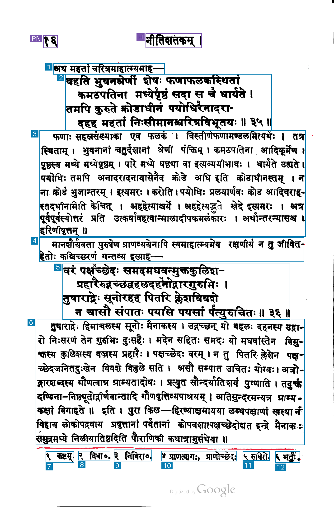
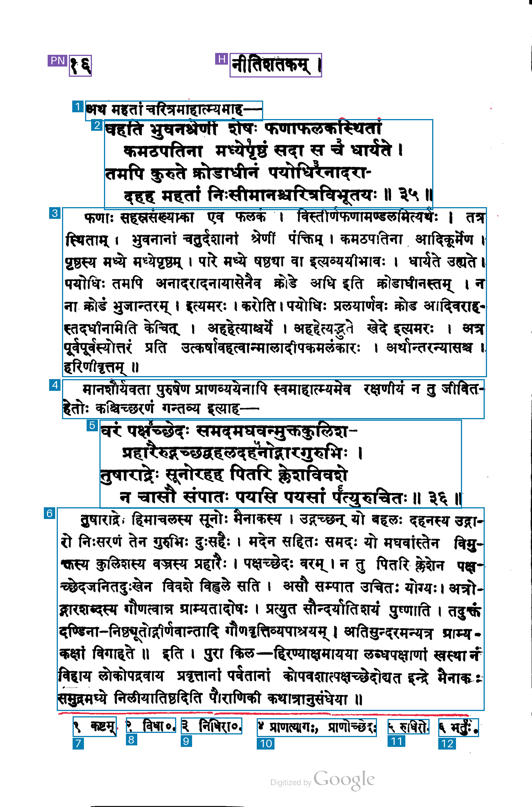
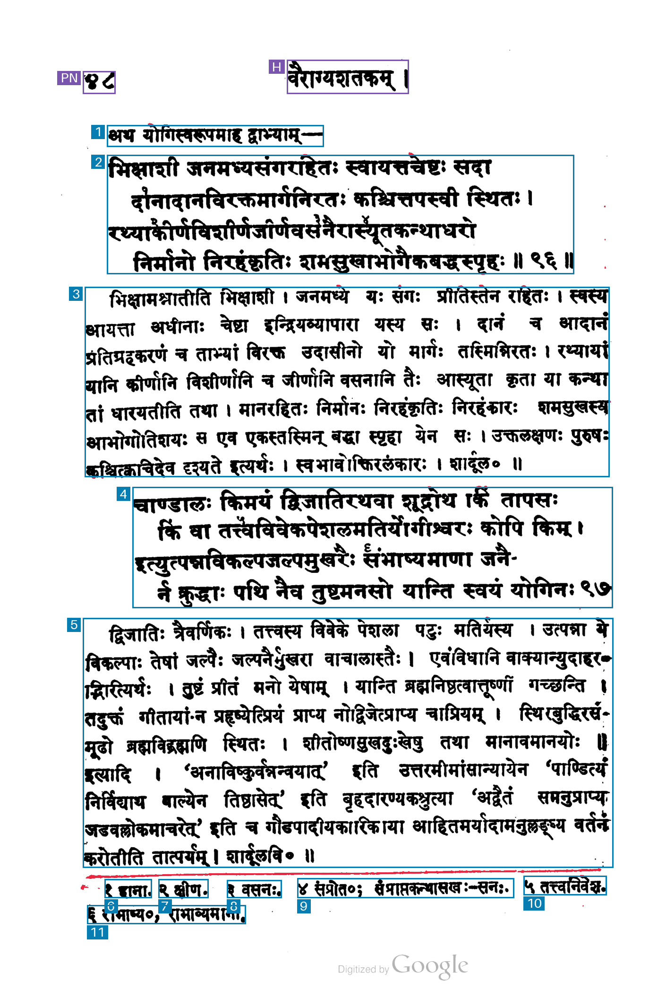
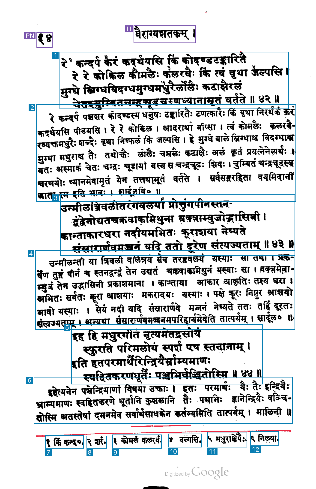
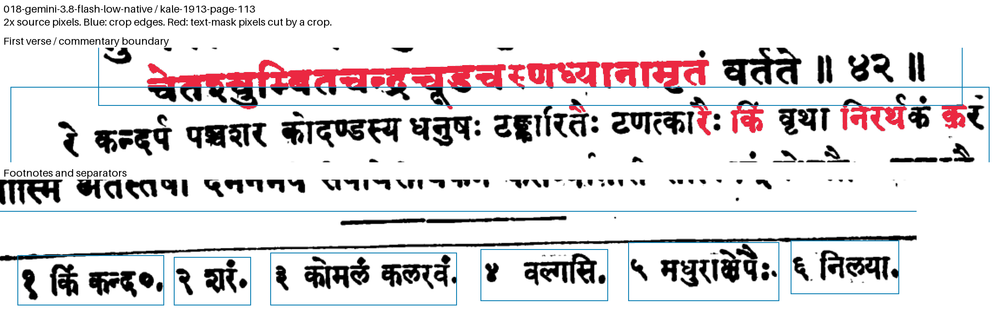

# 018-gemini-3.8-flash-low-native: Gemini 3.8 Flash low thinking, individual footnotes, native coordinates

The method sends the unchanged raw PNG and method 014's exact prompt and schema to `gemini-3.8-flash`, with thinking level `low`. It asks for one region per numbered footnote, including its marker and text, even when notes share a printed line.

Coordinates follow Google's documented `[ymin,xmin,ymax,xmax]` convention normalized to 0–1000. Returned arrays are preserved; derived `box` values reorder to x/y and scale to the original 1407 × 2135 image. Any edge clamping is recorded explicitly. The image is sent inline at resolution `high`, without local resizing. Maximum output is 16,384 tokens including thinking; service tier is standard, `store=false`, and automatic retries are disabled.

## Run

```sh
uv run python methods/018-gemini-3.8-flash-low-native/run.py inputs/kale-1913-page-017.png --check
uv run python methods/018-gemini-3.8-flash-low-native/run.py inputs/kale-1913-page-017.png
```

For another request, use a fresh `--output-dir`, such as `outputs/kale-1913-page-017/018-gemini-3.8-flash-low-native/run-002`. Existing output is protected against overwriting. Authentication uses the configured Google environment variables or the stored `llm` key named `gemini`.

## Artifacts and accounting

The output directory contains the exact request and prompt, raw response, model output text, parsed JSON, returned and converted coordinates, source hashes, token usage, timing, estimated cost, overlay and measurement mask. `regions.py` and `diagnostics.py` are copied unchanged from method 014. Blue marks kept regions, purple excluded page furniture and red uncovered measured ink; numbers show content reading order.

Google reports text output and thinking separately; they are added once to price output. `pricing.json` records the standard per-million-token rates checked on 2026-11-03: input 0.75, output including thinking 3.75, cached input 0.075, all in USD. API wall time ends after reading the response body and excludes local artifact writes and image rendering.

[Model documentation](https://aistudio.google.com/docs/models/gemini-3.8-flash), [thinking controls](https://aistudio.google.com/docs/thinking), [coordinate convention](https://aistudio.google.com/docs/image-understanding), and [pricing](https://aistudio.google.com/docs/pricing).

## Recorded run

Input: `kale-1913-page-017`, 1407 × 2135 pixels, unchanged raw PNG. Started 2026-11-03 15:16:51 UTC. Requested and returned model `gemini-3.8-flash`.

| Measurement | Result |
| --- | --- |
| Output boxes | 14 |
| Boxes marked keep=true | 12 |
| Regions marked uncertain | 0 |
| Footnote regions | 6 |
| API wall time | 7.46 s |
| Input tokens | 1,420 |
| Text output tokens | 622 |
| Thinking tokens | 0 |
| Output tokens, including thinking | 622 |
| Cached input tokens | 0 |
| Coordinate clamping adjustments | 0 |
| Estimated paid-tier cost | $0.0033975 |

Each of the six numbered footnotes has its own box containing its marker and text. Both four-line verses remain whole; the two commentary passages and two lead-ins have separate boxes. Several edges are tight, including the right edge of the fifth footnote.

The estimated cost uses $0.75 per million input tokens and $3.75 per million output tokens including thinking: (1,420 × $0.75 + 622 × $3.75) / 1,000,000 = $0.0033975. Rates checked on 2026-11-03.



A 2× nearest-neighbor footnote crop is saved as `footnotes-detail.png`, with its source crop, scale and hashes in `footnotes-detail.json`. To create it from an overlay:

```sh
uv run python methods/018-gemini-3.8-flash-low-native/inspect_footnotes.py outputs/kale-1913-page-017/018-gemini-3.8-flash-low-native
```

Existing detail output is protected against overwriting.

## Recorded run-002

Input: `kale-1913-page-017`, unchanged raw PNG, 1407 × 2135 pixels. Started 2026-11-04 03:23:40 UTC. Requested and returned model `gemini-3.8-flash`. HTTP 200, response completed.

| Measurement | Result |
| --- | --- |
| Output boxes | 14 |
| Boxes marked keep=true | 12 |
| Regions marked uncertain | 0 |
| Footnote regions | 6 |
| API wall time | 7.12 s |
| Input tokens | 1,420 |
| Text output tokens | 619 |
| Thinking tokens | 0 |
| Output tokens, including thinking | 619 |
| Cached input tokens | 0 |
| Coordinate clamping adjustments | 0 |
| Estimated paid-tier cost | $0.00338625 |

The estimated paid-tier cost uses $0.75 per million input tokens and $3.75 per million output tokens including thinking: (1,420 × $0.75 + 619 × $3.75) / 1,000,000 = $0.00338625. Rates checked on 2026-11-03.

Each of the six numbered footnotes has a separate box containing its marker and text. Both four-line verses remain whole, with separate commentary and lead-in boxes. Some box edges are tight, including the first commentary's right edge and the fifth footnote's left edge.


## Recorded run-003

Input: `kale-1913-page-017`, unchanged raw PNG, 1407 × 2135 pixels. Started 2026-11-04 03:23:58 UTC. Requested and returned model `gemini-3.8-flash`. HTTP 200, response completed.

| Measurement | Result |
| --- | --- |
| Output boxes | 14 |
| Boxes marked keep=true | 12 |
| Regions marked uncertain | 0 |
| Footnote regions | 6 |
| API wall time | 5.49 s |
| Input tokens | 1,420 |
| Text output tokens | 619 |
| Thinking tokens | 0 |
| Output tokens, including thinking | 619 |
| Cached input tokens | 0 |
| Coordinate clamping adjustments | 0 |
| Estimated paid-tier cost | $0.00338625 |

The estimated paid-tier cost uses $0.75 per million input tokens and $3.75 per million output tokens including thinking: (1,420 × $0.75 + 619 × $3.75) / 1,000,000 = $0.00338625. Rates checked on 2026-11-03.

Each of the six numbered footnotes has a separate box containing its marker and text. Both four-line verses remain whole, with separate commentary and lead-in boxes. A few glyph tips fall beyond tight boundaries, including the top of the first verse and the left edge of the second footnote.



## Kale (1913), PDF page 97 / 252

Input: `kale-1913-page-097`, unannotated 300 dpi RGB render, 1374 × 2114 pixels. Started 2026-11-04 04:28:23 UTC. Requested and returned model `gemini-3.8-flash`. Settings and prompt are unchanged; coordinate conversion uses this input's actual width and height. HTTP 200, response completed.

```sh
uv run python methods/018-gemini-3.8-flash-low-native/run.py inputs/kale-1913-page-097.png --check
uv run python methods/018-gemini-3.8-flash-low-native/run.py inputs/kale-1913-page-097.png
```

The completed artifacts are under `outputs/kale-1913-page-097/018-gemini-3.8-flash-low-native/`. Choose a fresh `--output-dir` for another API request.

| Measurement | Result |
| --- | --- |
| Output boxes | 13 |
| Boxes marked keep=true | 11 |
| Regions marked uncertain | 0 |
| Footnote regions | 6 |
| API wall time | 5.99 s |
| Input tokens | 1,379 |
| Text output tokens | 575 |
| Thinking tokens | 0 |
| Output tokens, including thinking | 575 |
| Cached input tokens | 0 |
| Coordinate clamping adjustments | 0 |
| Estimated paid-tier cost | $0.0031905 |

The estimated paid-tier cost uses $0.75 per million input tokens and $3.75 per million output tokens including thinking: (1,379 × $0.75 + 575 × $3.75) / 1,000,000 = $0.0031905. Rates checked on 2026-11-03.

Both four-line verses remain whole. The two commentary passages and the short lead-in have separate boxes. Each numbered footnote has a separate box containing its marker and text; the sixth footnote is on the second printed footnote line. Several boundaries are tight, with small glyph tips outside the first verse and commentary boxes.



## Recorded test on PDF page 113 / 252

Input `kale-1913-page-113`, unchanged raw PNG, 1370 × 2118 pixels.

```sh
uv run python methods/018-gemini-3.8-flash-low-native/run.py inputs/kale-1913-page-113.png --check
uv run python methods/018-gemini-3.8-flash-low-native/run.py inputs/kale-1913-page-113.png
```

The completed output is `outputs/kale-1913-page-113/018-gemini-3.8-flash-low-native/`; use a fresh `--output-dir` for a repeat run.

**Run:** 2026-11-04 06:00:30 UTC.

| Measurement | Result |
| --- | --- |
| Output boxes | 14 |
| Boxes marked keep=true | 12 |
| Regions marked uncertain | 0 |
| Footnote regions | 6 |
| Unique text components cut by kept crop edges | 63 |
| Overlapping kept-box pairs containing text | 5 |
| Detected separator pixels inside kept boxes | 337 |
| API wall time | 5.90 s |
| Input tokens | 1,379 |
| Text output tokens | 602 |
| Thinking tokens | 0 |
| Output tokens, including thinking | 602 |
| Cached input tokens | 0 |
| Coordinate clamping adjustments | 0 |
| Estimated paid-tier API cost | $0.00329175 |

The estimated paid-tier cost uses $0.75 per million input tokens and $3.75 per million output tokens including thinking: (1,379 × $0.75 + 602 × $3.75) / 1,000,000 = $0.00329175. Rates checked on 2026-11-03.

The audit uses grayscale <175, speckle and margin filtering, and the same automatic thin-line separator detector for all compared results. It counts connected text components crossing individual kept crop edges, kept-box overlaps containing text-mask pixels, and detected separator pixels inside kept boxes. A cut can belong to text from a neighboring passage that enters a crop.

Returned region types: 1 page number, 1 running header, 3 verse, 3 commentary, 6 footnote.

Three four-line verse groups, three commentary passages and six individual footnotes are returned. Neighboring body boxes overlap at five transitions, with text in each intersection. Several crop edges pass through upper or lower glyph parts. The audit records 63 cut text components.

The full-page overlay marks kept boxes blue and excluded page furniture purple. Red marks uncovered pixels from the method's analysis mask. The enlarged inspection marks text-mask pixels cut by individual crops in red.




