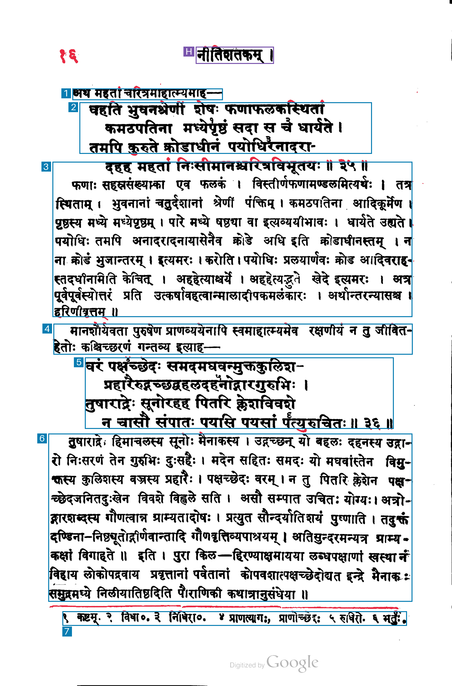

# 019-gemini-3.5-flash-lite-minimal: Gemini 3.5 Flash-Lite minimal thinking, individual footnotes, native coordinates

The method sends the unchanged raw PNG and method 014's exact prompt and schema to `gemini-3.5-flash-lite`, with thinking level `minimal`. It asks for one region per numbered footnote, including its marker and text, even when notes share a printed line.

Coordinates follow Google's documented `[ymin,xmin,ymax,xmax]` convention normalized to 0–1000. Returned arrays are preserved; derived `box` values reorder to x/y and scale to the original 1407 × 2135 image. Any edge clamping is recorded explicitly. The image is sent inline at resolution `high`, without local resizing. Maximum output is 16,384 tokens including thinking; service tier is standard, `store=false`, and automatic retries are disabled.

## Run

```sh
uv run --offline python methods/019-gemini-3.5-flash-lite-minimal/run.py inputs/kale-1913-page-017.png --check
uv run --offline python methods/019-gemini-3.5-flash-lite-minimal/run.py inputs/kale-1913-page-017.png
```

For another request, use a fresh `--output-dir`, such as `outputs/kale-1913-page-017/019-gemini-3.5-flash-lite-minimal/run-002`. Existing output is protected against overwriting. Authentication uses the configured Google environment variables or the stored `llm` key named `gemini`.

## Artifacts and accounting

Successful runs contain the exact request and prompt, raw response, model output text, parsed JSON, returned and converted coordinates, source hashes, token usage, timing, estimated cost, overlay and measurement mask. A validation failure preserves the completed API request, response, usage and raw proposals before stopping. `regions.py` and `diagnostics.py` are copied unchanged from method 014. Blue marks kept regions, purple excluded page furniture and red uncovered measured ink; numbers show content reading order.

Google reports text output and thinking separately; they are added once to price output. `pricing.json` records the standard per-million-token rates checked on 2026-11-03: input 0.3, output including thinking 2.5, cached input 0.03, all in USD. API wall time ends after reading the response body and excludes local artifact writes and image rendering.

[Model documentation](https://aistudio.google.com/docs/models/gemini-3.5-flash-lite), [thinking controls](https://aistudio.google.com/docs/thinking), [coordinate convention](https://aistudio.google.com/docs/image-understanding), and [pricing](https://aistudio.google.com/docs/pricing).

## Recorded run

Input: `kale-1913-page-017`, 1407 × 2135 pixels, unchanged raw PNG. Started 2026-11-03 15:16:57 UTC. Requested and returned model `gemini-3.5-flash-lite`.

| Measurement | Result |
| --- | --- |
| Output proposals | 9 |
| Boxes marked keep=true | 7 |
| Regions marked uncertain | 0 |
| Footnote regions | 1 |
| API wall time | 2.46 s |
| Input tokens | 1,420 |
| Text output tokens | 684 |
| Thinking tokens | 0 |
| Output tokens, including thinking | 684 |
| Cached input tokens | 0 |
| Valid rectangles rendered in diagnostic | 8 |
| Invalid rectangle proposals | 1 |
| Estimated paid-tier cost | $0.002136 |

The API returned nine proposals. The page-number proposal has inverted vertical coordinates, [130,132,22,173] in [ymin,xmin,ymax,xmax] order, and local validation stopped with `Nonpositive rectangle at region 1`. The first verse box contains only three of its four lines; its fourth line is included in the commentary box. All six numbered footnotes share one box.

The estimated cost uses $0.3 per million input tokens and $2.5 per million output tokens including thinking: (1,420 × $0.3 + 684 × $2.5) / 1,000,000 = $0.002136. Rates checked on 2026-11-03.



The diagnostic image above renders only the eight valid proposals, unchanged. The rejected proposal and original validation error remain in the record. To produce this diagnostic from a saved run:

```sh
uv run --offline python methods/019-gemini-3.5-flash-lite-minimal/inspect_response.py outputs/kale-1913-page-017/019-gemini-3.5-flash-lite-minimal
```

This creates a fresh `diagnostic/` directory with an overlay, measurement mask, excluded-proposal record, cost calculation and provenance hashes. Existing diagnostic output is protected against overwriting.
