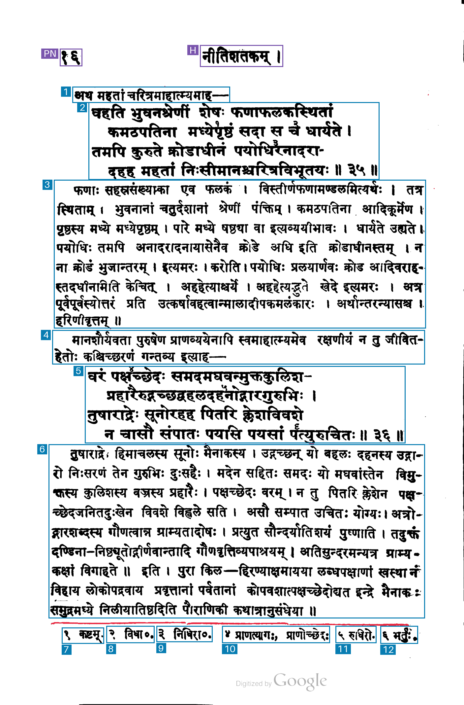
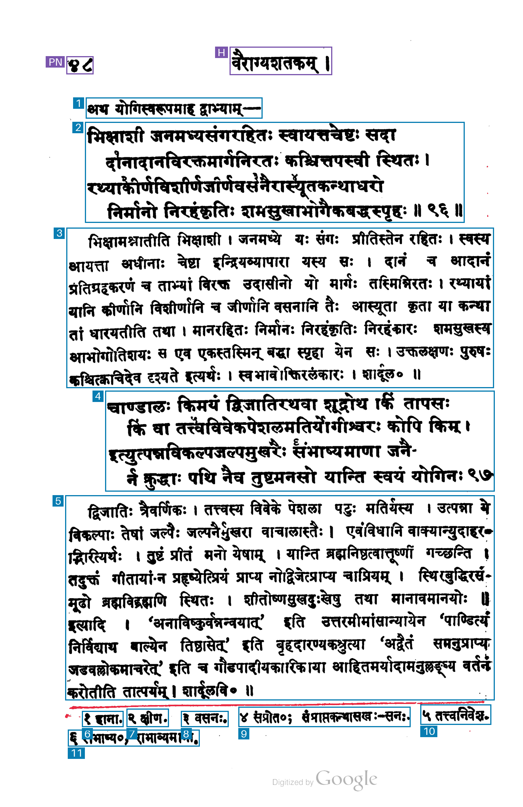
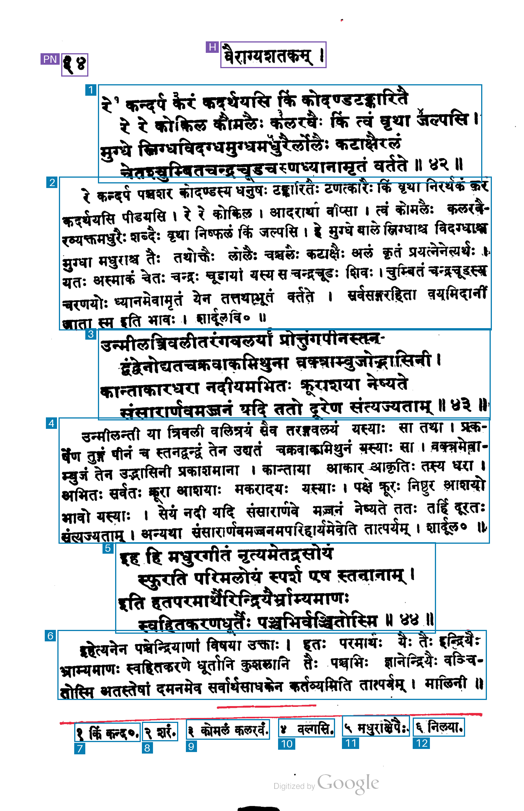
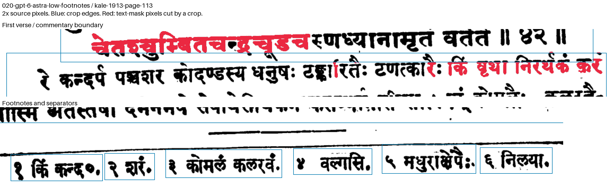

# 020-gpt-6-astra-low-footnotes: GPT-6 Astra low reasoning, individual footnotes

This method sends the unchanged raw PNG to `gpt-6-astra` through the OpenAI Responses API. It uses `reasoning.effort=low`, image detail `original`, strict JSON Schema output, a maximum of 16,384 output tokens including reasoning and `store=false`. It makes one synchronous non-streaming request without automatic retries.

The prompt is copied byte-for-byte from method 013: it explicitly requests one region per numbered footnote, including its marker and text, even when notes share a printed line. The original x/y 0–1000 schema is preserved from method 005. Returned coordinates are converted to original-image pixels by x × width / 1000 and y × height / 1000. Original values remain in the result; any edge clamping is recorded explicitly. The image is sent as the exact original PNG bytes, without local resizing.

## Run

```sh
uv run python methods/020-gpt-6-astra-low-footnotes/run.py inputs/kale-1913-page-017.png --check
uv run python methods/020-gpt-6-astra-low-footnotes/run.py inputs/kale-1913-page-017.png
```

For a repeat request, use a fresh `--output-dir`, for example `outputs/kale-1913-page-017/020-gpt-6-astra-low-footnotes/run-002`. Existing output is protected against overwriting. Authentication checks `OPENAI_API_KEY`, then the locally stored `llm` key named `openai`.

## Artifacts and cost

The output directory preserves the exact request, prompt, raw response, model output text, parsed JSON, original and derived coordinates, source hashes, selected response headers, token usage, timing, estimated cost, overlay and measurement mask. No authentication secret is saved. Display and foreground measurement helpers are copied from the existing comparison methods.

OpenAI output tokens already include reasoning. Input usage is split into ordinary tokens, cache reads and cache writes; each category is priced once. The request retains the documented default 30-minute cache lifetime. The per-million-token USD rates checked on 2026-11-03 are ordinary input 10.0, output including reasoning 50.0, cache read 1.0, and cache write 12.5. The actual usage categories and arithmetic are saved in `regions.json`.

API wall time ends after reading the response body and excludes credential lookup, artifact writes and rendering. Blue marks kept boxes, purple excluded page furniture and red uncovered measured ink; numbers show returned reading order.

Sources: [official OpenAI model documentation](https://developers.openai.com/api/docs/models/gpt-6-astra), [image-detail guidance](https://developers.openai.com/api/docs/guides/images-vision), and [cache accounting](https://developers.openai.com/api/docs/guides/prompt-caching).

## Recorded run

Input: `kale-1913-page-017`, 1407 × 2135 pixels, unchanged raw PNG. Started 2026-11-03 15:20:34 UTC. Requested and returned model `gpt-6-astra`.

| Measurement | Result |
| --- | --- |
| Output boxes | 14 |
| Boxes marked keep=true | 12 |
| Regions marked uncertain | 0 |
| Footnote regions | 6 |
| API wall time | 11.36 s |
| Input tokens | 3,932 |
| Ordinary input tokens | 3 |
| Cache-write input tokens, default 30-minute lifetime | 3,929 |
| Cache-read input tokens | 0 |
| Output tokens, including reasoning | 510 |
| Reasoning tokens | 49 |
| Output tokens excluding reasoning | 461 |
| Coordinate clamping adjustments | 0 |
| Estimated paid-tier cost | $0.0746425 |

Each of the six numbered footnotes has its own box containing its marker and text. Both four-line verses remain whole; the two commentary passages and two lead-ins have separate boxes. A few upper glyph tips on the first line of the final commentary extend above its box.

The estimated cost uses $10 per million ordinary input tokens, $12.5 per million default 30-minute cache-write tokens and $50 per million output tokens including reasoning: (3 × $10 + 3,929 × $12.5 + 510 × $50) / 1,000,000 = $0.0746425. Rates checked on 2026-11-03.



## Kale (1913), PDF page 97 / 252

Input: `kale-1913-page-097`, unannotated 300 dpi RGB render, 1374 × 2114 pixels. Started 2026-11-04 04:28:51 UTC. Requested and returned model `gpt-6-astra`. Settings and prompt are unchanged; coordinate conversion uses this input's actual width and height. HTTP 200, response completed.

```sh
uv run python methods/020-gpt-6-astra-low-footnotes/run.py inputs/kale-1913-page-097.png --check
uv run python methods/020-gpt-6-astra-low-footnotes/run.py inputs/kale-1913-page-097.png
```

The completed artifacts are under `outputs/kale-1913-page-097/020-gpt-6-astra-low-footnotes/`. Choose a fresh `--output-dir` for another API request.

| Measurement | Result |
| --- | --- |
| Output boxes | 13 |
| Boxes marked keep=true | 11 |
| Regions marked uncertain | 0 |
| Footnote regions | 6 |
| API wall time | 9.71 s |
| Input tokens | 3,852 |
| Ordinary input tokens | 3 |
| Cache-write input tokens, default 30-minute lifetime | 3,849 |
| Cache-read input tokens | 0 |
| Output tokens, including reasoning | 427 |
| Reasoning tokens | 0 |
| Output tokens excluding reasoning | 427 |
| Coordinate clamping adjustments | 0 |
| Estimated paid-tier cost | $0.0694925 |

The estimated paid-tier cost uses $10 per million ordinary input tokens, $12.5 per million default 30-minute cache-write tokens, $1 per million cache-read tokens and $50 per million output tokens including reasoning: (3 × $10 + 3,849 × $12.5 + 0 × $1 + 427 × $50) / 1,000,000 = $0.0694925. Rates checked on 2026-11-03.

Both four-line verses remain whole. The two commentary passages and the short lead-in have separate boxes. Each numbered footnote has a separate box containing its marker and text, including the sixth footnote on the second printed footnote line.



## Recorded test on PDF page 113 / 252

Input `kale-1913-page-113`, unchanged raw PNG, 1370 × 2118 pixels.

```sh
uv run python methods/020-gpt-6-astra-low-footnotes/run.py inputs/kale-1913-page-113.png --check
uv run python methods/020-gpt-6-astra-low-footnotes/run.py inputs/kale-1913-page-113.png
```

The completed output is `outputs/kale-1913-page-113/020-gpt-6-astra-low-footnotes/`; use a fresh `--output-dir` for a repeat run.

**Run:** 2026-11-04 05:59:23 UTC.

| Measurement | Result |
| --- | --- |
| Output boxes | 14 |
| Boxes marked keep=true | 12 |
| Regions marked uncertain | 0 |
| Footnote regions | 6 |
| Unique text components cut by kept crop edges | 33 |
| Overlapping kept-box pairs containing text | 5 |
| Detected separator pixels inside kept boxes | 479 |
| API wall time | 11.94 s |
| Input tokens | 3,852 |
| Ordinary input tokens | 3 |
| Cache-write input tokens, default 30-minute lifetime | 3,849 |
| Cache-read input tokens | 0 |
| Output tokens, including reasoning | 458 |
| Reasoning tokens | 0 |
| Coordinate clamping adjustments | 0 |
| Estimated paid-tier API cost | $0.0710425 |

The estimated paid-tier cost uses $10 per million ordinary input tokens, $12.5 per million default 30-minute cache-write tokens, $1 per million cache-read tokens and $50 per million output tokens including reasoning: (3 × $10 + 3,849 × $12.5 + 0 × $1 + 458 × $50) / 1,000,000 = $0.0710425. Rates checked on 2026-11-03.

The audit uses grayscale <175, speckle and margin filtering, and the same automatic thin-line separator detector for all compared results. It counts connected text components crossing individual kept crop edges, kept-box overlaps containing text-mask pixels, and detected separator pixels inside kept boxes. A cut can belong to text from a neighboring passage that enters a crop.

Returned region types: 1 page number, 1 running header, 3 verse, 3 commentary, 6 footnote.

Three four-line verse groups, three commentary passages and six individual footnotes are returned. Neighboring body boxes overlap at five transitions, with text in each intersection. Several crop edges pass through upper or lower glyph parts. The audit records 33 cut text components.

The full-page overlay marks kept boxes blue and excluded page furniture purple. Red marks uncovered pixels from the method's analysis mask. The enlarged inspection marks text-mask pixels cut by individual crops in red.




