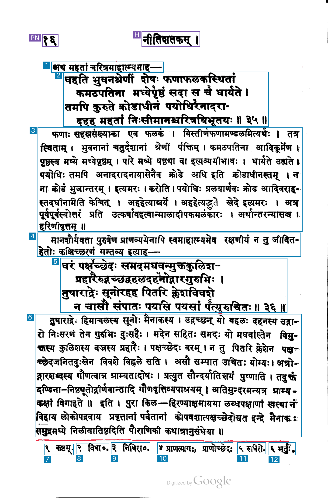
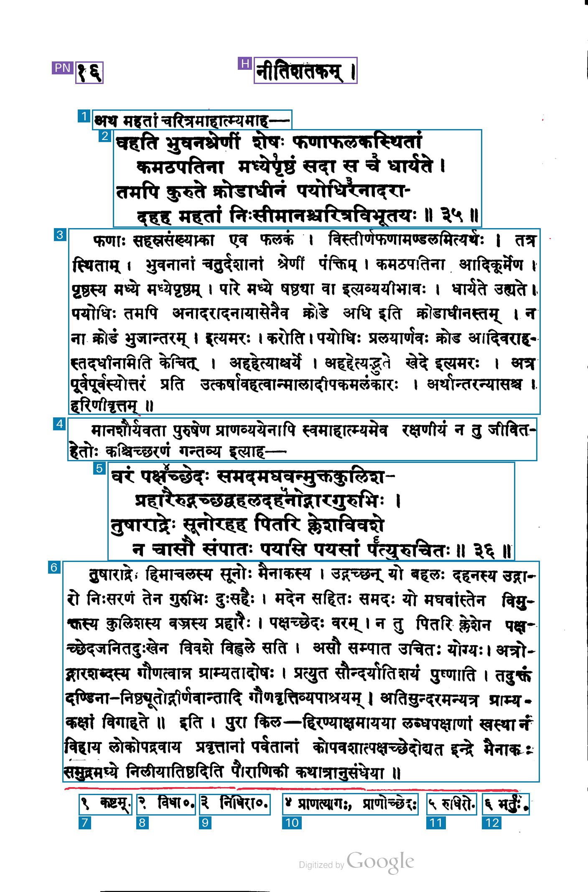
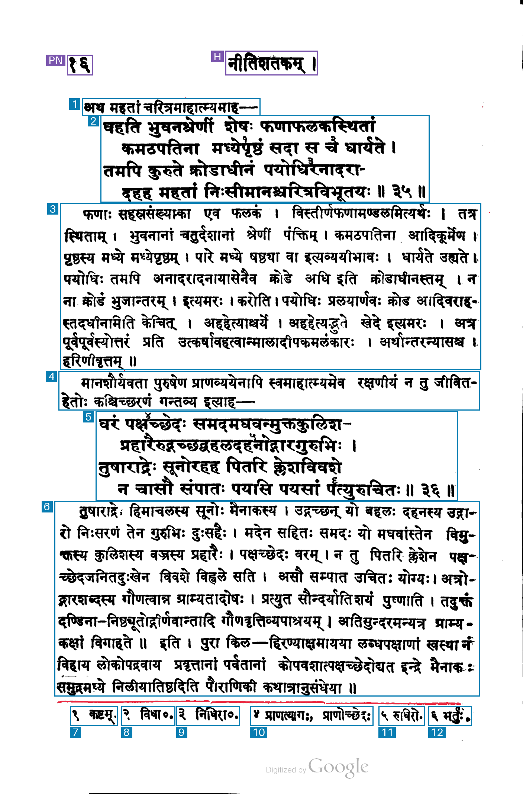

# 021-gpt-6.1-terra-low-footnotes: GPT-6.1 Terra low reasoning, individual footnotes

This method sends the unchanged raw PNG to `gpt-6.1-terra` through the OpenAI Responses API. It uses `reasoning.effort=low`, image detail `original`, strict JSON Schema output, a maximum of 16,384 output tokens including reasoning and `store=false`. It makes one synchronous non-streaming request without automatic retries.

The prompt is copied byte-for-byte from method 013: it explicitly requests one region per numbered footnote, including its marker and text, even when notes share a printed line. The original x/y 0–1000 schema is preserved from method 005. Returned coordinates are converted to original-image pixels by x × width / 1000 and y × height / 1000. Original values remain in the result; any edge clamping is recorded explicitly. The image is sent as the exact original PNG bytes, without local resizing.

## Run

```sh
uv run python methods/021-gpt-6.1-terra-low-footnotes/run.py inputs/kale-1913-page-017.png --check
uv run python methods/021-gpt-6.1-terra-low-footnotes/run.py inputs/kale-1913-page-017.png
```

For a repeat request, use a fresh `--output-dir`, for example `outputs/kale-1913-page-017/021-gpt-6.1-terra-low-footnotes/run-002`. Existing output is protected against overwriting. Authentication checks `OPENAI_API_KEY`, then the locally stored `llm` key named `openai`.

## Artifacts and cost

The output directory preserves the exact request, prompt, raw response, model output text, parsed JSON, original and derived coordinates, source hashes, selected response headers, token usage, timing, estimated cost, overlay and measurement mask. No authentication secret is saved. Display and foreground measurement helpers are copied from the existing comparison methods.

OpenAI output tokens already include reasoning. Input usage is split into ordinary tokens, cache reads and cache writes; each category is priced once. The request retains the documented default 30-minute cache lifetime. The per-million-token USD rates checked on 2026-11-03 are ordinary input 1.0, output including reasoning 5.0, cache read 0.05, and cache write 1.25. The actual usage categories and arithmetic are saved in `regions.json`.

API wall time ends after reading the response body and excludes credential lookup, artifact writes and rendering. Blue marks kept boxes, purple excluded page furniture and red uncovered measured ink; numbers show returned reading order.

Sources: [official OpenAI model documentation](https://developers.openai.com/api/docs/models/gpt-6.1-terra), [image-detail guidance](https://developers.openai.com/api/docs/guides/images-vision), and [cache accounting](https://developers.openai.com/api/docs/guides/prompt-caching).

## Recorded run

Input: `kale-1913-page-017`, 1407 × 2135 pixels, unchanged raw PNG. Started 2026-11-03 15:20:39 UTC. Requested and returned model `gpt-6.1-terra`.

| Measurement | Result |
| --- | --- |
| Output boxes | 14 |
| Boxes marked keep=true | 12 |
| Regions marked uncertain | 0 |
| Footnote regions | 6 |
| API wall time | 7.82 s |
| Input tokens | 3,932 |
| Ordinary input tokens | 3 |
| Cache-write input tokens, default 30-minute lifetime | 3,929 |
| Cache-read input tokens | 0 |
| Output tokens, including reasoning | 519 |
| Reasoning tokens | 58 |
| Output tokens excluding reasoning | 461 |
| Coordinate clamping adjustments | 0 |
| Estimated paid-tier cost | $0.00750925 |

Each of the six numbered footnotes has its own box containing its marker and text. Both four-line verses remain whole; the two commentary passages and two lead-ins have separate boxes. A few glyph tips extend beyond the commentary boundaries.

The estimated cost uses $1 per million ordinary input tokens, $1.25 per million default 30-minute cache-write tokens and $5 per million output tokens including reasoning: (3 × $1 + 3,929 × $1.25 + 519 × $5) / 1,000,000 = $0.00750925. Rates checked on 2026-11-03.



## Recorded run-002

Input: `kale-1913-page-017`, unchanged raw PNG, 1407 × 2135 pixels. Started 2026-11-04 03:23:48 UTC. Requested and returned model `gpt-6.1-terra`. HTTP 200, response completed.

| Measurement | Result |
| --- | --- |
| Output boxes | 14 |
| Boxes marked keep=true | 12 |
| Regions marked uncertain | 0 |
| Footnote regions | 6 |
| API wall time | 8.85 s |
| Input tokens | 3,932 |
| Ordinary input tokens | 3 |
| Cache-write input tokens, default 30-minute lifetime | 3,929 |
| Cache-read input tokens | 0 |
| Output tokens, including reasoning | 513 |
| Reasoning tokens | 52 |
| Output tokens excluding reasoning | 461 |
| Coordinate clamping adjustments | 0 |
| Estimated paid-tier cost | $0.00747925 |

The estimated paid-tier cost uses $1 per million ordinary input tokens, $1.25 per million default 30-minute cache-write tokens, $0.05 per million cache-read tokens and $5 per million output tokens including reasoning: (3 × $1 + 3,929 × $1.25 + 0 × $0.05 + 513 × $5) / 1,000,000 = $0.00747925. Rates checked on 2026-11-03.

Each of the six numbered footnotes has a separate box containing its marker and text. Both four-line verses remain whole, with separate commentary and lead-in boxes.




## Recorded run-003

Input: `kale-1913-page-017`, unchanged raw PNG, 1407 × 2135 pixels. Started 2026-11-04 03:24:05 UTC. Requested and returned model `gpt-6.1-terra`. HTTP 200, response completed.

| Measurement | Result |
| --- | --- |
| Output boxes | 14 |
| Boxes marked keep=true | 12 |
| Regions marked uncertain | 0 |
| Footnote regions | 6 |
| API wall time | 8.26 s |
| Input tokens | 3,932 |
| Ordinary input tokens | 3 |
| Cache-write input tokens, default 30-minute lifetime | 0 |
| Cache-read input tokens | 3,929 |
| Output tokens, including reasoning | 535 |
| Reasoning tokens | 74 |
| Output tokens excluding reasoning | 461 |
| Coordinate clamping adjustments | 0 |
| Estimated paid-tier cost | $0.00287445 |

The estimated paid-tier cost uses $1 per million ordinary input tokens, $1.25 per million default 30-minute cache-write tokens, $0.05 per million cache-read tokens and $5 per million output tokens including reasoning: (3 × $1 + 0 × $1.25 + 3,929 × $0.05 + 535 × $5) / 1,000,000 = $0.00287445. Rates checked on 2026-11-03.

Each of the six numbered footnotes has a separate box containing its marker and text. Both four-line verses remain whole, with separate commentary and lead-in boxes. The API reported 3,929 cached input tokens and zero cache-write tokens.


