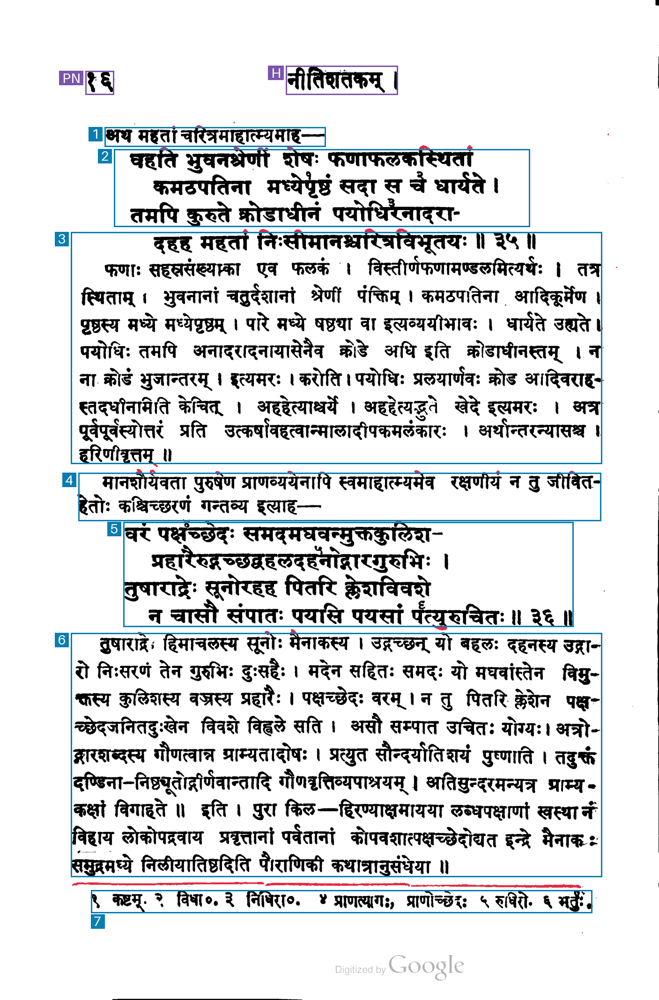

# 024-gemini-3.5-flash-lite-low: Gemini 3.5 Flash-Lite low thinking, individual footnotes, native coordinates

This method sends the unchanged raw PNG to `gemini-3.5-flash-lite`, using thinking level `low`, image resolution `high`, JSON Schema output, standard service tier. The maximum output is 16,384 tokens, `store=false`, and each invocation makes one synchronous request without automatic retries.

It asks for whole verses, separate commentary and lead-ins, and one region per numbered footnote including its marker and text, even when notes share a printed line. The prompt, schema and coordinate conversion are copied unchanged from method 019; this variant changes only thinking_level from `minimal` to `low`.

The prompt requests [ymin,xmin,ymax,xmax] integer coordinates normalized to 0–1000. The returned arrays are preserved and mechanically reordered and scaled to [xmin,ymin,xmax,ymax] pixels by x × width / 1000 and y × height / 1000. Any boundary clamping is recorded explicitly. The original image is sent without local resizing.

## Run

```sh
uv run python methods/024-gemini-3.5-flash-lite-low/run.py inputs/kale-1913-page-017.png --check
uv run python methods/024-gemini-3.5-flash-lite-low/run.py inputs/kale-1913-page-017.png
```

For another request, choose a fresh `--output-dir`, such as `outputs/kale-1913-page-017/024-gemini-3.5-flash-lite-low/run-002`. Existing output is protected against overwriting. Authentication uses GEMINI_API_KEY, GOOGLE_API_KEY, or the stored `llm` key named `gemini`.

## Artifacts and accounting

The output directory preserves the exact request and prompt, raw response, exact model output text, parsed JSON, original and derived coordinates, source hashes, selected response headers, token usage, timing, estimated cost, overlay and measurement mask. A validation failure preserves the request, response, usage and raw proposals before stopping.

Google's text-output and thinking token counts are added once to price output. Published standard USD rates per million tokens, checked on 2026-11-03: input 0.30, cached input 0.03, and output including thinking 2.50. The estimate uses returned usage and is saved with the pricing snapshot. API wall time ends after reading the response body and excludes local artifact writes and rendering.

Blue marks kept regions, purple excluded page furniture, and red uncovered measured ink. Content labels show returned reading order.

[Model documentation](https://aistudio.google.com/docs/models/gemini-3.5-flash-lite), [thinking controls](https://aistudio.google.com/docs/thinking), [coordinates](https://aistudio.google.com/docs/image-understanding), [pricing](https://aistudio.google.com/docs/pricing).

## Recorded run-001

Input: `kale-1913-page-017`, unchanged raw PNG, 1407 × 2135 pixels. Started 2026-11-04 03:24:14 UTC. Requested and returned model `gemini-3.5-flash-lite`. HTTP 200, response completed.

| Measurement | Result |
| --- | --- |
| Output boxes | 9 |
| Boxes marked keep=true | 7 |
| Regions marked uncertain | 0 |
| Footnote regions | 1 |
| API wall time | 1.94 s |
| Input tokens | 1,420 |
| Text output tokens | 378 |
| Thinking tokens | 0 |
| Output tokens, including thinking | 378 |
| Cached input tokens | 0 |
| Coordinate clamping adjustments | 0 |
| Estimated paid-tier cost | $0.001371 |

The estimated paid-tier cost uses $0.3 per million input tokens and $2.5 per million output tokens including thinking: (1,420 × $0.3 + 378 × $2.5) / 1,000,000 = $0.001371. Rates checked on 2026-11-03.

All six numbered footnotes share one box. The first verse box contains three of its four lines; the fourth line is included in the following commentary box. The second verse is whole. Several upper glyph tips extend beyond their box boundaries.


