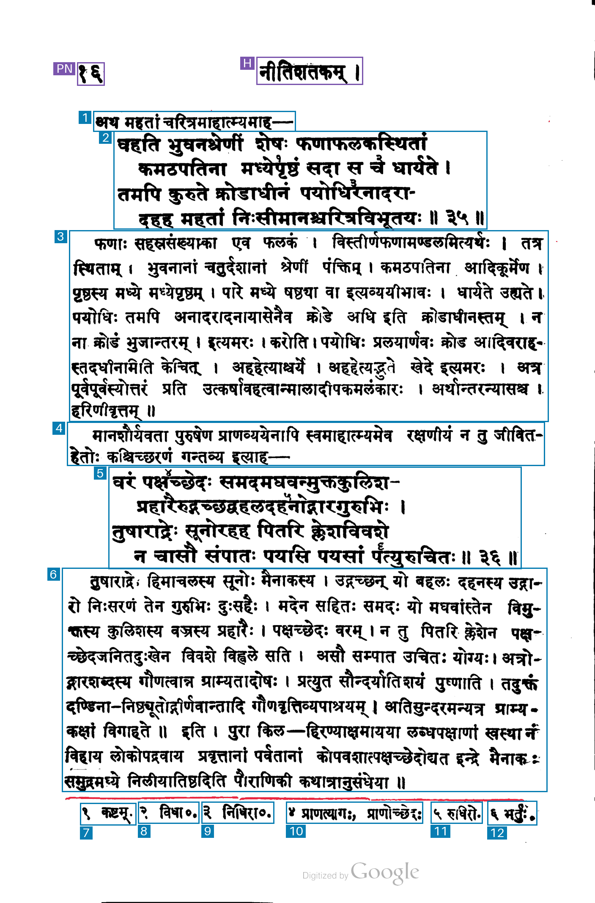

# 025-gpt-6.1-terra-none-footnotes: GPT-6.1 Terra without reasoning, individual footnotes

This method sends the unchanged raw PNG to `gpt-6.1-terra`, using reasoning effort `none`, image detail `original`, and strict JSON Schema output. The maximum output is 16,384 tokens, `store=false`, and each invocation makes one synchronous request without automatic retries.

It asks for whole verses, separate commentary and lead-ins, and one region per numbered footnote including its marker and text, even when notes share a printed line. The prompt, schema and coordinate conversion are copied unchanged from method 021; this variant changes only reasoning_effort from `low` to `none`.

The prompt requests [xmin,ymin,xmax,ymax] integer coordinates normalized to 0–1000. The returned arrays are preserved and mechanically scaled to original-image pixels by x × width / 1000 and y × height / 1000. Any boundary clamping is recorded explicitly. The original image is sent without local resizing.

## Run

```sh
uv run python methods/025-gpt-6.1-terra-none-footnotes/run.py inputs/kale-1913-page-017.png --check
uv run python methods/025-gpt-6.1-terra-none-footnotes/run.py inputs/kale-1913-page-017.png
```

For another request, choose a fresh `--output-dir`, such as `outputs/kale-1913-page-017/025-gpt-6.1-terra-none-footnotes/run-002`. Existing output is protected against overwriting. Authentication checks OPENAI_API_KEY, then the stored `llm` key named `openai`.

## Artifacts and accounting

The output directory preserves the exact request and prompt, raw response, exact model output text, parsed JSON, original and derived coordinates, source hashes, selected response headers, token usage, timing, estimated cost, overlay and measurement mask. A validation failure preserves the request, response, usage and raw proposals before stopping.

OpenAI output tokens already include reasoning. Ordinary input, cache reads and cache writes are priced separately, once each. Published standard short-context USD rates per million tokens, checked on 2026-11-03: ordinary input 1.00, cache read 0.05, default 30-minute cache write 1.25, and output 5.00. The estimate uses returned usage and is saved with the pricing snapshot. API wall time ends after reading the response body and excludes local artifact writes and rendering.

Blue marks kept regions, purple excluded page furniture, and red uncovered measured ink. Content labels show returned reading order.

[Official OpenAI model documentation](https://developers.openai.com/api/docs/models/gpt-6.1-terra), [image detail](https://developers.openai.com/api/docs/guides/images-vision), [cache accounting](https://developers.openai.com/api/docs/guides/prompt-caching).

## Recorded run-001

Input: `kale-1913-page-017`, unchanged raw PNG, 1407 × 2135 pixels. Started 2026-11-04 03:24:17 UTC. Requested and returned model `gpt-6.1-terra`. HTTP 200, response completed.

| Measurement | Result |
| --- | --- |
| Output boxes | 14 |
| Boxes marked keep=true | 12 |
| Regions marked uncertain | 0 |
| Footnote regions | 6 |
| API wall time | 8.36 s |
| Input tokens | 3,932 |
| Ordinary input tokens | 3 |
| Cache-write input tokens, default 30-minute lifetime | 3,929 |
| Cache-read input tokens | 0 |
| Output tokens, including reasoning | 459 |
| Reasoning tokens | 0 |
| Output tokens excluding reasoning | 459 |
| Coordinate clamping adjustments | 0 |
| Estimated paid-tier cost | $0.00720925 |

The estimated paid-tier cost uses $1 per million ordinary input tokens, $1.25 per million default 30-minute cache-write tokens, $0.05 per million cache-read tokens and $5 per million output tokens including reasoning: (3 × $1 + 3,929 × $1.25 + 0 × $0.05 + 459 × $5) / 1,000,000 = $0.00720925. Rates checked on 2026-11-03.

Each of the six numbered footnotes has a separate box containing its marker and text. Both four-line verses remain whole, with separate commentary and lead-in boxes. The API reported zero reasoning tokens.


