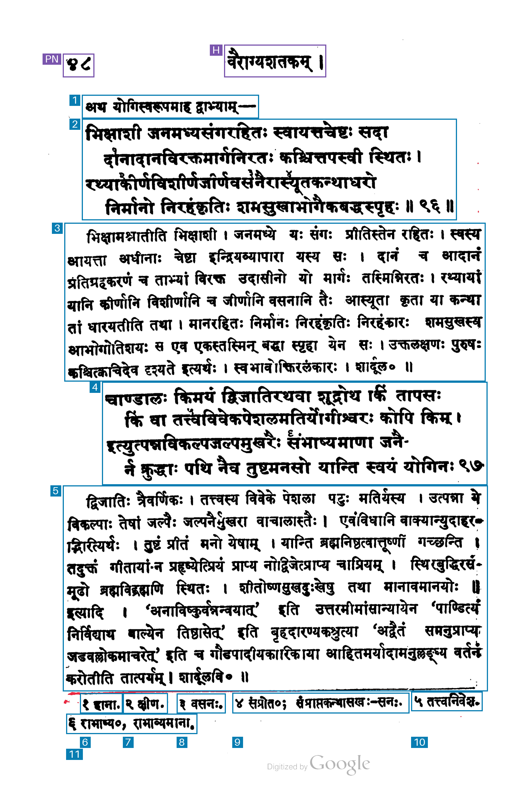
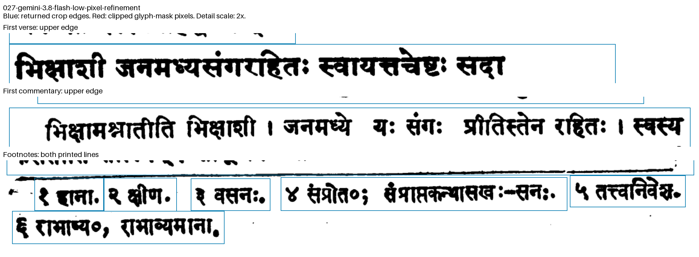

# 027-gemini-3.8-flash-low-pixel-refinement: Gemini 3.8 Flash low thinking + component completion and padding

This pipeline starts from the saved output of method 018 for the same raw image. It keeps the region count, semantic types, keep flags, reading order and original uncertainty flags. The source result, original coordinates and provenance hashes are preserved alongside the derived pixel boxes.

For each dark connected component, assign ownership to the original box containing the most of its foreground pixels. Assign a detached component only when it is within the padding distance of a uniquely nearest box. Complete owned components when the required extension is at most 1.5% of image width horizontally and 1.2% of image height vertically. Tied assignments and components beyond these limits are recorded for inspection.

Add padding equal to the ceiling of 0.5% of image width and 0.3% of image height: seven pixels per axis for the 1374 × 2114 test image. Padding stops at image borders, horizontal separator rows and midpoints between neighboring completed rectangles. Boxes expand from their original extents; source grouping stays fixed. Ambiguous components or overlapping completed rectangles are recorded as warnings for review.

The foreground mask uses grayscale <175, filters components smaller than five pixels at this image size, removes long rules and scan borders, and limits analysis to the central image area and top 94% of image height. The bottom exclusion removes the digitization watermark on these tested pages. Component diagnostics describe this mask.

## Run

```sh
uv run python methods/027-gemini-3.8-flash-low-pixel-refinement/test_refinement.py
uv run python methods/027-gemini-3.8-flash-low-pixel-refinement/run.py inputs/kale-1913-page-097.png --check
uv run python methods/027-gemini-3.8-flash-low-pixel-refinement/run.py inputs/kale-1913-page-097.png
```

Run the source method on the same input first. An explicit saved source result can be selected with `--base-regions`. Another refinement run requires a fresh `--output-dir`; existing output is protected against overwriting.

## Artifacts

`regions.json` saves the full source regions, source-result hash, method-code hashes, all assigned components, component-completion extents, padding constraints, before/after component cuts, warnings and timings. `source_box` remains the model's original pixel box; `box` is the final integer pixel rectangle, with exclusive right and bottom edges. `box_xyxy_1000` is derived from the refined rectangle.

`overlay.png` shows the refined boxes; `source-overlay.png` draws the original boxes with the same display code. Blue marks kept regions, purple excluded furniture and red uncovered measured ink. Footnote labels are placed below all footnotes so they do not cover the second printed footnote line.

The refinement makes zero API calls. Original API usage and cost are retained in `cost.source_api`; local processing times and additional API cost are recorded separately.

## Recorded page-97 result

Input `kale-1913-page-097`, unchanged raw PNG, 1374 × 2114 pixels.

**Run:** 2026-11-04 05:39:10 UTC.

| Measurement | Result |
| --- | --- |
| Output boxes | 13 |
| Boxes marked keep=true | 11 |
| Regions marked uncertain | 0 |
| Footnote regions | 6 |
| Source text components cut by crop edges, separator excluded | 17 |
| Output text components cut by crop edges, separator excluded | 0 |
| Padding requested per axis | 7 × 7 pixels |
| Component extension limit before padding | 21 pixels horizontally; 26 vertically |
| Changed boxes | 13 |
| Ambiguous component assignments | 1 |
| Overlapping completed rectangle pairs | 0 |
| Local pixel-refinement time | 0.0181 s |
| Local total before file writes, including mask and drawing | 0.1302 s |
| Additional API calls | 0 |
| Estimated source API cost | $0.0031905 |
| Additional API cost | $0 |

The source API request was previously recorded at an estimated $0.0031905. This run uses its saved boxes; the additional API cost is $0.

The boundary audit counts connected foreground components that cross individual kept crop edges in the grayscale <175 mask, after the existing speckle and margin filtering. Visual inspection identifies two slanted-separator components, bounded by [1096,1835,1273,1845] and [182,1839,1094,1858] in original-image pixels; these are reported separately from text-component cuts.

Returned region types: 2 verse, 2 commentary, 1 lead-in, 6 footnote, 1 running header and 1 page number.

Both four-line verses remain whole, with separate commentary and lead-in regions and six individual footnotes. The previously clipped text components are enclosed. The slanted separator survives the rule filter: one component receives a tied assignment, and parts of the separator enter the expanded final-commentary and footnote crops.

The full-page overlay marks kept boxes blue, page furniture purple and uncovered measured ink red. Reading-order labels for footnotes appear below both printed footnote lines.



The enlarged panels show original pixels at 2× scale, crop edges in blue and clipped text-mask pixels in red.




## Boundary review

The identical audit script is saved with all four new methods. For this page, visual inspection identifies connected-component IDs 443 and 444 as the two slanted-separator fragments:

```sh
uv run python methods/027-gemini-3.8-flash-low-pixel-refinement/audit_boundaries.py inputs/kale-1913-page-097.png outputs/kale-1913-page-097/027-gemini-3.8-flash-low-pixel-refinement/regions.json --separator-components 443 444
```

The resulting `boundary-review/audit.json` preserves all raw cuts, separator annotations, component boxes, exact pixel counts, crop windows and provenance hashes. `boundary-review/details.png` shows enlarged edges. Existing review output is protected against overwriting.
