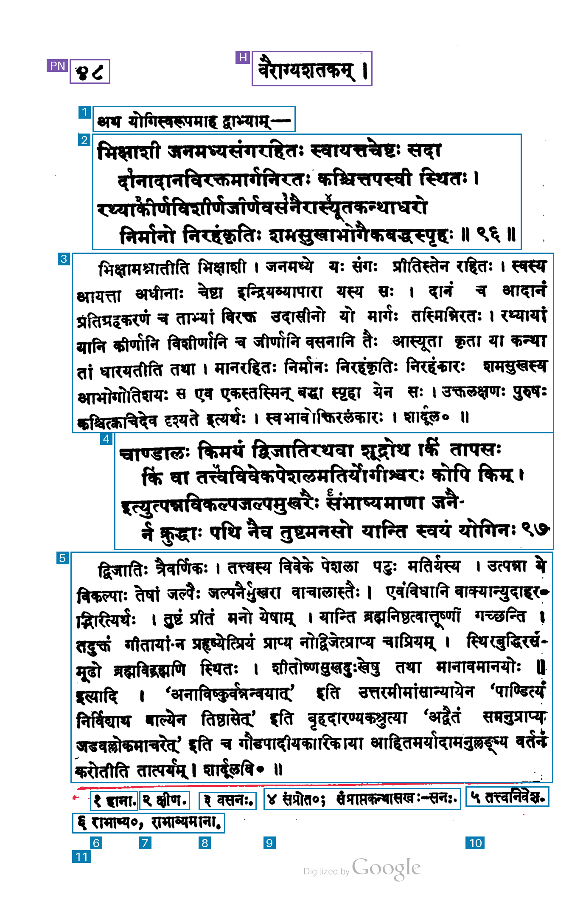
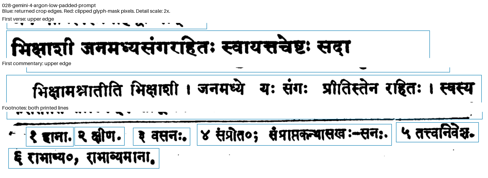
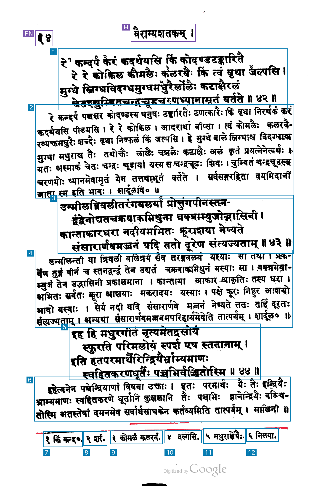
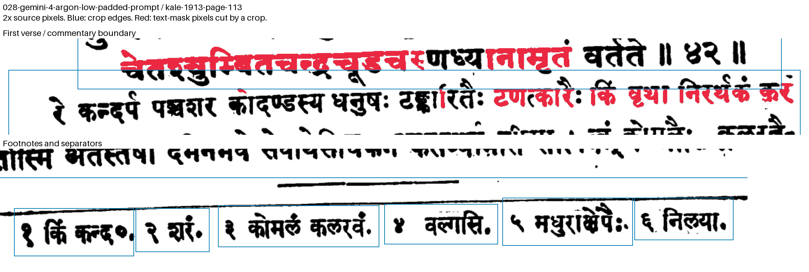
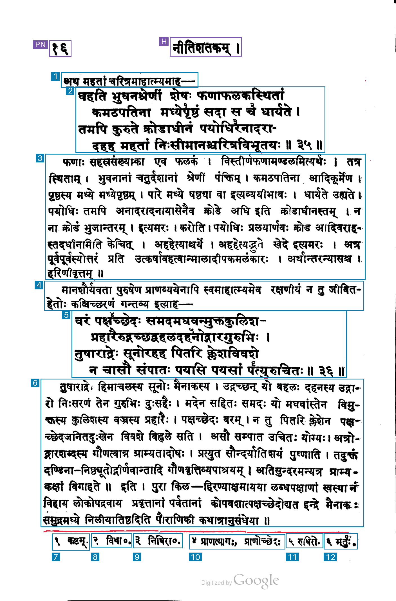
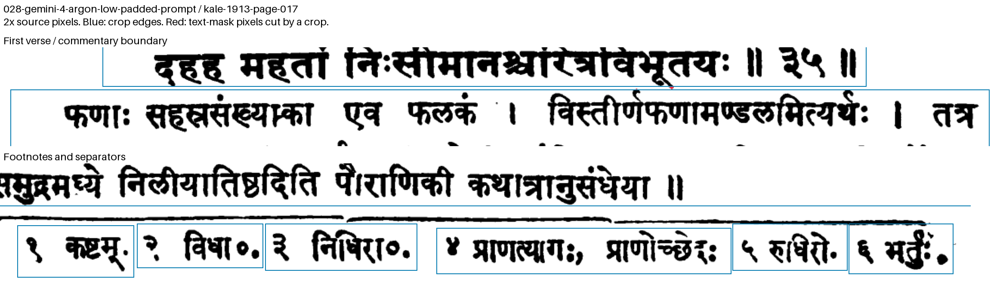

# 028-gemini-4-argon-low-padded-prompt: Gemini 4 Argon low thinking, explicit crop padding

This method sends the unchanged raw image to `gemini-4-argon` with low thinking, high image resolution and the existing native [ymin,xmin,ymax,xmax] 0–1000 schema. It uses one fresh synchronous request, maximum 16,384 output tokens including thinking, standard service tier, `store=false` and no automatic retries.

The prompt preserves the whole-verse, commentary, lead-in and individual-footnote requirements. It replaces the earlier general padding instruction with these explicit instructions:

> Include every visible glyph completely, including all diacritics, detached accents, superscripts, punctuation, upper tips and lower strokes. Never place a crop edge through printed ink.
>
> Leave a visible white margin of at least 5 normalized x units on the left and right and 3 normalized y units above and below the outermost ink (about seven original-image pixels per axis on this page). Reduce this margin only where it would include a neighboring text block or footnote, or a separator rule. Keep each footnote separate.
>
> Before returning the boxes, inspect every edge and expand any box whose edge touches or cuts a glyph. Prefer a slightly loose crop that preserves the complete glyph over a tight crop.

The schema, model ID, thinking level, image detail and API settings match method 017. The model receives the original raw image without any existing boxes or previous response. Returned coordinates are preserved and mechanically reordered/scaled to the original dimensions. Footnote display labels are placed below all footnotes.

## Run

```sh
uv run python methods/028-gemini-4-argon-low-padded-prompt/run.py inputs/kale-1913-page-097.png --check
uv run python methods/028-gemini-4-argon-low-padded-prompt/run.py inputs/kale-1913-page-097.png
```

For another request, select a fresh `--output-dir`; existing output is protected against overwriting. Authentication uses the configured Google environment variables or the stored `llm` key named `gemini`.

## Artifacts and accounting

The output preserves the exact request, prompt, raw response, exact model text, parsed JSON, original and derived coordinates, source hashes, usage, timing, cost, overlay and measurement mask. API wall time ends after reading the response body and excludes local rendering. Text output and thinking are added once for output pricing; the unchanged pricing snapshot is dated 2026-11-03.

Blue marks kept regions, purple excluded page furniture and red uncovered measured ink.

[Native coordinates](https://aistudio.google.com/docs/image-understanding#object-detection), [thinking settings](https://aistudio.google.com/docs/thinking), [pricing](https://aistudio.google.com/docs/pricing).

## Recorded page-97 result

Input `kale-1913-page-097`, unchanged raw PNG, 1374 × 2114 pixels.

**Run:** 2026-11-04 05:39:11 UTC.

| Measurement | Result |
| --- | --- |
| Output boxes | 13 |
| Boxes marked keep=true | 11 |
| Regions marked uncertain | 0 |
| Footnote regions | 6 |
| Source text components cut by crop edges, separator excluded | 19 |
| Output text components cut by crop edges, separator excluded | 0 |
| API wall time | 9.15 s |
| Input tokens | 1,920 |
| Text output tokens | 571 |
| Thinking tokens | 0 |
| Output tokens, including thinking | 571 |
| Cached input tokens | 0 |
| Coordinate clamping adjustments | 0 |
| Estimated paid-tier API cost | $0.00955 |

The estimated paid-tier cost uses $2 per million input tokens and $10 per million output tokens including thinking: (1,920 × $2 + 571 × $10) / 1,000,000 = $0.00955. Rates checked on 2026-11-03.

The boundary audit counts connected foreground components that cross individual kept crop edges in the grayscale <175 mask, after the existing speckle and margin filtering. Visual inspection identifies two slanted-separator components, bounded by [1096,1835,1273,1845] and [182,1839,1094,1858] in original-image pixels; these are reported separately from text-component cuts.

Returned region types: 2 verse, 2 commentary, 1 lead-in, 6 footnote, 1 running header and 1 page number.

Both four-line verses remain whole, with separate commentary and lead-in regions and six individual footnotes. The boxes have visible white margins. The audit finds zero cut text components after excluding the slanted separator. Part of that separator remains inside the final commentary crop.

The full-page overlay marks kept boxes blue, page furniture purple and uncovered measured ink red. Reading-order labels for footnotes appear below both printed footnote lines.



The enlarged panels show original pixels at 2× scale, crop edges in blue and clipped text-mask pixels in red.




## Boundary review

The identical audit script is saved with all four new methods. For this page, visual inspection identifies connected-component IDs 443 and 444 as the two slanted-separator fragments:

```sh
uv run python methods/028-gemini-4-argon-low-padded-prompt/audit_boundaries.py inputs/kale-1913-page-097.png outputs/kale-1913-page-097/028-gemini-4-argon-low-padded-prompt/regions.json --separator-components 443 444
```

The resulting `boundary-review/audit.json` preserves all raw cuts, separator annotations, component boxes, exact pixel counts, crop windows and provenance hashes. `boundary-review/details.png` shows enlarged edges. Existing review output is protected against overwriting.

## Recorded test on PDF page 113 / 252

Input `kale-1913-page-113`, unchanged raw PNG, 1370 × 2118 pixels.

```sh
uv run python methods/028-gemini-4-argon-low-padded-prompt/run.py inputs/kale-1913-page-113.png --check
uv run python methods/028-gemini-4-argon-low-padded-prompt/run.py inputs/kale-1913-page-113.png
```

The completed output is `outputs/kale-1913-page-113/028-gemini-4-argon-low-padded-prompt/`; use a fresh `--output-dir` for a repeat run.

**Run:** 2026-11-04 05:59:44 UTC.

| Measurement | Result |
| --- | --- |
| Output boxes | 14 |
| Boxes marked keep=true | 12 |
| Regions marked uncertain | 0 |
| Footnote regions | 6 |
| Unique text components cut by kept crop edges | 53 |
| Overlapping kept-box pairs containing text | 5 |
| Detected separator pixels inside kept boxes | 2161 |
| API wall time | 12.82 s |
| Input tokens | 1,920 |
| Text output tokens | 614 |
| Thinking tokens | 0 |
| Output tokens, including thinking | 614 |
| Cached input tokens | 0 |
| Coordinate clamping adjustments | 0 |
| Estimated paid-tier API cost | $0.00998 |

The estimated paid-tier cost uses $2 per million input tokens and $10 per million output tokens including thinking: (1,920 × $2 + 614 × $10) / 1,000,000 = $0.00998. Rates checked on 2026-11-03.

The audit uses grayscale <175, speckle and margin filtering, and the same automatic thin-line separator detector for all compared results. It counts connected text components crossing individual kept crop edges, kept-box overlaps containing text-mask pixels, and detected separator pixels inside kept boxes. A cut can belong to text from a neighboring passage that enters a crop.

Returned region types: 1 page number, 1 running header, 3 verse, 3 commentary, 6 footnote.

Three four-line verse groups, three commentary passages and six individual footnotes are returned. Neighboring body boxes overlap at five transitions, with text in each intersection. Several crop edges pass through upper or lower glyph parts. The audit records 53 cut text components.

The full-page overlay marks kept boxes blue and excluded page furniture purple. Red marks uncovered pixels from the method's analysis mask. The enlarged inspection marks text-mask pixels cut by individual crops in red.






## Recorded test on PDF page 17 / 252

Input `kale-1913-page-017`, unchanged raw PNG, 1407 × 2135 pixels.

```sh
uv run python methods/028-gemini-4-argon-low-padded-prompt/run.py inputs/kale-1913-page-017.png --check
uv run python methods/028-gemini-4-argon-low-padded-prompt/run.py inputs/kale-1913-page-017.png
```

The completed output is `outputs/kale-1913-page-017/028-gemini-4-argon-low-padded-prompt/`; use a fresh `--output-dir` for a repeat run.

**Run:** 2026-11-04 06:00:06 UTC.

| Measurement | Result |
| --- | --- |
| Output boxes | 14 |
| Boxes marked keep=true | 12 |
| Regions marked uncertain | 0 |
| Footnote regions | 6 |
| Unique text components cut by kept crop edges | 8 |
| Overlapping kept-box pairs containing text | 1 |
| Detected separator pixels inside kept boxes | 305 |
| API wall time | 8.06 s |
| Input tokens | 1,961 |
| Text output tokens | 617 |
| Thinking tokens | 0 |
| Output tokens, including thinking | 617 |
| Cached input tokens | 0 |
| Coordinate clamping adjustments | 0 |
| Estimated paid-tier API cost | $0.010092 |

The estimated paid-tier cost uses $2 per million input tokens and $10 per million output tokens including thinking: (1,961 × $2 + 617 × $10) / 1,000,000 = $0.010092. Rates checked on 2026-11-03.

The audit uses grayscale <175, speckle and margin filtering, and the same automatic thin-line separator detector for all compared results. It counts connected text components crossing individual kept crop edges, kept-box overlaps containing text-mask pixels, and detected separator pixels inside kept boxes. A cut can belong to text from a neighboring passage that enters a crop.

Returned region types: 1 page number, 1 running header, 2 lead in, 2 verse, 2 commentary, 6 footnote.

Both verses remain whole, with separate commentary, lead-ins and six footnotes. Some glyph tips still cross crop edges. One neighboring pair overlaps printed text.

The full-page overlay marks kept boxes blue and excluded page furniture purple. Red marks uncovered pixels from the method's analysis mask. The enlarged inspection marks text-mask pixels cut by individual crops in red.




