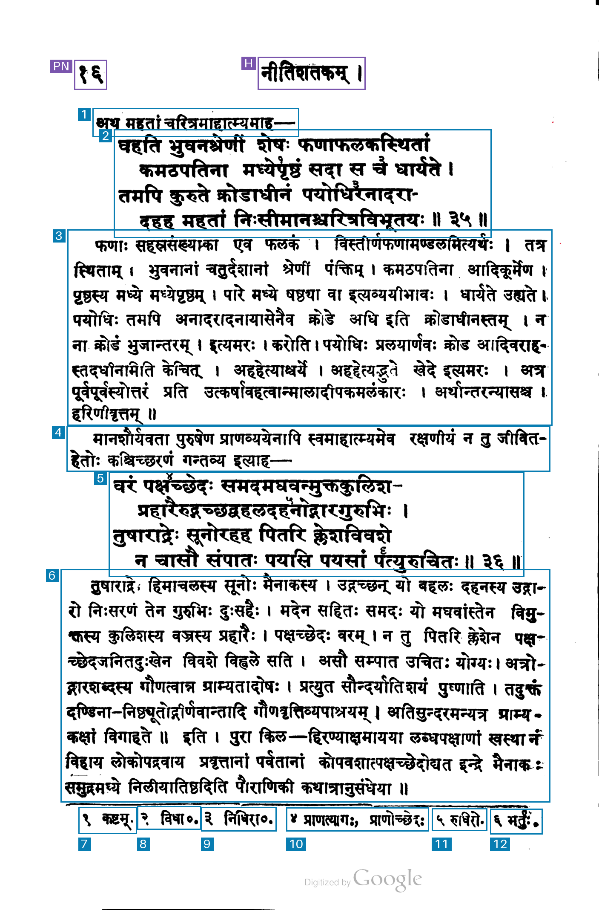
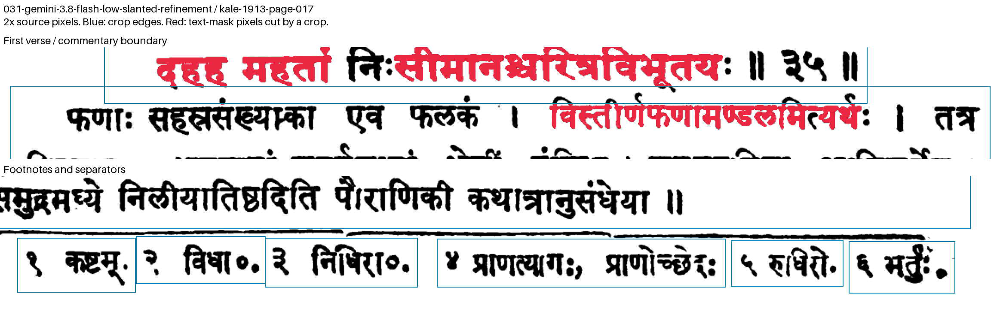
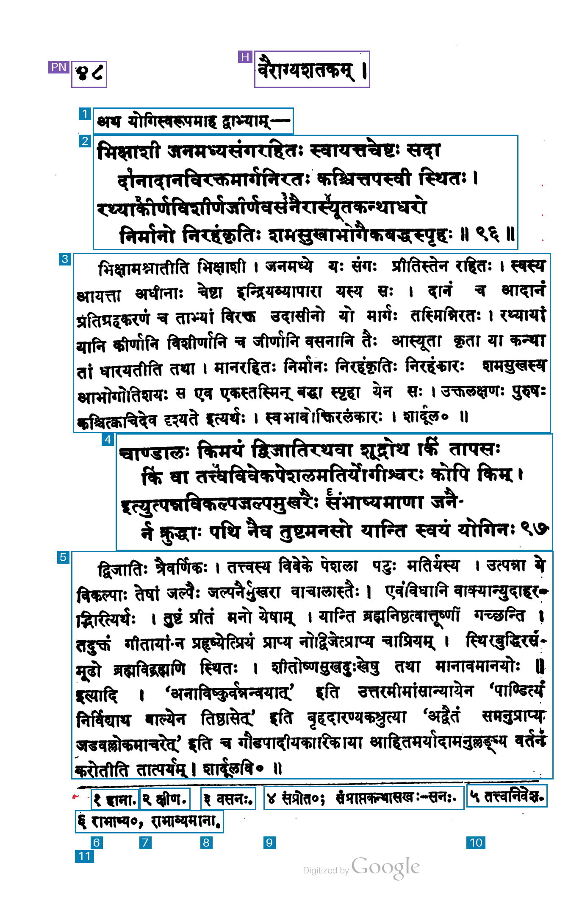
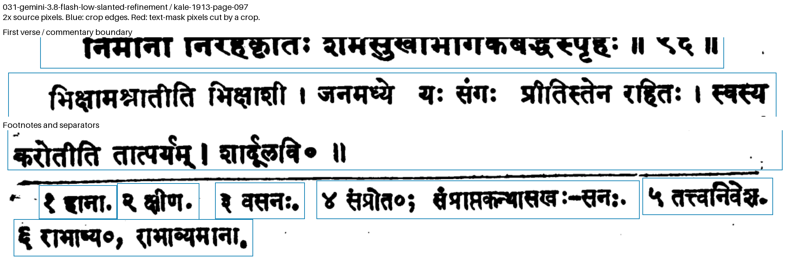
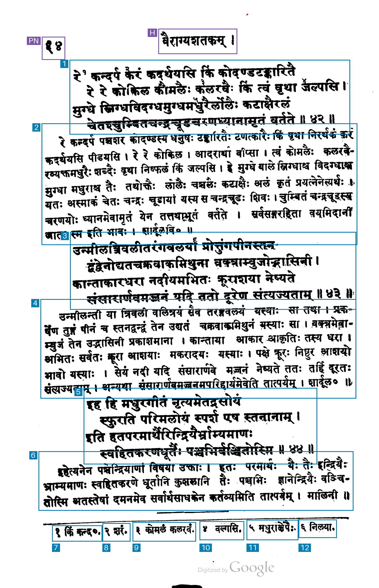
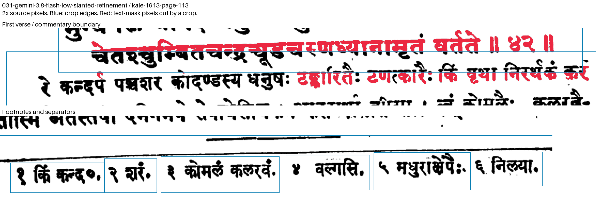

# 031-gemini-3.8-flash-low-slanted-refinement: Gemini 3.8 Flash low thinking + component completion, padding and slanted-separator handling

This pipeline applies the component-completion and padding steps from method 027 to the same pinned source method, `018-gemini-3.8-flash-low-native`. It retains region count, semantic types, keep flags, reading order and source uncertainty flags. Original boxes remain in `base_regions` and `source_box`.

Before component ownership is assigned, a separator detector examines thresholded source pixels. It accepts components spanning at least max(80 pixels, 8% of image width), aspect ratio at least 10, height at most 5% of image height and at least 95% filled columns. It requires median column thickness at most max(3 pixels, 0.3% of image height), maximum thickness at most twice that, absolute fitted slope at most 0.05 and 95th-percentile line-fit residual at most max(1.5 pixels, 0.15% of image height). Accepted line pixels are excluded from the text mask.

The inherited completion step restores owned glyph components within 1.5% of image width and 1.2% of image height of the source box. It then requests padding of ceil(0.5% of image width) horizontally and ceil(0.3% of image height) vertically, with neighboring-box constraints.

The final step caps vertical edges at the detected separator's local envelope over the crop's x span, with a one-pixel gap where text permits. It can remove source whitespace and separator pixels that were already inside a box. It preserves all owned text components and all text-mask pixels originally inside the source box. Cases whose protected text spans the separator remain flagged. Overlapping source grouping remains recorded for inspection.

## Run

```sh
uv run python methods/031-gemini-3.8-flash-low-slanted-refinement/test_refinement.py
uv run python methods/031-gemini-3.8-flash-low-slanted-refinement/run.py inputs/kale-1913-page-097.png --check
uv run python methods/031-gemini-3.8-flash-low-slanted-refinement/run.py inputs/kale-1913-page-097.png
```

Run the pinned source method on the same input first. Use `--base-regions` to select another saved run of that method and `--output-dir` for a fresh repeat output. Existing output is protected against overwriting.

## Artifacts

`regions.json` saves original and final boxes, source hashes, component assignments, line-fit evidence, exact separator columns, padding and trimming constraints, unresolved relationships, diagnostics and timings. `ink-mask.png` is the refinement text mask; `original-analysis-mask.png` preserves the earlier mask; `separator-mask.png` identifies detected line pixels. `separators-overlay.png` marks those pixels orange on the original scan.

`overlay.png` and `source-overlay.png` use the same renderer and text mask. Blue marks kept regions, purple excluded furniture, and red text-mask pixels outside the boxes. API costs and timing for the original source request are retained separately. This local step makes zero API calls.

## Recorded test on PDF page 17 / 252

Input `kale-1913-page-017`, unchanged raw PNG, 1407 × 2135 pixels.

```sh
uv run python methods/031-gemini-3.8-flash-low-slanted-refinement/run.py inputs/kale-1913-page-017.png --check
uv run python methods/031-gemini-3.8-flash-low-slanted-refinement/run.py inputs/kale-1913-page-017.png
```

The completed output is `outputs/kale-1913-page-017/031-gemini-3.8-flash-low-slanted-refinement/`; use a fresh `--output-dir` for a repeat run.

**Run:** 2026-11-04 06:05:32 UTC.

| Measurement | Result |
| --- | --- |
| Output boxes | 14 |
| Boxes marked keep=true | 12 |
| Regions marked uncertain | 0 |
| Footnote regions | 6 |
| Unique text components cut by kept crop edges | 25 |
| Overlapping kept-box pairs containing text | 3 |
| Detected separator pixels inside kept boxes | 0 |
| Source text components cut by kept crop edges | 15 |
| Detected separator fragments | 3 |
| Regions constrained by separators | 4 |
| Requested padding per axis | 8 × 7 pixels |
| Ambiguous component assignments | 0 |
| Completed rectangle overlap warnings | 3 |
| Local refinement time | 0.0383 s |
| Local total before file writes | 0.2096 s |
| Additional API calls | 0 |
| Estimated source API cost | $0.0033975 |
| Additional API cost | $0 |

The local step uses the saved source boxes. Its additional API cost is $0; the previously recorded source request is estimated at $0.0033975.

The audit uses grayscale <175, speckle and margin filtering, and the same automatic thin-line separator detector for all compared results. It counts connected text components crossing individual kept crop edges, kept-box overlaps containing text-mask pixels, and detected separator pixels inside kept boxes. A cut can belong to text from a neighboring passage that enters a crop.

Returned region types: 1 page number, 1 running header, 2 lead in, 2 verse, 2 commentary, 6 footnote.

The detected separator stays outside every kept box, and source labels and reading order are retained. Padding extends into neighboring text at existing body-box overlaps. The audit records 25 cut text components and 3 overlaps containing text. The output retains 0 ambiguous component assignments and 3 completed-rectangle overlap warnings for inspection. Source text-mask pixels remain enclosed.

The full-page overlay marks kept boxes blue and excluded page furniture purple. Red marks uncovered pixels from the method's analysis mask. The enlarged inspection marks text-mask pixels cut by individual crops in red.






## Recorded test on PDF page 97 / 252

Input `kale-1913-page-097`, unchanged raw PNG, 1374 × 2114 pixels.

```sh
uv run python methods/031-gemini-3.8-flash-low-slanted-refinement/run.py inputs/kale-1913-page-097.png --check
uv run python methods/031-gemini-3.8-flash-low-slanted-refinement/run.py inputs/kale-1913-page-097.png
```

The completed output is `outputs/kale-1913-page-097/031-gemini-3.8-flash-low-slanted-refinement/`; use a fresh `--output-dir` for a repeat run.

**Run:** 2026-11-04 06:05:33 UTC.

| Measurement | Result |
| --- | --- |
| Output boxes | 13 |
| Boxes marked keep=true | 11 |
| Regions marked uncertain | 0 |
| Footnote regions | 6 |
| Unique text components cut by kept crop edges | 0 |
| Overlapping kept-box pairs containing text | 0 |
| Detected separator pixels inside kept boxes | 0 |
| Source text components cut by kept crop edges | 17 |
| Detected separator fragments | 2 |
| Regions constrained by separators | 5 |
| Requested padding per axis | 7 × 7 pixels |
| Ambiguous component assignments | 0 |
| Completed rectangle overlap warnings | 0 |
| Local refinement time | 0.0361 s |
| Local total before file writes | 0.2225 s |
| Additional API calls | 0 |
| Estimated source API cost | $0.0031905 |
| Additional API cost | $0 |

The local step uses the saved source boxes. Its additional API cost is $0; the previously recorded source request is estimated at $0.0031905.

The audit uses grayscale <175, speckle and margin filtering, and the same automatic thin-line separator detector for all compared results. It counts connected text components crossing individual kept crop edges, kept-box overlaps containing text-mask pixels, and detected separator pixels inside kept boxes. A cut can belong to text from a neighboring passage that enters a crop.

Returned region types: 1 page number, 1 running header, 1 lead in, 2 verse, 2 commentary, 6 footnote.

Both verses, commentary passages and the lead-in retain their source grouping; each of the six footnotes remains separate. The detected separator stays outside every kept box. The audit records zero cut text components and zero overlaps containing text. Component assignments and completed rectangles produce zero ambiguity or overlap warnings.

The full-page overlay marks kept boxes blue and excluded page furniture purple. Red marks uncovered pixels from the method's analysis mask. The enlarged inspection marks text-mask pixels cut by individual crops in red.






## Recorded test on PDF page 113 / 252

Input `kale-1913-page-113`, unchanged raw PNG, 1370 × 2118 pixels.

```sh
uv run python methods/031-gemini-3.8-flash-low-slanted-refinement/run.py inputs/kale-1913-page-113.png --check
uv run python methods/031-gemini-3.8-flash-low-slanted-refinement/run.py inputs/kale-1913-page-113.png
```

The completed output is `outputs/kale-1913-page-113/031-gemini-3.8-flash-low-slanted-refinement/`; use a fresh `--output-dir` for a repeat run.

**Run:** 2026-11-04 06:05:35 UTC.

| Measurement | Result |
| --- | --- |
| Output boxes | 14 |
| Boxes marked keep=true | 12 |
| Regions marked uncertain | 0 |
| Footnote regions | 6 |
| Unique text components cut by kept crop edges | 119 |
| Overlapping kept-box pairs containing text | 5 |
| Detected separator pixels inside kept boxes | 0 |
| Source text components cut by kept crop edges | 63 |
| Detected separator fragments | 2 |
| Regions constrained by separators | 7 |
| Requested padding per axis | 7 × 7 pixels |
| Ambiguous component assignments | 10 |
| Completed rectangle overlap warnings | 5 |
| Local refinement time | 0.0363 s |
| Local total before file writes | 0.1823 s |
| Additional API calls | 0 |
| Estimated source API cost | $0.00329175 |
| Additional API cost | $0 |

The local step uses the saved source boxes. Its additional API cost is $0; the previously recorded source request is estimated at $0.00329175.

The audit uses grayscale <175, speckle and margin filtering, and the same automatic thin-line separator detector for all compared results. It counts connected text components crossing individual kept crop edges, kept-box overlaps containing text-mask pixels, and detected separator pixels inside kept boxes. A cut can belong to text from a neighboring passage that enters a crop.

Returned region types: 1 page number, 1 running header, 3 verse, 3 commentary, 6 footnote.

The detected separator stays outside every kept box, and source labels and reading order are retained. Padding extends into neighboring text at existing body-box overlaps. The audit records 119 cut text components and 5 overlaps containing text. The output retains 10 ambiguous component assignments and 5 completed-rectangle overlap warnings for inspection. Source text-mask pixels remain enclosed.

The full-page overlay marks kept boxes blue and excluded page furniture purple. Red marks uncovered pixels from the method's analysis mask. The enlarged inspection marks text-mask pixels cut by individual crops in red.





## Reproduce the common boundary review

The review uses this method's automatic separator detector and analysis mask on any saved result for the same input. It saves `separator-review/audit.json` and an enlarged pixel inspection, protecting existing review output.

```sh
uv run python methods/031-gemini-3.8-flash-low-slanted-refinement/review.py inputs/kale-1913-page-097.png outputs/kale-1913-page-097/031-gemini-3.8-flash-low-slanted-refinement/regions.json
```

Ten focused tests cover component completion, detached accents, neighbor padding, ambiguous ownership, slanted rules, character stems, rules touching glyphs, protected-text trimming and separator-spanning text. The identical implementation is used in methods 030 and 031; only their source method IDs differ.
