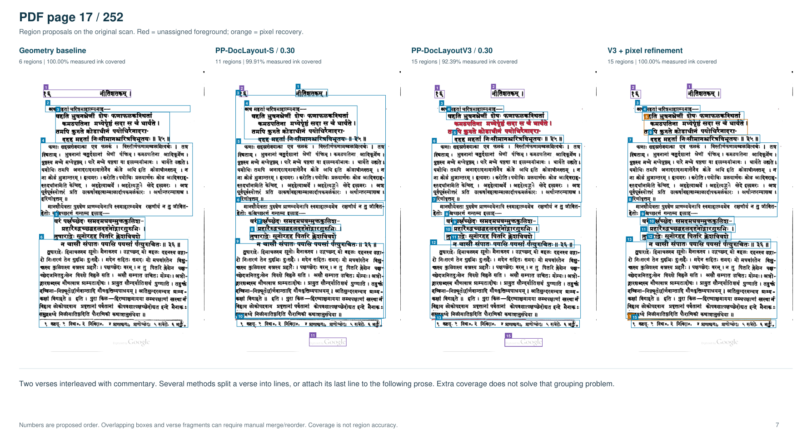

# Getting useful layout boxes from scanned books

Living comparison, started 2026-11-01. The immediate goal is to find ordered,
editable regions for cropping and reassembling the **original scan pixels**:
whole Sanskrit verses, separate commentary, lead-ins and footnotes, with page
furniture identified for exclusion. OCR transcription is not needed.

The existing evidence favors PP-DocLayoutV3 over PP-DocLayout-S for retaining
Sanskrit text at the tested settings. It does **not** establish that either model
produces the passage groups we want. The interactive vision pilot suggests that
a general vision model can improve grouping; independent provider comparisons
are the next experiment.

## Evidence collected so far

| Experiment | Material | Status |
| --- | --- | --- |
| Geometry, PP-DocLayout-S, PP-DocLayoutV3, and V3 with pixel recovery | 24 selected pages from one 252-page book | Saved local CPU detections, diagnostics and qualitative review notes |
| Interactive assistant vision grouping | PDF pages 17, 97 and 113; seven proposed whole verses | Saved illustration with conversation context; not a blind API experiment |
| Fresh OpenAI, Anthropic, Google and xAI model requests | Same three unannotated pages initially | Planned; no provider benchmark calls made in this session |

All page numbers below are **1-based PDF positions**, not printed page labels.
The 24 pages were selected, not randomly sampled. The three vision pages are
difficult Sanskrit examples within that set, not a representative test set.

The available [vision pilot PDF](output/Kale-vision-pilot.pdf) compares V3 with
the interactive proposals. The earlier archive references a separate
`Kale-region-comparison.pdf`, which is not present in this workspace; its
[implementation, raw results and review notes are available in the archive](input/Kale-region-experiment.zip).
The numbers below are recalculated from those raw results, rather than copied
from a missing report.

## 1. Specialized layout detectors and geometry

The original PDF was rendered at 300 dpi; its text layer was ignored. Learned
detectors used pinned **community ONNX exports**, rather than a new run of
the upstream Paddle inference pipeline. The archive's `models.json` records
download URLs, revisions and SHA-256 checksums.

| Method               | What was actually run                                                                      | Expected role and observed limitation                                                                               |
| -------------------- | ------------------------------------------------------------------------------------------ | ------------------------------------------------------------------------------------------------------------------- |
| Custom geometry      | Whitespace, line bands, indentation and connected components                               | Fast proposals without learned inference; often merges passages and has substantial omissions on crowded page 113   |
| PP-DocLayout-S       | 480 × 480 detector input, confidence ≥ 0.30; class-agnostic NMS at IoU 0.55                | Small detector; omits verse material on several Sanskrit pages; enclosing boxes can hide missing internal structure |
| PP-DocLayoutV3       | 800 × 800 detector input, confidence ≥ 0.30; saved candidates down to 0.20                 | Better coverage on these Sanskrit pages, but often splits verses into lines and retains overlapping predictions     |
| V3 sensitivity check | Same inference candidates, confidence ≥ 0.50                                               | Shows how much verse content is lost at a stricter threshold                                                        |
| V3 + pixel recovery  | V3 at 0.30, connected-component boundary extension, residual-ink boxes, spatial reordering | Recovers missed foreground and protects crop edges; does not resolve semantic grouping                              |

The custom geometry method is **not k2pdfopt**; k2pdfopt was not run. The detector
label sets do not provide the requested semantic verse/commentary grouping.
V3 polygon masks were not evaluated. V3's learned order is saved; the other
methods use spatial order, so reading-order quality has not been independently
compared.

### Coverage and region counts

<!-- BEGIN GENERATED BASELINES -->

| Method | Pooled ink covered | Mean page | Worst page | Total boxes |
| --- | --- | --- | --- | --- |
| Custom geometry | 97.80% | 98.19% | 61.45% | 150 |
| PP-DocLayout-S (0.30) | 94.41% | 94.90% | 77.33% | 210 |
| PP-DocLayoutV3 (0.30) | 98.65% | 98.66% | 92.06% | 327 |
| PP-DocLayoutV3 (0.50) | 88.76% | 89.53% | 33.41% | 227 |
| V3 + pixel recovery | 99.94% | 99.94% | 99.67% | 304 |

<!-- END GENERATED BASELINES -->

Pooled coverage is `1 − total uncovered ink / total measured ink`. Mean-page
coverage weights every page equally; pooled coverage weights pages by measured
ink. The distinction matters when comparing summaries.

**These are foreground diagnostics, not segmentation accuracy.** A whole-page
rectangle would cover all the ink while failing the task. Region counts include
the methods' proposed furniture and other regions; fewer boxes do not necessarily
mean better grouping.

The shared mask excludes the top 2.5%, bottom 6%, left 2.5% and right 2% of each
image, plus tiny components, narrow tall borders and some long thin rules.
The bottom band removes this scan's Google watermark. Ornaments and stray marks
can remain inside the mask; text near excluded edges is outside this measurement.

### Which pages account for the difference?

These descriptive groups follow the saved page notes. They are not independent
corpora or a newly annotated ground-truth classification.

<!-- BEGIN GENERATED STRATA -->

| Page group | Pages | Geometry | S (0.30) | V3 (0.30) | V3 + recovery |
| --- | --- | --- | --- | --- | --- |
| Opening / contents | 3 | 99.98% | 98.33% | 98.93% | 99.95% |
| Sanskrit verse / commentary | 10 | 95.68% | 88.33% | 97.44% | 99.91% |
| English translation | 5 | 99.91% | 99.61% | 99.72% | 99.97% |
| Notes / final page | 6 | 99.16% | 99.83% | 99.93% | 99.99% |

<!-- END GENERATED STRATA -->

This supports a narrow finding: **Sanskrit verse/commentary pages distinguish
these methods much more than the regular English pages do.** An overall average
alone obscures that difference.

The original recorded mean detector stages were about **27 ms/page for S**
and **1.238 s/page for V3**, using CPUExecutionProvider with two intra-op threads.
These historical times include preprocessing and inference after model loading;
they exclude rendering, mask creation, diagnostics and drawing. Geometry's
roughly 25 ms timer also excludes its mask pass. The threshold-refinement script
does not re-time hybrid cleanup, so the stored cleanup timings cannot be assigned
to the final hybrid boxes. These are not end-to-end or current-machine timings.

### Cases worth keeping in every review

| PDF page | Saved observation | What it teaches us |
| --- | --- | --- |
| 17 | S covers 99.91% of measured ink, V3 92.39%; several methods split verses or attach a last line to prose | V3 does not win every page; ink retention and meaningful grouping are separate |
| 33 | S covers 99.90% using a large enclosing body region | High coverage can conceal unusable segmentation |
| 57 | S covers 77.33%; V3 at 0.30 covers 99.98% | Missing verse content is a real detector failure on this sample |
| 97 | V3 coverage rises from 33.41% at 0.50 to 95.65% at 0.30 | Confidence calibration materially changes the result |
| 113 | Geometry covers 61.45%, while both learned detectors cover about 99.4% | Deterministic geometry can omit complete text; crowded boundaries also challenge vision estimates |
| 145 / 161 | Geometry merges numbered English entries despite nearly complete coverage | Internal divisions matter even on easy pages |

These are observations from the [saved review notes](input/review-notes.json),
supported where numeric by [the saved detections](input/regions.json).
They do not constitute a formal region-accuracy evaluation.

The archive also contains this saved comparison plate for PDF page 17:



## 2. What the existing interactive vision pilot adds

The assistant proposed all seven visible verse passages as whole blocks on pages
17, 97 and 113, with separate commentary, lead-ins, footnotes and furniture.
The [frozen proposals](vision-regions.json) retain estimated coordinates;
the [pilot PDF](output/Kale-vision-pilot.pdf) shows them beside V3.

<!-- BEGIN GENERATED PILOT -->

| PDF page | V3 boxes | Pilot boxes | Proposed verse blocks | V3 ink covered | Pilot ink covered |
| --- | --- | --- | --- | --- | --- |
| 17 | 15 | 9 | 2 | 92.39% | 98.86% |
| 97 | 16 | 8 | 2 | 95.65% | 99.13% |
| 113 | 22 | 9 | 3 | 99.40% | 98.76% |

<!-- END GENERATED PILOT -->

For page 97, ink covered by multiple boxes is 41.90% for saved V3 detections
and 0% for the interactive proposals. On page 113 it is 9.24% and 0.73%,
respectively. The pilot's estimated boxes still overlap slightly at crowded
verse/commentary boundaries. These diagnostics count all proposed boxes,
including furniture, within the same mask window.

This is evidence for testing **semantic grouping separately from crop boundary
precision**. It is not a provider leaderboard: the assistant had prior
conversation context, there were no independent API requests or repetitions,
and the seven verse proposals have not been scored against an independent
reference. The saved model-family label is `gpt-6.1-sol`, with no serving snapshot;
it is not equivalent to a reproducible API configuration.

## 3. General vision models to compare next

The following exact IDs were checked against official provider documentation on
**2026-11-01**. They are candidates, not measured winners on scanned-book layout.
Account access and the returned model/version must be checked at run time.

| Provider | Initial candidate | Documented interface relevant to this experiment | Status |
| --- | --- | --- | --- |
| OpenAI | `gpt-6-astra` | Image input and structured outputs; [model documentation](https://developers.openai.com/api/docs/models/gpt-6-astra) | Not run |
| Anthropic | `claude-fable-5-1` | Image input; [current model IDs](https://platform.claude.com/docs/en/models/overview) and [JSON-schema output](https://platform.claude.com/docs/en/build-with-claude/structured-outputs) | Not run |
| Google | `gemini-4-argon` | Image input and structured outputs; [model documentation](https://ai.google.dev/gemini-api/docs/models/gemini-4-argon) | Not run |
| xAI | `grok-4.7` | Image input and structured outputs; [model documentation](https://docs.x.ai/developers/models/grok-4.7) | Not run |

Once quality is established, compare less expensive or faster options:
OpenAI `gpt-6.1-sol`, `gpt-6.1-terra` and `gpt-6-luna`
([OpenAI model catalog](https://developers.openai.com/api/docs/models));
Anthropic `claude-opus-5-5` and `claude-sonnet-5-5`
([Anthropic model catalog](https://platform.claude.com/docs/en/models/overview));
Google `gemini-3.8-flash`
([image-input and structured-output capabilities](https://ai.google.dev/gemini-api/docs/models/gemini-3.8-flash)).
A provider's general capability claims do not establish box quality on this book.

For implementation, OpenAI's Responses API uses a JSON-schema
`text.format` ([official OpenAI documentation](https://developers.openai.com/api/docs/guides/structured-outputs));
Claude's Messages API uses `output_config.format`
([Anthropic documentation](https://platform.claude.com/docs/en/build-with-claude/structured-outputs));
Gemini's Interactions API uses JSON `response_format` with a schema
([Google documentation](https://ai.google.dev/gemini-api/docs/structured-output));
xAI documents structured JSON output for its Responses API
([xAI documentation](https://docs.x.ai/developers/model-capabilities/text/structured-outputs)).
Valid JSON still needs geometric and semantic validation.

### A controlled prompt test, then a coordinate-format test

**A — Same prompt:** use the existing [PROMPT.md](PROMPT.md) verbatim, one
unannotated image per fresh request, with no tools, earlier detections, examples
from these pages or chat history. Keep its `[x1,y1,x2,y2]`, 0–1000 box convention.
Use an equivalent response schema wherever supported, recording the exact schema.

**B — Provider-recommended coordinates:** preserve the grouping instructions,
but explicitly version the coordinate instruction and schema. Anthropic recommends
absolute pixel coordinates and warns against asking Claude for normalized boxes
([coordinate documentation](https://platform.claude.com/docs/en/build-with-claude/vision-coordinates)).
Gemini's detection examples use 0–1000 coordinates ordered
`[ymin,xmin,ymax,xmax]`
([image understanding documentation](https://ai.google.dev/gemini-api/docs/image-understanding)).
Convert results into the shared x/y schema in code, retaining the raw values.
If a provider resizes the image, record the coordinate frame and mapping.

Report A and B separately: A tests a shared instruction, while B tests whether
a provider's preferred representation improves localization. Do not silently
transpose axes, clamp invalid values, repair outputs, or merge regions before
saving raw results.

### First run and expansion

1. Start with the three existing unannotated PNGs: page 17 is 676 × 1025,
   page 97 is 660 × 1015, page 113 is 658 × 1017. Send identical image bytes to
   every model. This tests the existing small renders, not the 300-dpi detector
   inputs; record provider resizing and image-detail settings. Test higher
   resolution as a separate arm before attributing differences to model family.
2. Make **three fresh requests per page per model**: 36 planned requests for
   the four initial candidates in arm A. Preserve failures and retries.
   Use a fixed, recorded configuration per model; a common setting named
   “high” does not imply equal compute across providers.
3. Save responses before inspecting existing proposals or making prompt changes.
   Any subsequent prompt tuning gets a new version and a separate result row.
4. Expand to the original 24 pages, then a held-out sample and other books.
   Avoid selecting a winner from three difficult Sanskrit pages alone.
5. Compare direct model boxes with model grouping of independently detected,
   numbered lines. Evaluate pixel refinement as a separate postprocessing stage,
   keeping the model-only output available.

The checked provider API-key environment variables are unset in this shell.
Codex, Claude and llm executables are present; their stored credentials and
provider access have not been tested. This does not establish that API access
is unavailable. Check local authentication without printing secrets before
executing requests. No provider calls were made for this write-up.

## 4. What to measure

Create a small reference set independently of model outputs, with whole-verse
membership, commentary boundaries, footnotes, furniture and content order.
Ambiguous divisions can retain alternatives or uncertainty. The interactive
proposals are examples to review, not automatic ground truth.

| Dimension | Record for each page and repetition |
| --- | --- |
| Whole-verse grouping | Intact reference verses; extra splits; verses merged with commentary or another verse |
| Commentary and footnotes | Incorrect merges/splits, misclassified regions, missing notes or references |
| Missing and clipped content | Omitted lines; clipped glyphs/diacritics; foreground coverage as a supporting diagnostic |
| Crop precision and overlap | Region matches and IoU against reviewed boxes; excess neighboring content; duplicated ink |
| Reading order | Inversions among matched kept regions; furniture incorrectly included |
| Stability | Variation in group membership, count and matched box positions across repetitions |
| Correction effort | Splits, merges, additions, deletions, relabeling and boundary edits needed to accept a page; correction time when measured |
| Runtime and price | End-to-end latency, token usage including billed reasoning/image tokens, actual or explicitly estimated cost, failure/retry rate |

Declare matching and acceptance rules before computing accuracy; report semantic
grouping and boundary metrics separately. Do not infer manual effort from box
count, or describe foreground coverage as text recall.

Each run should save the timestamp, provider, requested and returned model IDs,
available snapshot/version, prompt text and hash, schema, image hash and dimensions,
detail/resizing settings, generation parameters, repetition, exact request body
without credentials, raw response, parsed regions, finish/error status, request ID,
usage and wall-clock time. Save repaired/refined results as derived artifacts.
For cost estimates, record the rate source/date and include failed attempts.

## Updating this comparison

`summarize_baseline.py` uses only the Python standard library. It verifies source
hashes and saved metric consistency, then regenerates the three marked tables
above plus:

- [Aggregate results and provenance](output/layout-baseline-summary.json)
- [120 per-page/method diagnostic rows](output/layout-baseline-pages.csv)

From this directory:

```sh
python3 summarize_baseline.py
python3 summarize_baseline.py --check
```

Neither command calls a model. `--check` only reads files. Add future independent
runs below with their settings, artifacts, reviewed examples and conclusions;
leave historical detector results and the interactive pilot identifiable.

## Experiment log

- **2026-11-01 — Existing evidence consolidated.** Recalculated the 24-page
  detector summaries, documented the threshold effect, included the frozen
  three-page illustration, verified current provider candidates, and specified
  the next controlled experiments. No new detector or provider inference.
