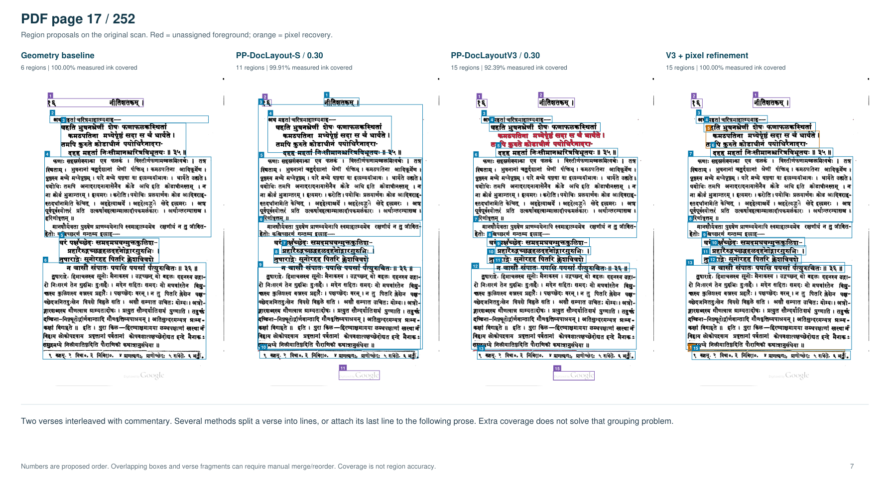

# Layout experiments

## Kale (1913), PDF page 17 / 252

Recorded on 2026-11-01 from existing test results.

The page contains two Sanskrit verses interleaved with commentary, short lead-ins, a footnote, a running header and a page number. The input page was rendered at 300 dpi, giving an image of 1407 × 2135 pixels.

Measured ink consists of pixels with grayscale intensity below 175, after excluding the top 2.5%, bottom 6%, left 2.5% and right 2% of the image and filtering small components, narrow tall borders and long horizontal rules. The resulting mask contains 410,866 pixels. Coverage is the percentage of these pixels inside at least one output box. Box counts include all output regions.

### 1. Geometry baseline

**Method:** Groups connected ink components into line bands, then groups the bands using whitespace, indentation and changes in line width.

**Result:** 6 boxes. Measured ink covered: 100.0000%. Uncovered ink: 0 pixels.

### 2. PP-DocLayout-S

**Settings:** ONNX model running on CPU; image resized to 480 × 480 pixels; confidence threshold 0.30; overlapping predictions suppressed across classes at intersection-over-union threshold 0.55.

**Result:** 11 boxes. Measured ink covered: 99.9095%. Uncovered ink: 372 pixels.

### 3. PP-DocLayoutV3

**Settings:** ONNX model running on CPU; image resized to 800 × 800 pixels; confidence threshold 0.30.

**Result:** 15 boxes. Measured ink covered: 92.3905%. Uncovered ink: 31,265 pixels.

### 4. PP-DocLayoutV3 + pixel refinement

**Method:** Starts with the PP-DocLayoutV3 boxes at confidence threshold 0.30, extends boundaries to include intersecting connected ink components, adds boxes around remaining foreground, removes boxes starting in the bottom 6% of the image, and sorts the boxes spatially. This is the method labelled “V3 + pixel refinement” in the image.

**Result:** 15 boxes. Measured ink covered: 99.9951%. Uncovered ink: 20 pixels.

### Output image

Panels run left to right in the same order as the four entries. Red marks uncovered foreground; orange marks regions added by pixel recovery. Box numbers show the proposed order. Coverage in the image is rounded to two decimal places.

