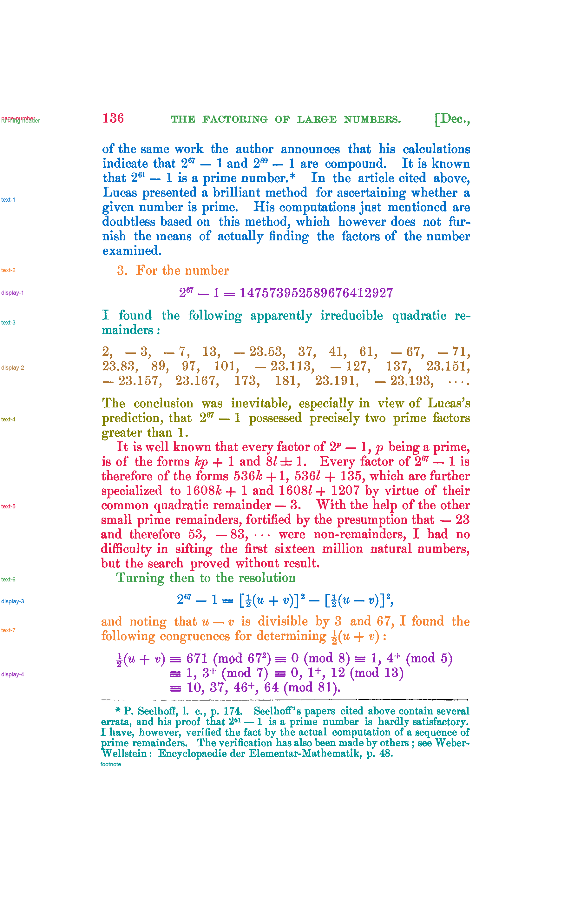

# Passage reference: F. N. Cole (1903), page 3 of 4

**Status: version 2, revised by Claude on 2026-11-04 after the user's review of version 1. The user reviewed version 2 the same day and confirmed it.** The `status` field inside `passage-spec.json` and `passages.json` predates that review; those files are left unchanged because saved evaluations record their hashes.

This is a component-level assignment of ink on [cole-1903-page-003](../../inputs/cole-1903-page-003.png) to passages. It covers the page number, running header, seven prose blocks, four displayed formulas or lists, and the footnote. The footnote rule is marked as separator. Version 1 was written before any model or method 033 output existed for this page, from the page image and the method 032 line segmentation. No model API was called for either version.

## Versions

- **Version 1** (`version-1/`, built 2026-11-04 18:19 UTC with method 033's `reference.py`; labels SHA-256 `99cf66d1e3e5…`).
  - The user's review found two problems in display-4. Part of one ≡ sign and all of the next were unlabeled, and pieces of the footnote rule were labeled display-4 and footnote.
  - Every reference evaluation of this page made before 2026-11-04 19:57 UTC used version 1. That includes the evaluations recorded in NOTEBOOK.md under "Cross-book test".
- **Version 2** (this folder, built 19:56 UTC with [method 035's `reference.py`](../../methods/035-gpt-6.1-terra-none-column-margin-ownership/reference.py); labels SHA-256 `823e6cbf7d0b…`). It keeps version 1's line assignment and adds four component rules (`components_in_boxes` in `passage-spec.json`). Each rule labels the components lying wholly inside a box:
  - **display-4:** the six bars of the ≡ signs that begin the second and third congruence rows. Four of them are on no detected line, so the line-based builder had left them unlabeled.
  - **separator:** every piece of the footnote rule. The line finder classes the broken left end of the rule (fragments 2–4 pixels high) as text, attached to lines 47 and 49 or to no line.
  - **display-2:** the minus sign before 23.157, and the four dots after 23.193. All are on no line. These were found by checking every unlabeled text component on the page, not by the user's review.

  Between the versions, 1,117 pixels changed label:
  - unlabeled to display-4: 561;
  - unlabeled to display-2: 242;
  - display-4 to separator: 124;
  - footnote to separator: 133;
  - unlabeled to separator: 57.

  No text component is left unlabeled.

## Files

- `passage-labels.png`: 8-bit labels on the method 032 hysteresis ink mask. Value 0 is unlabeled, 1–14 are the passages in `passages.json`, and 255 is separator.
- `passages.json`: legend, pixel and component counts, tight boxes, unlabeled components, and the components each component rule matched. It also records hashes of the input, spec, label image and builder code.
- `review.png`: every passage in its own color, with separators in black and unlabeled ink in light gray.
- `passage-spec.json`: the hand-written line-to-passage assignment and component rules.

