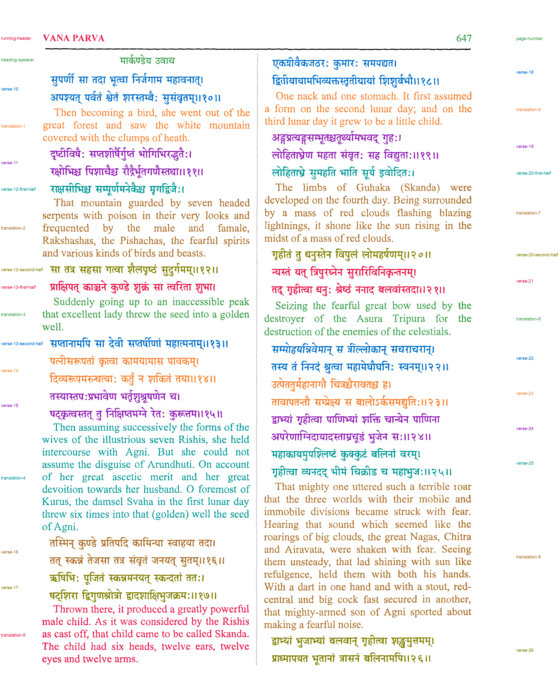

# Passage reference: M. N. Dutt, Mahābhārata, file 14F chapter 225, page 2

**Status: the user reviewed version 1 on 2026-11-04 and found the labels correct.** Version 2 has the same labels, with a review image that is easier to read. The user looked at version 2's review image the same day and confirmed it.

This is a component-level assignment of ink on [dutt-mahabharata-14f-chapter-225-page-002](../../inputs/dutt-mahabharata-14f-chapter-225-page-002.png) to passages. The page has two columns. Each column interleaves Devanagari verses, or half-verses, with English translation paragraphs. The reference has one passage per printed verse or half-verse block, per translation paragraph, and for the speaker heading, running header and page number. It was written before any model or method 033 output existed for this page, from the page image and the method 032 line segmentation. No model API was called.

## Versions

- **Version 1** (`version-1/`, built 2026-11-04 18:18 UTC with method 033's `reference.py`). Its `review.png` put every label in the left margin, which made the right column hard to read.
- **Version 2** (this folder, built 19:56 UTC with [method 035's `reference.py`](../../methods/035-gpt-6.1-terra-none-column-margin-ownership/reference.py)). The passage assignment is unchanged; only the spec's `status` text differs. The label image is byte-identical to version 1 (SHA-256 `75f0a6caf3da…`), so every evaluation made against version 1 also holds for version 2. In `review.png`, right-column passages are labeled in a margin added to the right of the page.

## Files

- `passage-labels.png`: 8-bit labels on the method 032 hysteresis ink mask. Value 0 is unlabeled, 1–32 are the passages in `passages.json`, and 255 is separator.
- `passages.json`: legend, pixel and component counts, tight boxes, unlabeled components, and hashes of the input, spec, label image and builder code.
- `review.png`: every passage in its own color, with separators in black and unlabeled ink in light gray.
- `passage-spec.json`: the hand-written line-to-passage assignment.

