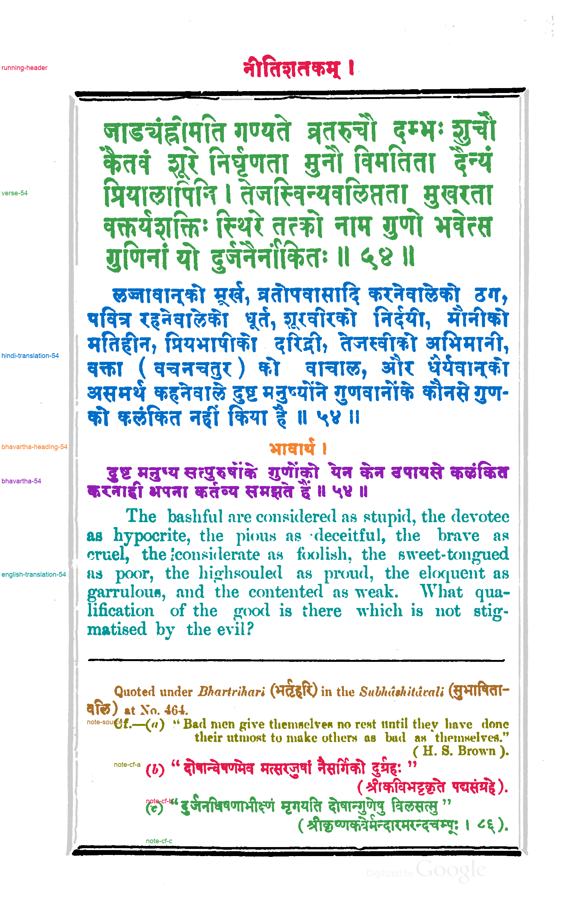

# Passage reference: Nītiśataka, Śṛṅgāraśataka and Vairāgyaśataka (1896), PDF page 123

**Status: version 3, revised by Claude on 2026-11-04. It is version 2, which the user reviewed and confirmed, with one more correction. The user reviewed version 3 the same day and confirmed it.** Version 2's files are in `version-2/` and version 1's in `version-1/`.

This is a component-level assignment of ink on [gopinath-1896-page-123](../../inputs/gopinath-1896-page-123.png) to passages. It covers the running header, verse 54, its Hindi translation, the भावार्थ heading and paragraph, the English translation, and four separately set note items. Version 1 was written before any model or method 033 output existed for this page, from the page image and the method 032 line segmentation. No model API was called for either version.

The page frame is not text:
- its top and bottom are labeled separator;
- its vertical bars and the small frame pieces that the line finder attaches to text lines are unlabeled.

## Versions

- **Version 1** (`version-1/`, built 2026-11-04 18:15 UTC with method 033's `reference.py`; labels SHA-256 `ad1f8c802d4b…`).
  - The user's review found a small piece of the frame's inner top rule labeled verse-54.
  - Every reference evaluation of this page made before 2026-11-04 19:57 UTC used version 1. That includes the evaluations recorded in NOTEBOOK.md under "Cross-book test".
- **Version 2** (this folder, built 19:56 UTC with [method 035's `reference.py`](../../methods/035-gpt-6.1-terra-none-column-margin-ownership/reference.py); labels SHA-256 `2d21c6feecda…`). It keeps version 1's line assignment and adds two component rules (`components_in_boxes` in `passage-spec.json`):
  - **unlabeled:** the frame piece (x 586–672, y 261–267, 438 pixels), which the line finder attaches to line 1;
  - **note-cf-a:** the "e" of "done" at the end of line 29 (174 pixels). It is on no detected line. It was found by checking every unlabeled text component on the page, not by the user's review.

  The remaining unlabeled text components are frame pieces and specks outside the text.
- **Version 3** (this folder, built 2026-11-04 22:16 UTC with the same builder; labels SHA-256 `f47edb4f8157…`).
  - **The error:** version 2 labeled the closing quotation mark of note (b) as note-cf-a. The quote follows दुर्ग्रहः but sits high, so the line finder put it on the "(H. S. Brown)." line of note (a), above and to the right, and the line-based builder followed.
  - **The fix:** a third component rule labels the quote note-cf-b, so 103 pixels change from note-cf-a to note-cf-b.
  - **How it was found:** while testing method 039, which places such short glyphs by the line band they sit in. A search of all nine references for glyphs labeled differently from the line band they sit in found this quote and one 15-pixel speck in Telang page 108's margin; the speck was left as it is.
  - **Evaluations:** those made before 22:16 UTC used version 1 or 2.

## Files

- `passage-labels.png`: 8-bit labels on the method 032 hysteresis ink mask. Value 0 is unlabeled, 1–10 are the passages in `passages.json`, and 255 is separator.
- `passages.json`: legend, pixel and component counts, tight boxes, unlabeled components, and the components each component rule matched. It also records hashes of the input, spec, label image and builder code.
- `review.png`: every passage in its own color, with separators in black and unlabeled ink in light gray.
- `passage-spec.json`: the hand-written line-to-passage assignment, split rules and component rules.

