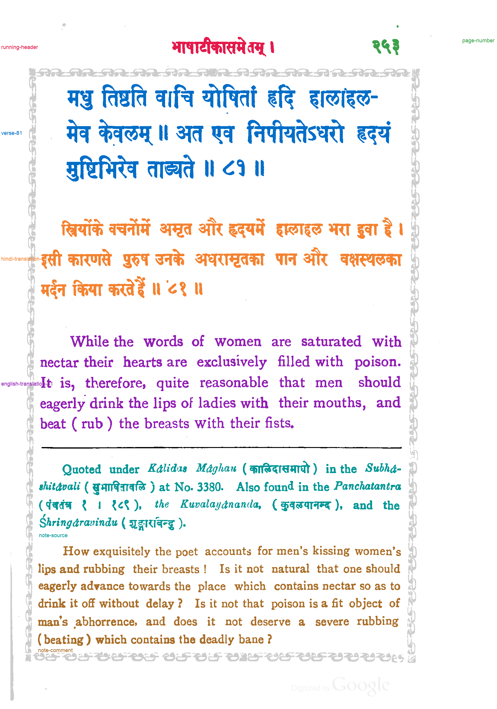

# Passage reference: Nītiśataka, Śṛṅgāraśataka and Vairāgyaśataka (1914), PDF page 258

**Status: version 2, revised by Claude on 2026-11-04 after the user's review of version 1. The user reviewed version 2 the same day and confirmed it.** The `status` field inside `passage-spec.json` and `passages.json` predates that review; those files are left unchanged because saved evaluations record their hashes.

This is a component-level assignment of ink on [gopinath-1914-page-258](../../inputs/gopinath-1914-page-258.png) to passages. It covers the running header, page number, verse 81, its Hindi and English translations, and two note paragraphs. Version 1 was written before any model or method 033 output existed for this page, from the page image and the method 032 line segmentation. No model API was called for either version.

The page border of repeated ornaments is left unlabeled. The rule above the notes is labeled separator.

## Versions

- **Version 1** (`version-1/`, built 2026-11-04 18:16 UTC with method 033's `reference.py`; labels SHA-256 `85c3ba6f6e8b…`).
  - The user's review found the word मुष्टिभिरेव in verse 81 unlabeled. It is one merged component, 240 × 87 pixels, which the line finder leaves off every line. The line-based builder could not label it, and version 1 left it unlabeled deliberately.
  - Every reference evaluation of this page made before 2026-11-04 19:57 UTC used version 1. That includes the evaluations recorded in NOTEBOOK.md under "Cross-book test".
- **Version 2** (this folder, built 19:56 UTC with [method 035's `reference.py`](../../methods/035-gpt-6.1-terra-none-column-margin-ownership/reference.py); labels SHA-256 `bcc99ded754a…`). It keeps version 1's line assignment and adds two component rules (`components_in_boxes` in `passage-spec.json`):
  - **verse-81:** the word मुष्टिभिरेव (8,604 pixels);
  - **note-comment:** the apostrophe of "women's" on line 22 (60 pixels). It is on no detected line. It was found by checking every unlabeled text component on the page, not by the user's review.

  The remaining unlabeled text components are border ornaments and specks.

## Files

- `passage-labels.png`: 8-bit labels on the method 032 hysteresis ink mask. Value 0 is unlabeled, 1–7 are the passages in `passages.json`, and 255 is separator.
- `passages.json`: legend, pixel and component counts, tight boxes, unlabeled components, and the components each component rule matched. It also records hashes of the input, spec, label image and builder code.
- `review.png`: every passage in its own color, with separators in black and unlabeled ink in light gray. The page number's label is in the margin to the right of the page.
- `passage-spec.json`: the hand-written line-to-passage assignment, split rules and component rules.

