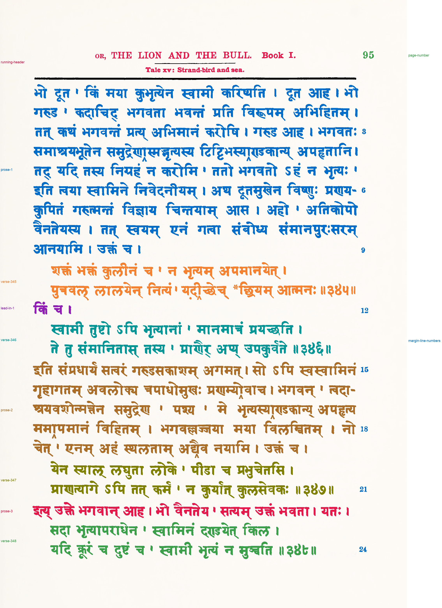

# Passage reference: Hertel's edition of the Pañcatantra, PDF page 152 (printed page 95)

**Status: proposed by Claude on 2026-11-04; the user reviewed `review.png` the same day and confirmed it.** The `status` field inside `passage-spec.json` and `passages.json` predates the review; those files are left unchanged because saved evaluations record their hashes.

This is a component-level assignment of ink on [hertel-panchatantra-page-152](../../inputs/hertel-panchatantra-page-152.png) to passages, built by [method 035's `reference.py`](../../methods/035-gpt-6.1-terra-none-column-margin-ownership/reference.py) on the method 032 line segmentation. It covers the running header with its tale line, the page number, three prose blocks, verses 345–348, the lead-in किं च ।, and the edition's line numbers in the right margin.

The page belongs to the fresh held-out sample (`inputs/pages-fresh.json`), and was chosen by rule as the third page of its book's list. The Terra requests for the sample had been sent, but no model or method output for this page was opened before the reference was built. No model API was used for the reference.

Component rules label the margin line numbers (which the line finder attaches to some text lines and leaves others on no line) and three header pieces on no line. The reference was also checked for glyphs whose label differs from the passage of the line band they sit in, which is the failure found on Nītiśataka 1896 page 123.

## Files

- `passage-labels.png`: 8-bit labels on the method 032 hysteresis ink mask. Value 0 is unlabeled, 1–11 are the passages in `passages.json`, and 255 is separator.
- `passages.json`: legend, pixel and component counts, tight boxes, unlabeled components, the components each component rule matched, and hashes.
- `review.png`: every passage in its own color, with separators in black and unlabeled ink in light gray.
- `passage-spec.json`: the hand-written line-to-passage assignment, split rules and component rules.

