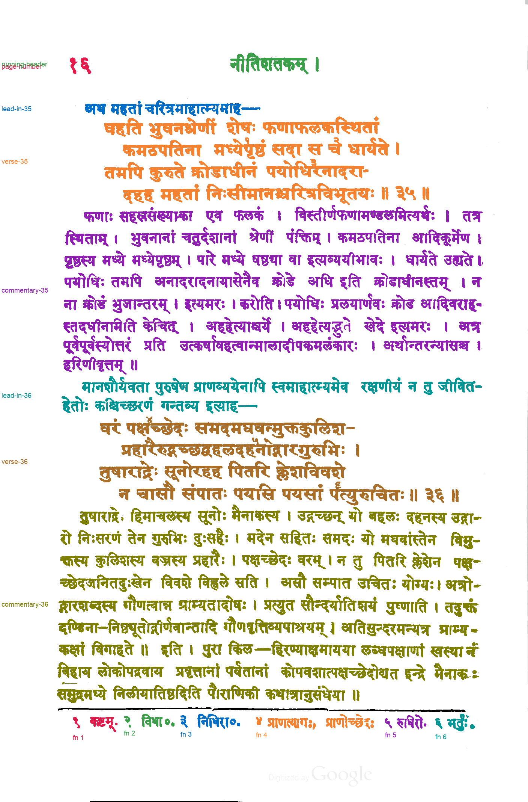

# Proposed passage reference: Kale (1913), PDF page 17 / 252

**Status: proposed by Claude on 2026-11-04 and reviewed by the user the same day, who confirmed that `review.png` looks good.** The `status` field inside `passage-spec.json` and `passages.json` predates the review. Those files are left unchanged because saved evaluations record their hashes.

This is a component-level assignment of ink on [kale-1913-page-017](../../inputs/kale-1913-page-017.png) to passages. It covers the page number, running header, two lead-ins, verses 35 and 36 with their commentaries, and footnotes 1–6. Printed rules are marked as separators. It was written before any method 033 or 034 output existed for this page, from the page image and the method 032 line segmentation with line numbers drawn on it. No model API was called.

`passage-spec.json` assigns detected lines to passages:

- Line 1 is the lead-in to verse 35, lines 2–5 are verse 35, lines 6–13 are its commentary, lines 14–15 are the lead-in to verse 36, lines 16–19 are verse 36 and lines 20–28 are its commentary.
- Line 0 is split at x = 400 into page number and running header. A scanner-edge mark at the right end of line 0, and another on line 27, are left unlabeled.
- Footnote line 29 is split at the centers of the ink-free column runs before each footnote numeral: x = 321.5, 473, 661, 1011.5 and 1148.5. The gap between प्राणत्यागः, and प्राणोच्छेदः is inside footnote 4 and is not a split.

`reference.py` from [method 033](../../methods/033-gpt-6.1-terra-none-line-polygons/README.md) then labels every ink component by its line. It is method 032's builder with one addition: a split rule can leave components unlabeled. The line finder and ink mask are unchanged copies of method 032's.

## Files

- `passage-labels.png`: 8-bit labels on the method 032 hysteresis ink mask. Value 0 is unlabeled, 1–14 are the passages in `passages.json`, and 255 is separator.
- `passages.json`: legend, pixel and component counts, tight boxes, unlabeled components, and hashes of the input, spec, label image and builder code.
- `review.png`: every passage in its own color, with separators in black.
- `passage-spec.json`: the hand-written line-to-passage assignment.

Four components are unlabeled, all scanner-edge marks at x ≥ 1399, including a tall edge strip classified as large non-text.

## Reviewing

Check `review.png` for any component colored as the wrong passage, especially detached marks near passage boundaries and the footnote splits. If something is wrong, write a corrected spec or label image as a new reference version rather than editing these files, because saved evaluations record their hashes.

