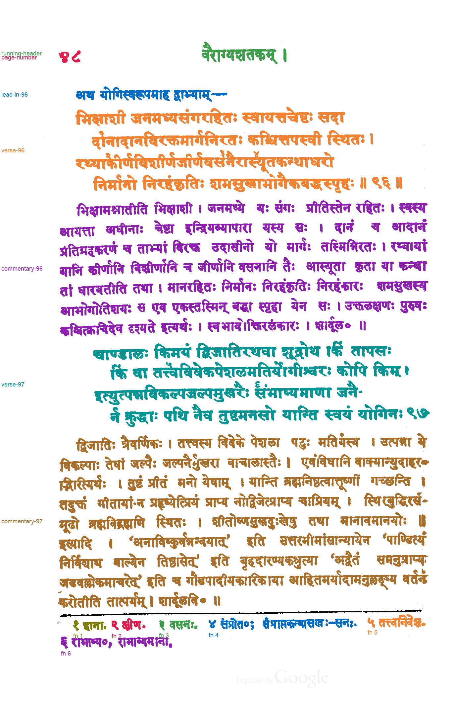

# Proposed passage reference: Kale (1913), PDF page 97 / 252

**Status: proposed by Claude on 2026-11-04 and reviewed by the user the same day, who confirmed that `review.png` looks good.** The `status` field inside `passage-spec.json` and `passages.json` predates the review. Those files are left unchanged because saved evaluations record their hashes.

This is a component-level assignment of ink on [kale-1913-page-097](../../inputs/kale-1913-page-097.png) to passages. It covers the page number, running header, one lead-in, verses 96 and 97 with their commentaries, and footnotes 1–6. Printed rules are marked as separators. It was written before any method 033 or 034 output existed for this page, from the page image and the method 032 line segmentation with line numbers drawn on it. No model API was called.

`passage-spec.json` assigns detected lines to passages:

- Line 1 is the lead-in, lines 2–5 are verse 96, lines 6–12 are its commentary, lines 13–16 are verse 97 and lines 17–25 are its commentary.
- Line 0 is split at x = 400 into page number and running header.
- Footnote line 26 is split at the centers of the ink-free column runs before each footnote numeral: x = 329, 459.5, 613 and 1093.5. The gap between संप्रोत०; and संप्राप्तकन्थासखः is inside footnote 4 and is not a split. Line 27 is footnote 6.
- A small smudge left of footnote numeral १ (x 171–187) is left unlabeled.

`reference.py` from [method 033](../../methods/033-gpt-6.1-terra-none-line-polygons/README.md) then labels every ink component by its line. It is method 032's builder with one addition: a split rule can leave components unlabeled. The line finder and ink mask are unchanged copies of method 032's.

## Files

- `passage-labels.png`: 8-bit labels on the method 032 hysteresis ink mask. Value 0 is unlabeled, 1–14 are the passages in `passages.json`, and 255 is separator.
- `passages.json`: legend, pixel and component counts, tight boxes, unlabeled components, and hashes of the input, spec, label image and builder code.
- `review.png`: every passage in its own color, with separators in black.
- `passage-spec.json`: the hand-written line-to-passage assignment.

One component is unlabeled: the 93-pixel smudge left of footnote numeral १.

## Reviewing

Check `review.png` for any component colored as the wrong passage, especially detached marks near passage boundaries and the footnote splits. If something is wrong, write a corrected spec or label image as a new reference version rather than editing these files, because saved evaluations record their hashes.

