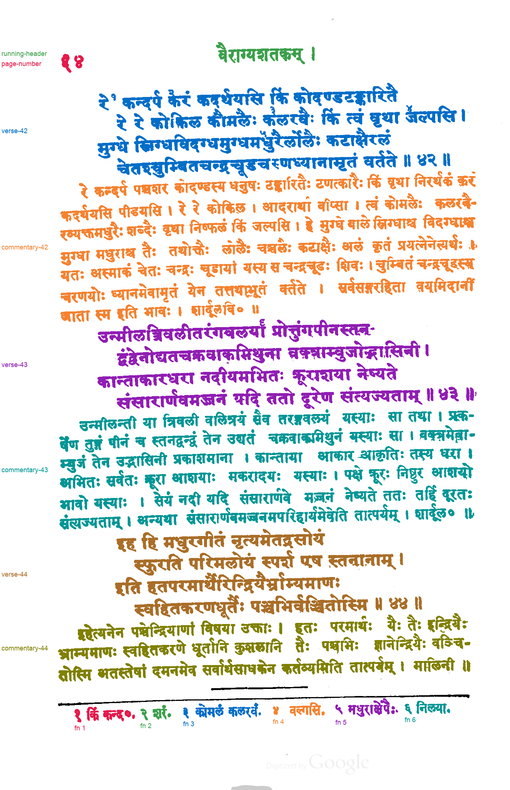

# Proposed passage reference: Kale (1913), PDF page 113 / 252

**Status: proposed by Claude on 2026-11-04 and reviewed by the user the same day, who confirmed every label in `review.png` is correct.** The `status` field inside `passage-spec.json` and `passages.json` predates the review. Those files are left unchanged because saved evaluations record their hashes.

This is a component-level assignment of ink on [kale-1913-page-113](../../inputs/kale-1913-page-113.png) to passages. It covers the page number, running header, verses 42–44 with their three commentary passages, and footnotes 1–6. The two printed rules are marked as separators. It was built by [method 032](../../methods/032-line-skew-separability/README.md) from `passage-spec.json`, which Claude wrote after inspecting the page and the method's line segmentation. No model API was called:

- Text lines 1–4, 12–15 and 22–25 are the verses.
- Lines 5–11, 16–21 and 26–28 are the commentary passages.
- Line 0 is split at x = 400 into page number and running header.
- Footnote line 29 is split at the centers of the ink-free column runs before each footnote numeral: x = 369.5, 475.5, 716.5, 886.0 and 1078.0. The gap between numeral ४ and its text is not a split.

## Files

- `passage-labels.png`: 8-bit labels on the method 032 hysteresis ink mask, with strong ink ≤ 136 and weak ink < 195.5. Value 0 is unlabeled, 1–14 are the passages in `passages.json`, and 255 is separator.
- `passages.json`: legend, pixel and component counts, tight boxes, unlabeled components, hashes of the input, spec, label image and method code. Its hash for method 032's `survey.py` is stale because that script was edited afterwards; it does not affect the reference, and the hashes of the files that do still match.
- `review.png`: every passage in its own color, with separators in black.
- `passage-spec.json`: the hand-written line-to-passage assignment.

Three components are unlabeled: a 30-pixel dot near the top margin, a 16-pixel dot near the Google watermark, and the dark mark at the bottom edge.

## Reviewing

Check `review.png` for any component colored as the wrong passage. Pay particular attention to detached marks near the five verse/commentary boundaries, using the `boundary-*.png` images in `outputs/kale-1913-page-113/032-line-skew-separability/passage-boundaries/`. If something is wrong, write a corrected spec or label image as a new reference version rather than editing these files, because saved evaluations record their hashes.

