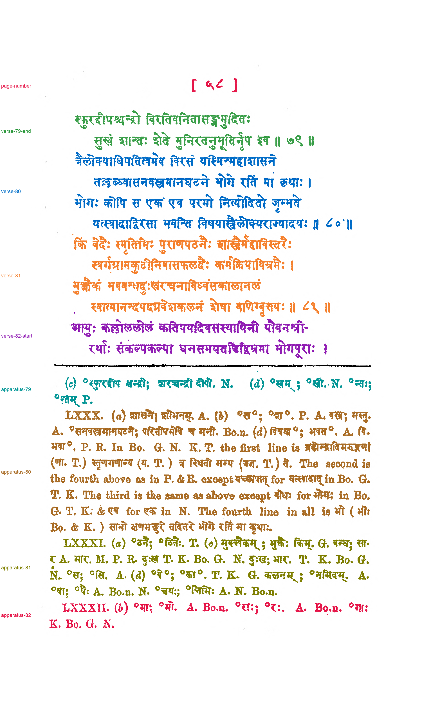

# Passage reference: Telang edition of Bhartṛhari (Digital Library of India scan), PDF page 108

**Status: proposed by Claude on 2026-11-04. The user reviewed it the same day and found it fine.** The `status` field inside `passage-spec.json` and `passages.json` predates the review. Those files are left unchanged because saved evaluations record their hashes.

This is a component-level assignment of ink on [telang-dli-page-108](../../inputs/telang-dli-page-108.png) to passages. It covers:
- the page number;
- the end of verse 79, verses 80 and 81, and the start of verse 82;
- the variant-reading apparatus entries for verses 79–82, each starting with its verse's Roman numeral.

The two pieces of the rule above the apparatus are labeled separator. Eight specks that the line finder put on no line stay unlabeled.

The reference was written before any model or method 033 output for this page was opened, from the page image and the method 032 line segmentation. `reference.py` from [method 033](../../methods/033-gpt-6.1-terra-none-line-polygons/README.md) built it on 2026-11-04 at 18:14 UTC; the label image's SHA-256 begins `fc0a75c959e2`. No model API was called.

## Files

- `passage-labels.png`: 8-bit labels on the method 032 hysteresis ink mask. Value 0 is unlabeled, 1–9 are the passages in `passages.json`, and 255 is separator.
- `passages.json`: legend, pixel and component counts, tight boxes, unlabeled components, and hashes of the input, spec, label image and builder code.
- `review.png`: every passage in its own color, with separators in black and unlabeled ink in light gray.
- `passage-spec.json`: the hand-written line-to-passage assignment.

If something is wrong, write a corrected spec as a new version. Move these files into `version-1/` first, as was done for `references/cole-1903-page-003`.

