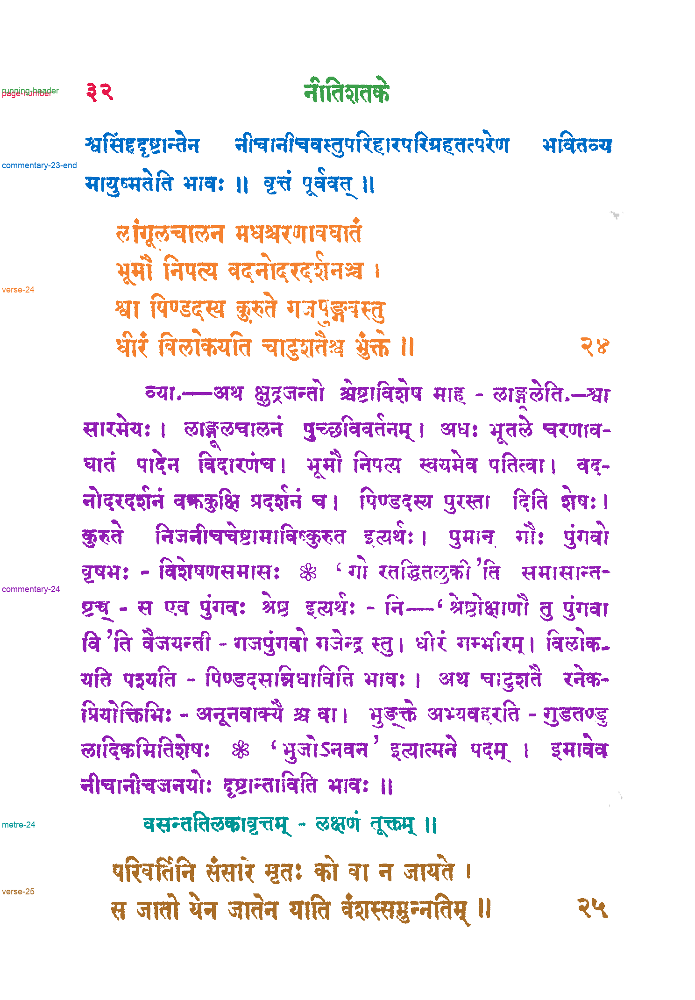

# Passage reference: Vavilla edition of Bhartṛhari with Rāmacandra Budhendra's commentary, PDF page 34

**Status: proposed by Claude on 2026-11-04. The user reviewed it the same day and found it fine.** The `status` field inside `passage-spec.json` and `passages.json` predates the review. Those files are left unchanged because saved evaluations record their hashes.

This is a component-level assignment of ink on [vavilla-page-034](../../inputs/vavilla-page-034.png) to passages. It covers:
- the page number and running header;
- the end of commentary 23;
- verse 24, its commentary and its metre line;
- verse 25.

The metre line is a separate passage because it is set apart from the commentary. A result that joins it to the commentary has made a grouping difference, not an ownership error. The page has no rules.

Line 4 is a small mark in the right margin, at x 1305–1326 and y 451–471. A split rule leaves it unlabeled, and three specks are unlabeled too.

The reference was written before any model or method 033 output for this page was opened, from the page image and the method 032 line segmentation. `reference.py` from [method 033](../../methods/033-gpt-6.1-terra-none-line-polygons/README.md) built it on 2026-11-04 at 18:14 UTC; the label image's SHA-256 begins `dea626c0666d`. No model API was called.

## Files

- `passage-labels.png`: 8-bit labels on the method 032 hysteresis ink mask. Value 0 is unlabeled, 1–7 are the passages in `passages.json`, and 255 is separator.
- `passages.json`: legend, pixel and component counts, tight boxes, unlabeled components, and hashes of the input, spec, label image and builder code.
- `review.png`: every passage in its own color, with separators in black and unlabeled ink in light gray.
- `passage-spec.json`: the hand-written line-to-passage assignment and split rules.

If something is wrong, write a corrected spec as a new version. Move these files into `version-1/` first, as was done for `references/cole-1903-page-003`.

